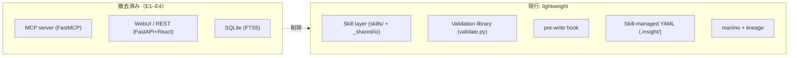
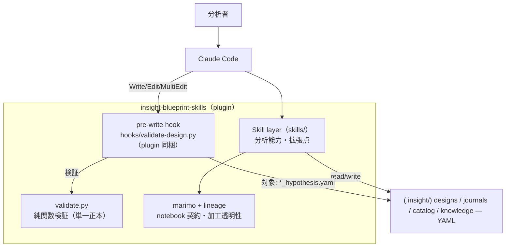
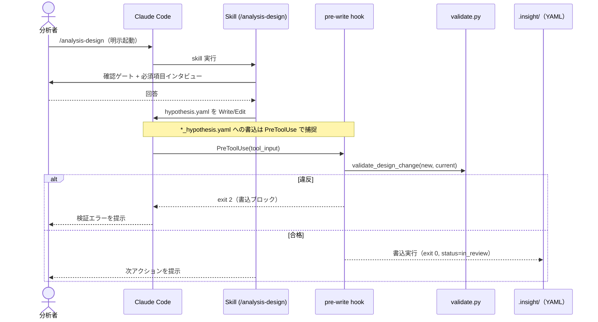
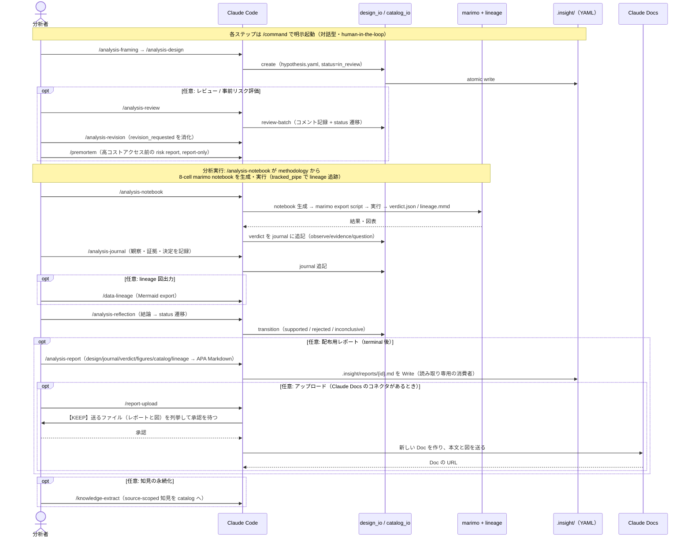
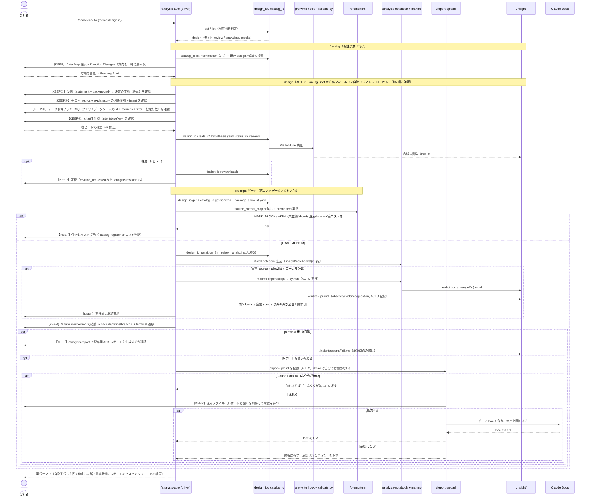
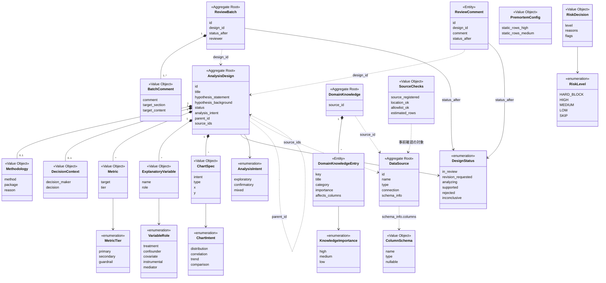

# ARCHITECTURE: insight-blueprint-skills

本書は軽量版（target state）アーキテクチャの**正本**。CLAUDE.md は要約とポインタのみを置く。
プロダクト要件は [PRD.md](PRD.md)、個別決定は [docs/adr/](adr/) を参照。

**移行状況**: MCPサーバ / WebUI / SQLite は E1–E4 で除去済み
（[ADR-0001](adr/0001-drop-mcp-server-embed-validation.md)）。本書は現行アーキテクチャを表す。
E5 で解体計画は完結: premortem 自立化（E5a, report-only 化）/ knowledge 抽出強化（E5b,
Claude-native + source-scoped）/ catalog 柔軟化（E5c, open string taxonomy, [ADR-0004](adr/0004-open-string-catalog-taxonomy.md)）。

## 不変条件（invariants）

- **No daemon / No MCP server / No SQLite**。plugin は常駐プロセス・MCP サーバ・SQLite を同梱しない。ホストが持つコネクタは、無くても核が動く任意の機能に限って使ってよい。
  核は PRD の「守る核」とその検証を指す。コネクタを使う skill は、無い環境では何もせずに案内して終わる
  （[ADR-0015](adr/0015-host-connectors-for-optional-features.md)）。
- 検証はプロセスではなく**ライブラリ**として埋め込む（SQLite と同じ転換）。
- 分析設計の整合性の**正本は `validate.py` の1箇所**。hook と skill の双方が再利用する。
- リリースは **tag 駆動**（`publish.yml` は `v*` タグで発火）。main マージ＝publish ではない。

## 構成（E1–E4 完了後）

full（MCP server / WebUI / SQLite）は撤去済み。現行は軽量版のみ。



## コンテキストマップ

コンテキスト: 仮説駆動の分析（[docs/UBIQUITOUS_LANGUAGE.md](UBIQUITOUS_LANGUAGE.md)）。
境界づけられたコンテキストは1つで、まだ分けていない。分ける基準は UBIQUITOUS_LANGUAGE の「コンテキストを分けるとき」に従う。

## コンポーネントと責務



- **Skill layer（`skills/`）** — すべての分析能力。拡張点。skill の一覧は [README の Skills](../README.md#skills) が正本。分析設計・journal・catalog 等の YAML を直接 read/write する。
- **Validation library（`src/insight_blueprint/validate.py`）** — I/O を持たない純関数。
  Pydantic スキーマ検証（`AnalysisDesign`。`DesignStatus`、空でない `Methodology.method`、両方そろった `DecisionContext` など）+
  状態遷移ガード（`VALID_TRANSITIONS`。例: `analyzing` から進めるのは `in_review` だけで、`analyzing → supported` は拒む。terminal status からはどこへも遷移しない）。分析設計の整合性の単一正本。
  `design_io` 経由で書く skill も、書く前に Python 側で同じ検証を通す。tool の書き込み（hook）と
  helper の書き込み（`design_io`）の両方が守られる。
- **pre-write hook（`hooks/validate-design.py`, plugin 同梱 `hooks/hooks.json`）** —
  `.insight/designs/*_hypothesis.yaml` への Write/Edit/MultiEdit を plugin の uv 環境で `validate.py`
  にかけ、違反を `exit 2` でブロックする I/O 殻。利用者の install 先プロジェクトでも効く
  （この repo の `.claude/settings.json` は dev 用に同スクリプトを配線）。
- **Skill-managed YAML（`.insight/`）** — designs / journals / catalog / knowledge。skill が直接管理する。
- **marimo + lineage（`src/insight_blueprint/lineage/`）** — 分析 notebook は同梱テンプレートでなく、
  **`/analysis-notebook` skill が分析設計の `methodology` から 8-cell 契約に沿って生成・実行**する
  （`skills/analysis-notebook/references/notebook-contract.md`）。`lineage`（`tracked_pipe` / Mermaid export）は
  optional な `insight-blueprint-lineage[notebook]` パッケージで、notebook 内の加工を追跡・可視化する。

### Skill invocation model

**既定は明示・対話型**: 全 skill は frontmatter で `disable-model-invocation: true`（明示 `/command` 起動）
であり、各ステップはユーザーが明示的に起動する。無人バッチ実行は batch-analysis の役割で E3.5 で意図的に撤去された。

**selective autonomy（`/analysis-auto`）**: driver スキル `/analysis-auto` を起動したときに限り、Claude が
既存 skill を順に駆動し、**本物の判断（KEEP ゲート）でだけ停止**する guided autopilot になる。invocation フラグは
大域変更しない（自律性はこの run に限定）。KEEP ゲート = design の4ビート（① 仮説 / ② 手法・指標・explanatory の
因果役割・intent / ③ データ取得プラン（SQL クエリ or データソースの id + columns + filter, premortem の前。パスは見せない、[ADR-0022](adr/0022-connection-reaches-only-the-notebook.md)） / ④ chart 仕様）/
データソース登録 / premortem `HARD_BLOCK`・`HIGH` / notebook の非 allowlist・宣言 source 以外の外部通信 / 結論 /
レポートの生成 / アップロードで送るファイルの承認（`/report-upload` が聞く）。
notebook の auto 実行は premortem 通過 + allowlist + 宣言 source 限定のときのみ。詳細は
[ADR-0005](adr/0005-selective-autonomous-chaining.md)（selective autonomy）と
[ADR-0007](adr/0007-upstream-judgment-gates.md)（上流の判断ゲートを design ビートに分割 + data-extraction 新設）。
**「auto mode」は無人ではなく guided autopilot**（対話型・オプトイン）である。

**外部へ送る前の KEEP ゲート**: skill が `.insight/` の中身を外部へ送るときは、送るファイルを列挙して KEEP ゲートで承認を待つ。
`/analysis-auto` の中でも自動にしない。承認は1回の実行に限り、覚えない
（[ADR-0016](adr/0016-approval-before-external-send.md)）。今これに当たる skill は `/report-upload` だけである。

## ディレクトリ構成（開発時 vs plugin 利用時）

この plugin は **コードの在処**（plugin 本体）と **データの在処**（利用者の分析成果物 `.insight/`）を
分離する。開発リポジトリでは両者が**同一ツリーに同居**するため混同しやすい。実際、install 先で
動かない不具合（Epic 09）はこの2役割の混同が根本原因だった（cwd 前提・repo レイアウト前提のコマンドが
「コード置き場＝データ置き場」を暗黙に仮定していた）。以下で2つの視点を明確に分ける。
実行時のパス解決の詳細は [ADR-0006](adr/0006-plugin-execution-model.md)。

### 1. 開発リポジトリ上の構成（このリポジトリ）

開発時は **cwd = リポジトリルート** で、plugin コードと自分の分析データ（`.insight/`）が
**同じツリーに同居**する。これが「開発では動くのに install 先で動かない」錯覚を生む。

```
insight-blueprint-skills/          ← リポジトリルート（＝ plugin 配布物の中身）
├── .claude-plugin/                # plugin マニフェスト（plugin.json / marketplace.json）
├── bin/                           # plugin 有効時に PATH に載る: design_io / catalog_io / premortem / report_check ラッパー
├── hooks/                         # plugin 同梱 hook: hooks.json + validate-design.py
├── skills/                        # 全 skill + _shared/（design_io.py / catalog_io.py / report_check.py / ids.py / config_loader.py / models.py）+ premortem/
├── src/insight_blueprint/         # PyPI パッケージ insight-blueprint-lineage: models/ · validate.py · lineage/
├── tests/  docs/  scripts/
├── pyproject.toml · uv.lock       # ← この uv プロジェクトが「plugin の実行環境」を供給する
├── .claude/                       # dev 専用: settings.json が hook をローカル配線（配布されない）
└── .insight/                      # dev 専用のサンプル作業データ（config.yaml + rules/。このリポジトリ自身の分析ワークスペース）
```

- **配布物** = リポジトリツリーそのもの。install 時これが `${CLAUDE_PLUGIN_ROOT}` に展開される。
- **dev 専用**（配布物ではない）: `.claude/`（ローカル hook 配線）と リポジトリ直下の `.insight/`。
  後者はこのリポジトリを「1人の利用者プロジェクト」として使うときの作業データで、利用者の `.insight/` とは無関係。
- したがって dev では `${CLAUDE_PLUGIN_ROOT}`（コード）と `${CLAUDE_PROJECT_DIR}`（データ）が
  **たまたま同じ**（どちらもリポジトリルート）。install 先ではこれが分離する（下記）。

### 2. plugin 利用者視点の構成

`/plugin marketplace add … && /plugin install …` で導入すると、2つのルートが**物理的に分離**する。

| ルート | 変数 | 実体 | 誰が触る |
|---|---|---|---|
| plugin コード | `${CLAUDE_PLUGIN_ROOT}` | Claude Code の plugin キャッシュ（例 `~/.claude/plugins/cache/…/insight-blueprint-skills/`） | 触らない（読み取り専用の配布物） |
| 利用者データ | `${CLAUDE_PROJECT_DIR}/.insight/` | **自分のプロジェクト直下** | 分析成果物すべてがここに出る |

利用者の分析成果物は**すべて自分のプロジェクトの `.insight/`** に出力される（plugin 側には一切書かない）:

```
<あなたのプロジェクト>/.insight/          ← ${CLAUDE_PROJECT_DIR}/.insight
├── config.yaml                     # 任意: premortem 閾値など（無ければ既定値）
├── rules/
│   └── package_allowlist.yaml      # 任意: notebook が使ってよいパッケージ許可リスト（無ければ既定の許可リスト。下記†）
├── designs/
│   ├── {id}_hypothesis.yaml        # design_io create/update（pre-write hook が検証）
│   ├── {id}_journal.yaml           # journal イベント
│   ├── {id}_reviews.yaml           # review バッチ
│   └── {id}_revision.yaml          # /analysis-revision の修正追跡
├── catalog/
│   ├── sources/{id}.yaml           # /catalog-register
│   └── knowledge/{id}.yaml         # /knowledge-extract
├── notebooks/
│   ├── {id}.py                     # /analysis-notebook が生成する 8-cell marimo notebook
│   ├── {id}_flat.py                # marimo export script（実行可能なフラット版）
│   ├── {id}_verdict.json           # verdict 副作用（figures[] 含む; skill が読み戻す）
│   ├── {id}_fig{NN}.png            # viz cell が保存する図（/analysis-report が埋め込む）
│   └── {id}.html                   # 任意: 閲覧用レポート
├── reports/
│   └── {id}.md                     # /analysis-report が生成する APA 風配布レポート
└── lineage/
    └── {id}.mmd                    # lineage の Mermaid 図
```

† `package_allowlist.yaml` の書式（`allowed_packages: import名→pip名`）と、読み取り専用 plugin env への
供給手順（`--with <pip名>` による ephemeral 注入）は
[`skills/analysis-notebook/references/notebook-contract.md`](../skills/analysis-notebook/references/notebook-contract.md)
の「Package allowlist — format & supplying packages」節が正本。
ファイルが無いときは、plugin の env に最初から入っている既定の許可リストを使う（[ADR-0021](adr/0021-default-package-allowlist.md)）。

**marimo notebook はどこに出るか（混乱ポイントの明示回答）**: 利用者プロジェクトの
`${CLAUDE_PROJECT_DIR}/.insight/notebooks/`（および `lineage/`）に出る。**plugin ディレクトリではない**。
理由は下のパス解決機構にある。

### パス解決機構（なぜ同じ `.insight/` に着地するのか）

コードは `${CLAUDE_PLUGIN_ROOT}` にあるのに、出力は `${CLAUDE_PROJECT_DIR}/.insight/` に落ちる。
これを実現する経路は**2種類**あり、着地先は同じでも仕組みが違う。

| 経路 | cwd | パス解決 | 出力先 |
|---|---|---|---|
| `design_io` / `catalog_io` / `premortem`（bin ラッパー） | plugin のルートに**移動する**（`${CLAUDE_PLUGIN_ROOT}`。無ければラッパー自身の場所から求める） | 絶対パス env `INSIGHT_BASE_DIR=${CLAUDE_PROJECT_DIR}/.insight` で解決（`CLAUDE_PROJECT_DIR` が無ければ cwd） | 利用者 `.insight/` |
| `/analysis-notebook`（marimo 実行） | **利用者プロジェクトのまま**（移動しない） | 相対パス `.insight/notebooks/…`（cwd 基準） | 利用者 `.insight/` |

ポイントは notebook 経路の `uv run --project "${CLAUDE_PLUGIN_ROOT}" --extra notebook …`:
`--project` は **実行環境（marimo/pandas/insight_blueprint を供給する uv 環境）だけを plugin から借りる**
指定で、**cwd は移動しない**。だから notebook 内の相対 `.insight/…` は利用者プロジェクトに解決される。
一方 bin ラッパーは `cd` で plugin へ移動する代わりに、絶対 `INSIGHT_BASE_DIR` でデータ先を指す。
どちらも「コードは plugin・データは利用者プロジェクト」を別の手段で満たしている。

ホストは skill の本文に書いた `${CLAUDE_PLUGIN_ROOT}` を置き換えるが、Bash ツールの環境にはこの変数が来ない。
そのため bin ラッパーは、変数が無ければ自身の場所から plugin のルートを求める
（[ADR-0017](adr/0017-plugin-variables-not-in-bash-env.md)）。

## 代表シーケンス

### 分析設計の書込と検証ガード

`*_hypothesis.yaml` を書くときの検証フロー。skill は `/command` で明示起動され、書込は
pre-write hook が捕捉して検証する。



### 分析ワークフロー全体（対話型・明示起動）

end-to-end の代表フロー。既定では**各 `/skill` はユーザーが明示的に起動する**が、`/analysis-auto`
（guided autopilot）を使うと driver がこの同じ経路を駆動し KEEP ゲートでだけ停止する（上記 «Skill invocation model» /
[ADR-0005](adr/0005-selective-autonomous-chaining.md)）。**notebook の生成・実行は `/analysis-notebook` が design の
`methodology` から 8-cell 契約に沿って行う**（`skills/analysis-notebook/references/notebook-contract.md`）。
`/analysis-review`・`/premortem`・`/data-lineage`・`/analysis-report`・`/report-upload` は任意ステップ。
Claude Docs はホストが持つコネクタで、plugin の外にある（[ADR-0015](adr/0015-host-connectors-for-optional-features.md)）。



### guided autopilot（`/analysis-auto`）の詳細シーケンス

初学者が最初に使う想定の入口。driver `/analysis-auto` が各 skill を駆動し、**KEEP ゲート**（太字の
`U に確認`）でだけ停止する。個々の skill・CLI・premortem・notebook 実行との詳細インタラクションを示す
（[ADR-0005](adr/0005-selective-autonomous-chaining.md)）。



アップロードで分析者に聞くのは、`/report-upload` の KEEP ゲートの1回だけである。driver は「アップロードするか」を別に聞かない
（[ADR-0016](adr/0016-approval-before-external-send.md)）。

## Domain Model

`src/insight_blueprint/models/` と `skills/_shared/models.py` のクラスの全体図（[ADR-0011](adr/0011-domain-model-overview-in-architecture.md)）。
Epic の DesignDoc の `## Domain Model` 節はこの図からの差分だけを描く。モデルを変えた PR では、この図も同じ PR で更新する。
図とコードのクラスと enum の値が一致することは `tests/docs/test_canonical_docs.py` が確かめる。



図の読み方: 箱は1つのクラスで、上段がクラス名と種類（`<<Aggregate Root>>` など）、下段が主なフィールドか enum の値を表す。
フィールドは主なものだけを載せ、全部はコードを見る。
実線の黒いひし形（`*--`）は「親が子を持つ」で、両端の数字は個数を表す。
実線の矢印（`-->`）は「その enum の値を持つ」を表す。破線の矢印（`..>`）は型で結ばれていない参照で、ラベルが参照に使うフィールドを表す（ID のほか、`schema_info` のように dict に入れた形もある）。
`RiskDecision`・`SourceChecks`・`PremortemConfig` は `/premortem` の入出力で、ファイルには保存しない。

| 型 | 種類 | 不変条件 |
|---|---|---|
| `AnalysisDesign` | 集約ルート | `status` は `VALID_TRANSITIONS` の遷移でだけ変わる。`methodology` があれば `method` は空でない。`decision_context` があれば `decision_maker` と `decision` はどちらも空でない（[ADR-0014](adr/0014-analysis-design-decision-context.md)） |
| `ReviewBatch` | 集約ルート | `comments` は1件以上。1つのバッチは `status_after` への遷移を1回だけ起こす |
| `DataSource` | 集約ルート | `type` は空でない open string（[ADR-0004](adr/0004-open-string-catalog-taxonomy.md)） |
| `DomainKnowledge` | 集約ルート | 1つの `source_id` に属する。`category` は空でない open string |

### Python のクラスを持たないファイルの契約

次のファイルは `.insight/` に保存されるが、Python のクラスを持たない。形の正本はリンク先にある。

| ファイル | 中身 | 形の正本 |
|---|---|---|
| `designs/{id}_journal.yaml` | journal（観察・証拠・決定・問い） | [skills/analysis-journal/SKILL.md](../skills/analysis-journal/SKILL.md) |
| `designs/{id}_revision.yaml` | review コメントへの対応の追跡 | [skills/analysis-revision/SKILL.md](../skills/analysis-revision/SKILL.md) |
| `notebooks/{id}_verdict.json` | notebook の verdict と figures manifest（`figures[]`）。指標は任意で効果量・信頼区間・標本サイズを持つ | [notebook-contract.md](../skills/analysis-notebook/references/notebook-contract.md)、[ADR-0008](adr/0008-notebook-figure-manifest.md)、[ADR-0013](adr/0013-verdict-metric-optional-items.md) |
| `reports/{id}.md` | レポート。データ由来の文はエスケープして載る | [apa-template.md](../skills/analysis-report/references/apa-template.md) |
| `rules/package_allowlist.yaml` | notebook が使ってよいパッケージ | [notebook-contract.md](../skills/analysis-notebook/references/notebook-contract.md) |
| `config.yaml` | premortem の閾値（読み込むと `PremortemConfig` になる） | [skills/_shared/config_loader.py](../skills/_shared/config_loader.py) |

## Epic マッピング

Epic の一覧と DesignDoc へのリンクは [PRD のロードマップ](PRD.md#ロードマップ) にある。ここには各 Epic が触るコンポーネントだけを書く。

| Epic | 主に触るコンポーネント |
|---|---|
| E1 | WebUI/REST（撤去）— full の縮小 |
| E2 | Validation library + pre-write hook（新設） |
| E3 | Skill layer ↔ Skill-managed YAML（分析設計のライフサイクルの直接 I/O 化、design_io） |
| E3.5 | catalog / premortem / lineage の MCP→YAML 変換 + batch-analysis 撤去（E4 前提） |
| E4 | MCP server（撤去） |
| E5a | premortem（report-only 自立化） |
| E5b | catalog_io（knowledge write/upsert）+ /knowledge-extract（Claude-native 抽出） |
| E5c | models.catalog（open string taxonomy + extra=allow）+ 2 skill 汎用化 |
| Epic 06 | Skill layer（`/analysis-review`）+ `design_io review-batch` |
| Epic 07 | Skill layer（`/analysis-notebook`）+ marimo + lineage（8-cell 契約） |
| Epic 08 | Skill layer（`/analysis-auto` driver）と既存 skill の chaining |
| Epic 09 | plugin 配布（`bin/` ラッパー、`hooks/hooks.json`、パス解決） |
| Epic 10 | Skill layer（`/analysis-report`）+ notebook 契約の `figures[]` |
| Epic 11 | 文書の正本（CLAUDE.md・PRD・本書・UBIQUITOUS_LANGUAGE）と ADR |
| Epic 12 | Skill layer（`/analysis-report` の拡張、`/report-upload` の新設、`/analysis-auto` の配線）+ notebook 契約の verdict の指標 + 分析設計の `DecisionContext` |
| Epic 13 | Skill layer（`/analysis-report` の写す手順）+ `report_check`（できたレポートの検査） |
| Epic 14 | Skill layer（`/analysis-report` のテンプレートの出典・書式・省く条件） |
| Epic 15 | Skill layer（`/analysis-design`・`/analysis-report`・`/analysis-notebook`・`/premortem`・`/analysis-auto` がデータソースを読む場所）+ `catalog_io describe` |
| Epic 16 | Skill layer（`/premortem`・`/analysis-auto` がパッケージ許可リストの無いときに使う既定の許可リスト）+ `risk_evaluator` の `HARD_BLOCK` の理由 |
| Epic 17 | Skill layer（`/analysis-framing`・`/analysis-design`・`/analysis-notebook`・`/analysis-auto`・`/catalog-register` が `connection` を読む場所）+ `catalog_io create`・`update` の認証情報の検査 |
| Epic 18 | Skill layer（`/analysis-framing`・`/analysis-design`・`/analysis-reflection` の論点ツリー）+ 論点ツリーのモデルと `validate.py` の検証 + `tree_io`・`tree_check`（計画中。構成図への反映は実装の Story で行う） |


## 参照

- [ADR-0001](adr/0001-drop-mcp-server-embed-validation.md) — MCPサーバ廃止・検証の埋め込み化
- [ADR-0002](adr/0002-trunk-based-epic-stacking.md) — トランクベース + stacked Epic
- [ADR-0003](adr/0003-skill-yaml-io-via-design-io.md) — skill の設計書 I/O を design_io に集約
- [ADR-0004](adr/0004-open-string-catalog-taxonomy.md) — catalog の taxonomy を open string に
