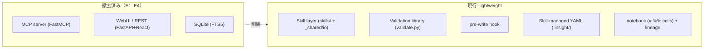
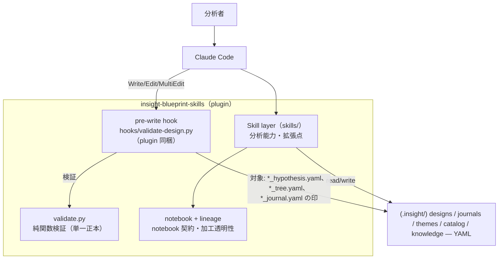
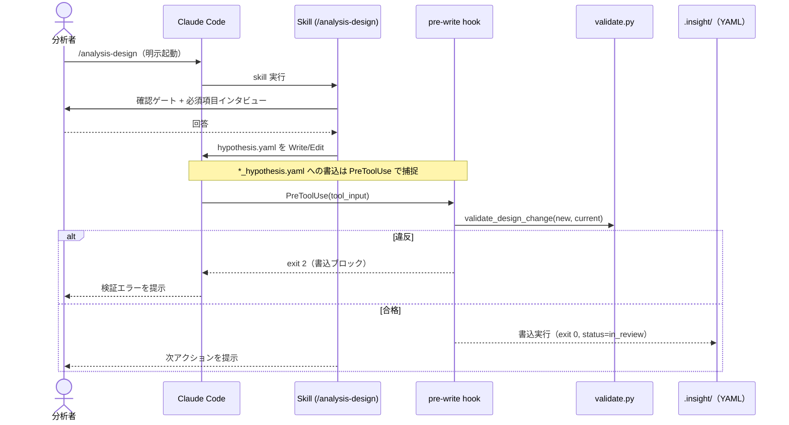
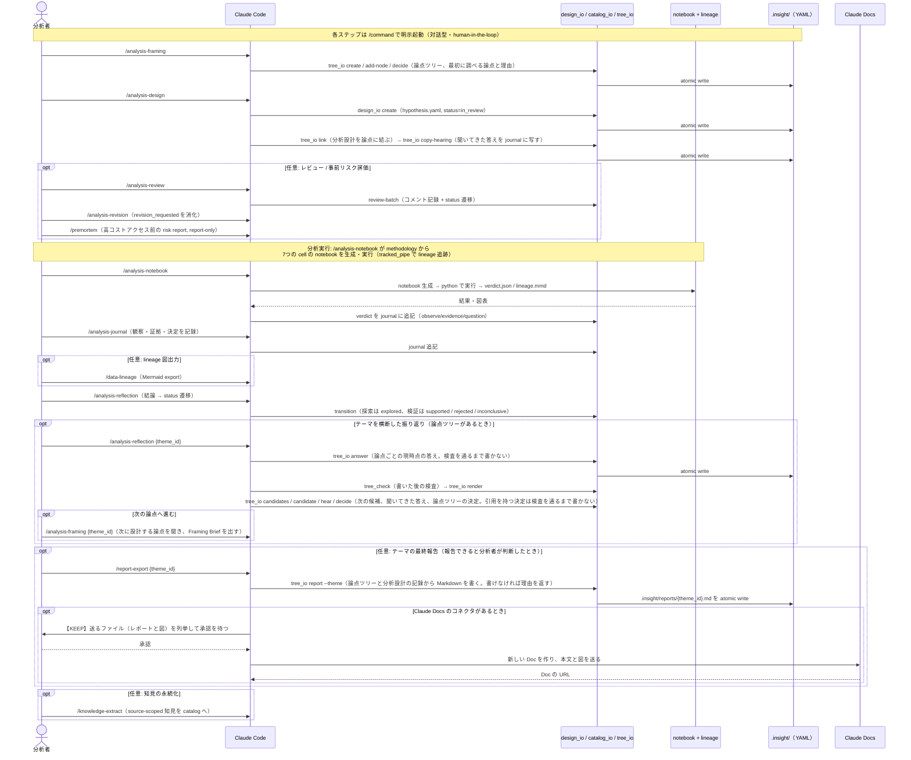
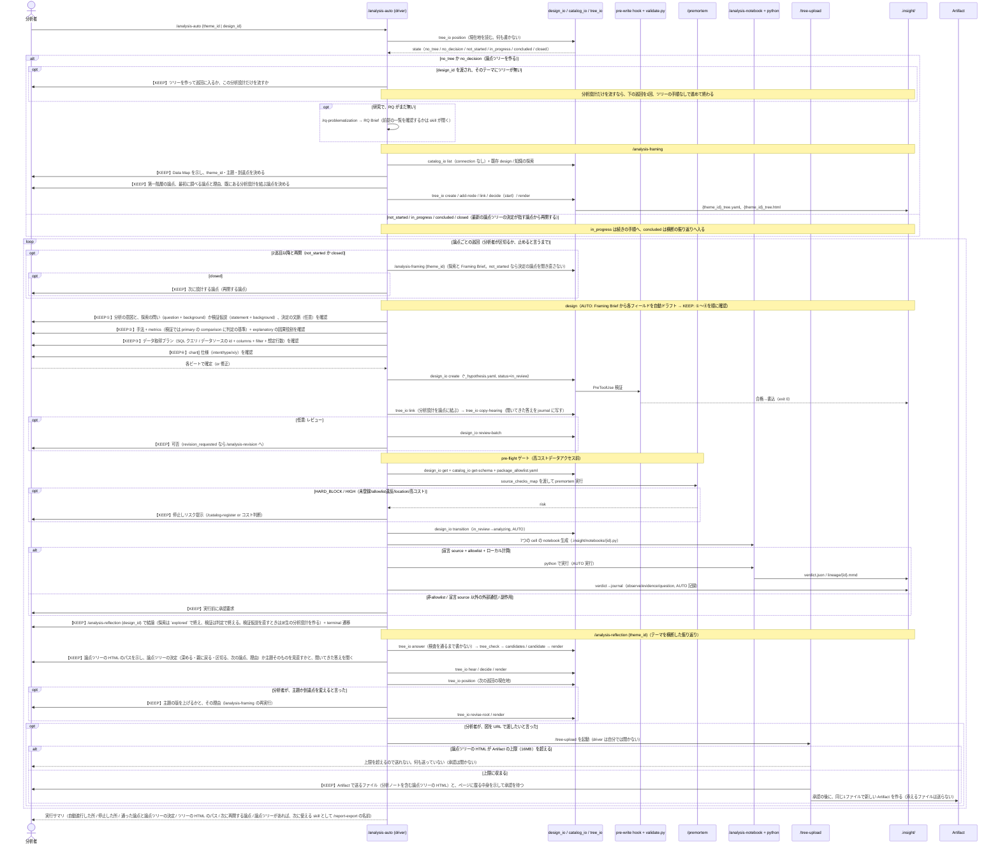
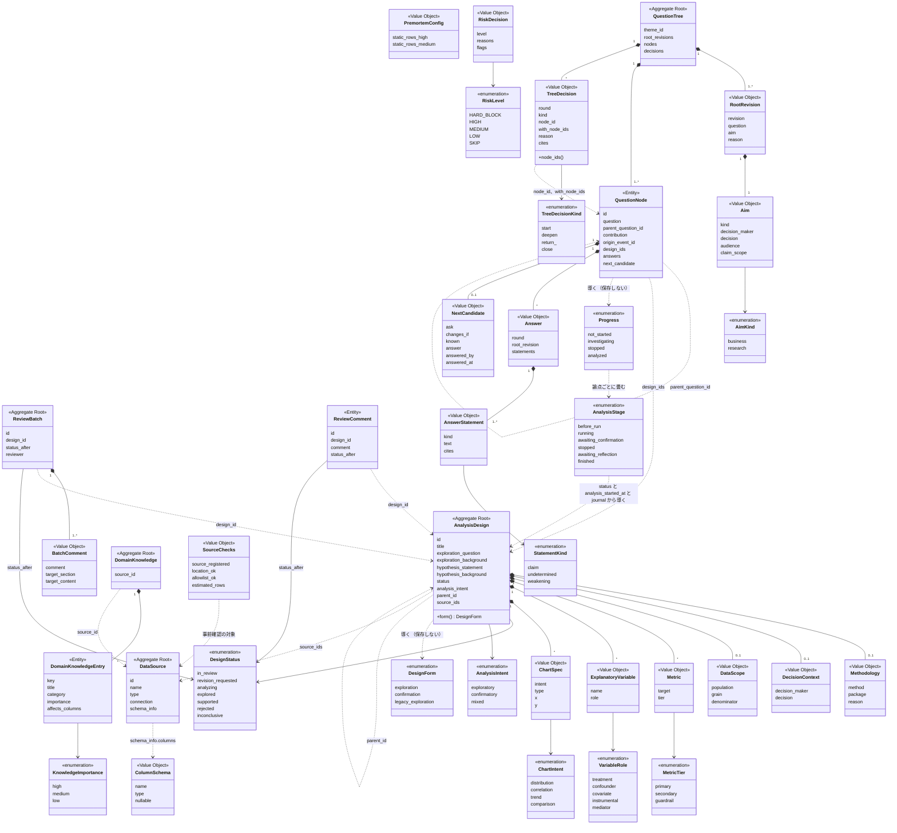

# ARCHITECTURE: insight-blueprint-skills

本書は軽量版（target state）アーキテクチャの**正本**。CLAUDE.md は要約とポインタのみを置く。
プロダクト要件は [PRD.md](PRD.md)、個別決定は [docs/adr/](adr/) を参照。

**移行状況**: MCPサーバ / WebUI / SQLite は E1–E4 で除去済み
（[ADR-0001](adr/0001-drop-mcp-server-embed-validation.md)）。本書は現行アーキテクチャを表す。
E5 で解体計画は完結: premortem 自立化（E5a, report-only 化）/ knowledge 抽出強化（E5b,
Claude-native + source-scoped）/ catalog 柔軟化（E5c, open string taxonomy, [ADR-0004](adr/0004-open-string-catalog-taxonomy.md)）。

## 不変条件（invariants）

- **No daemon / No MCP server / No SQLite**。plugin は常駐プロセス・MCP サーバ・SQLite を同梱しない。ホストが持つコネクタは、無くても核が動く任意の機能に限って使ってよい。
  核は PRD の「守る核」とその検証を指す。コネクタを使う skill は、無い環境では何もせずに案内して終わる
  （[ADR-0015](adr/0015-host-connectors-for-optional-features.md)）。
- 検証はプロセスではなく**ライブラリ**として埋め込む（SQLite と同じ転換）。
- 分析設計の整合性の**正本は `validate.py` の1箇所**。hook と skill の双方が再利用する。
- リリースは **tag 駆動**。marketplace は `v*` タグの commit を配り、`ci.yml` はタグの push で `check_tag_version` を回してタグと版の一致を確かめる。main へのマージはリリースではない（[ADR-0047](adr/0047-stop-publishing-to-pypi.md)）。

## 構成（E1–E4 完了後）

full（MCP server / WebUI / SQLite）は撤去済み。現行は軽量版のみ。



## コンテキストマップ

コンテキスト: 仮説駆動の分析（[docs/UBIQUITOUS_LANGUAGE.md](UBIQUITOUS_LANGUAGE.md)）。
境界づけられたコンテキストは1つで、まだ分けていない。分ける基準は UBIQUITOUS_LANGUAGE の「コンテキストを分けるとき」に従う。

## コンポーネントと責務



- **Skill layer（`skills/`）** — すべての分析能力。拡張点。skill の一覧は [README の Skills](../README.md#skills) が正本。分析設計・journal・catalog 等の YAML を直接 read/write する。
- **Validation library（`src/insight_blueprint/validate.py`）** — I/O を持たない純関数。
  Pydantic スキーマ検証（`AnalysisDesign`。`DesignStatus`、空でない `Methodology.method`、両方そろった `DecisionContext` など）+
  状態遷移ガード（`VALID_TRANSITIONS`。例: `analyzing → supported` は許し、`analyzing → revision_requested` は拒む。結果を見た後のレビューで `in_review` へ戻すのは任意（[ADR-0029](adr/0029-analyzing-reaches-conclusion-directly.md)）。terminal status からはどこへも遷移しない）。分析設計の整合性の単一正本。
  遷移は分析設計の形（`DesignForm`。分析の意図と項目から導き、保存しない）を受け取る。結論の状態は形で決まり、探索は `explored` で、検証と旧形式の探索は `supported`・`rejected`・`inconclusive` で終わる。それより前の遷移は形で変わらない（`valid_targets`。[ADR-0048](adr/0048-intent-decides-the-form-and-the-end-of-a-design.md)）。
  検査は2段ある。読むときの検査（`validate_schema`。hook もこれを使う）は、保存済みの旧形式の探索と `mixed` を通す。
  作るときの検査（新しく作るときは `validate_creation` を `design_io create` が、書き換えるときは `validate_update` を `design_io update` が呼ぶ。`validate_update` は遷移も確かめる）は、旧形式の探索と `mixed` を新しく作ることを拒む（[ADR-0049](adr/0049-legacy-exploration-stays-readable-and-is-marked.md)）。
  `validate_update` は分析を始めた分析設計の固定も確かめる（[ADR-0053](adr/0053-a-started-confirmation-keeps-its-hypothesis-criterion-and-intent.md)）。分析を始めたかは `analysis_started` が答える。分析の印（`analysis_started_at`）があるか、状態が `analyzing` か terminal status なら、分析を始めている。印は初めて `analyzing` か terminal status に入る書き込みで `design_io` が付ける。印を消す書き込みと変える書き込みは通らない。印の無い保存済みの分析設計が、印を持たずに `analyzing` から `in_review` へ戻る書き込みも通らない（結論へ進む書き込みは通る）。
  分析を始めた検証・旧形式の探索・`mixed` は、検証仮説と、primary の指標の組（`target` と `comparison`。足す・消す・`tier` の変更を含む）と、意図を変えない。分析を始めた探索は、意図と形を変えない。背景とほかの項目は直せる。
  分析を始めていない検証・旧形式の探索・`mixed` が `analyzing` か `supported`・`rejected` に入る書き込みは、primary の指標があり、どの primary の指標も `comparison` が空でないときだけ通る。基準が無くても `inconclusive` には入れる（分析をせずに閉じる道）。
  `design_io` 経由で書く skill も、書く前に Python 側で同じ検証を通す。tool の書き込み（hook）と
  helper の書き込み（`design_io`）の両方で、読むときの検査が効く。書き換えるときの検査（`validate_update`）は、hook もディスク上の記録が読めるときに行う。読めないときも、生の記録が分析を始めていれば、固定の項目だけを `validate_repair` が確かめる（ADR-0053 の9）。新しく作るときの検査（`validate_creation`）は `design_io` だけが行う。
  論点ツリーの形も同じ場所で検証する（`validate_tree`。[ADR-0024](adr/0024-question-tree-yaml-and-generated-html.md)）。
  主題がちょうど1つあること、論点の親が同じツリーにあって循環しないこと、主題の版が1から1ずつ増えること、論点ツリーの決定が指す論点がツリーにあることを確かめ、モデルに無い項目を拒む。
  書き込む前の正本があれば、主題の版が減っていないことと、今の版より前の版が変わっていないことも確かめる。論点ツリーの決定と現時点の答えは足すことだけができる。
  現時点の答えの引用先が実在するか、文の数が引用先の本文にあるかは、ここでは確かめない。journal を読む必要があるので、ツリーの検査（`tree_check`。[ADR-0025](adr/0025-cited-answers-checked-after-writing.md)）が確かめる。
  現時点の答えは `tree_io answer` で書く。`tree_io answer` は書く前にツリーの検査を呼び、違反があれば何も書かない。
  論点ツリーの決定は `tree_io decide` で書く。決定が理由の根拠にした出来事を引用していれば、書く前にツリーの検査を呼び、違反があれば何も書かない。引用を持たない決定は検査しない（[ADR-0058](adr/0058-a-tree-decision-may-cite-the-events-behind-its-reason.md)）。
  進捗は項目に無いので、保存できない。結んだ分析設計の状態から進捗を導く規則は `QuestionTree.progress` にあり、ページ・`tree_io progress`・レポートがこれを呼ぶ。ファイルを読んで渡すのは `tree_read` で、CLI は `tree_io progress` である。
  答えの変化、上の論点での引用、引用していない下の結果も項目に無く、保存しない。`tree_changes` が論点ツリーだけから導き、`tree_io render` の表示に出す。同じ値を `tree_io changes` が JSON で返す（[ADR-0056](adr/0056-answer-changes-are-derived-from-cites-and-shown-on-both-cards.md)）。
- **pre-write hook（`hooks/validate-design.py`, plugin 同梱 `hooks/hooks.json`）** —
  `.insight/designs/*_hypothesis.yaml` と `.insight/themes/*_tree.yaml` への Write/Edit/MultiEdit を plugin の uv 環境で `validate.py`
  にかけ、違反を `exit 2` でブロックする I/O 殻。論点ツリーでは、ファイル名のテーマと中身の `theme_id` が同じことも確かめる。
  `.insight/designs/*_journal.yaml` では、分析者への確認・答え・止めた理由の印を持つ出来事が変わらないことだけを確かめる。印は `design_io` の命令が Python から書き、hook を通らない（[ADR-0067](adr/0067-the-hook-keeps-the-journal-marks-of-design-io.md)）。利用者の install 先プロジェクトでも効く
  （この repo の `.claude/settings.json` は dev 用に同スクリプトを配線）。
- **Skill-managed YAML（`.insight/`）** — designs / journals / themes / catalog / knowledge。skill が直接管理する。
  論点ツリー（`themes/{theme_id}_tree.yaml`）は `tree_io` を通して書く。
  表示（`themes/{theme_id}_tree.html`）は `tree_io render` が正本から作る生成物で、手では書かない。script を持たず、外部を読まない。
- **notebook + lineage（`src/insight_blueprint/lineage/`）** — 分析 notebook は同梱テンプレートでなく、
  **`/analysis-notebook` skill が分析設計の `methodology` から、`# %% <名前>` で区切る7つの cell の契約に沿って生成し、`python` で1段で実行**する
  （`skills/analysis-notebook/references/notebook-contract.md`、[ADR-0045](adr/0045-notebook-is-plain-python-with-percent-cells.md)）。`lineage`（`tracked_pipe` / Mermaid export）は
  plugin の env の中で動き（`--extra notebook`）、notebook 内の加工を追跡・可視化する。

### Skill invocation model

**既定は明示・対話型**: 全 skill は frontmatter で `disable-model-invocation: true`（明示 `/command` 起動）
であり、各ステップはユーザーが明示的に起動する。無人バッチ実行は batch-analysis の役割で E3.5 で意図的に撤去された。

**selective autonomy（`/analysis-auto`）**: driver スキル `/analysis-auto` を起動したときに限り、Claude が
既存 skill を順に駆動し、**本物の判断（KEEP ゲート）でだけ停止**する guided autopilot になる。invocation フラグは
大域変更しない（自律性はこの run に限定）。`/analysis-auto` は分析者の入口で、テーマを受けて論点ツリーを作り、
論点ツリーの決定が指す1つ以上の論点を、1回の巡回で調べる（[ADR-0026](adr/0026-analysis-auto-walks-the-question-tree.md)、[ADR-0061](adr/0061-a-tree-decision-may-hand-over-several-questions-and-the-stage-is-derived.md)）。再開する所は `tree_io position` が正本から導く。

KEEP ゲートは次のとおり。

- 着手: 論点ツリーの無いテーマの `design_id` を渡されたときに、ツリーを作るかどうか / `theme_id`・主題・到達点 /
  第一階層の論点と最初に調べる論点 / 主題の版を上げるかどうか。
- 分析設計の4ビート: ① 分析の意図と、探索の問いか検証仮説 / ② 手法・指標（検証では primary の指標の `comparison` に判定の基準）・explanatory の因果役割 /
  ③ データ取得プラン（SQL クエリ or データソースの id + columns + filter, premortem の前。パスは見せない、[ADR-0022](adr/0022-connection-reaches-only-the-notebook.md)） / ④ chart 仕様。
- 実行: データソース登録 / premortem `HARD_BLOCK`・`HIGH` / notebook の非 allowlist・宣言 source 以外の外部通信 / 結論。
- 巡回の終わり: 論点ツリーの決定（深める・親に戻る・区切る、次に調べる論点、理由と、その根拠にした出来事）と、人に聞いてきた答え。主題そのものを見直すと選んだときは、`/analysis-framing` の主題の版を上げる手順を通ってから、同じ場面で決定を聞き直す。
- 外部へ送る前: アップロードで送るファイルの承認（`/tree-upload` が聞く）。`/tree-upload` が送るのは分析ノートを含む論点ツリーの HTML の1ファイルで、承認の文にページに載る中身を書く。Artifact の上限（16MB）を超えるときは、承認を聞く前に止めて何も送らない（[ADR-0037](adr/0037-tree-upload-sends-the-design-notes.md)）。

巡回はレポートを書かない。巡回が止まったら、テーマのレポートを export する skill として `/report-export` の名前を挙げるだけで、始めない
（[ADR-0040](adr/0040-report-export-sends-the-report-to-claude-docs.md)）。
notebook の auto 実行は premortem 通過 + allowlist + 宣言 source 限定のときのみ。詳細は
[ADR-0005](adr/0005-selective-autonomous-chaining.md)（selective autonomy）と
[ADR-0007](adr/0007-upstream-judgment-gates.md)（上流の判断ゲートを design ビートに分割 + data-extraction 新設）。
**「auto mode」は無人ではなく guided autopilot**（対話型・オプトイン）である。

**外部へ送る前の KEEP ゲート**: skill が `.insight/` の中身を外部へ送るときは、送るファイルを列挙して KEEP ゲートで承認を待つ。
`/analysis-auto` の中でも自動にしない。承認は1回の実行に限り、覚えない
（[ADR-0016](adr/0016-approval-before-external-send.md)）。今これに当たる skill は `/report-export` と `/tree-upload` である。

## ディレクトリ構成（開発時 vs plugin 利用時）

この plugin は **コードの在処**（plugin 本体）と **データの在処**（利用者の分析成果物 `.insight/`）を
分離する。開発リポジトリでは両者が**同一ツリーに同居**するため混同しやすい。実際、install 先で
動かない不具合（Epic 09）はこの2役割の混同が根本原因だった（cwd 前提・repo レイアウト前提のコマンドが
「コード置き場＝データ置き場」を暗黙に仮定していた）。以下で2つの視点を明確に分ける。
実行時のパス解決の詳細は [ADR-0006](adr/0006-plugin-execution-model.md)。

### 1. 開発リポジトリ上の構成（このリポジトリ）

開発時は **cwd = リポジトリルート** で、plugin コードと自分の分析データ（`.insight/`）が
**同じツリーに同居**する。これが「開発では動くのに install 先で動かない」錯覚を生む。

```
insight-blueprint-skills/          ← リポジトリルート（＝ plugin 配布物の中身）
├── .claude-plugin/                # plugin マニフェスト（plugin.json / marketplace.json）
├── bin/                           # plugin 有効時に PATH に載る: design_io / catalog_io / tree_io / premortem / tree_check ラッパー
│                                  #   + _prelude.sh（5本が読み込む共通部分。実行ビットを付けないので、コマンドにはならない）
├── hooks/                         # plugin 同梱 hook: hooks.json + validate-design.py
├── skills/                        # 全 skill + _shared/（design_io.py / catalog_io.py / tree_io.py / tree_read.py / tree_changes.py / tree_render.py / tree_render_parts.py / tree_render_derived.py / tree_words.py / theme_report.py / tree_check.py / ids.py / config_loader.py / models.py）+ premortem/
├── src/insight_blueprint/         # plugin の env の中でだけ使うライブラリ（配布名 insight-blueprint-lineage）: models/（analysis_stage.py を含む） · validate.py · lineage/
├── tests/  docs/  scripts/
├── pyproject.toml · uv.lock       # ← この uv プロジェクトが「plugin の実行環境」を供給する
├── .claude/                       # dev 専用: settings.json が hook をローカル配線（配布されない）
└── .insight/                      # dev 専用のサンプル作業データ（config.yaml + rules/。このリポジトリ自身の分析ワークスペース）
```

- **配布物** = リポジトリツリーそのもの。install 時これが `${CLAUDE_PLUGIN_ROOT}` に展開される。
- **dev 専用**（配布物ではない）: `.claude/`（ローカル hook 配線）と リポジトリ直下の `.insight/`。
  後者はこのリポジトリを「1人の利用者プロジェクト」として使うときの作業データで、利用者の `.insight/` とは無関係。
- したがって dev では `${CLAUDE_PLUGIN_ROOT}`（コード）と `${CLAUDE_PROJECT_DIR}`（データ）が
  **たまたま同じ**（どちらもリポジトリルート）。install 先ではこれが分離する（下記）。

### 2. plugin 利用者視点の構成

`/plugin marketplace add … && /plugin install …` で導入すると、2つのルートが**物理的に分離**する。

| ルート | 変数 | 実体 | 誰が触る |
|---|---|---|---|
| plugin コード | `${CLAUDE_PLUGIN_ROOT}` | Claude Code の plugin キャッシュ（例 `~/.claude/plugins/cache/…/insight-blueprint-skills/`） | 触らない（読み取り専用の配布物） |
| 利用者データ | `${CLAUDE_PROJECT_DIR}/.insight/` | **自分のプロジェクト直下** | 分析成果物すべてがここに出る |

利用者の分析成果物は**すべて自分のプロジェクトの `.insight/`** に出力される（plugin 側には一切書かない）:

```
<あなたのプロジェクト>/.insight/          ← ${CLAUDE_PROJECT_DIR}/.insight
├── config.yaml                     # 任意: premortem 閾値など（無ければ既定値）
├── rules/
│   └── package_allowlist.yaml      # 任意: 既定の許可リストに足して notebook が使ってよいパッケージ（下記†）
├── designs/
│   ├── {id}_hypothesis.yaml        # design_io create/update（pre-write hook が検証）
│   ├── {id}_journal.yaml           # journal イベント（pre-write hook が印だけ検証）
│   ├── {id}_reviews.yaml           # review バッチ
│   └── {id}_revision.yaml          # /analysis-revision の修正追跡
├── themes/
│   ├── {theme_id}_tree.yaml        # 論点ツリーの正本。tree_io が書く（pre-write hook が検証）
│   └── {theme_id}_tree.html        # 論点ツリーの表示。下にテーマの分析設計ごとの分析ノートを並べた1ファイル。tree_io render が作る生成物
├── notes/
│   └── {design_id}.html            # 論点ツリーの無いテーマの分析ノート（単独のページ）。tree_io render --design が作る生成物
├── catalog/
│   ├── sources/{id}.yaml           # /catalog-register
│   └── knowledge/{id}.yaml         # /knowledge-extract
├── notebooks/
│   ├── {id}.py                     # /analysis-notebook が生成する notebook（`# %%` で区切る7つの cell の素の Python。そのまま python で走る）
│   ├── {id}_verdict.json           # verdict 副作用（figures[] 含む; skill が読み戻す）
│   └── {id}_fig{NN}.png            # viz cell が保存する図（分析ノートとレポートが載せる）
├── reports/
│   └── {theme_id}.md               # テーマの最終報告のレポート。tree_io report が書く生成物（/report-export が Claude Docs へ export する）
└── lineage/
    └── {id}.mmd                    # lineage の Mermaid 図
```

† `package_allowlist.yaml` の書式（`allowed_packages: import名→pip名`）と、読み取り専用 plugin env への
供給手順（`--with <pip名>` による ephemeral 注入）は
[`skills/analysis-notebook/references/notebook-contract.md`](../skills/analysis-notebook/references/notebook-contract.md)
の「Package allowlist — format & supplying packages」節が正本。
plugin の env に最初から入っている既定の許可リストは、ファイルの有無や中身にかかわらず許し、ファイルはそこにパッケージを足す（[ADR-0021](adr/0021-default-package-allowlist.md)、[ADR-0027](adr/0027-default-allowlist-always-allowed.md)）。中身は `insight_blueprint`・`pandas`・`matplotlib`・`numpy` である（[ADR-0046](adr/0046-marimo-leaves-the-plugin-env-and-the-default-allowlist.md)）。

**notebook はどこに出るか（混乱ポイントの明示回答）**: 利用者プロジェクトの
`${CLAUDE_PROJECT_DIR}/.insight/notebooks/`（および `lineage/`）に出る。**plugin ディレクトリではない**。
理由は下のパス解決機構にある。

### パス解決機構（なぜ同じ `.insight/` に着地するのか）

コードは `${CLAUDE_PLUGIN_ROOT}` にあるのに、出力は `${CLAUDE_PROJECT_DIR}/.insight/` に落ちる。
これを実現する経路は**2種類**あり、着地先は同じでも仕組みが違う。

| 経路 | cwd | パス解決 | 出力先 |
|---|---|---|---|
| `design_io` / `catalog_io` / `tree_io` / `premortem`（bin ラッパー） | plugin のルートに**移動する**（`${CLAUDE_PLUGIN_ROOT}`。無ければラッパー自身の場所から求める） | 絶対パス env `INSIGHT_BASE_DIR=${CLAUDE_PROJECT_DIR}/.insight` で解決（`CLAUDE_PROJECT_DIR` が無ければ cwd） | 利用者 `.insight/` |
| `/analysis-notebook`（notebook の実行） | **利用者プロジェクトのまま**（移動しない） | 相対パス `.insight/notebooks/…`（cwd 基準） | 利用者 `.insight/` |

ポイントは notebook 経路の `uv run --project "${CLAUDE_PLUGIN_ROOT}" --extra notebook …`:
`--project` は **実行環境（pandas/matplotlib/numpy/insight_blueprint を供給する uv 環境）だけを plugin から借りる**
指定で、**cwd は移動しない**。だから notebook 内の相対 `.insight/…` は利用者プロジェクトに解決される。
一方 bin ラッパーは `cd` で plugin へ移動する代わりに、絶対 `INSIGHT_BASE_DIR` でデータ先を指す。
どちらも「コードは plugin・データは利用者プロジェクト」を別の手段で満たしている。

ホストは skill の本文に書いた `${CLAUDE_PLUGIN_ROOT}` を置き換えるが、Bash ツールの環境にはこの変数が来ない。
そのため bin ラッパーは、変数が無ければ自身の場所から plugin のルートを求める
（[ADR-0017](adr/0017-plugin-variables-not-in-bash-env.md)）。

## 代表シーケンス

### 分析設計の書込と検証ガード

`*_hypothesis.yaml` を書くときの検証フロー。skill は `/command` で明示起動され、書込は
pre-write hook が捕捉して検証する。



### 分析ワークフロー全体（対話型・明示起動）

end-to-end の代表フロー。分析者の入口は `/analysis-auto`（guided autopilot）で、driver がこの同じ経路を
論点ごとの巡回として駆動し、KEEP ゲートでだけ停止する（上記 «Skill invocation model» /
[ADR-0005](adr/0005-selective-autonomous-chaining.md) / [ADR-0026](adr/0026-analysis-auto-walks-the-question-tree.md)）。
下の図は、**各 `/skill` を分析者が明示的に起動する**ときの同じ経路を示す。並びは1回の巡回の順である。**notebook の生成・実行は `/analysis-notebook` が design の
`methodology` から7つの cell の契約に沿って行う**（`skills/analysis-notebook/references/notebook-contract.md`）。
`/analysis-review`・`/premortem`・`/data-lineage`・`/report-export`・`/tree-upload` は任意ステップ。
Claude Docs のコネクタと Artifact はホストが持つ機能で、plugin の外にある（[ADR-0015](adr/0015-host-connectors-for-optional-features.md)）。



### guided autopilot（`/analysis-auto`）の詳細シーケンス

分析者の入口。driver `/analysis-auto` がテーマを受けて論点ツリーを作り、論点ごとに巡回する
（[ADR-0026](adr/0026-analysis-auto-walks-the-question-tree.md)）。各 skill を駆動し、**KEEP ゲート**（`【KEEP】`）でだけ停止する
（[ADR-0005](adr/0005-selective-autonomous-chaining.md)）。個々の skill・CLI・premortem・notebook 実行とのやり取りを示す。

図の読み方: 上から下へ時間が進む。矢印は呼び出しと応答で、`【KEEP】` の付いた矢印だけが分析者に聞く。
`alt` は場合分け、`opt` は条件が合うときだけ、`loop` は巡回の繰り返しを表す。



巡回の中で、外部へ送ることを分析者に聞くのは、`/tree-upload` の KEEP ゲート（1回）だけである。driver は「送るか」を別に聞かない
（[ADR-0016](adr/0016-approval-before-external-send.md)）。`/tree-upload` は、分析者が頼んだときにだけ起動する。`/report-export` は巡回の中では起動しない。

再開する所は `tree_io position` が導く。最新の論点ツリーの決定が指す全部の論点（次に調べる論点と一緒に任せた論点）を読み、
終わっていない分析設計が1つでもあれば `in_progress`、決定より後に作った分析設計がどれも終わったか止めたなら `concluded`、どちらも無ければ `not_started` になる。
止めた分析は再開しないので、巡回を待たせない。`position` は論点ごとに、結んだ分析設計とその分析の段階も返す（[ADR-0061](adr/0061-a-tree-decision-may-hand-over-several-questions-and-the-stage-is-derived.md)）。最後の決定が区切るで、その後に分析設計を起こしていなければ `closed` になる。

## Domain Model

`src/insight_blueprint/models/` と `skills/_shared/models.py` のクラスの全体図（[ADR-0011](adr/0011-domain-model-overview-in-architecture.md)）。
Epic の DesignDoc の `## Domain Model` 節はこの図からの差分だけを描く。モデルを変えた PR では、この図も同じ PR で更新する。
図とコードのクラスと enum の値が一致することは `tests/docs/test_canonical_docs.py` が確かめる。



図の読み方: 箱は1つのクラスで、上段がクラス名と種類（`<<Aggregate Root>>` など）、下段が主なフィールドか enum の値を表す。
フィールドは主なものだけを載せ、全部はコードを見る。
実線の黒いひし形（`*--`）は「親が子を持つ」で、両端の数字は個数を表す。
実線の矢印（`-->`）は「その enum の値を持つ」を表す。破線の矢印（`..>`）は型で結ばれていない参照で、ラベルが参照に使うフィールドを表す（ID のほか、`schema_info` のように dict に入れた形もある）。
`RiskDecision`・`SourceChecks`・`PremortemConfig` は `/premortem` の入出力で、ファイルには保存しない。
`Progress` も保存しない。論点に結んだ分析設計の分析の段階（`AnalysisStage`）を畳んで導く。
`AnalysisStage` も保存しない。分析設計の `status` と分析の印と journal から導く（[ADR-0061](adr/0061-a-tree-decision-may-hand-over-several-questions-and-the-stage-is-derived.md)）。
`DesignForm` も保存しない。分析設計の意図と項目から導く（[ADR-0048](adr/0048-intent-decides-the-form-and-the-end-of-a-design.md)）。

| 型 | 種類 | 不変条件 |
|---|---|---|
| `AnalysisDesign` | 集約ルート | `status` は `VALID_TRANSITIONS` の遷移でだけ変わる。`methodology` があれば `method` は空でない。`decision_context` があれば `decision_maker` と `decision` はどちらも空でない（[ADR-0014](adr/0014-analysis-design-decision-context.md)）。探索の問いと検証仮説のどちらか一方だけを持ち、形が1つに決まる。探索は `explored` でだけ終わり、検証と旧形式の探索は判定の3つでだけ終わる（[ADR-0048](adr/0048-intent-decides-the-form-and-the-end-of-a-design.md)、[ADR-0049](adr/0049-legacy-exploration-stays-readable-and-is-marked.md)） |
| `ReviewBatch` | 集約ルート | `comments` は1件以上。1つのバッチは `status_after` への遷移を1回だけ起こす |
| `DataSource` | 集約ルート | `type` は空でない open string（[ADR-0004](adr/0004-open-string-catalog-taxonomy.md)） |
| `DomainKnowledge` | 集約ルート | 1つの `source_id` に属する。`category` は空でない open string |
| `QuestionTree` | 集約ルート | 1テーマに1つ。主題（親を持たない論点）はちょうど1つで、その文は今の主題の版の問いと同じ。論点の親は同じツリーにあり、循環しない。主題の版は1から1ずつ増え、今の版より前の版は書き換えも削除もできない。結ぶ分析設計と発見元は同じテーマのもの。論点ツリーの決定は追記だけで、最初の決定は `start`。決定は次に調べる論点（`node_id`）に加えて、一緒に任せた論点（`with_node_ids`）を持てる。一緒に任せた論点はツリーにあり、互いにも `node_id` とも重ならず、`close` は持てない。種類は直前の決定が指した全部の論点を基準にし、`deepen` はそのどれかの中、`return` はそのどれの外、`close` はそのどれかを指す（[ADR-0061](adr/0061-a-tree-decision-may-hand-over-several-questions-and-the-stage-is-derived.md)）。論点ツリーの決定の引用（`cites`）は0個以上で、id の形は `{theme}-H{nn}-E{nn}`。引用を持たない保存済みの決定は空として読む（[ADR-0058](adr/0058-a-tree-decision-may-cite-the-events-behind-its-reason.md)）。モデルに無い項目を持てない（[epic-18](design/epic-18-question-tree.md)） |

### Python のクラスを持たないファイルの契約

次のファイルは `.insight/` に保存されるが、Python のクラスを持たない。形の正本はリンク先にある。

| ファイル | 中身 | 形の正本 |
|---|---|---|
| `designs/{id}_journal.yaml` | journal（観察・証拠・人に聞いた答え・決定・問い） | [skills/analysis-journal/SKILL.md](../skills/analysis-journal/SKILL.md) |
| `designs/{id}_revision.yaml` | review コメントへの対応の追跡 | [skills/analysis-revision/SKILL.md](../skills/analysis-revision/SKILL.md) |
| `notebooks/{id}_verdict.json` | notebook の verdict と figures manifest（`figures[]`）。指標は任意で効果量・値の区間・標本サイズを持ち、群の行で群ごとの値を持てる。検証の primary の指標は支持の線・棄却の線・指標の判定を持つ（[ADR-0052](adr/0052-verdict-holds-two-lines-a-judgment-an-interval-kind-and-groups.md)） | [notebook-contract.md](../skills/analysis-notebook/references/notebook-contract.md)、[ADR-0008](adr/0008-notebook-figure-manifest.md)、[ADR-0013](adr/0013-verdict-metric-optional-items.md) |
| `rules/package_allowlist.yaml` | notebook が使ってよいパッケージ | [notebook-contract.md](../skills/analysis-notebook/references/notebook-contract.md) |
| `config.yaml` | premortem の閾値（読み込むと `PremortemConfig` になる） | [skills/_shared/config_loader.py](../skills/_shared/config_loader.py) |

## Epic マッピング

Epic の一覧と DesignDoc へのリンクは [PRD のロードマップ](PRD.md#ロードマップ) にある。ここには各 Epic が触るコンポーネントだけを書く。

| Epic | 主に触るコンポーネント |
|---|---|
| E1 | WebUI/REST（撤去）— full の縮小 |
| E2 | Validation library + pre-write hook（新設） |
| E3 | Skill layer ↔ Skill-managed YAML（分析設計のライフサイクルの直接 I/O 化、design_io） |
| E3.5 | catalog / premortem / lineage の MCP→YAML 変換 + batch-analysis 撤去（E4 前提） |
| E4 | MCP server（撤去） |
| E5a | premortem（report-only 自立化） |
| E5b | catalog_io（knowledge write/upsert）+ /knowledge-extract（Claude-native 抽出） |
| E5c | models.catalog（open string taxonomy + extra=allow）+ 2 skill 汎用化 |
| Epic 06 | Skill layer（`/analysis-review`）+ `design_io review-batch` |
| Epic 07 | Skill layer（`/analysis-notebook`）+ marimo + lineage（8-cell 契約） |
| Epic 08 | Skill layer（`/analysis-auto` driver）と既存 skill の chaining |
| Epic 09 | plugin 配布（`bin/` ラッパー、`hooks/hooks.json`、パス解決） |
| Epic 10 | Skill layer（`/analysis-report`）+ notebook 契約の `figures[]` |
| Epic 11 | 文書の正本（CLAUDE.md・PRD・本書・UBIQUITOUS_LANGUAGE）と ADR |
| Epic 12 | Skill layer（`/analysis-report` の拡張、`/report-upload` の新設、`/analysis-auto` の配線）+ notebook 契約の verdict の指標 + 分析設計の `DecisionContext` |
| Epic 13 | Skill layer（`/analysis-report` の写す手順）+ `report_check`（できたレポートの検査） |
| Epic 14 | Skill layer（`/analysis-report` のテンプレートの出典・書式・省く条件） |
| Epic 15 | Skill layer（`/analysis-design`・`/analysis-report`・`/analysis-notebook`・`/premortem`・`/analysis-auto` がデータソースを読む場所）+ `catalog_io describe` |
| Epic 16 | Skill layer（`/premortem`・`/analysis-auto` がパッケージ許可リストの無いときに使う既定の許可リスト）+ `risk_evaluator` の `HARD_BLOCK` の理由 |
| Epic 17 | Skill layer（`/analysis-framing`・`/analysis-design`・`/analysis-notebook`・`/analysis-auto`・`/catalog-register` が `connection` を読む場所）+ `catalog_io create`・`update` の認証情報の検査 |
| Epic 18 | Skill layer（`/analysis-framing`・`/analysis-design`・`/analysis-reflection` の論点ツリー、`/analysis-auto` の論点ごとの巡回）+ 論点ツリーのモデルと `validate.py` の検証 + `tree_io`・`tree_check`（Story 18.1 で正本・`tree_io`・hook の対象を、Story 18.2 で `/analysis-framing` と `/analysis-design` の論点ツリーを、Story 18.3 で現時点の答えの型と `tree_check` を実装した。残りは計画中で、シーケンス図への反映は実装の Story で行う） |
| Epic 19 | Validation library（`VALID_TRANSITIONS` の `analyzing` の行）+ Skill layer（`/analysis-design` の Status Flow、`/analysis-reflection` の結論の手順） |
| Epic 26 | Skill layer（`/analysis-reflection` の Step 2 の読むもの） |
| Epic 27 | Skill layer（`/analysis-auto` の report と upload の段。前の実行で書いたレポートも `/report-upload` の KEEP ゲートへ回す） |
| Epic 28 | Skill layer（`/analysis-reflection`・`/analysis-notebook`・`/analysis-auto`・`/tree-upload` が分析ノートを作って示し、送る段）+ `tree_io render` の表示（論点ツリーの HTML の中に並べる分析ノートと、論点ツリーの無いテーマの単独のページ `notes/{design_id}.html`） |
| Epic 29 | Skill layer（`/report-export` の新設、`/analysis-report` と `/report-upload` の削除、`/analysis-auto` の report と upload の段の削除）+ `tree_io report` の出力（テーマの最終報告のレポート `reports/{theme_id}.md`）。Story 29.1〜29.5 で実装した |
| Epic 30 | Skill layer（`/analysis-notebook` の notebook の契約と実行）+ 分析ノートの cell の切り出し + plugin の env（`notebook` extra）と既定の許可リスト |
| Epic 31 | Skill layer（`/data-lineage` の対象と実行の env）+ リリース（PyPI の公開をやめ、タグと版の照合を CI に移す） |
| Epic 32 | Validation library（分析設計の形、`explored`、意図を見る遷移）+ Skill layer（`/analysis-framing`・`/analysis-design`・`/analysis-auto`・`/analysis-review`・`/analysis-notebook`・`/analysis-journal`・`/analysis-reflection`・`/premortem` の意図による分け方）+ `tree_io render` と `tree_io report` の表示（論点の下の分析設計の枝、状態の言葉、定型文） |
| Epic 33 | notebook の契約（verdict の指標の形）+ Validation library（分析の印、分析を始めた後の固定）+ Skill layer（`/analysis-review`・`/analysis-revision` の結果の review）+ `tree_io render` と `tree_io report` の表示（指標の表、レビューの節、review コメントの件数） |
| Epic 34 | Question tree（`tree_io render` の表示: 答えの変化、上の論点での引用、引用していない下の結果、進み具合の数。`tree_check` と `TreeDecision` の引用）+ Skill layer（`/analysis-reflection` の決める場面）+ 引き継ぎの試行（2本目の合成シナリオと6つ目の問い） |
| Epic 35 | Question tree（`TreeDecision` が指す論点の並び、`tree_io position` と進捗が読む分析の段階、`tree_io render` の任せる前に読む節、`tree_check` が数えないもの）+ YAML I/O（`design_io` と `tree_io` の読んでから書くまでのロック、分析設計のデータの範囲、分析者への確認と止める命令）+ Skill layer（`/analysis-auto` のまとめて任せる流れ） |


## 参照

- [ADR-0001](adr/0001-drop-mcp-server-embed-validation.md) — MCPサーバ廃止・検証の埋め込み化
- [ADR-0002](adr/0002-trunk-based-epic-stacking.md) — トランクベース + stacked Epic
- [ADR-0003](adr/0003-skill-yaml-io-via-design-io.md) — skill の設計書 I/O を design_io に集約
- [ADR-0004](adr/0004-open-string-catalog-taxonomy.md) — catalog の taxonomy を open string に
