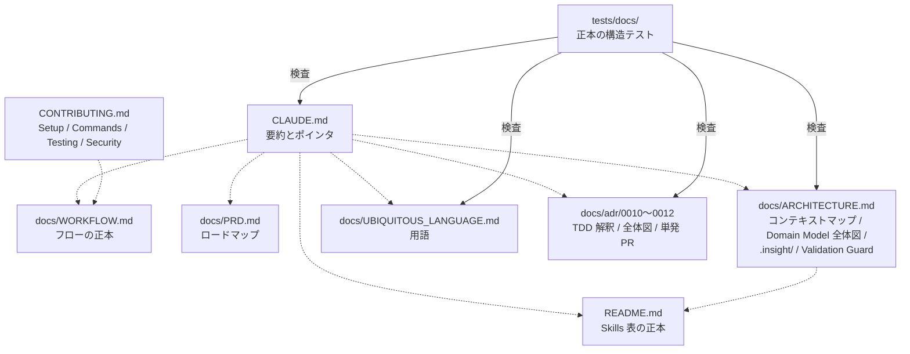
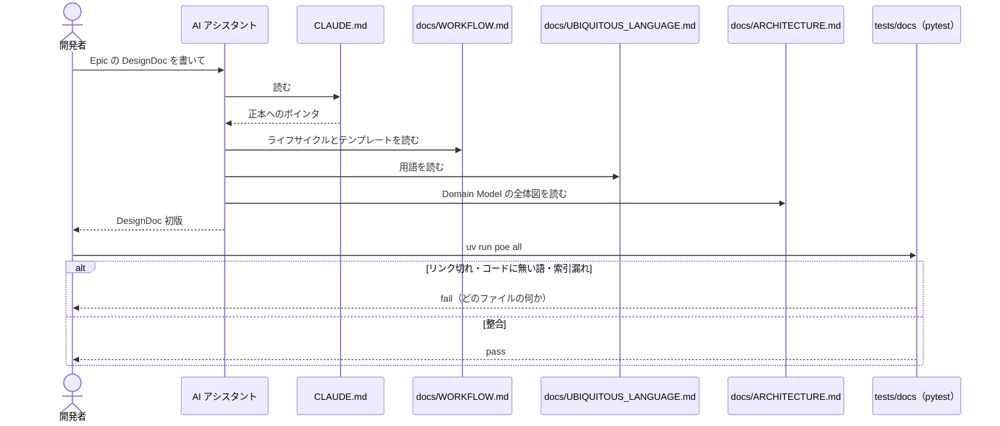

# Epic 11: repo-template の開発フローへの準拠

## Background

本書がこの Epic の要求と背景の正本（[FLOW-0001](../adr/flow/0001-designdoc-owns-requirements.md)）。
Epic issue（[#56](https://github.com/etoyama/insight-blueprint-skills/issues/56)）には要約と本書へのリンクだけを置く。

- 解く課題: このリポジトリで開発する人間と AI アシスタントは、同じ情報を複数の文書で読む。
  CLAUDE.md（154行）が Skills 表・`.insight/` のファイル一覧・検証の仕組みの実体を持ち、
  同じものが README と ARCHITECTURE にもある。どれが正本か分からず、片方だけ直されて食い違う。
  CLAUDE.md §11 は存在しない rules 3本を指し、§9 は今の環境に無いレビュー道具を名指ししている。
  PRD のロードマップは E5c を「進行中」としたまま Epic 06〜10 を載せていない。
  用語の正本（`docs/UBIQUITOUS_LANGUAGE.md`）は雛形のままで、同じ概念を「設計書」「analysis design」
  「hypothesis」「design document」と呼び分けている。
- PRD の要件: 機能要件ではなく、要件と構成の正本（PRD・ARCHITECTURE・UBIQUITOUS_LANGUAGE）を
  [docs/WORKFLOW.md](../WORKFLOW.md) §2 の正本ルールに合わせる。
- 既存手段が不十分な理由: 段階1（[ADR-0009](../adr/0009-adopt-repo-template-flow.md)、PR #55）は
  repo-template のファイルを機械的に移しただけで、判断を含む書き換えを意図的に残した。
  WORKFLOW には「skill の TDD をどう読むか」「Domain Model の全体図をどこに置くか」
  「Epic 以外の PR をいつ認めるか」の答えが無く、このリポジトリで決める必要がある。
  旧フローの残骸（`.spec-workflow/` と `.mcp.json` の spec-workflow MCP 設定）は
  plugin 利用者にも配られている。

## User Stories

### US-1: CLAUDE.md の再編

AI アシスタントとして、作業の前に正本を迷わず開くために、CLAUDE.md が要約と正本へのポインタだけを持ってほしい。

- [x] AC 1: CLAUDE.md が repo-template の節構成（Documents・Development Workflow・ADR ハードルール・
  Coding Principles・Rules and Templates・Language）を持つ。Skills 表・`.insight/` のファイル一覧・
  Validation Guard の説明の実体を持たず、正本へのリンクで代える。
- [x] AC 2: CLAUDE.md の相対リンクがすべて実在するファイルを指す。
- [x] AC 3: Code Review の節が今の環境にあるレビュー道具と、それが無いときの代替と、
  レビュー出力の置き場所を書く。
- [x] AC 4: CONTRIBUTING.md が Setup・Common Commands・Testing・Security Checklist の4節だけを持ち、
  ほかの規約は WORKFLOW・CLAUDE.md・coding-principles へのリンクで代える。

### US-2: 正本文書の整備

このリポジトリのメンテナとして、全体像と用語を1か所で確かめるために、PRD・ARCHITECTURE・
UBIQUITOUS_LANGUAGE が今の状態を正しく持ってほしい。

- [x] AC 1: PRD のロードマップが Epic 01〜11 をすべて載せ、E5c を「完了」にする。
- [x] AC 2: ARCHITECTURE がコンテキストマップの節を持ち、Epic マッピングが Epic 06〜11 を載せる。
- [x] AC 3: ARCHITECTURE が Domain Model の全体図（mermaid `classDiagram`）を持つ。
  `src/insight_blueprint/models/` と `skills/_shared/models.py` のクラスが図に載る。
- [x] AC 4: UBIQUITOUS_LANGUAGE の初版が、ドメインの語だけを載せる。「コード上の名前」はコードに実在し、
  削除済み機能の語（WebUI・REST API・MCP server など）を載せない。
- [x] AC 5: 揺れている語（「設計書」など）の正の語を人間が決め、表の「使わない言い換え」に反映する。

### US-3: 解釈の記録

次の Epic を始める人間と AI として、repo-template に答えの無い3つの問いで迷わないために、
このリポジトリでの解釈が ADR に残っていてほしい。

- [x] AC 1: skill の TDD の読み方（D6）を ADR に書く。
- [x] AC 2: Domain Model の全体図の置き場所と、Python のクラスを持たない YAML / JSON の契約の扱い（D7）を ADR に書く。
- [x] AC 3: Epic 以外の PR を認める条件（D11）を ADR に書き、CLAUDE.md §4 からポインタを1行張る。
- [x] AC 4: `docs/adr/` のすべての ADR が `docs/adr/README.md` の索引に載る。

### US-4: 旧フローの残骸の掃除

plugin 利用者として、使わない MCP サーバを勝手に設定されないために、旧フローの設定を配布物から消してほしい。

- [x] AC 1: `.spec-workflow/` と `.mcp.json` がリポジトリに無い。テストが「`.mcp.json` が無い」を確かめる。
- [x] AC 2: CHANGELOG の Unreleased に、利用者向けの変更として `.mcp.json` の削除を書く。
- [x] AC 3: `docs/design/epic-10-analysis-report.md` の未チェックの AC 6個を、人間が確かめたうえでチェックする。

## Stories

| Story issue | User Story | 扱う AC |
|---|---|---|
| [#57](https://github.com/etoyama/insight-blueprint-skills/issues/57) | [US-1](#us-1-claudemd-の再編) | AC 1〜4 |
| [#58](https://github.com/etoyama/insight-blueprint-skills/issues/58) | [US-2](#us-2-正本文書の整備) | AC 1〜5 |
| [#59](https://github.com/etoyama/insight-blueprint-skills/issues/59) | [US-3](#us-3-解釈の記録) | AC 1〜4 |
| [#60](https://github.com/etoyama/insight-blueprint-skills/issues/60) | [US-4](#us-4-旧フローの残骸の掃除) | AC 1〜3 |

## Ubiquitous Language

この Epic で [docs/UBIQUITOUS_LANGUAGE.md](../UBIQUITOUS_LANGUAGE.md) の初版を書く。

- 追加: 初版の全語（US-2 で確定する）

## Scope

- Epic 範囲内: [docs/WORKFLOW.md](../WORKFLOW.md) §2 の正本ルールに沿った文書の再配置（CLAUDE.md・CONTRIBUTING.md・
  PRD・ARCHITECTURE・UBIQUITOUS_LANGUAGE）、解釈の ADR 3本、旧フローの設定の削除、
  正本の構造を確かめる自動テスト。
- Epic 範囲外:
  - skill・Python コード・データモデルの振る舞いの変更。
  - 既存の DesignDoc 13本と ADR-0001〜0008 の書き直し（[ADR-0009](../adr/0009-adopt-repo-template-flow.md) で凍結）。
    例外は人間が確かめた epic-10 の AC のチェックだけ。
  - repo-template の新しいコミットの取り込み（`921b1bc` に固定）。
  - `.claude/docs/research/` の10本（凍結して残す）。

## Architecture

この Epic が変えるのは文書の参照関係である。CLAUDE.md は実体を持たず、正本へのリンクだけを持つ。
破線は「リンクする」を表す。

## Domain Model

変更なし。この Epic はデータモデルを変えない。
全体図は [docs/ARCHITECTURE.md の「Domain Model」](../ARCHITECTURE.md#domain-model) にある（US-2 で描く）。

## Module Responsibilities

| モジュール / 関数 | 責務（する） | 境界（しない → 委譲先） |
|---|---|---|
| `CLAUDE.md` | AI への行動指示と、各正本へのポインタ | 規則・構成・用語の実体を持たない → WORKFLOW・ARCHITECTURE・UBIQUITOUS_LANGUAGE・README |
| `docs/ARCHITECTURE.md` | 不変条件、構成、コンテキストマップ、Domain Model の全体図、ファイルの契約の所在 | Epic の一覧と DesignDoc へのリンクを持たない → PRD のロードマップ。契約の形を写さない → 各 SKILL.md・`notebook-contract.md` |
| `docs/UBIQUITOUS_LANGUAGE.md` | 用語・コード上の名前・定義・使わない言い換え | yomiyasu の語の一覧を手で持たない → `scripts/export_yomiyasu_words.py` が生成 |
| `scripts/export_yomiyasu_words.py::render` | Terms 表から `allow.txt`・`flag.txt` の中身を作る純関数 | ファイルを書かない → `main` |
| `tests/docs/test_canonical_docs.py` | リンク切れ、CLAUDE.md への実体の逆流、図とコードの食い違い、語の実在、ADR の索引、生成物の同期を検出する | 表の読み取りを自分で持たない → `scripts/export_yomiyasu_words.py` の `section`・`terms_rows` |
| `tests/test_plugin_structure.py::TestMcpJson` | 配布物に MCP サーバの設定が無いことを確かめる | `.spec-workflow/` は見ない → `TestNoLegacyFlowFiles` |

## Sequence Diagram

AI アシスタントが新しい Epic の文書を書くとき、正本をたどる順序。
開発者が PR を出すと、正本の構造テストがリンク切れと語の食い違いを検出する。

## Decisions

D4・D5・D8・D9 は Epic を始める前に人間が決めた（2026-11-15）。番号は準拠作業の論点番号。
D1・D2・D3・D10 は [ADR-0009](../adr/0009-adopt-repo-template-flow.md) にある。

### Decision: ubiquitous-language-first-edition（D4）

- What: UBIQUITOUS_LANGUAGE の初版は、ドメインの概念だけを載せる。候補の出所は
  `src/insight_blueprint/models/` と `skills/_shared/models.py` のクラスと enum 値、skill 名、
  `.insight/` のファイルの種類、既存 DesignDoc の Glossary のうちドメインの語（review batch、verdict、
  terminal status、finding、KEEP / AUTO ゲートなど）。削除済み機能の語と実装の名前（`validate.py`、
  `design_io` など）は載せない。コンテキストは1つで始める。
- Why: 同じ概念の呼び方の揺れを、表の上で決着させる。
- Criteria: 揺れを表で決着できること、表の語がコードに実在すること（決め手）。出典は人間の決定。
- Affected modules: `docs/UBIQUITOUS_LANGUAGE.md`
- Alternatives considered: Glossary の全語を移す（揺れと削除済みの語が残る）。空で置く（US-2 を満たさない）。
- Consequences: 正の語の選定は US-2 で人間に別に出す。

### Decision: claude-md-content-destinations（D5）

- What: CLAUDE.md §7（Skill-Managed Data）と §8（Validation Guard）は ARCHITECTURE の
  「コンポーネントと責務」へのポインタにする。Skills 表の正本は README の `## Skills` とし、
  CLAUDE.md と ARCHITECTURE は README へリンクする。§9 Code Review は CLAUDE.md に残し
  （WORKFLOW は repo-template と同じに保つ）、存在しない `orchestra:team-review` を今ある道具に差し替える。
- Why: [WORKFLOW](../WORKFLOW.md) §2 の「同じ情報を2か所に正本として書かない」に合わせる。
- Criteria: 正本が1つであること。WORKFLOW を repo-template から変えないこと。出典は人間の決定。
- Affected modules: `CLAUDE.md`、`docs/ARCHITECTURE.md`、`README.md`
- Alternatives considered: Skills 表の正本を ARCHITECTURE に置く（利用者が最初に読む README から遠い）。
  レビュー手順を WORKFLOW に足す（repo-template からの差分が増える）。
- Consequences: レビュー道具の選定とレビュー出力の置き場所は US-1 で人間が決める。

### Decision: story-issues（D8）

- What: すべての Story を `.github/ISSUE_TEMPLATE/story.yml` で issue に起票し（label `type:story`）、
  本書の Stories 表に載せる。この Epic が最初の例になる。
- Why: Stories 表と Story ブランチ名（`<story-num>`）が issue 番号を前提にしている。
- Criteria: WORKFLOW §3・§5 との一致。出典は人間の決定。
- Affected modules: なし（運用）
- Alternatives considered: DesignDoc の中だけで Story を管理する（過去の Story issue は0件だった）。
- Consequences: Story ごとに issue が1件増える。

### Decision: legacy-flow-cleanup（D9）

- What: `.spec-workflow/`（11本）と `.mcp.json` を US-4 で削除し、`tests/test_plugin_structure.py` の
  `.mcp.json` の存在の検査を「無い」の検査に書き換えて、不変条件「No MCP server」を確かめるテストにする。
  CONTRIBUTING.md は固有の4節に削る。`.claude/docs/research/` の10本は残す（凍結。ADR-0006 と CHANGELOG がパスで参照する）。
- Why: marketplace の source が `./` なので、`.mcp.json`（`npx -y @pimzino/spec-workflow-mcp@latest`）は
  インストール済みの 0.8.0 の plugin キャッシュに入っている。利用者が使わない MCP サーバを配っている。
- Criteria: 配布物に旧フローの設定が残らないこと。過去の参照を壊さないこと。出典は人間の決定。
- Affected modules: `.mcp.json`、`.spec-workflow/`、`tests/test_plugin_structure.py`、`CONTRIBUTING.md`、`CHANGELOG.md`
- Alternatives considered: `.mcp.json` を残して spec-workflow だけ消す（空の設定ファイルが残り、意味がない）。
- Consequences: 利用者向けの変更なので CHANGELOG に書く。Claude Code が利用者の環境でこのサーバを
  実際に起動していたかは確かめていない。

### Decision: code-review-tooling

- What: CLAUDE.md §9 のレビュー手順を、`pstack:thermos`（バグ・セキュリティとコード品質）を主にし、
  pstack が無い環境では `/code-review` を使う形にする。テストカバレッジと AC は Epic PR の作者が
  DesignDoc に照らして確かめ、PR 説明に書く。レビューの出力は PR コメントに残し、ファイルにしない。
- Why: `orchestra:team-review` はこの環境に無い。`.claude/docs/research/` は D9 で凍結したので、
  新しいレビュー出力の置き場が要る。
- Criteria: 名指しする道具が実在すること（Must）。旧 team-review の観点を覆うこと、
  正本ルール（WORKFLOW §2）に反しないことが決め手。重みは Claude の推測で、人間が案 A を選んで追認した（2026-11-15）。
- Affected modules: `CLAUDE.md`
- Alternatives considered: `/code-review` だけ（品質と AC の観点が抜ける）。
  出力を `docs/reviews/epic-NN/` にコミットする（古いレビューを正本と取り違える）。
- Consequences: pstack を外すと主の道具が消え、代替に落ちる。AC 照合は道具ではなく作者の手順になる。
- Epic に留める理由: 効果は以後の Epic に及ぶが、手順の正本は CLAUDE.md §9 で、決めたのは存在しない道具の差し替えだけである。設計の制約や契約は変えない。道具を替えるときは CLAUDE.md を直し、同じ PR でこの Decision を参照する。

### Decision: canonical-term-analysis-design

- What: `AnalysisDesign`（`{id}_hypothesis.yaml`）の正の語を「分析設計」（英語は analysis design）にする。
  使わない言い換えは設計書・design document・hypothesis（分析設計そのものを指すとき）。
  この Epic では UBIQUITOUS_LANGUAGE の表と、この Epic が書き直す文書（CLAUDE.md・PRD・ARCHITECTURE）だけを直す。
  skills と凍結した文書の一括置換はしない。
- Why: 同じ概念を、設計書（docs 46行）、analysis design（skills 18行）、hypothesis（skills 99行、ファイル名を含む）、
  design document と呼び分けている（`git grep -ci` で数えた）。
- Criteria: 1つの概念に正の語が1つであること（FLOW-0002、Must）。決め手は開発フローの DesignDoc とも
  仮説の文（`hypothesis_statement`）とも取り違えないこと。重みは Claude の推測で、人間が案 A を選んで追認した（2026-11-15）。
- Affected modules: `docs/UBIQUITOUS_LANGUAGE.md`、`docs/PRD.md`、`docs/ARCHITECTURE.md`
- Alternatives considered: 「設計書」（docs の多数派だが DesignDoc と衝突する）。「仮説」（`hypothesis_statement` と衝突する）。
- Consequences: skills には「design document」などが残る。表の「使わない言い換え」に載せ、触ったときに直す。
  ARCHITECTURE の参照の節にある ADR-0003 の題（「設計書 I/O」）は凍結した ADR の題なので変えない。
- Epic に留める理由: UBIQUITOUS_LANGUAGE の初版で語を足すだけで、表に既にあった語の改名ではない（WORKFLOW §7 は「新語の追加だけなら PR 説明への明記でよい」とする）。今後この語を変えるときは ADR を書く。

### Decision: generate-yomiyasu-words

- What: WORKFLOW §8 が求める `.yomiyasu-words/allow.txt`・`flag.txt` を、`scripts/export_yomiyasu_words.py` で
  UBIQUITOUS_LANGUAGE から生成してコミットする。`allow.txt` は「用語」の列、`flag.txt` は「使わない言い換え」を
  `言い換え<TAB>用語` の形で書く。条件つきの言い換え（「hypothesis（分析設計そのものを指すとき）」）は書き出さない。
  生成物と表が一致することは `tests/docs/` が確かめる。
- Why: WORKFLOW §8 は書き出しを求めるが、repo-template に手順もスクリプトもない。手で写すと表とずれる。
- Criteria: 正本を UBIQUITOUS_LANGUAGE の1つに保つこと（WORKFLOW §2・§8）。
- Affected modules: `scripts/export_yomiyasu_words.py`、`.yomiyasu-words/`、`tests/docs/test_canonical_docs.py`
- Alternatives considered: 手で写す（ずれる）。コミットせず推敲のたびに生成する（チームで共有できない。yomiyasu はリポジトリに入れる前提）。
- Consequences: UBIQUITOUS_LANGUAGE を変えたら、スクリプトを回して同じ PR に生成物を入れる。忘れるとテストが落ちる。
- Epic に留める理由: WORKFLOW §8 が決めた書き出しの実装で、新しい規則は足していない。義務はテストが知らせるので、文書の規則として覚えておく必要がない。

### Decision: split-story-c

- What: 引き継ぎの Story 案 C（解釈の記録と掃除）を、US-3（ADR）と US-4（削除）に分ける。
- Why: C のままだと AC が7個になり、WORKFLOW §3 の上限5個を超える。ADR の追加とファイルの削除は、
  読むときの観点も違う。
- Criteria: AC が5個以下であること（WORKFLOW §3）。
- Affected modules: なし（Story の切り方）
- Alternatives considered: AC をまとめて5個に詰める（1つの AC が複数の確認を含み、チェックの意味が曖昧になる）。
- Consequences: Story issue が4件になる。

### Cross-epic decisions (links to ADR)

- [ADR-0010: skill の TDD は構造テストを先に書くことと読む](../adr/0010-skill-tdd-structure-tests.md): ✓ は自動テストがある層だけ。無い層は「—（理由）」（D6）
- [ADR-0011: Domain Model の全体図を ARCHITECTURE に置く](../adr/0011-domain-model-overview-in-architecture.md): DesignDoc は差分だけ。クラスを持たない契約は表でリンク（D7）
- [ADR-0012: Epic 以外の PR は、定めた振る舞いを変えない変更に限る](../adr/0012-single-pr-scope.md): 振る舞いを足す・変える変更は Epic（D11）

## Test Design Matrix

[ADR-0010](../adr/0010-skill-tdd-structure-tests.md) の読み方に従う。✓ は Red → Green を経た自動テストがある層だけに付け、
自動テストが無い層は「—（理由）」と書く。ゲートは「— 以外がすべて ✓」。
文書の構造テスト（`tests/docs/`、`tests/test_plugin_structure.py`）はファイルを読むだけの検査なので Unit に置く。

| Story \ Layer | Unit | Integration | E2E |
|---|---|---|---|
| #57 CLAUDE.md の再編 | ✓（`tests/docs/test_canonical_docs.py`: `TestClaudeMd`・`TestContributing`・`test_relative_links_resolve`） | —（文書だけで、組み合わせて動くものが無い） | —（同上） |
| #58 正本文書の整備 | ✓（`TestRoadmap`・`TestDomainModelDiagram`・`TestUbiquitousLanguage`・`TestYomiyasuWords`） | —（同上） | —（同上） |
| #59 解釈の記録 | ✓（`TestAdrs`: 索引、新形式の節、リンク、CLAUDE.md と ARCHITECTURE からの参照） | —（同上） | —（同上） |
| #60 旧フローの残骸の掃除 | ✓（`tests/test_plugin_structure.py`: `TestMcpJson`・`TestNoLegacyFlowFiles`） | —（同上） | —（plugin を入れ直して `.mcp.json` が配られないことは、リリース後に手で確かめる） |

## Story Timeline

- 2026-11-15 — Epic #56 を起票し、DesignDoc 初版を書いた。Story #57〜#60 を起票した。
- 2026-11-15 — Story #57 完了: CLAUDE.md を要約とポインタにし（154行 → 107行）、CONTRIBUTING.md を4節に削った。CLAUDE.md から外した検証と `_revision.yaml` の記述を ARCHITECTURE に移した。
- 2026-11-15 — Story #58 完了: PRD と ARCHITECTURE に Epic 01〜11 を載せ、ARCHITECTURE にコンテキストマップと Domain Model の全体図（22クラス）を足した。UBIQUITOUS_LANGUAGE の初版（35語）を書いた。全体図を含む mermaid 8ブロックが mermaid 11.4.1 の parse と render を通ることを、内蔵ブラウザで確かめた（手動）。
- 2026-11-15 — Story #59 完了: ADR-0010〜0012 を新形式で書き、索引に載せた。CLAUDE.md §4・§6 と ARCHITECTURE の Domain Model から参照を張った。D11 の根拠の PR の本数を数え直し、判断時の「25本中13本」に対して「27本中14本」だった（結論は変わらない）。
- 2026-11-15 — Story #60 完了: `.spec-workflow/`（11本）と `.mcp.json` を削除し、`TestMcpJson` を「無い」の検査に書き換えた（Red を確認してから削除した）。CHANGELOG の Unreleased に書いた。epic-10 の AC 6個は、人間が確認したうえでチェックだけを直した（本文は変えていない）。
- 2026-11-15 — #58 の追補: UBIQUITOUS_LANGUAGE の「使わない言い換え」を、実際に使われている語だけに絞った。YAML のフィールド名と使用0件の語を外し、既存の文書が使う terminal status と figures manifest を正の語にした。`.yomiyasu-words/` を生成するスクリプトと、同期を確かめるテストを足した。
- 2026-11-15 — Epic PR の前の推敲（WORKFLOW §8）: 今回書いた日本語の文書10本に yomiyasu 3.1.0 の check run と verify をかけた（全件でハッシュが一致し、meaning_risk=0）。直したのは、間を作るだけの読点11か所。既存の文の em dash と太字は変えていない。
- 2026-11-15 — `pstack:thermos` のコード品質レビューに対応した。Terms 表の読み取りをスクリプトに1本化し、全体図の enum の値もコードと照合するようにした。Epic の一覧は PRD だけに置き、ARCHITECTURE の Epic マッピングから DesignDoc の列を外した。リンク切れのテストを1本にまとめ、見出しを数えるときにコードフェンスを除くようにした。CLAUDE.md の節番号への参照（ARCHITECTURE の冒頭と ADR-0012）は節の名前に直した。CLAUDE.md §4・§8 が WORKFLOW の要約を持つ点は、repo-template の CLAUDE.md と同じに保つため残した。
- 2026-11-15 — `pstack:thermos` のバグ観点のレビューに対応した。ARCHITECTURE の遷移の例が事実と逆だった（`in_review → supported` は許される）ので、`analyzing → supported` を拒む例に直した。図の破線の読み方を、dict に入れた参照も含む形に直した。Module Responsibilities を埋め、`flag.txt` から Claude Code 本体の機能名と重なる「auto mode」を外した。CONTRIBUTING から消えた「コメントと docstring は英語」を CLAUDE.md §8 に戻した。
