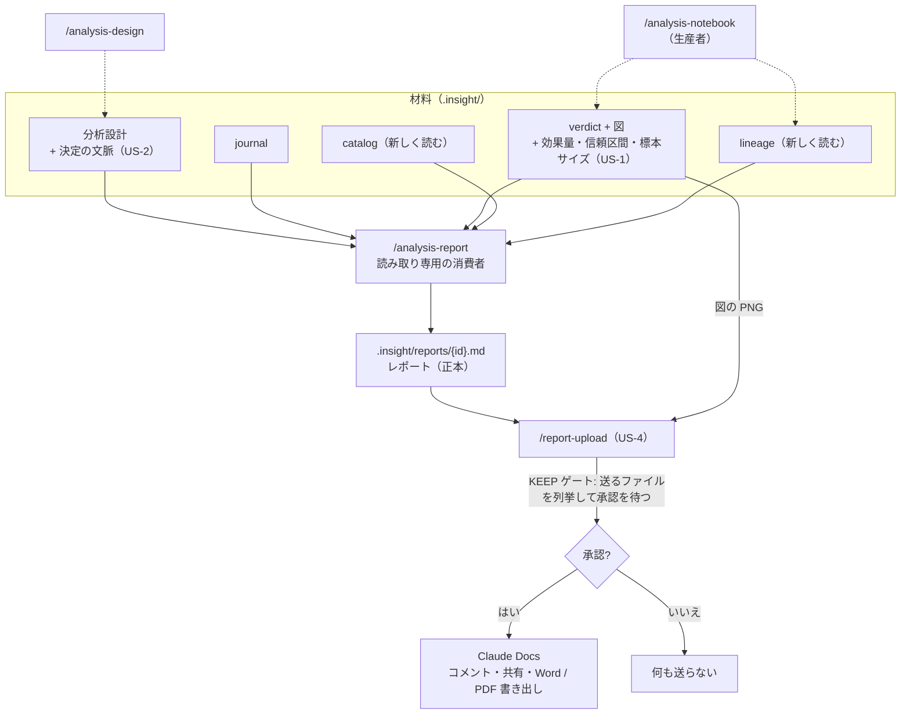
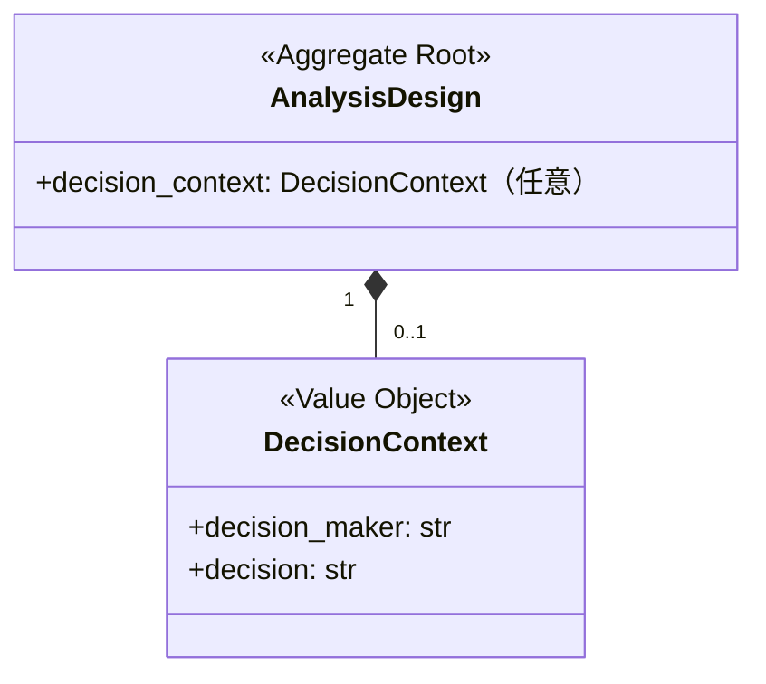
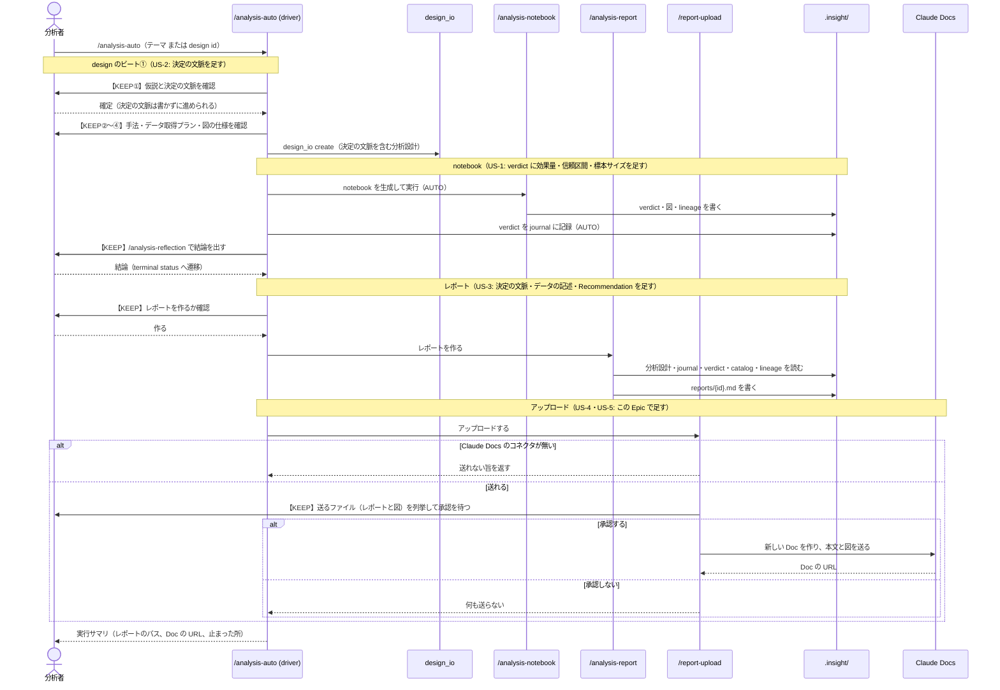
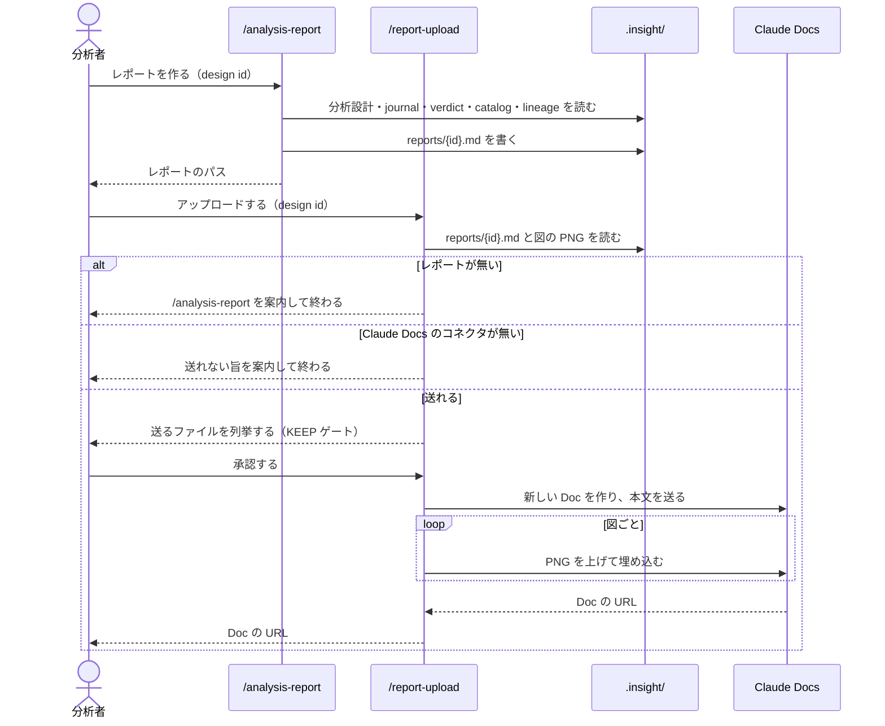

# Epic 12: 意思決定に使えるレポートと Claude Docs へのアップロード

## Background

本書がこの Epic の要求と背景の正本（[FLOW-0001](../adr/flow/0001-designdoc-owns-requirements.md)）。
Epic issue（[#62](https://github.com/etoyama/insight-blueprint-skills/issues/62)）には要約と本書へのリンクだけを置く。

- 解く課題: レポートを受け取った読者（ビジネスや研究の意思決定者）が、レポートだけでは判断できない。
  [Epic 10](epic-10-analysis-report.md) の `/analysis-report` は結論の出た分析を APA 風の Markdown にするが、次の4点が足りない。
  - 課題1: 数値が判断に足りない。verdict の指標は値・閾値・p 値・合否だけを持つ。
    効果量・信頼区間・標本サイズがなく、読者は「有意だが小さい効果」と「大きい効果」を区別できない。
  - 課題2: データの素性が載らない。レポートは catalog も lineage も読まない。
    読者は結果をどこまで一般化してよいか判断できない。
  - 課題3: 「だから何をすべきか」が載らない。Discussion は Limitations と Future Directions だけを持つ。
    分析設計の `next_action` は使われず、「誰が何を決めるための分析か」は分析設計に項目がない。
  - 課題4: 読者が読む場所がない。出力はローカルの Markdown で、図は相対パスで参照する。
    ファイル1つを渡すと図が切れる。コメントも Word / PDF への変換も手作業になる。
- PRD の要件: [docs/PRD.md](../PRD.md) のコアバリュー「journal / reflection — 結果の解釈と結論づけ」を、
  結論を読者に渡して判断に使わせる所まで延ばす。PRD の機能要件にはレポートの項目がまだない。US-5 で足す。
- 既存手段が不十分な理由: Epic 10 は「分析者がわずかな手直しで配布できる下書き」を目標にし、
  読者が判断に使えるかどうかは範囲外だった。docx / PDF への変換も範囲外で、読者に渡す手段は利用者に任されている。
  Claude Docs は共有・コメント・Word / PDF への書き出しを持つので、渡す手段をここに任せられる。

## User Stories

### US-1: 判断に足る数値

レポートの読者として、効果の大きさと確かさを知るために、Results に効果量・信頼区間・標本サイズが載ってほしい。

- [x] AC 1: notebook の契約が verdict の指標ごとに任意の項目として効果量・信頼区間・標本サイズを定義する。
- [x] AC 2: 契約テストの sample notebook がこの3項目を出し、テストが verdict に載ることを確かめる。
- [x] AC 3: レポートの Results の数値表が3項目の列を持つ。どの指標にも値がない列は省く。
- [x] AC 4: 3項目を持たない verdict（契約を広げる前の分析）でも、レポートが今と同じ形で出る。
- [x] AC 5: notebook の公開契約の変更を ADR に書く。

### US-2: 決定の文脈

分析者として、結論を読者の判断につなげるために、分析設計に「誰が何を決めるための分析か」を書けてほしい。

- [x] AC 1: 分析設計が任意の項目として決定の文脈を持ち、検証ライブラリがその形を確かめる。
- [x] AC 2: `/analysis-design` が仮説のビートで決定の文脈を聞く。分析者は書かずに進められる。
- [x] AC 3: `/analysis-review` が決定の文脈を読み、仮説と噛み合っているかを見る。
- [x] AC 4: 決定の文脈を持たない既存の分析設計が、今のまま検証を通る。
- [x] AC 5: 分析設計のスキーマの変更を ADR に書き、ARCHITECTURE の Domain Model の全体図を同じ PR で更新する。

### US-3: 判断の材料がそろったレポート

レポートの読者として、レポートだけで判断するために、データの素性と推奨が載ってほしい。

- [x] AC 1: Introduction に決定の文脈が載る。分析設計に無ければ省く。
- [x] AC 2: Method に、データソースの名前・種類・説明（catalog）と、加工での行数の変化（lineage）が載る。
- [x] AC 3: Discussion に Implications と Recommendation が載る。Recommendation は `next_action` と決定の文脈から書き、
  どちらも無ければ節ごと省く。
- [x] AC 4: Appendix に lineage の図と notebook のパスが載る。
- [x] AC 5: `/analysis-report` は読み取り専用のままで、数値を自分で計算しない。構造テストがこれを確かめる。

### US-4: Claude Docs へのアップロード

分析者として、読者がコメントできる形でレポートを渡すために、レポートを Claude Docs にアップロードできてほしい。

- [x] AC 1: 新しい skill が `.insight/reports/{id}.md` を読んで新しい Doc を作り、URL を示す。
  既存の Doc は上書きしない。レポートが無ければ `/analysis-report` を案内して終わる。
- [x] AC 2: 送る前に、送るファイル（レポートと図）を列挙し、分析者の承認を待つ。承認が無ければ何も送らない。
- [x] AC 3: Claude Docs のコネクタが無い環境では、何も送らず、その旨を案内して終わる。Markdown のレポートは残る。
- [x] AC 4: 図を Doc に載せる。図を上げる手段が無いか失敗したときは、図を省いて注記を1行入れる。
- [x] AC 5: 外部へ送る前の承認の決まりと、不変条件「No MCP server」の読み方を ADR に書く。

### US-5: 配線と文書の更新

分析者として、結論からレポート、アップロードまでを迷わずたどるために、skill の連鎖と文書がそろっていてほしい。

- [ ] AC 1: `/analysis-report` と新しい skill の Chaining 表が、互いを指す。
- [ ] AC 2: `/analysis-auto` がレポートを作った後に `/report-upload` を起動する。分析者がアップロードで聞かれるのは、送るファイルの承認の1回だけである。
- [ ] AC 3: README の Skills 表と、PRD の機能要件に、レポートとアップロードの項目が載る。
- [ ] AC 4: この Epic で足した語が UBIQUITOUS_LANGUAGE に載り、ARCHITECTURE の代表シーケンスがアップロードを含む。

## Stories

| Story issue | User Story | 扱う AC |
|---|---|---|
| [#63](https://github.com/etoyama/insight-blueprint-skills/issues/63) | [US-1](#us-1-判断に足る数値) | AC 1〜5 |
| [#64](https://github.com/etoyama/insight-blueprint-skills/issues/64) | [US-2](#us-2-決定の文脈) | AC 1〜5 |
| [#65](https://github.com/etoyama/insight-blueprint-skills/issues/65) | [US-3](#us-3-判断の材料がそろったレポート) | AC 1〜5 |
| [#67](https://github.com/etoyama/insight-blueprint-skills/issues/67) | [US-4](#us-4-claude-docs-へのアップロード) | AC 1〜5 |
| [#66](https://github.com/etoyama/insight-blueprint-skills/issues/66) | [US-5](#us-5-配線と文書の更新) | AC 1〜4 |

実装の順は US-1 → US-2 → US-3 → US-4 → US-5。US-3 は US-1 と US-2 が出す材料を読む。
US-4 は US-3 を待たずに進められる。

## Ubiquitous Language

定義の正本は [docs/UBIQUITOUS_LANGUAGE.md](../UBIQUITOUS_LANGUAGE.md)。
表の「コード上の名前」はコードに実在する必要があるので、語は名前が決まる Story の中で表に足す。

- 追加: 決定の文脈（US-2）、効果量・信頼区間・標本サイズ（US-1）、アップロード（US-4）
- 変更: なし。「レポート」は APA 風の Markdown を指すままで、アップロードで作った Doc はその写しとして扱う。

## Scope

[docs/PRD.md](../PRD.md) の「journal / reflection」の価値を読者の判断まで延ばす。
[docs/ARCHITECTURE.md](../ARCHITECTURE.md) では Skill layer（`/analysis-report` と新しい skill）、
notebook の契約、分析設計のモデルを前進させる。

- Epic 範囲内:
  - verdict の指標への効果量・信頼区間・標本サイズの追加。
  - 分析設計への決定の文脈の追加。
  - レポートのテンプレートの拡張（Introduction・Method・Results・Discussion・Appendix）。
  - Markdown のレポートを Claude Docs にアップロードする新しい skill（`/report-upload`）。
  - chaining、`/analysis-auto`、README、PRD、UBIQUITOUS_LANGUAGE、ARCHITECTURE の更新。
- Epic 範囲外:
  - 厳密な APA の体裁（running head、本文中の引用、参考文献リスト）。Epic 10 の判断を引き継ぐ。
  - データの期間。catalog にも verdict にも材料がない。必要になったら別の Epic で扱う。
  - Docs から Markdown への書き戻し。Docs 上の手直しは Markdown に反映しない。
  - アップロードで作った Doc の更新と、design id と Doc の URL の対応の保存。
  - 終端でない状態の分析のレポート。Epic 10 の terminal status の前提を引き継ぐ。
  - docx / PDF の生成。Claude Docs の書き出しに任せる。

## Architecture

左が材料、中央が今ある組み立て、右がこの Epic で足すアップロード。実線は読み書き、破線は生産者が成果物を作る関係を表す。
Markdown から右へ進むのは、分析者が承認したときだけである。

既存のファイル: [skills/analysis-report/SKILL.md](../../skills/analysis-report/SKILL.md)、
[skills/analysis-report/references/apa-template.md](../../skills/analysis-report/references/apa-template.md)、
[skills/analysis-notebook/references/notebook-contract.md](../../skills/analysis-notebook/references/notebook-contract.md)、
[src/insight_blueprint/models/design.py](../../src/insight_blueprint/models/design.py)。

## Domain Model

全体図（[docs/ARCHITECTURE.md の「Domain Model」](../ARCHITECTURE.md#domain-model)）からの差分だけを描く。
クラス名と項目名は Story #64 で確定した（[ADR-0014](../adr/0014-analysis-design-decision-context.md)）。

| 型 | 種類 | 不変条件 |
|---|---|---|
| `DecisionContext` | 値オブジェクト | 任意。あるときは、誰が（`decision_maker`）と何を決めるか（`decision`）がどちらも空でない |

Python のクラスを持たないファイルの契約は、図に描かず表で示す（[ADR-0011](../adr/0011-domain-model-overview-in-architecture.md)）。

| ファイル | 変更 | 形の正本 |
|---|---|---|
| `{id}_verdict.json` の `metrics` | 指標ごとに任意の効果量（`effect_size`）・信頼区間（`confidence_interval`）・標本サイズ（`sample_size`）を足す（[ADR-0013](../adr/0013-verdict-metric-optional-items.md)） | [notebook-contract.md](../../skills/analysis-notebook/references/notebook-contract.md) |
| `.insight/reports/{id}.md` | 節を足す（決定の文脈、データの記述、Implications、Recommendation、Appendix） | [apa-template.md](../../skills/analysis-report/references/apa-template.md) |

## Module Responsibilities

初版の見取り図。Story の実装に合わせて詳細化する。

| モジュール / 関数 | 責務（する） | 境界（しない → 委譲先） |
|---|---|---|
| `/analysis-notebook`（拡張） | 効果量・信頼区間・標本サイズを計算して verdict に書く | レポートを組み立てない → `/analysis-report` |
| `/analysis-design`（拡張） | 仮説を決めた直後に決定の文脈を聞き、分析設計に書く。分析者が答えなければ項目ごと省く | 形の検証をしない → 検証ライブラリ |
| `/analysis-review`（拡張） | 決定の文脈があれば読み、仮説と噛み合うかを見て review コメントにする | 決定の文脈が無いことを指摘しない（任意の項目）。分析設計を直さない → `/analysis-revision` |
| 検証ライブラリ（`DecisionContext`） | 決定の文脈があるとき、誰がと何を決めるかの両方が空でないことを確かめる | 中身の妥当さ（役職か個人名か、仮説と噛み合うか）は見ない → `/analysis-design` の聞き方と `/analysis-review` |
| `/analysis-report`（拡張） | 分析設計・journal・verdict・図・catalog・lineage を読み、Markdown のレポートを書く | 数値を計算しない → `/analysis-notebook`。外部に送らない → `/report-upload` |
| `/report-upload`（新設） | レポートと図を読み、承認の後に Claude Docs へ送り、URL を示す | レポートを組み立てない → `/analysis-report`。Markdown を書き換えない。Doc を更新しない（範囲外） |
| `/analysis-auto`（拡張） | 分析者の入口。レポートを作った後に `/report-upload` を起動し、結果を実行サマリに書く | アップロードの承認を自分で取らない → `/report-upload` の KEEP ゲート。アップロードを自分で行わない → `/report-upload` |

## Sequence Diagram

### guided autopilot（`/analysis-auto`）からアップロードまで

分析者の入口は `/analysis-auto` である。driver が既存の skill を順に動かし、KEEP ゲートでだけ止まる。
この Epic が変える所を Note で示す。変えない所（framing、review、premortem の分岐）は省いた。
全体は [docs/ARCHITECTURE.md の「guided autopilot の詳細シーケンス」](../ARCHITECTURE.md#guided-autopilotanalysis-autoの詳細シーケンス) にある。

- アップロードで分析者に聞くのは1回だけである。driver は「アップロードするか」を別に聞かず、`/report-upload` が送るファイルを列挙して承認を待つ。
- レポートを作らなかったときは、driver は `/report-upload` を起動しない。
- コネクタが無い環境では、driver は KEEP ゲートを出さずに実行サマリへ進み、送れなかった旨をサマリに書く。

### skill を単独で起動したとき

結論の出た分析を、分析者が `/analysis-report` と `/report-upload` を自分で起動してアップロードするまで。

境界の補足:

- Claude Docs はホスト（Claude Code）が持つコネクタで、plugin は常駐プロセスを持たない。
- 図を上げる手段は Docs のコネクタではなく、ホストの別のツールが担う。無い環境では図を省く（US-4 AC 4）。
- ツール名の接頭辞は環境ごとに違う。SKILL.md はツール名を書かず、「Claude Docs のコネクタ」と呼ぶ。

## Decisions

### Decision: publish-as-separate-skill

- What: Claude Docs へのアップロードは `/analysis-report` に足さず、別の skill にする。Markdown のレポートを正本として残す。
- Why: 課題4を解く。あわせて、外部への依存を1つの skill に閉じ込める。
- Criteria: コネクタが無い環境でもレポートが出ること（Must、PRD「plugin として配布・利用できる」）。
  外部への送信は承認の後だけであること（Must、[ADR-0005](../adr/0005-selective-autonomous-chaining.md)）。
  CI で検証できる範囲（Want）と、実装と保守の量（Want）。決め手は CI で検証できる範囲。
  2026-11-15 に人間が決めた。
- Affected modules: `/report-upload`（新設）、`/analysis-auto`
- Alternatives considered: `/analysis-report` に出力先の選択を足す案。skill は増えないが、
  読み取り専用の消費者に外部への書き込みが混ざる。Claude Docs を正本にする案。コネクタが無い環境でレポートが出なくなる。
- Consequences: skill と chaining の配線が1つずつ増える。Markdown を経由するので、Docs ならではの表現は使いにくい。
  `/analysis-report` の今のテストはそのまま使える。

### Decision: lightweight-apa-plus-decision-context

- What: 軽量な APA を保ち、判断の材料（効果量・信頼区間・標本サイズ・データの記述・Implications・Recommendation）を足す。
  さらに分析設計に決定の文脈を持たせる。
- Why: 課題1・2・3を解く。決定の文脈が無いと、Recommendation が誰のどの判断に答えるのかを書けない。
- Criteria: 読者がレポートだけで判断できること（Want、人間の発言「それだけで意思決定ができる」）。
  公開契約の変更の量（Want）。空の節が生まれないこと（Want、Epic 10 Scope）。
  決め手は、読者がレポートだけで判断できること。2026-11-15 に人間が決めた。
- Affected modules: notebook の契約、分析設計のモデルと検証ライブラリ、`/analysis-design`、`/analysis-review`、`/analysis-report`
- Alternatives considered: 決定の文脈を足さない案。スキーマは変わらないが、課題3のうち「誰のどの判断に答えるか」が残る。
  厳密な APA 7 にする案。EDA では引用文献がほぼなく、空の節が増える。
- Consequences: スキーマの変更が上流の skill に広がる。足す項目はすべて任意にし、既存の分析設計と verdict を壊さない。
  公開契約の変更は US-1 と US-2 の Story で ADR に書く。

### Decision: spike-constraints

- What: 実装の前に、Markdown と PNG を Claude Docs に載せる経路を1度通した（2026-11-15）。
  経路は通り、設計を左右する制約が3つ見つかった。US-4 はこの3つを前提にする。
  1. Docs から Markdown へは戻せない。書き戻すと図がテキストの代替表示に置き換わる。
  2. ツール名の接頭辞が環境ごとに違う。SKILL.md にツール名を書けず、構造テストでも検証できない。
  3. 図を上げる手段は Docs のコネクタと別のツールである。依存が2つになる。
- Why: US-4 の前提（SKILL.md の指示だけでアップロードできるか、コネクタが無い環境で止まれるか）が未確認だった。
- Criteria: 経路が通ること。コネクタが無い環境で、モデルが無いと判定できること。
- Affected modules: `/report-upload`
- Alternatives considered: スパイクを省いて US-4 を実装する案。経路が通らなければ Epic の後半が無駄になる。
- Consequences: 実際の SKILL.md を新しいセッションで起動した再現、CLI での図のアップロード、
  アップロードごとの承認の有無は、まだ確かめていない。US-4 の Story で確かめる。

### Decision: skill-name-report-upload

- What: Claude Docs へ送る skill の名前を `/report-upload` にする。この動作の用語は「アップロード」とする。
- Why: 名前はディレクトリ名・chaining の表・README に入り、後から変えにくい。
- Criteria: 「公開」「共有」を含意しないこと（Must、人間の発言「誤解が必ず発生する」）。
  `/analysis-report` と打ち間違えず、役割も取り違えないこと（Want、人間の発言）。
  名前から外へ出ることが読めること（Want、[ADR-0005](../adr/0005-selective-autonomous-chaining.md)）。
  既存の命名と用語にそろうこと（Want）。決め手は、外へ出ることが読めること。2026-11-15 に人間が決めた。
- Affected modules: `/report-upload`、`/analysis-auto`、README、UBIQUITOUS_LANGUAGE
- Alternatives considered: `/analysis-publish` と `/analysis-share`。Doc は作った本人だけが見える状態で始まるので、
  「誰かに見える・届く」と読める名前は実際と食い違う。`/report-to-docs`。docs が文書一般にも読める。
  `/report-export`。Claude Docs の Word / PDF への書き出しと同じ語になる。
  `/write-report`。`/analysis-report` も「レポートを書く」skill なので、役割を取り違える。
- Consequences: 送り先は名前から読めない。description の1文目と承認の文で、送り先が Claude Docs であることと、
  Doc が自分だけに見える状態で作られることを示す。`analysis-<名詞>` の形からは外れ、`catalog-register` と同じ「対象-動詞」の形になる。

### Decision: report-data-source-candidates

- What: レポートに載せるデータソースの候補を、分析設計の `source_ids` と、
  `metrics` と `explanatory` の `data_source` の値から集める。`catalog_io get` で登録を確かめ、登録されたものだけを載せる。
  載せるのは名前・種類・説明の3つで、`connection` は載せない。
- Why: US-3 AC 2 は catalog から載せると定めるが、分析設計のどの項目から id を引くかは定めていない。
  `/analysis-design` は `source_ids` を書かないので、`source_ids` だけを読むとデータソースの表がほぼ常に空になる。
- Criteria: 今の skill が作る分析設計でデータソースが載ること（Want、US-3 AC 2）。
  分析設計のスキーマと上流の skill を変えないこと（Want、この Story の範囲）。
  登録のないものを載せないこと（Must、AC 2「catalog」）。決め手は1つ目。
  2026-11-15 に人間がこの案を選んだ。
- Affected modules: `/analysis-report`
- Alternatives considered: `source_ids` だけを読む案。指示は短いが、今の分析設計では表が出ない。
  `/analysis-design` に `source_ids` を書かせる案。出典が1つになるが、上流の skill を変えるので、この Story の範囲を超える。
- Consequences: `data_source` は自由な文字列なので、id の形（`[a-zA-Z0-9_-]+`）でない値は catalog に聞かずに捨てる。
  catalog に同じ id のデータソースがたまたまあると、分析に使っていないものが載りうる。分析者の手直しで除く。
  `design_io create` で作った分析設計で確かめた所、`source_ids` は空で、`metrics` の `data_source` の値から登録済みのデータソースが引けた。

### Decision: report-row-counts-from-lineage-diagram

- What: 行数の変化は `.insight/lineage/{id}.mmd` から書き写す。Appendix の図は同じファイルを `mermaid` のコードブロックにそのまま入れる。
- Why: lineage で `.insight/` に残るのはこのファイルだけである。レポートは notebook を再実行しない（US-3 AC 5）。
- Criteria: レポートが数値を計算しないこと（Must、US-3 AC 5）。notebook の契約を変えないこと（Want、この Story の範囲）。
- Affected modules: `/analysis-report`
- Alternatives considered: verdict に行数の変化を持たせる案。構造化されて読みやすいが、notebook の公開契約を変える。
- Consequences: 表はファイルにある行数と差分だけを持ち、残った割合などは載せない。
  ファイルが `graph LR` で始まらないか、コードブロックの区切りを含むときは、図を省く。
  図の文字列がコードブロックの外に出て、レポートの体裁が崩れるのを防ぐためである。

### Decision: recommendation-follows-the-design-branch

- What: Recommendation の行動は、`next_action` のうち終端の状態に合う枝（`supported` は `if_supported`、`rejected` は `if_rejected`）から書く。
  `inconclusive` では枝を選ばず、証拠からは決定を導けないと書いて Limitations を指す。
  決定の文脈だけがあるときは、結論が決定のどちら向きかまでを書く。分析設計にない行動は作らない。
- Why: US-3 AC 3 は「`next_action` と決定の文脈から書く」と定める。枝が状態に合わないときの扱いは定めていない。
- Criteria: レポートが分析設計にない推奨を作らないこと（Must、`/analysis-report` は読み取り専用の消費者）。
  空の節が生まれないこと（Want、Epic 10 Scope）。
- Affected modules: `/analysis-report`
- Alternatives considered: `inconclusive` のとき Recommendation を省く案。決定の文脈があるのに、読者は「まだ決められない」と読み取れない。
- Consequences: `next_action` だけがあって状態に合う枝が無いときは、節ごと省く。

### Decision: upload-note-first

- What: `/report-upload` は、図のリンクをすべて注記に置き換えた本文で Doc を作る。そのあと図を1枚ずつ上げ、上がった図の注記だけを図に置き換える。
- Why: US-4 AC 4 は、図を上げられないときに図を省いて注記を入れると定める。上げる順と、途中で止まったときの Doc の状態は定めていない。
  図を上げる手段はホストの別のツールで、呼び出しごとにホストが承認を求めることがある（spike-constraints の 3）。断られるとその場で止まる。
- Criteria: どこで止まっても、Doc に切れた図のリンクとローカルのパスが残らないこと（Must、US-4 AC 4）。指示が短いこと（Want）。
- Affected modules: `/report-upload`
- Alternatives considered: 図を先に上げてから本文を作る案。失敗した図にだけ注記を入れればよいが、途中で止まると Doc が無いか、本文が欠ける。
- Consequences: 図が1枚も上がらなくても、注記つきの Doc が残る。図の数だけ Doc を書き換える。

### Decision: report-upload-joins-the-chaining-check-in-story-66

- What: `/report-upload` を `tests/skills/test_skill_structure.py` の `ALL_SKILLS` に、この Story では足さない。
  必須の節と Chaining の表は `tests/skills/test_report_upload_structure.py` が確かめる。
- Why: `ALL_SKILLS` に足すと、chaining の双方向の検査が `/analysis-report` と `/analysis-auto` の表にも同じ行を求める。
  その2つの表を直すのは US-5（Story #66）である。
- Criteria: Story の範囲を越えないこと（Must、Story #67 の指示）。
- Affected modules: `tests/skills/test_skill_structure.py`
- Alternatives considered: この Story で2つの表も直す案。US-5 AC 1 を先取りし、Story #66 と同じファイルを触る。
- Consequences: Story #66 が `ALL_SKILLS` に足すまで、双方向の検査は `/report-upload` を見ない。

### Cross-epic decisions (links to ADR)

- [ADR-0013: verdict の指標に、任意の効果量・信頼区間・標本サイズを持たせる](../adr/0013-verdict-metric-optional-items.md):
  指標ごとに `effect_size`（種類と値）・`confidence_interval`（水準・下限・上限）・`sample_size` を任意で持たせる（US-1）。

- [ADR-0014: 分析設計に、任意の決定の文脈を入れ子の型で持たせる](../adr/0014-analysis-design-decision-context.md):
  `AnalysisDesign.decision_context` に `DecisionContext`（`decision_maker` と `decision`）を任意で持たせる（US-2）。

- [ADR-0015: 不変条件を「同梱しない」と書き、ホストのコネクタは任意の機能に限って使う](../adr/0015-host-connectors-for-optional-features.md):
  plugin は MCP サーバを同梱も設定もしない。ホストのコネクタは、無くても核が動く任意の機能に限って使う（US-4）。

- [ADR-0016: skill が `.insight/` の中身を外部へ送るときは、KEEP ゲートで承認を待つ](../adr/0016-approval-before-external-send.md):
  送るファイルを列挙して承認を待つ。`/analysis-auto` の中でも自動にせず、承認を覚えない（US-4）。

## Test Design Matrix

| Story \ Layer | Unit | Integration | E2E |
|---|---|---|---|
| US-1 判断に足る数値 | ✓（`tests/skills/test_analysis_report_structure.py`: `TestNumbersTable`） | ✓（`tests/integration/test_analysis_notebook_contract.py`: `test_verdict_metric_carries_effect_size_confidence_interval_and_sample_size`・`test_verdict_metric_keeps_the_existing_keys`） | —（skill がレポートを組み立てる所は自動テストが無い。この Story では手動確認もしていない。レポート全体を通す確認は US-3 で行う） |
| US-2 決定の文脈 | ✓（`tests/test_design_models.py`: `test_decision_context_*`・`test_analysis_design_decision_context_defaults_to_none`、`tests/test_validate.py`、`tests/skills/test_decision_context_structure.py`、`tests/docs/test_canonical_docs.py`: `TestDomainModelDiagram`） | ✓（`tests/test_design_io.py`: `test_decision_context_is_written`・`test_half_filled_decision_context_writes_nothing`・`test_design_written_before_decision_context_still_updates`・`test_comment_may_target_the_decision_context`） | —（skill が決定の文脈を聞く所と review で読む所は自動テストが無い。この Story では手動確認もしていない） |
| US-3 判断の材料がそろったレポート | ✓（`tests/skills/test_analysis_report_structure.py`: `TestDecisionContextInIntroduction`・`TestDataDescriptionInMethod`・`TestImplicationsAndRecommendation`・`TestAppendix`・`TestReadOnlyConsumer`） | —（レポートは検証ライブラリも `design_io` も変えない。レポートが読む `catalog_io get` と lineage の書き出しは、既存のテストが確かめている） | —（skill がレポートを組み立てる所は自動テストが無い。手動確認は Story Timeline の 2026-11-15） |
| US-4 Claude Docs へのアップロード | ✓（`tests/skills/test_report_upload_structure.py`、`tests/docs/test_canonical_docs.py`: `TestExternalSendRules`、`tests/test_plugin_structure.py`: `TestSkillsDirectory`） | —（skill は検証ライブラリも `design_io` も変えない。Claude Docs のコネクタはホストが持ち、テストからは呼べない） | —（skill がアップロードする所は自動テストが無い。手動確認は Story Timeline の 2026-11-16） |
| US-5 配線と文書の更新 | ☐ | ☐ | ☐ |

完了時に ✓ を付ける。自動テストがない層には「—（理由）」を書く（[ADR-0010](../adr/0010-skill-tdd-structure-tests.md)）。

## Story Timeline

- 2026-11-15 — スパイク: Markdown と PNG を Claude Docs に載せる経路を手で通した。結果は Decisions の spike-constraints。
- 2026-11-15 — Epic 起票（#62）、DesignDoc 初版。
- 2026-11-15 — 人間が DesignDoc 初版を承認。Story を起票（#63〜#66）。
- 2026-11-15 — 人間が skill の名前を `/report-upload` に決めた。US-4 の Story を起票（#67）。
- 2026-11-15 — 人間が verdict の指標の項目の形を決めた（自己記述の入れ子。ADR-0013）。
- 2026-11-15 — Story #63 completed: notebook の契約に効果量・信頼区間・標本サイズを足し、レポートの数値表に列を足した。
- 2026-11-15 — 人間が決定の文脈の形を決めた（入れ子の型。ADR-0014）。
- 2026-11-15 — Story #64 completed: 分析設計に決定の文脈を足し、`/analysis-design` が聞き、`/analysis-review` が読むようにした。
- 2026-11-15 — 手動確認（US-3）: `design_io`・`catalog_io`・lineage の書き出しで作った `.insight/` から、Claude がテンプレートどおりにレポートを手で組み立てた。
  決定の文脈、データソースの表、行数の変化の表、数値表の3列、Implications、Recommendation、Appendix が出て、`connection` の値は載らなかった。
  `/analysis-report` を新しいセッションで起動した確認はしていない。
- 2026-11-15 — Story #65 completed: レポートに決定の文脈・データの記述・Implications・Recommendation・Appendix を足した。
- 2026-11-15 — 人間が ADR 2本の中身を決めた（不変条件の文と、外部へ送る前の承認の決まり。issue #67 のコメント。ADR-0015・ADR-0016）。
