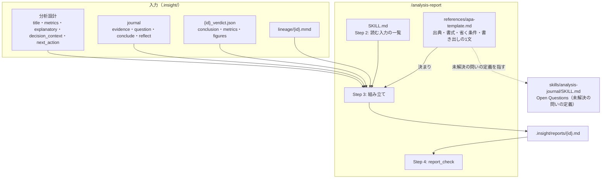
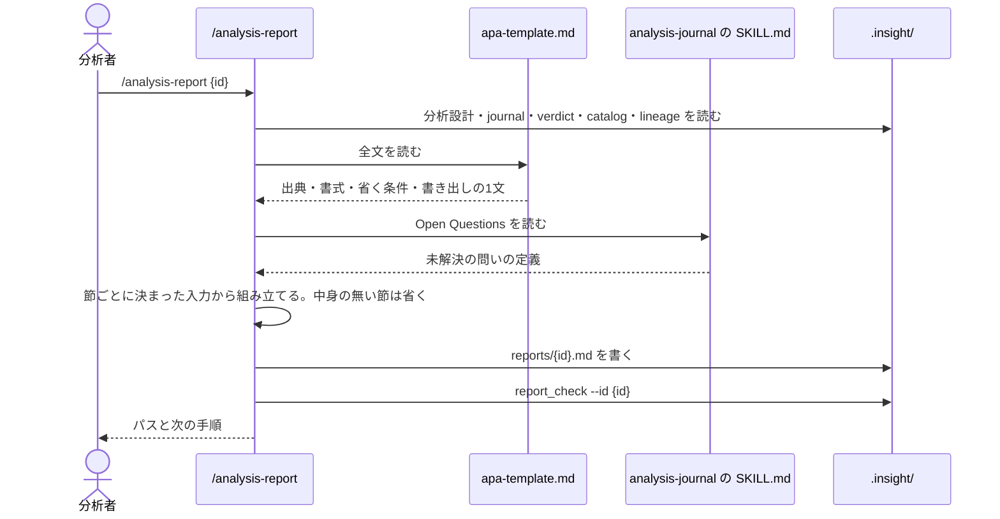

# Epic 14: レポートのテンプレートに書いていない所を決める

## Background

本書がこの Epic の要求と背景の正本（[FLOW-0001](../adr/flow/0001-designdoc-owns-requirements.md)）。
Epic issue（[#76](https://github.com/etoyama/insight-blueprint-skills/issues/76)）には要約と本書へのリンクだけを置く。

- 解く課題: 同じ分析から、モデルや実行のたびに違う形のレポートができる。レポートは意思決定者が読むので、形が揃わないと比べにくい。
  `/analysis-report` のテンプレート（[apa-template.md](../../skills/analysis-report/references/apa-template.md)）に書いていない所を、モデルが自分で埋めている。
  - 課題1: どの入力をどの節に書くかが決まっていない所がある。verdict の `evidence_summary` と `open_questions` は SKILL.md が読むよう指示するが、
    テンプレートの対応表に行き先が無い。Future Directions の「次工程」には出典が無い。未解決の問いの見分け方を、レポートの側から参照していない。
  - 課題2: 書式が決まっていない所がある。Method の指標と説明変数の出し方、証拠の向き（`direction`）の書き方、数値表の `Pass` の `false` の書き方、
    行数の表の `Change` の単位。信頼区間の水準を「95%」と書くのが、数を計算しない決まりに当たるかも書いていない。
  - 課題3: 中身が無いときの扱いが決まっていない。Limitations と Future Directions が空のとき、モデルはテンプレートに無い文
    （「journal に未解決の問いは記録されていない。」など）を足した。
  - 課題4: 語り直す文の言い回しが揺れる。Abstract・Implications・Recommendation の言い回しは実行ごとに違い、
    Recommendation の言い切りの強さもモデルの解釈だった。Abstract と Limitations には `conclude` の同じ文が重なった。
  - 課題5: 定型文が事実と食い違う。verdict.json が無いときにも、図が無い理由を「notebook が図を生成していない」と書く。
- PRD の要件: [docs/PRD.md](../PRD.md) の機能要件「レポート」（結論の出た分析を配布用にまとめる）。
  レポートを読んで比べられることを足す。
- 既存手段が不十分な理由: どれも [Epic 10](epic-10-analysis-report.md) からある隙間である。
  [Epic 12](epic-12-decision-ready-report.md) の手動確認（2026-11-17）で、この作業を知らないサブエージェントに
  SKILL.md とテンプレートだけでレポートを3本書かせて見つけた（issue #76 の11項目）。
  [Epic 13](epic-13-report-source-text.md) の手動確認（2026-11-20）でも、同じ種類の隙間が4つ見つかった（`Change` の単位、`Pass` の書き方、記法を落としたことを分析者に言うか、語り直す文の揺れ）。
  構造テストはテンプレートに文があることまでしか見ず（[ADR-0010](../adr/0010-skill-tdd-structure-tests.md)）、書いていない所は誰も見ない。

## User Stories

AC の正本はここ。

### US-1: レポートの各部分の出典が1つに決まっている

意思決定者として、どのレポートでも同じ節に同じ種類の内容を読めるように、各部分がどの入力から来るかが決まっていてほしい。

- [x] AC 1: テンプレートは未解決の問いの見分け方として、journal の SKILL.md の「Open Questions」を指す。
  `conclude` の `metadata.resolves` は、id 1つでも id のリストでもよいと書く。
- [x] AC 2: レポートは verdict の `evidence_summary` と `open_questions` を読まない。SKILL.md の Step 2 から外し、
  テンプレートには、この2つが journal の `evidence` と `question` としてレポートに届くと書く。
- [x] AC 3: テンプレートの対応表に、`# {title}` の出典として分析設計の `title` の行がある。
- [x] AC 4: Future Directions の出典は未解決の問いだけである。骨組みと対応表から「次工程」を消す。
- [x] AC 5: 図が無いときの定型文は原因ごとに分かれる。verdict.json が無いときに「notebook が図を生成していない」と書かない。

### US-2: 表と数の書式が1つに決まっている

意思決定者として、レポートどうしを並べて比べられるように、表と数の書式が実行ごとに変わらないでほしい。

- [x] AC 1: Method に指標の表（`target`・`tier`・`aggregation`・`grouping`・`filter`・`comparison`）と
  説明変数の表（`name`・`role`・`description`・`time_points`）がある。どの行にも値が無い列は省き、一部の行だけに無い値は `—` と書く。
  リストが空なら表を省き、注記を足さない。セルはテンプレートの「Source text」の手順で写す。データソースの列は置かない（issue #71）。
- [x] AC 2: 信頼区間の `level` を百分率で書くのは表示の形で、計算ではないと書く。
- [x] AC 3: 数値表の `Pass` は、`pass` が `true` なら `✓`、`false` なら `✗`、無ければ `—` と書く。
- [x] AC 4: 行数の表の `Change` は符号つきの数だけを書き、`rows` を書かない。
- [x] AC 5: Results は `evidence` を「仮説を支持する証拠」と「仮説に反する証拠」の2つの組に分けて並べ、`direction` の値をそのまま書かない。
  組の名前は太字の行にする（見出しにすると、あとに続く数値表と図がその下に入る）。片方が無ければ、その組を省く。

### US-3: 結論を言う文と Discussion の書き方が揺れない

意思決定者として、どのレポートでも最初の数文で結論と推奨を同じように読み取れるように、語り直す文の書き出しと Discussion の書き方が決まっていてほしい。

- [x] AC 1: Abstract は terminal status ごとに決まった1文で始まる（3通り）。
- [x] AC 2: Recommendation は書き方の表の行ごとに決まった最初の1文を持つ。
- [x] AC 3: Limitations は `conclude` と `reflect` の文のうち限界と前提を述べた部分と、結論に反する証拠から書く。
  Abstract に置いた文を Limitations で繰り返さない。
- [x] AC 4: Limitations と Future Directions は、中身が無ければ見出しごと省き、注記を足さない。
- [x] AC 5: 語り直す文から記法を落としたことを、分析者に言わない。テンプレートにそう書く。

## Stories

| Story issue | User Story | 扱う AC |
|---|---|---|
| [#90](https://github.com/etoyama/insight-blueprint-skills/issues/90) | US-1 | AC 1〜5 |
| [#91](https://github.com/etoyama/insight-blueprint-skills/issues/91) | US-2 | AC 1〜5 |
| [#92](https://github.com/etoyama/insight-blueprint-skills/issues/92) | US-3 | AC 1〜5 |

## Ubiquitous Language

- 追加: 未解決の問い

## Scope

[docs/PRD.md](../PRD.md) の機能要件「レポート」と、[docs/ARCHITECTURE.md](../ARCHITECTURE.md) の Skill layer（`/analysis-report`）を前進させる。

- Epic 範囲内:
  - `apa-template.md` に、出典・書式・省く条件・書き出しの1文の決まりを足す。
  - `/analysis-report` の SKILL.md の Step 2 から、読まない入力を外す。
  - `report_check` のテスト（`tests/test_report_check.py` の `CLEAN_REPORT`）を、テンプレートの新しい形に合わせる。
- Epic 範囲外:
  - 未登録の id で `catalog_io get` が何を返すか（issue #76 の項目6）と、Method のデータソースの書き方（項目5のうちデータソースの部分）。
    issue #71 に委ねる。#71 が分析設計の形を変えると、Method のデータソースの書き方も変わる（判断12、2026-11-20）。
  - journal の形の変更。限界を述べる専用の項目を `conclude` に足せば Limitations を機械的に切り出せるが、
    journal と `/analysis-reflection` の契約が変わる。
  - Implications の書き出しの定型化。Implications は解釈の節で、定型にすると中身を縛る。
  - bin ラッパーの前置きの写し（issue #88）。

## Architecture

決まりはテンプレートが持ち、SKILL.md は言い直さない（Epic 12 の Decision `template-owns-the-report-rules`）。
未解決の問いの定義は journal の SKILL.md が持ち、テンプレートはそこを指す。

## Domain Model

変更なし。`src/insight_blueprint/models/` と `skills/_shared/models.py` のクラスは変えない。全体図は
[docs/ARCHITECTURE.md の「Domain Model」](../ARCHITECTURE.md#domain-model) にある（[ADR-0011](../adr/0011-domain-model-overview-in-architecture.md)）。

Python のクラスを持たないファイルの契約は、図に描かず表で示す（同じ ADR）。

| ファイル | 変更 | 形の正本 |
|---|---|---|
| `.insight/reports/{id}.md` | Method に指標と説明変数の表が載る。Results の証拠が向きで分かれる。Abstract と Recommendation が決まった1文で始まる。Limitations と Future Directions は空なら省く | [apa-template.md](../../skills/analysis-report/references/apa-template.md) |

## Sequence Diagram

`report_check` の流れは Epic 13 から変えない。

## Decisions

### Decision: promote-issue-76-to-epic

- What: issue #76 を Epic issue にし（`type:epic`、本文は要約と本書へのリンク）、Story を3本に分ける。
  issue #76 の項目6と、項目5のうちデータソースの部分は issue #71 に回す。
- Why: レポートに載る文が変わるので、単発の PR では扱えない（[ADR-0012](../adr/0012-single-pr-scope.md)）。
  #71 が分析設計の形を変えると Method のデータソースの書き方も変わるので、先に固めると書き直しになる。
- Criteria: 振る舞いの変更が DesignDoc を伴うこと（Must、ADR-0012）。意思決定者が受け取るレポートの形のばらつきを止めること（Want、高、人間）。
  決め手は2つ目。2026-11-20 に人間が決めた（判断12）。Epic issue の形は Epic 13 の Decision `promote-issue-75-to-epic` と揃えた（2026-11-20 に人間が選んだ）。
- Affected modules: なし（進め方）
- Alternatives considered: 新しい Epic issue を起票する案（#76 と役割がだぶる）。
- Consequences: issue #76 の元の本文は本書の Background に移した。

### Decision: fix-the-lead-sentences

- What: 一意に決まる項目と Method の表に加えて、Abstract と Recommendation の最初の1文を定型にする。Implications は定型にしない。
- Why: 揃えたいのは、意思決定者が最初に読む文である。節の構成と表だけを揃えても、結論を言う1文の言い回しと強さは揺れる（課題4）。
- Criteria: テンプレートに無い文がレポートに入らないこと（Must、課題3）。実行ごとの形の揺れが減ること（Want、高、人間）。
  決まりが増えて、テンプレートを読むモデルの負担が増えること（Want、中、Claude の推測）。
  決め手は2つ目。2026-11-20 に人間が選んだ。
- Affected modules: `apa-template.md`
- Alternatives considered: 食い違いだけを直す案（Limitations と Method の隙間が残り、Must を満たさない）。
  表と省く条件だけを決め、語り直す文は自由にする案（結論を言う1文が揺れたまま）。
- Consequences: 定型の文は日本語で書く。本文の言語が日本語でないときは、同じ意味の1文をその言語で書く。

### Decision: method-tables-show-every-item

- What: Method の指標と説明変数の表に、データソースを除く全項目を出す。どの行にも値が無い列は省く。
- Why: `filter` と `grouping` が無いと、結果がどの対象についてのものかを意思決定者が読み取れない。
- Criteria: 意思決定者が結果の範囲を読み取れること（Want、中、Claude の推測）。表の幅（Want、低、Claude の推測）。
  決め手は1つ目。2026-11-20 に人間が選んだ。
- Affected modules: `apa-template.md`
- Alternatives considered: 最小の列（指標・優先度・集計 / 変数・役割・説明）だけを出す案。
- Consequences: 項目の多い分析設計では表が横に長くなる。空の列は省くので、項目の少ない分析設計では狭いまま。

### Decision: future-directions-from-open-questions-only

- What: Future Directions は未解決の問いだけから書く。骨組みの「次工程」を消す。
- Why: 「次工程」には出典が無い。出典の無い節は、モデルが文を作るか、書かないかで揺れる。
- Criteria: 出典の無い文を書かないこと（Must、課題1）。読む人が次に何を調べるかを知れること（Want、中、Claude の推測）。
  2026-11-20 に人間が選んだ。
- Affected modules: `apa-template.md`
- Alternatives considered: journal の `branch` イベント（派生した仮説とその理由）も載せる案。必要になってから足せる（YAGNI）。
- Consequences: 派生した分析設計はレポートに載らない。

### Decision: no-space-around-fields

- What: 定型の文は、差し込む値の前後に空白を置かない。Epic 12 から載っている Introduction の決定の文脈の文
  （「この分析は、{decision_maker}が{decision}を決めるための材料である。」）も同じ形に直す。
- Why: 手動確認（2026-11-20）で、テンプレートの空白を sonnet は残し、haiku は落とした。同じ分析から2つの形ができた。
- Criteria: 実行ごとの形の揺れが減ること（Want、高、人間）。日本語の文として読めること（Want、中、Claude の推測）。決め手は1つ目。
  人間が選んだ範囲（Decision `fix-the-lead-sentences`）の中を詰める直しと判断した。Epic PR の説明でも人間に確かめる。
- Affected modules: `apa-template.md`、`tests/test_report_check.py` の `CLEAN_REPORT`
- Alternatives considered: 空白を残し、「テンプレートの字のまま書く」とだけ足す案。差し込んだ値の区切りは見やすいが、日本語の文として不自然で、モデルが落としたくなる形が残る。
- Consequences: 差し込む値が英字で終わるときも空白は入らない。

### Decision: limits-only-in-limitations

- What: `conclude` の文が結果と限界を両方述べるとき、Abstract は結果だけを語り直し、限界は Limitations だけに書く。
  `inconclusive` のときは、結論に反する証拠は無いものとする。向きの無い `evidence` は、`observe` のあとに journal の順で語り直す。
- Why: 手動確認（2026-11-20）で、sonnet が限界の文を Abstract と Limitations の両方に書いた。
  `inconclusive` の Limitations と、向きの無い証拠の順番では、2つのモデルが「書いていないので自分で決めた」と報告した。
- Criteria: AC（US-3 AC 3、US-2 AC 5）を一意に読めること（Must）。
- Affected modules: `apa-template.md`
- Alternatives considered: なし（AC の読み方を1つにするだけ）。
- Consequences: なし。

### Cross-epic decisions (links to ADR)

なし（今の時点）。

## Test Design Matrix

| Story \ Layer | Unit | Integration | E2E |
|---|---|---|---|
| US-1 出典 | ✓（`tests/skills/test_analysis_report_structure.py`: `TestSourceOfEachPart`） | —（組み立てるのはモデルで、Python の境界が無い。手動確認を Story Timeline に残す） | —（headless 実行の E2E は ADR-0010 で必須にしていない） |
| US-2 書式 | ✓（同: `TestFormatOfTablesAndNumbers`、`TestSourceText` の写す入力の一覧。`tests/test_report_check.py` の `CLEAN_REPORT` を新しい形に合わせた） | —（同上） | —（同上） |
| US-3 書き出しと Discussion | ✓（同: `TestLeadSentencesAndDiscussion`） | —（同上） | —（同上） |

完了時に ✓ を付ける。自動テストがない層には「—（理由）」を書く（[ADR-0010](../adr/0010-skill-tdd-structure-tests.md)）。

## Story Timeline

- 2026-11-20 — 人間が進め方と中身を決めた。issue #76 を Epic にし、項目6と Method のデータソースの書き方は #71 に回す（判断12）。
  語り直す文は Abstract と Recommendation の書き出しだけを定型にする。Method の表は全項目、Future Directions は未解決の問いだけ。
- 2026-11-20 — DesignDoc 初版。issue #76 を Epic にし、Story を起票した（#90・#91・#92）。
- 2026-11-20 — Story #90・#91・#92 completed: テンプレートに出典・書式・省く条件・書き出しの1文を足した。構造テストを先に Red にした。
- 2026-11-20 — 手動確認（US-1・US-2・US-3）: 合成データの `.insight/` に、結論の出た分析を3つ作った。
  supported（決定の文脈と `next_action` あり、両方の向きの証拠と向きの無い証拠、`resolves` はリスト、未解決の問い1件、限界を述べた `reflect`、図、lineage）、
  rejected（決定の文脈だけ、説明変数なし、verdict.json なし、`resolves` は id 1つ）、inconclusive（決定の文脈も `next_action` もなし、指標なし、`figures == []`）。
  この作業を知らないサブエージェント2つ（sonnet と haiku）に、SKILL.md のパスと `.insight/` だけを渡し、3本ずつ書かせた。plugin として起動した確認ではなく、コマンドは `bin/` のパスで呼ばせた。
  - 1回目: 見出し・表・定型の文は2本でほぼ揃った。割れたのは、定型の文の差し込みの前後の空白（sonnet は残し、haiku は落とした）と、
    限界の文を Abstract にも書くか（sonnet は両方に書いた）。`inconclusive` の Limitations と、向きの無い証拠の順番は、2本とも「書いていない」と報告した。
    haiku は骨組みの題の行の注記を、題を2回書く指示と読みかけた。テンプレートを直した（Decision `no-space-around-fields`、`limits-only-in-limitations`）。
  - 2回目（直したあと、新しいサブエージェント2つ）: 3本とも、見出し・表・太字の行・箇条書き・引用の行が2本で1行ずつ同じだった。
    Abstract・Introduction の決定の文脈・Recommendation の書き出しの文も同じだった。`report_check` は6本とも違反なし。`connection` の値と絶対パスはどのレポートにも載らなかった。
  - 残った揺れ: 語り直す文の言い回し（Introduction、Method の叙述、Implications、Recommendation の2文目以降）。Abstract に効果量を足すかもモデルで違った。
    どれも Decision `fix-the-lead-sentences` でモデルに任せた所である。sonnet は Implications に「区間は0を含まない」と書いた。数を計算しない決まりとの境目にあり、直していない。
  - 確かめていないこと: fable と opus での結果。plugin として入れた先での起動。Claude Docs での見え方（アップロードしていない）。
