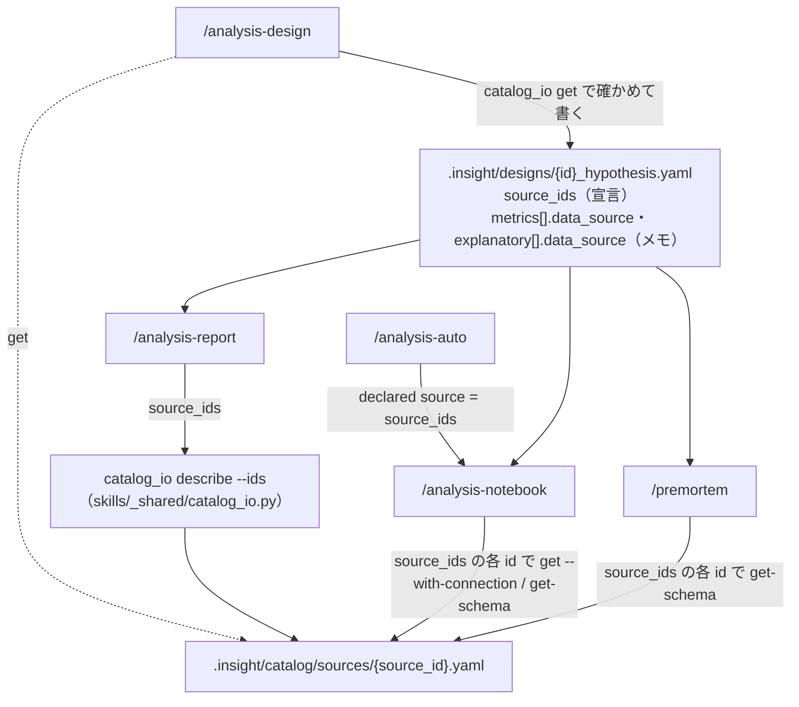
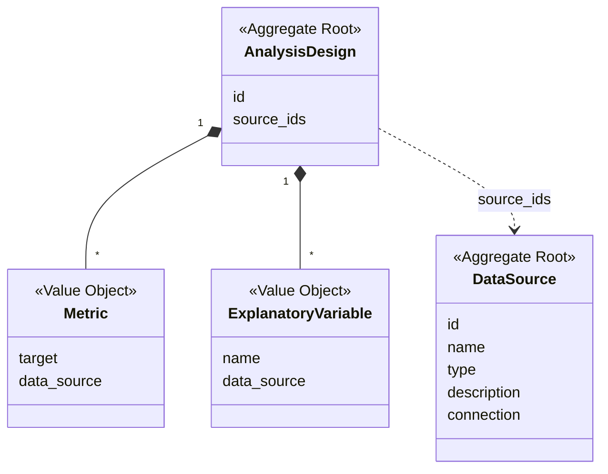
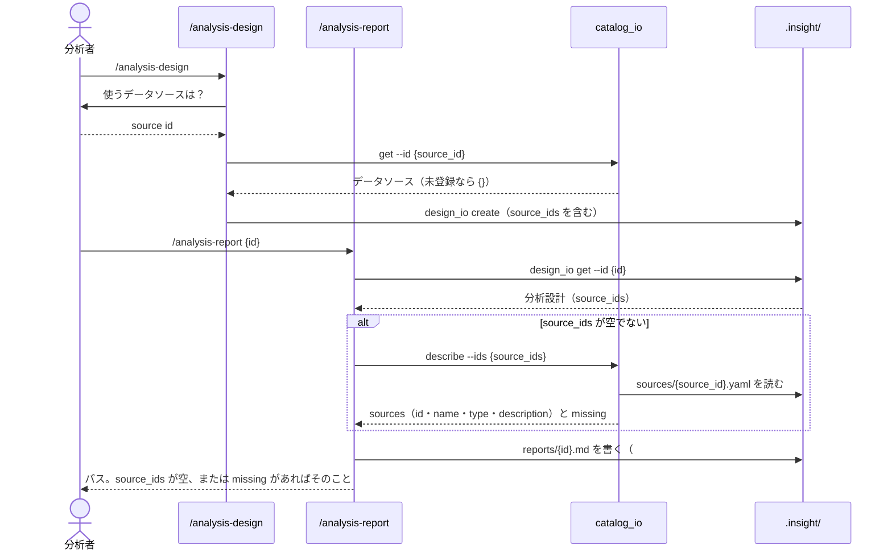

# Epic 15: 分析設計が使うデータソースを source_ids に宣言する

## Background

本書がこの Epic の要求と背景の正本（[FLOW-0001](../adr/flow/0001-designdoc-owns-requirements.md)）。
Epic issue（[#71](https://github.com/etoyama/insight-blueprint-skills/issues/71)）には要約と本書へのリンクだけを置く。

- 解く課題: 分析設計が使うデータソースを宣言する場所が無い。
  - 課題1: 分析設計の `source_ids` はどの skill も書かない。指標と説明変数の `data_source` は型の無い値で、
    指標では辞書、説明変数では文字列であり、id でない文字列も入る。それでも `/analysis-report`・`/analysis-notebook`・`/premortem`・`/analysis-auto` の4つは、
    分析設計が宣言したデータソースを前提にしている。どの項目から読むかを書いた skill は無い。
    Epic 12 の Story #65 は `/analysis-report` に両方を読ませて回避した（[epic-12](epic-12-decision-ready-report.md) の Decision `report-data-source-candidates`）。
    放置すると、後の skill が同じ回避を重ねる。
  - 課題2: `/analysis-report` がデータソースを集める手順（候補を集める、id を検査する、catalog に聞く、重複を除く、`name`・`type`・`description` だけを取る）は、
    入力が決まれば出力が決まる処理である。それなのに LLM 向けの文で書いてあり、守っているのは文と構造テストだけである。
  - 課題3: Method でのデータソースの書き方が決まっていない。Epic 14 は指標と説明変数の表にデータソースの列を置かなかった。
    手動確認では、指標の `data_source: {}` と説明変数の `data_source: ""` の扱いでモデルが迷った（issue #71 のコメント）。
  - 課題4: 未登録の id で `catalog_io get` が `{}` を返し、終了コードが 0 であることを、どの文書も書いていない（issue #76 の項目6）。
- PRD の要件: [docs/PRD.md](../PRD.md) の機能要件「分析設計」と「レポート」。分析設計からレポートまで、データソースを同じ場所から読めるようにする。
- 既存手段が不十分な理由: `source_ids` は model と `design_io create` の引数にはあるが、skill の手順に出てこない。
  `data_source` を id として読むと、分析に使っていないデータソースを拾うことがある。

## User Stories

AC の正本はここ。

### US-1: 分析者が、使うデータソースを分析設計に宣言できる

分析者として、下流の skill が同じデータソースを使うように、分析設計を作るときに使うデータソースを1か所に宣言したい。

- [ ] AC 1: `/analysis-design` の項目の表に `source_ids` がある。catalog に登録済みのデータソースの id のリストである。
- [ ] AC 2: `/analysis-design` は使うデータソースを聞き、`catalog_io get` で登録を確かめてから `source_ids` に書く。
  未登録なら `/catalog-register` を案内し、その id を書かない。
- [ ] AC 3: `/analysis-design` は `data_source` を、指標や説明変数の値をデータソースのどこから取るかを書くメモとして説明する。id は `source_ids` に書く。
- [ ] AC 4: `/analysis-design` の Step 2.6（コードの型）は `source_ids` の各 id から catalog のスキーマを引く。

### US-2: レポートが、宣言したデータソースだけを載せる

意思決定者として、分析が何のデータに基づくかを読めるように、レポートには分析設計が宣言したデータソースが載ってほしい。

- [ ] AC 1: `catalog_io describe --ids a,b` は、登録済みのデータソースの `id`・`name`・`type`・`description` を、渡した順で重複なく返す。
  未登録の id と id の形でない値は `missing` に分けて返す。`connection` は返さない。unit test で確かめる。
- [ ] AC 2: `/analysis-report` は `source_ids` だけを読み、`catalog_io describe` に渡す。`data_source` は読まない。
- [ ] AC 3: `source_ids` が空なら、データソースの表を省き、`design_io update` で足せることを分析者に伝える。
  `missing` があれば表に載せず、どの id が未登録かを分析者に伝える。
- [ ] AC 4: Method の指標と説明変数の表には、データソースの列を置かない。テンプレートにその理由（`data_source` は id でないメモ）を書く。
- [ ] AC 5: `/analysis-report` の「catalog_io Reference」に、未登録の id で `catalog_io get` が `{}`・終了コード 0 を返すことを書く。

### US-3: 下流の skill が、同じ場所からデータソースを読む

分析者として、notebook・premortem・自動実行が同じデータソースを扱うように、どの skill も `source_ids` からデータソースを読んでほしい。

- [ ] AC 1: `/analysis-notebook` は `source_ids` の各 id について `catalog_io get --with-connection` と `get-schema` を呼ぶ。
  `source_ids` が空なら止まり、`/analysis-design` で宣言するよう案内する。
- [ ] AC 2: `/premortem` は `source_ids` の各 id から `source_checks_map` を作る。
- [ ] AC 3: `/analysis-auto` の「declared source(s)」は `source_ids` を指す。

## Stories

| Story issue | User Story | 扱う AC |
|---|---|---|
| （起票前） | US-1 | AC 1〜4 |
| （起票前） | US-2 | AC 1〜5 |
| （起票前） | US-3 | AC 1〜3 |

## Ubiquitous Language

- 変更: データソース（コード上の名前に `source_ids` を足す。分析設計が宣言する、使うデータソースの id のリスト）

## Scope

[docs/PRD.md](../PRD.md) の機能要件「分析設計」「レポート」と、[docs/ARCHITECTURE.md](../ARCHITECTURE.md) の Skill layer と `skills/_shared/catalog_io.py` を前進させる。

- Epic 範囲内:
  - `/analysis-design`・`/analysis-report`・`/analysis-notebook`・`/premortem`・`/analysis-auto` の SKILL.md と、レポートのテンプレート。
  - `catalog_io describe` の追加と、その unit test。
  - ADR（データソースの宣言の場所と、`catalog_io describe` の契約）。
- Epic 範囲外:
  - model（`src/insight_blueprint/models/design.py`）の変更。`source_ids` も `data_source` も今の形のまま使う。PyPI の wheel の契約は変わらない。
  - 既存の分析設計の移行。`source_ids` が空の分析設計は、分析者が `design_io update` で足す（人間の判断、2026-11-20）。
  - `source_ids` と `data_source` の食い違いを機械で見つけること。
  - `catalog_io get` の振る舞いの変更。未登録の id で `{}` を返すことは文書に書くだけで、変えない。
  - bin ラッパーの前置きの写し（issue #88）。

## Architecture

下流の skill は `source_ids` だけを読む。`data_source` を id として読む skill は無くなる。

## Domain Model

model のクラスは変えない。`AnalysisDesign` と `DataSource` の関係は、[docs/ARCHITECTURE.md の「Domain Model」](../ARCHITECTURE.md#domain-model) が
もう `source_ids` で描いている。この Epic は skill の振る舞いをその関係に合わせる。関係する部分だけを描く。

| 型 | 種類 | 不変条件 |
|---|---|---|
| `AnalysisDesign.source_ids` | 値（id のリスト） | 分析設計が使うデータソースの宣言はここだけにある。型では縛らず、`/analysis-design` が登録済みの id だけを書く |
| `Metric.data_source`・`ExplanatoryVariable.data_source` | 値（メモ） | どの skill も id として読まない |

Python のクラスを持たない契約は表で示す（[ADR-0011](../adr/0011-domain-model-overview-in-architecture.md)）。

| 契約 | 変更 | 形の正本 |
|---|---|---|
| `catalog_io describe --ids` の出力 | 追加。`{"sources": [{"id", "name", "type", "description"}], "missing": [id]}` | `skills/_shared/catalog_io.py` と ADR |

## Sequence Diagram

`/analysis-notebook` と `/premortem` は `describe` を使わない。前者は `connection` が要り、後者はスキーマが要るので、今のとおり id ごとに `get` と `get-schema` を呼ぶ。

## Decisions

### Decision: promote-issue-71-to-epic

- What: issue #71 を Epic issue にする。Story を3本に分ける。
- Why: 分析設計の skill の振る舞いが変わるので、単発の PR では扱えない（[ADR-0012](../adr/0012-single-pr-scope.md)）。
- Criteria: 振る舞いの変更が DesignDoc を伴うこと（Must、ADR-0012）。2026-11-20 に人間が決めた（判断13）。
- Affected modules: なし（進め方）
- Alternatives considered: 新しい Epic issue を起票する案。
- Consequences: issue #71 の元の本文は本書の Background に移した。

### Cross-epic decisions (links to ADR)

- ADR-0020（Story US-1 で書く）: 分析設計が使うデータソースは `source_ids` に宣言する。

## Test Design Matrix

| Story \ Layer | Unit | Integration | E2E |
|---|---|---|---|
| US-1 宣言 | ☐ | ☐ | ☐ |
| US-2 レポート | ☐ | ☐ | ☐ |
| US-3 下流の skill | ☐ | ☐ | ☐ |

## Story Timeline

- 2026-11-20 — 人間が出典を決めた。分析設計が使うデータソースは `source_ids` に宣言し、`data_source` は id として読まない。
  `source_ids` が空の既存の分析設計からは拾わない（案 A1）。
