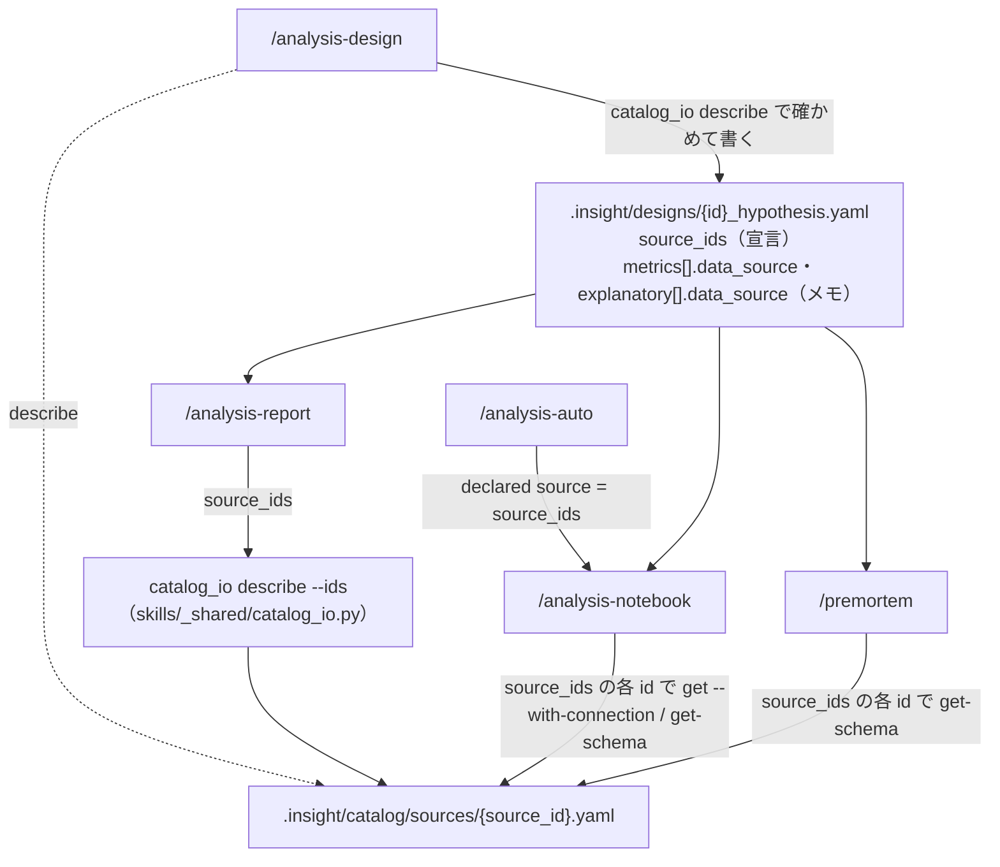
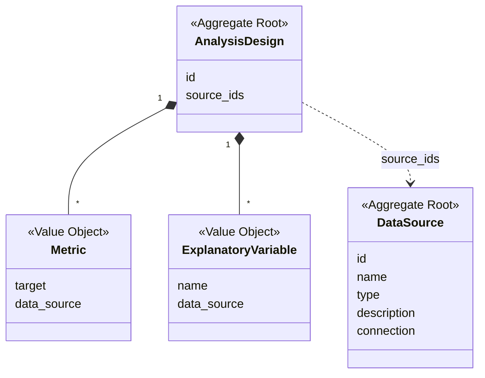
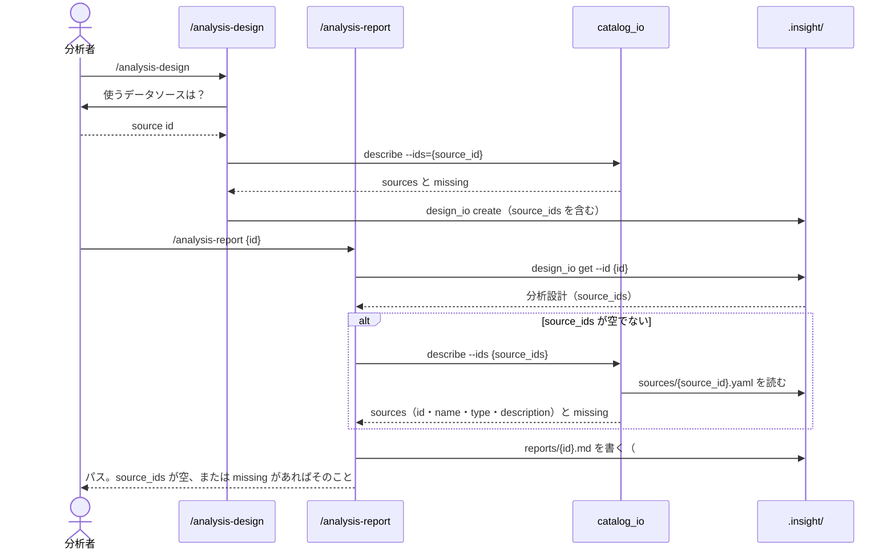

# Epic 15: 分析設計が使うデータソースを source_ids に宣言する

## Background

本書がこの Epic の要求と背景の正本（[FLOW-0001](../adr/flow/0001-designdoc-owns-requirements.md)）。
Epic issue（[#71](https://github.com/etoyama/insight-blueprint-skills/issues/71)）には要約と本書へのリンクだけを置く。

- 解く課題: 分析設計が使うデータソースを宣言する場所が無い。
  - 課題1: 分析設計の `source_ids` はどの skill も書かない。指標と説明変数の `data_source` は型の無い値で、
    指標では辞書、説明変数では文字列であり、id でない文字列も入る。それでも `/analysis-report`・`/analysis-notebook`・`/premortem`・`/analysis-auto` の4つは、
    分析設計が宣言したデータソースを前提にしている。どの項目から読むかを書いた skill は無い。
    Epic 12 の Story #65 は `/analysis-report` に両方を読ませて回避した（[epic-12](epic-12-decision-ready-report.md) の Decision `report-data-source-candidates`）。
    放置すると、後の skill が同じ回避を重ねる。
  - 課題2: `/analysis-report` がデータソースを集める手順（候補を集める、id を検査する、catalog に聞く、重複を除く、`name`・`type`・`description` だけを取る）は、
    入力が決まれば出力が決まる処理である。それなのに LLM 向けの文で書いてあり、守っているのは文と構造テストだけである。
  - 課題3: Method でのデータソースの書き方が決まっていない。Epic 14 は指標と説明変数の表にデータソースの列を置かなかった。
    手動確認では、指標の `data_source: {}` と説明変数の `data_source: ""` の扱いでモデルが迷った（issue #71 のコメント）。
  - 課題4: 未登録の id で `catalog_io get` が `{}` を返し、終了コードが 0 であることを、どの文書も書いていない（issue #76 の項目6）。
- PRD の要件: [docs/PRD.md](../PRD.md) の機能要件「分析設計」と「レポート」。分析設計からレポートまで、データソースを同じ場所から読めるようにする。
- 既存手段が不十分な理由: `source_ids` は model と `design_io create` の引数にはあるが、skill の手順に出てこない。
  `data_source` を id として読むと、分析に使っていないデータソースを拾うことがある。

## User Stories

AC の正本はここ。

### US-1: 分析者が、使うデータソースを分析設計に宣言できる

分析者として、下流の skill が同じデータソースを使うように、分析設計を作るときに使うデータソースを1か所に宣言したい。

- [x] AC 1: `/analysis-design` の項目の表に `source_ids` がある。catalog に登録済みのデータソースの id のリストである。
- [x] AC 2: `/analysis-design` は使うデータソースを聞き、`catalog_io describe` で登録を確かめてから `source_ids` に書く。
  未登録なら `/catalog-register` を案内し、その id を書かない。
- [x] AC 3: `/analysis-design` は `data_source` を、指標や説明変数の値をデータソースのどこから取るかを書くメモとして説明する。id は `source_ids` に書く。
- [x] AC 4: `/analysis-design` の Step 2.6（コードの型）は `source_ids` の各 id から catalog のスキーマを引く。

### US-2: レポートが、宣言したデータソースだけを載せる

意思決定者として、分析が何のデータに基づくかを読めるように、レポートには分析設計が宣言したデータソースが載ってほしい。

- [x] AC 1: `catalog_io describe --ids a,b` は、登録済みのデータソースの `id`・`name`・`type`・`description` を、渡した順で重複なく返す。
  未登録の id と id の形でない値は `missing` に分けて返す。`connection` は返さない。unit test で確かめる。
- [x] AC 2: `/analysis-report` は `source_ids` だけを読み、`catalog_io describe` に渡す。`data_source` は読まない。
- [x] AC 3: `source_ids` が空なら、データソースの表を省き、`/analysis-design` で足せることを分析者に伝える。
  `missing` があれば表に載せず、どの id が未登録かを分析者に伝える。
- [x] AC 4: Method の指標と説明変数の表には、データソースの列を置かない。テンプレートにその理由（`data_source` は id でないメモ）を書く。
- [x] AC 5: `/catalog-register` の「catalog_io Reference」に、未登録の id で `catalog_io get` が `{}`・終了コード 0 を返すことを書く。

### US-3: 下流の skill が、同じ場所からデータソースを読む

分析者として、notebook・premortem・自動実行が同じデータソースを扱うように、どの skill も `source_ids` からデータソースを読んでほしい。

- [x] AC 1: `/analysis-notebook` は `source_ids` の各 id について `catalog_io get --with-connection` と `get-schema` を呼ぶ。
  `source_ids` が空なら止まり、`/analysis-design` で宣言するよう案内する。
- [x] AC 2: `/premortem` は `source_ids` の各 id から `source_checks_map` を作る。
- [x] AC 3: `/analysis-auto` の「declared source(s)」は `source_ids` を指す。

## Stories

| Story issue | User Story | 扱う AC |
|---|---|---|
| [#97](https://github.com/etoyama/insight-blueprint-skills/issues/97) | US-1 | AC 1〜4 |
| [#98](https://github.com/etoyama/insight-blueprint-skills/issues/98) | US-2 | AC 1〜5 |
| [#99](https://github.com/etoyama/insight-blueprint-skills/issues/99) | US-3 | AC 1〜3 |

## Ubiquitous Language

- 変更: データソース（コード上の名前に `source_ids` を足す。分析設計が宣言する、使うデータソースの id のリスト）

## Scope

[docs/PRD.md](../PRD.md) の機能要件「分析設計」「レポート」と、[docs/ARCHITECTURE.md](../ARCHITECTURE.md) の Skill layer と `skills/_shared/catalog_io.py` を前進させる。

- Epic 範囲内:
  - `/analysis-design`・`/analysis-report`・`/analysis-notebook`・`/premortem`・`/analysis-auto` の SKILL.md と、レポートのテンプレート。
  - `catalog_io describe` の追加と、その unit test。
  - ADR（データソースの宣言の場所と、`catalog_io describe` の契約）。
- Epic 範囲外:
  - model（`src/insight_blueprint/models/design.py`）の変更。`source_ids` も `data_source` も今の形のまま使う。PyPI の wheel の契約は変わらない。
  - 既存の分析設計の移行。`source_ids` が空の分析設計は、分析者が `design_io update` で足す（人間の判断、2026-11-20）。
  - `source_ids` と `data_source` の食い違いを機械で見つけること。
  - `catalog_io get` の振る舞いの変更。未登録の id で `{}` を返すことは文書に書くだけで、変えない。
  - bin ラッパーの前置きの写し（issue #88）。

## Architecture

下流の skill は `source_ids` だけを読む。`data_source` を id として読む skill は無くなる。

## Domain Model

model のクラスは変えない。`AnalysisDesign` と `DataSource` の関係は、[docs/ARCHITECTURE.md の「Domain Model」](../ARCHITECTURE.md#domain-model) が
もう `source_ids` で描いている。この Epic は skill の振る舞いをその関係に合わせる。関係する部分だけを描く。

| 型 | 種類 | 不変条件 |
|---|---|---|
| `AnalysisDesign.source_ids` | 値（id のリスト） | 分析設計が使うデータソースの宣言はここだけにある。型では縛らず、`/analysis-design` が登録済みの id だけを書く |
| `Metric.data_source`・`ExplanatoryVariable.data_source` | 値（メモ） | どの skill も id として読まない |

Python のクラスを持たない契約は表で示す（[ADR-0011](../adr/0011-domain-model-overview-in-architecture.md)）。

| 契約 | 変更 | 形の正本 |
|---|---|---|
| `catalog_io describe --ids` の出力 | 追加。`{"sources": [{"id", "name", "type", "description"}], "missing": [id]}` | `skills/_shared/catalog_io.py` と ADR |

## Sequence Diagram

`/analysis-notebook` と `/premortem` は `describe` を使わない。前者は `connection` が要り、後者はスキーマが要るので、今のとおり id ごとに `get` と `get-schema` を呼ぶ。

## Decisions

### Decision: promote-issue-71-to-epic

- What: issue #71 を Epic issue にする。Story を3本に分ける。
- Why: 分析設計の skill の振る舞いが変わるので、単発の PR では扱えない（[ADR-0012](../adr/0012-single-pr-scope.md)）。
- Criteria: 振る舞いの変更が DesignDoc を伴うこと（Must、ADR-0012）。2026-11-20 に人間が決めた（判断13）。
- Affected modules: なし（進め方）
- Alternatives considered: 新しい Epic issue を起票する案。
- Consequences: issue #71 の元の本文は本書の Background に移した。

### Decision: describe-in-catalog-io

- What: レポートに載せるデータソースを集める手順を `catalog_io describe --ids` にする。`catalog_io` は分析設計を読まず、`source_ids` は呼ぶ skill が渡す。
  未登録の id と id の形でない値は、どちらも `missing` に入れる。
- Why: issue #71 のコメントが、出典が決まったら手順を `catalog_io` のコマンドに移すよう求めていた。
- Criteria: catalog と分析設計の境界を崩さないこと（Want、中、Claude の推測）。id の形でない値で例外を出さないこと（Must、`describe` は手で書いた `source_ids` も受ける）。
- Affected modules: `skills/_shared/catalog_io.py`、`/analysis-design`、`/analysis-report`、`/catalog-register`
- Alternatives considered: `design_io sources --id` として分析設計の側に置く案（`design_io` が catalog を読むことになる）。id の形でない値を別の欄に分ける案（`create_source` が通さないので登録はありえず、呼ぶ側の扱いは未登録と同じ）。
- Consequences: `/analysis-report` は `catalog_io get` を呼ばなくなった。`/analysis-design` も登録の確認に `describe` を使う。
  `get` は id の形でない値で非ゼロ終了するが、`describe` はそれを `missing` に入れるので、手順の分岐が1つで済む（`pstack:thermos` のレビュー、2026-11-20）。
  ids はコマンド行で `--ids=` の形で渡す。先頭が `-` の id（`SAFE_ID_PATTERN` が許す）も値として読まれる。
  呼ぶ skill は `^[a-zA-Z0-9_-]+$` に完全に一致する値だけをコマンド行に置く。分析設計はファイルで、外から来ることがあり、ほかの値はシェルの構文になりうる。
  `describe` は `--with-connection` を拒む。黙って無視するより、効かないことが利用者に見える。

### Decision: ac-changes-after-first-version

- What: 初版のあとで AC を3つ変えた。Epic PR の説明で人間に確かめる。
  - US-1 AC 2。変更前は「`catalog_io get` で登録を確かめてから」。変更後は「`catalog_io describe` で登録を確かめてから」（Decision `describe-in-catalog-io`）。
  - US-2 AC 3。変更前は「`design_io update` で足せることを分析者に伝える」。変更後は「`/analysis-design` で足せることを分析者に伝える」。
  - US-2 AC 5。変更前は「`/analysis-report` の「catalog_io Reference」に書く」。変更後は「`/catalog-register` の「catalog_io Reference」に書く」。
- Why: AC 3 については、`/analysis-report` は読むだけの skill で、構造テスト（`TestReadOnlyConsumer`）は本文に `design_io update` が出ることを許さない。分析者が使うのも CLI ではなく skill である。
  AC 5 については、`/analysis-report` が `catalog_io get` を呼ばなくなったため、その返り方を書く場所として合わない。`get` を一覧にしているのは `/catalog-register` の「catalog_io Reference」である。
- Criteria: AC が守りたいこと（分析者が直し方を知る、`get` の返り方が文書にある）を変えないこと（Must）。
- Affected modules: `/analysis-report`、`/catalog-register`
- Alternatives considered: AC のまま書き、構造テストの側を緩める案。読むだけの skill という保証が弱まる。
- Consequences: なし。

### Decision: premortem-blocks-empty-source-ids

- What: `skills/premortem/lib/risk_evaluator.py` は、`source_ids` が空か無い分析設計を `HARD_BLOCK` にする。理由は `no data source declared` である。
  `/premortem` は分析設計を `design_io get` が返したまま渡す。`/analysis-auto` は、この理由のとき `/analysis-design` で `source_ids` を足すよう案内し、
  `source not registered` のときは `/catalog-register` を案内する。複数のデータソースの確認は1つのエントリにまとめる（どれかが `false` なら `false`、`estimated_rows` は最大）。
- Why: `skills/premortem/cli.py` は、`source_checks_map` にエントリの無い分析設計を登録済みとみなす（`source_registered` の既定値が `True`）。
  何もしなければ、`source_ids` が空の分析設計は premortem を通り、notebook で初めて止まる。
  初めは SKILL.md の文で `source_registered: false` を書かせていたが、`pstack:thermos` のレビュー（2026-11-20）が2つの観点から指摘した。
  1つは、決まった手順を文に置くのは ADR-0020 の動機と逆であること。もう1つは、理由が `source not registered` と同じになり、`/analysis-auto` が案内先を選べないこと。
- Criteria: データに触れる前に止まること（Must、premortem の役目）。書き忘れても閉じる側に倒れること（Want、高、レビュー）。
- Affected modules: `skills/premortem/lib/risk_evaluator.py`、`/premortem`、`/analysis-auto`
- Alternatives considered: `cli.py` の既定値を `False` に変える案。payload を手で作る呼び手すべての振る舞いが変わる。SKILL.md の文で `false` を書かせる案（上の理由で落とした）。
- Consequences: v0.10.0 までに作った分析設計は、`source_ids` を足すまで premortem で `HARD_BLOCK` になる（ADR-0020 の Negative に同じ）。Epic PR の説明で人間に確かめる。

### Decision: existing-design-update-path

- What: `/analysis-design` の Step 0 に、既存の分析設計を変える入口（Step 3b へ進む）を足す。Step 3b は `source_ids` を変える前に Step 2 の「Data sources」と同じ確認をし、`source_ids` を丸ごと送る。
  `/analysis-notebook` は、状態を `analyzing` に変える前に `source_ids` が空かを見て止まる。
- Why: `source_ids` が空の分析設計は、どの skill からも `/analysis-design`（Step 3b）へ送られる。Step 0 が新規作成しか受けず、Step 3b が確認をしないと、重複した分析設計を作るか、未登録の id を書く。
  notebook は確認の前に状態を変えていたので、何も実行せずに `analyzing` になっていた。`pstack:thermos` のレビュー（2026-11-20）が指摘した。
- Criteria: 既存の分析設計の戻り道が手順として通ること（Must、ADR-0020 の案 A1）。
- Affected modules: `/analysis-design`、`/analysis-notebook`
- Alternatives considered: なし。
- Consequences: 複数のデータソースを notebook の cell 2 でどう読むか（結合するか、別々に読むか）は決めていない。モデルが手法から決める。

### Cross-epic decisions (links to ADR)

- [ADR-0020: 分析設計が使うデータソースは `source_ids` に宣言し、下流の skill はそこだけを読む](../adr/0020-design-declares-sources-in-source-ids.md)

## Test Design Matrix

| Story \ Layer | Unit | Integration | E2E |
|---|---|---|---|
| US-1 宣言 | ✓（`tests/skills/test_source_ids_structure.py`: `TestAnalysisDesignDeclaresTheSources`、`TestAnExistingDesignCanDeclareItsSources`） | —（聞き方はモデルが行い、Python の境界が無い。手動確認を Story Timeline に残す） | —（headless 実行の E2E は ADR-0010 で必須にしていない） |
| US-2 レポート | ✓（`tests/test_catalog_io.py`: `TestDescribe`。`test_analysis_report_structure.py`: `TestDataDescriptionInMethod`。`test_source_ids_structure.py`: `TestCatalogRegisterReference`） | ✓（`TestDescribe` の CLI のテストが、サブプロセスで `catalog_io describe` を動かし、`connection` が出ないことを確かめる） | —（同上） |
| US-3 下流の skill | ✓（`test_source_ids_structure.py`: `TestDownstreamSkillsReadSourceIds`。`tests/batch_harness/test_risk_evaluator.py`: 宣言の無い分析設計が `HARD_BLOCK` になる） | ✓（`tests/integration/test_premortem_report.py` の分析設計に `source_ids` を足し、`cli.py` 経由の判定が今までどおりであることを確かめる） | —（同上） |

完了時に ✓ を付ける。自動テストがない層には「—（理由）」を書く（[ADR-0010](../adr/0010-skill-tdd-structure-tests.md)）。

## Story Timeline

- 2026-11-20 — 人間が出典を決めた。分析設計が使うデータソースは `source_ids` に宣言し、`data_source` は id として読まない。
  `source_ids` が空の既存の分析設計からは拾わない（案 A1）。
- 2026-11-20 — DesignDoc 初版。issue #71 を Epic にし、Story を起票した（#97・#98・#99）。
- 2026-11-20 — Story #97・#98・#99 completed: `/analysis-design` が `source_ids` を書き、`catalog_io describe` を足し、
  `/analysis-report`・`/analysis-notebook`・`/premortem`・`/analysis-auto` が `source_ids` だけを読むようにした。構造テストと unit test を先に Red にした。
- 2026-11-20 — 手動確認（US-1・US-2）: 合成データの `.insight/` を作り、この作業を知らないサブエージェント（sonnet）2つに SKILL.md のパスだけを渡した。コマンドは `bin/` のパスで呼ばせた。
  - US-1: 台本の答えで `/analysis-design` を進めさせた。名前で答えた「月次売上」「店舗マスタ」は `catalog_io search` で id にし、`get` で確かめて `source_ids` に書いた。
    未登録の `weather_daily` は `{}` を見て `/catalog-register` を案内し、書かなかった。Step 2.6 は `source_ids` の各 id のスキーマを引いた。
  - US-2: 3本のレポートを書かせた。`source_ids` に重複がある分析設計（SALES-H01）では、`describe` が重複を除き、表は2行だった。
    未登録の id を持つ分析設計（SALES-H02）では、その id は表に載らず、分析者への知らせに出た。`source_ids` が空の旧形式の分析設計（LEGACY-H01）では、
    `describe` を呼ばずにデータソースの表を省き、`/analysis-design` で足せると知らせた。`data_source` の値はどれも読まなかった。
    `report_check` は3本とも違反なし。`connection` の値はどのレポートにも載らなかった（自分で `report_check` と `grep` を流して確かめた）。
  - 迷った所: 名前に「のデータ」が付くと `search` で見つからなかった。未登録のデータソースから取る説明変数の `data_source` に何を書くか。
    `source_ids` を渡す前に重複を除くか（`describe` が除くので結果は同じ）。どれも直していない。
  - 確かめていないこと: US-3（notebook・premortem・auto）は実行していない。構造テストだけである。plugin として入れた先での起動。sonnet 以外のモデル。
- 2026-11-20 — レビュー（`pstack:thermos`）: バグ・セキュリティとコード品質の2観点で Epic ブランチを見た。High はバグの観点では無く、コード品質の観点で2つ（premortem の空の `source_ids` を文で補っていること、`/analysis-design` が id ごとに `get` を呼ぶこと）。
  直したもの: premortem の判定をコードに移した。`/analysis-design` の確認を `describe` にした。レポートが `source_ids` の値を検査せずにコマンド行へ置く穴を塞いだ（id の形の値だけを `--ids=` で渡す）。
  既存の分析設計の戻り道（Step 0 と Step 3b）、notebook の確認の順番、`/analysis-auto` の data-extraction のビートと premortem の2つの理由、
  Typed Field Values の表が `design_io` がしない確認を約束していたこと、`describe` が `--with-connection` を黙って無視していたこと、
  `source_ids` が唯一の場所であることを5か所で言い直していたこと、template が `data_source` を読まないことを2回書いていたこと、
  レポートの構造テストの重複と、削除を見張るだけのテスト（Decision `describe-in-catalog-io`・`premortem-blocks-empty-source-ids`・`existing-design-update-path`）。
  直していないもの: `catalog_io get` が `{}` を返すことを `/catalog-register` に書いた行（US-2 AC 5 なので残した）。`describe` の戻り値を `TypedDict` にすること（呼び手が1つのため）。
- 2026-11-20 — 手動確認（レビューの直しのあと）: 新しい sonnet のサブエージェント2つで確かめた。
  - レポート: SALES-H02（未登録の id）、SALES-H03（`source_ids` に `bad id; echo PWNED > /tmp/pwned_epic15` を入れた）、LEGACY-H01（`source_ids` が空）。
    SALES-H03 では、id の形でない値をコマンド行に置かず `--ids=sales_monthly` だけを渡し、その値を分析者への知らせにだけ書いた。`/tmp/pwned_epic15` はできていない。
    LEGACY-H01 では `describe --ids=` を呼び、空の結果で表を省いた。`report_check` は3本とも違反なし。`connection` の値と不正な値はどのレポートにも載らなかった（自分で確かめた）。
  - 既存の分析設計の戻り道: 「LEGACY-H01 に使うデータソースを宣言したい」と頼ませた。Step 0 から Step 3b へ進み、`describe` で確かめ、未登録の `weather_daily` を除いて
    `source_ids: [sales_monthly, stores]` を書いた。状態は `inconclusive` のまま変わらなかった（YAML を自分で開いて確かめた）。
  - 迷った所: 数値表の `p` が verdict に無いときの書き方（Epic 14 の範囲）。`search` で見つからない値を id として `describe` に渡してよいか。更新のあとの Step 4 の案内。直していない。

