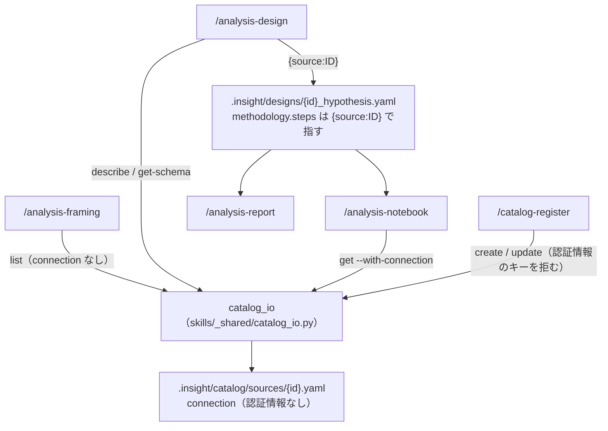
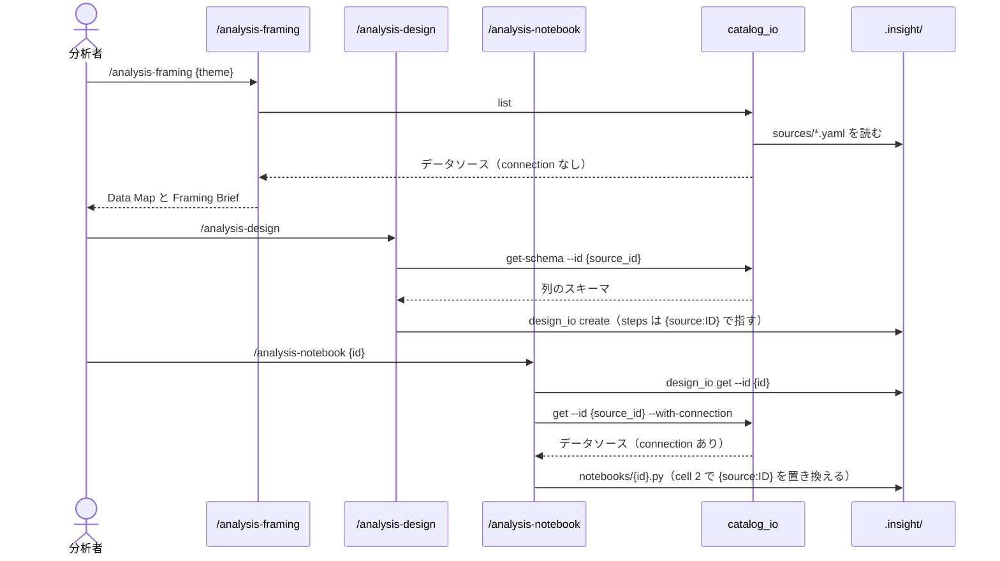

# Epic 16: 接続情報を notebook の外に出さず、認証情報を catalog に入れない

## Background

本書がこの Epic の要求と背景の正本（[FLOW-0001](../adr/flow/0001-designdoc-owns-requirements.md)）。
Epic issue（[#102](https://github.com/etoyama/insight-blueprint-skills/issues/102)）には要約と本書へのリンクだけを置く。

- 解く課題: データソースの `connection` が `catalog_io` を通らない経路でモデルの文脈に入り、分析設計とレポートの材料に流れる。
  - 課題1: `/analysis-framing` の Step 2b は catalog の YAML を Glob して Read するよう書いている。
    データソースは `.insight/catalog/sources/<id>.yaml` にあるので、この glob は何も拾わない。
    v0.10.0 の実機確認（2026-11-20、`main` b67a741、Claude Code 2.1.227）では、driver が glob を使わずに `cat` で YAML を読み、`connection` の目印（パス・パスワードの形・project id）が文脈に入った。
    Step 2d は `.insight/` 全体を Grep するので、ここでも `connection` の行が文脈に入る。
    [ADR-0018](../adr/0018-catalog-io-omits-connection-by-default.md) は、skill が YAML を直接読む経路を Negative に挙げただけで、塞いでいない。
  - 課題2: `/analysis-design` の Step 2.6 は `methodology.steps` にデータを読むコードを書く。
    実機確認では、`connection.path` の CSV の絶対パスがそのコードに入った。`/analysis-report` は `design_io get` でこれを読むので、パスがレポートの材料に入った。
    レポート本文に出なかったのは、Method の叙述が手順を語り直したためで、守る仕組みがあったからではない。
    Step 2.6 の見本も利用者の環境の project id とライブラリ（`lib.accessor.bigquery`）をそのまま載せている。
  - 課題3: 人間の方針は「認証情報などなぜ必要になるの？そんなもの取り扱いたくない。」（2026-11-20）。
    今これを守っているのは、`/catalog-register` の「API キーは環境変数から取る」という1文だけである。`connection` は自由な dict なので、`password` を書いても `catalog_io create` は通す。
- PRD の要件: [docs/PRD.md](../PRD.md) の機能要件「レポート」。配るレポートに分析者のローカルの値を載せない。
- 既存手段が不十分な理由: ADR-0018 は `catalog_io` の出力だけを守る。skill が YAML を直接読むことと、分析設計が `connection` の値を持ち運ぶことは、文でも構造でも止めていない。

## User Stories

AC の正本はここ。

### US-1: framing が、`connection` を読まずにデータソースを探す

分析者として、framing のあとの分析設計やレポートに自分のパスや接続先が流れないように、framing には `connection` を読まずにデータソースを探してほしい。

- [ ] AC 1: `/analysis-framing` の Step 2b はデータソースを `catalog_io list` で読む。データソースの YAML を Glob や Read で読むよう書かない。
- [ ] AC 2: `/analysis-framing` の Step 2d の Grep は `catalog/sources/` を対象から外す。
- [ ] AC 3: `/catalog-register` を除くどの skill の文書も `catalog/sources/` を読む先として書かない（構造テストで確かめる）。

### US-2: 分析設計が、データソースを id で指す

分析者として、分析設計とレポートに接続先が載らないように、分析設計にはデータソースの id だけを書いてほしい。データをどこから読むかは notebook が決める。

- [ ] AC 1: `/analysis-design` の Step 2.6 は `methodology.steps` でデータソースを `{source:ID}` と書く。パス・ホスト・project id・テーブル名など `connection` の値を書かない。
- [ ] AC 2: Step 2.6 の見本は特定の利用者の環境の値（project id、社内のライブラリ）を含まない。
- [ ] AC 3: `/analysis-notebook` の cell 2 は `{source:ID}` を `catalog_io get --id ID --with-connection` の `connection` で置き換えて読む。notebook の契約にも書く。
- [ ] AC 4: `/analysis-auto` の design ③ data-extraction のビートは、パスではなくデータソースの id・カラム・フィルタを見せる。

### US-3: catalog が認証情報を受け付けない

分析者として、このプラグインに認証情報を預けずに済むように、catalog には認証情報を書けないようにしてほしい。

- [ ] AC 1: `catalog_io create` と `update` は、`connection` のキー名が認証情報を表すとき（`password`・`secret`・`token`・`api_key`・`credential`・`private_key` など）、書かずに非ゼロで終わる。入れ子の dict も見る。unit test で確かめる。
- [ ] AC 2: 名前が `_env` で終わるキー（環境変数の名前を書く）は通す。
- [ ] AC 3: エラーは拒んだキー名を挙げ、値を出さない。環境変数の名前を `*_env` に書くよう案内する。
- [ ] AC 4: 読み込み（`load_source`・`catalog_io get`・`list`）は変えない。保存済みの YAML は今までどおり読める。
- [ ] AC 5: `/catalog-register` は、`connection` に認証情報を書かないこと、要るなら環境変数の名前を `*_env` に書くことを説明し、見本もそれに従う。

## Stories

| Story issue | User Story | 扱う AC |
|---|---|---|
| TBD | US-1 | AC 1〜3 |
| TBD | US-2 | AC 1〜4 |
| TBD | US-3 | AC 1〜5 |

## Ubiquitous Language

- 追加: 接続情報、認証情報、データソースの参照

## Scope

[docs/PRD.md](../PRD.md) の機能要件「レポート」と、[docs/ARCHITECTURE.md](../ARCHITECTURE.md) の Skill layer と `skills/_shared/catalog_io.py` を前進させる。

- Epic 範囲内:
  - `/analysis-framing`・`/analysis-design`・`/analysis-notebook`・`/analysis-auto`・`/catalog-register` の SKILL.md と、notebook の契約。
  - `catalog_io create`・`update` の認証情報の検査と、その unit test。
  - ADR（`connection` を文脈に入れるのは notebook だけ。catalog は認証情報を持たない）。
- Epic 範囲外:
  - PreToolUse hook で `catalog/sources/` の読み取りを拒むこと（人間の判断、2026-11-20。判断1 の案 1B を採らない）。
  - 値の形で認証情報を見分けること（同じく判断3 の案 3C を採らない）。
  - 既存の分析設計の `methodology.steps` にあるパスを書き換えること。分析者が `/analysis-design` で直す。
  - notebook のセルに認証情報を書かない決まり。今までどおり文で守る。
  - `/premortem`（並行する #101 の領分）。
  - model（`src/insight_blueprint/models/`）。`DataSource.connection` は自由な dict のままで、wheel の契約は変わらない。

## Architecture



`connection` の値がモデルの文脈に入るのは `/analysis-notebook` だけになる。framing と design は `catalog_io` の既定の出力だけを読み、分析設計はデータソースを id で指す。

## Domain Model

model のクラスは変えない。`DataSource.connection` は今までどおり自由な dict で、`catalog_io` が書き込み時にキー名を検査する。関係する部分だけを描く。

```mermaid
classDiagram
    class AnalysisDesign {
        <<Aggregate Root>>
        id
        source_ids
        methodology
    }
    class Methodology {
        <<Value Object>>
        method
        steps
    }
    class DataSource {
        <<Aggregate Root>>
        id
        connection
    }
    AnalysisDesign "1" *-- "1" Methodology
    AnalysisDesign ..> DataSource : source_ids
    Methodology ..> DataSource : steps の {source:ID}
```

| 型 | 種類 | 不変条件 |
|---|---|---|
| `DataSource.connection` | 値（dict） | 認証情報を表すキーを持たない（`*_env` を除く）。`catalog_io create`・`update` が書き込み時に守る |
| `Methodology.steps` | 値（dict のリスト） | データソースを `{source:ID}` で指し、`connection` の値を持たない。型では縛らず、`/analysis-design` が守る |

Python のクラスを持たない契約は表で示す（[ADR-0011](../adr/0011-domain-model-overview-in-architecture.md)）。

| 契約 | 変更 | 形の正本 |
|---|---|---|
| `methodology.steps` の `{source:ID}` | 追加。notebook の cell 2 が `connection` の値で置き換える | `skills/analysis-notebook/references/notebook-contract.md` と ADR |
| `catalog_io create`・`update` の拒否 | 追加。認証情報のキーがあれば非ゼロで終わり、キー名を stderr に出す | `skills/_shared/catalog_io.py` と ADR |

## Sequence Diagram



`/catalog-register` の `create`・`update` で認証情報のキーを渡すと、`catalog_io` は書かずに非ゼロで終わる。図には描かない。

## Decisions

### Decision: promote-issue-102-to-epic

- What: issue #102 を Epic issue にする。Story を3本に分ける。
- Why: framing・design・notebook の振る舞いと `catalog_io` の契約が変わるので、単発の PR では扱えない（[ADR-0012](../adr/0012-single-pr-scope.md)）。
- Criteria: 振る舞いの変更が DesignDoc を伴うこと（Must、ADR-0012）。Epic 15 の Decision `promote-issue-71-to-epic` と同じ進め方。
- Affected modules: なし（進め方）
- Alternatives considered: 新しい Epic issue を起票する案。
- Consequences: issue #102 の元の本文は本書の Background に移した。

### Cross-epic decisions (links to ADR)

- ADR-0021: `connection` の値をモデルの文脈に入れるのは `/analysis-notebook` だけにする（US-1・US-2）
- ADR-0022: catalog は認証情報を持たない（US-3）

## Test Design Matrix

| Story \ Layer | Unit | Integration | E2E |
|---|---|---|---|
| US-1 framing | ☐ | ☐ | ☐ |
| US-2 design と notebook | ☐ | ☐ | ☐ |
| US-3 認証情報 | ☐ | ☐ | ☐ |

完了時に ✓ を付ける。自動テストがない層には「—（理由）」を書く（[ADR-0010](../adr/0010-skill-tdd-structure-tests.md)）。

## Story Timeline

- 2026-11-20 — 人間が3つを決めた（Decision Analysis）。framing は `catalog_io list` で読み、構造テストで守る（1A。hook は足さない）。
  分析設計はデータソースを `{source:ID}` で指し、notebook が `get --with-connection` で解決する（2A）。
  `catalog_io create`・`update` は認証情報のキー名を拒み、`*_env` は通す（3B）。
- 2026-11-20 — DesignDoc 初版。
