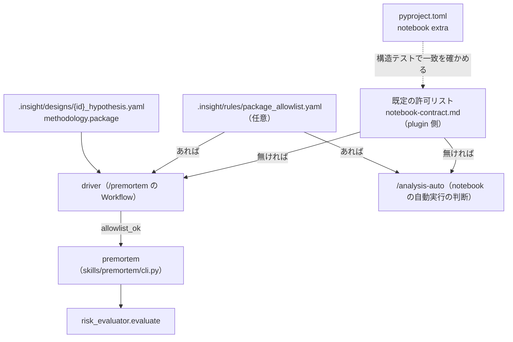
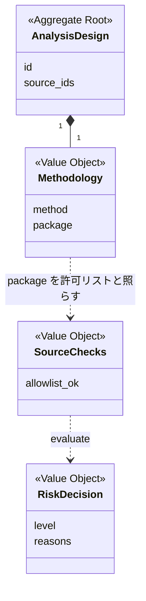
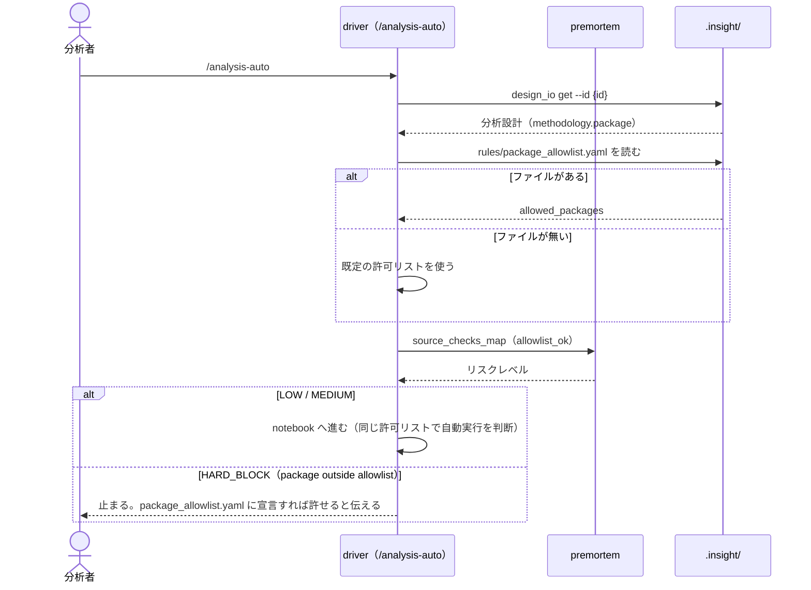

# Epic 16: パッケージ許可リストが無いプロジェクトでは既定の許可リストを使う

## Background

本書がこの Epic の要求と背景の正本（[FLOW-0001](../adr/flow/0001-designdoc-owns-requirements.md)）。
Epic issue（[#101](https://github.com/etoyama/insight-blueprint-skills/issues/101)）には要約と本書へのリンクだけを置く。

- 解く課題: パッケージ許可リスト（`.insight/rules/package_allowlist.yaml`）が無い新しいプロジェクトでは、guided autopilot が premortem で必ず止まる。
  - 課題1: v0.10.0 の手動確認（2026-11-20）で、`.insight/rules/` が空のプロジェクトで `/analysis-auto` を回した。driver は `allowlist_ok: null` を入れ、
    premortem は `HIGH`（`allowlist check failed (read error)`）を返して止まった。費用の問題ではないのに、初めて使う分析者が最初に止まる。
  - 課題2: ファイルが無いときに `allowlist_ok` をどう決めるかを、どの文書も書いていない。`/premortem` の SKILL.md は「`package_allowlist.yaml` から作る」とだけ書く。
    driver によって `null`・`true`・`false` のどれにもなりうる。
  - 課題3: パッケージ許可リストは、notebook を自動で実行してよいかの境界でもある（[ADR-0005](../adr/0005-selective-autonomous-chaining.md)）。
    ファイルが無いときに何でも許すと、この境界が消える。
- PRD の要件: [docs/PRD.md](../PRD.md) の非機能要件「Claude Code plugin として配布・利用できる」。plugin を入れたばかりのプロジェクトでも、基本のパッケージだけを使う分析は止まらずに notebook まで進む。
- 既存手段が不十分な理由: [docs/ARCHITECTURE.md](../ARCHITECTURE.md) はこのファイルを「任意」としている。それなのに、ファイルが無いと必ず止まる。
  `allowlist_ok` を決めるのは driver で、コードはファイルを読まない。そのため、扱いを決めて SKILL.md に書くしか方法が無い。

## User Stories

AC の正本はここ。

### US-1: 新しいプロジェクトでも、基本のパッケージだけの分析は止まらない

分析者として、パッケージ許可リストを書く前の新しいプロジェクトでも guided autopilot を notebook まで進めたい。そのために、ファイルが無いときは plugin の既定の許可リストを使ってほしい。

- [ ] AC 1: notebook の契約（`notebook-contract.md`）に、ファイルが無いときに使う既定の許可リストがある。その import 名は、`pyproject.toml` の `notebook` extra と `insight_blueprint` に一致する。
  ファイルがあるときは、ファイルの内容だけを使う。
- [ ] AC 2: `/premortem` は、`methodology.package` に書かれた各パッケージを許可リスト（ファイル、無ければ既定の許可リスト）と照らして `allowlist_ok` を決める。
  `methodology.package` が空なら `true` にする。ファイルが無いことを理由に `null` にしない。`null` は、ファイルがあるのに読めないときだけ使う。
- [ ] AC 3: `/analysis-auto` が notebook を自動で実行してよいかを決めるときも、ファイルが無ければ既定の許可リストを使う。
- [ ] AC 4: パッケージ許可リストの外のパッケージで `HARD_BLOCK` になったとき、その理由は、パッケージを `.insight/rules/package_allowlist.yaml` に宣言すれば許せることを伝える。

## Stories

| Story issue | User Story | 扱う AC |
|---|---|---|
| [#107](https://github.com/etoyama/insight-blueprint-skills/issues/107) | US-1 | AC 1〜4 |

## Ubiquitous Language

- 追加: パッケージ許可リスト、既定の許可リスト

## Scope

[docs/PRD.md](../PRD.md) の非機能要件「Claude Code plugin として配布・利用できる」と、[docs/ARCHITECTURE.md](../ARCHITECTURE.md) の `.insight/rules/package_allowlist.yaml` を前進させる。

- Epic 範囲内:
  - `/premortem` と `/analysis-auto` の SKILL.md、notebook の契約の「Package allowlist」節。
  - `skills/premortem/lib/risk_evaluator.py` の `HARD_BLOCK` の理由の文。
  - ADR（ファイルが無いときの扱いと、既定の許可リストの置き場所）。
- Epic 範囲外:
  - `methodology.package` からパッケージを機械で取り出すこと。今のとおり driver が読む。
  - `.insight/rules/` に雛形を書き出すこと（ADR の比較で落とした）。
  - ファイルがあるときに既定の許可リストを足し合わせること。
  - `/analysis-notebook` の SKILL.md。並行する #102 の作業が触るので、許可リストの扱いは notebook の契約にだけ書く。

## Architecture

## Domain Model

model のクラスは変えない。関係する部分だけを描く。

| 型 | 種類 | 不変条件 |
|---|---|---|
| `SourceChecks.allowlist_ok` | 値 | `true` は許可リストの中、`false` は外、`null` はファイルがあるのに読めない。ファイルが無いことは `null` にしない |

Python のクラスを持たない契約は表で示す（[ADR-0011](../adr/0011-domain-model-overview-in-architecture.md)）。

| 契約 | 変更 | 形の正本 |
|---|---|---|
| 既定の許可リスト | 追加。`allowed_packages` と同じ形（import 名 → pip 名） | `skills/analysis-notebook/references/notebook-contract.md` と ADR |

## Sequence Diagram

## Decisions

### Decision: promote-issue-101-to-epic

- What: issue #101 を Epic issue にする。Story は1本にする。
- Why: premortem と guided autopilot の振る舞いが変わるので、単発の PR では扱えない（[ADR-0012](../adr/0012-single-pr-scope.md)）。AC は4つで、1本の Story に収まる。
- Criteria: 振る舞いの変更が DesignDoc を伴うこと（Must、ADR-0012）。
- Affected modules: なし（進め方）
- Alternatives considered: 新しい Epic issue を起票する案。issue #101 の本文がそのまま Background になるので、分ける理由が無い。
- Consequences: issue #101 の元の本文は本書の Background に移した。

### Cross-epic decisions (links to ADR)

- [ADR-0021: パッケージ許可リストが無いときは、plugin の既定の許可リストを使う](../adr/0021-default-package-allowlist.md)

## Test Design Matrix

| Story \ Layer | Unit | Integration | E2E |
|---|---|---|---|
| US-1 既定の許可リスト | ☐ | ☐ | ☐ |

完了時に ✓ を付ける。自動テストがない層には「—（理由）」を書く（[ADR-0010](../adr/0010-skill-tdd-structure-tests.md)）。

## Story Timeline

- 2026-11-20 — 人間が扱いを決めた。ファイルが無いときは、plugin 側に置いた既定の許可リストで `allowlist_ok` を決める（案 A）。判断は ADR に残す。
- 2026-11-20 — DesignDoc 初版。issue #101 を Epic にし、Story #107 を起票した。
