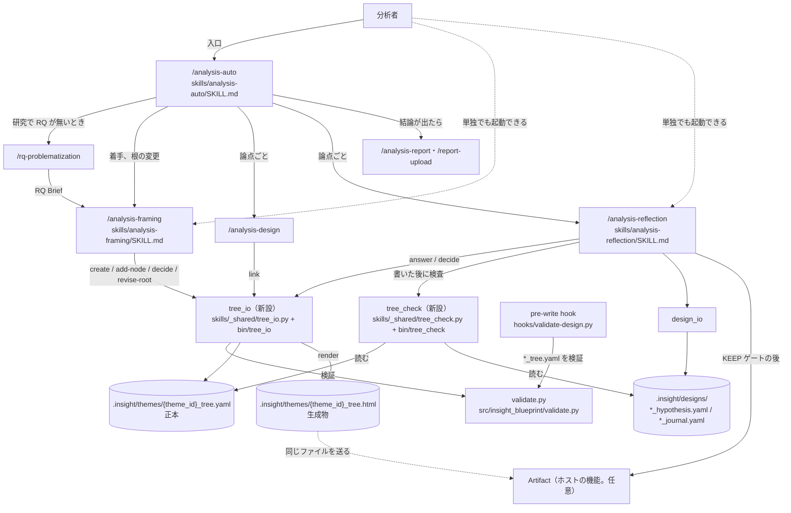
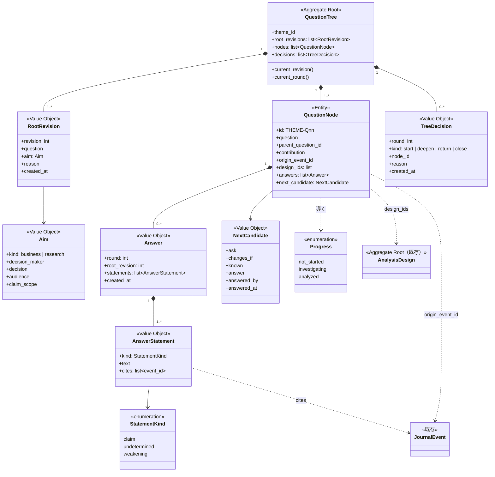
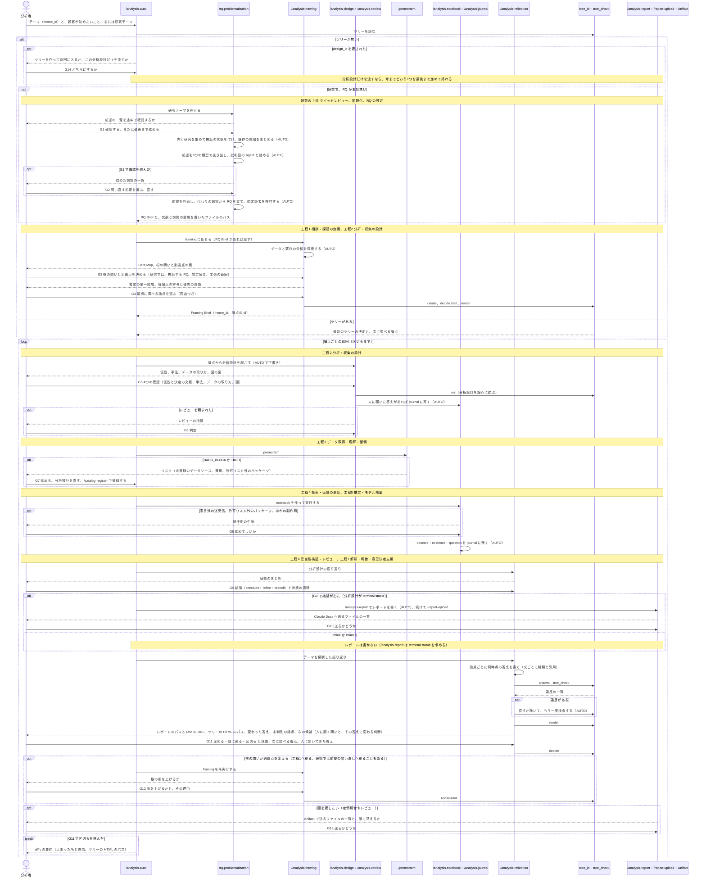

# Epic 18: テーマごとの論点ツリー

## Background

本書がこの Epic の要求と背景の正本（[FLOW-0001](../adr/flow/0001-designdoc-owns-requirements.md)）。
Epic issue（[#116](https://github.com/etoyama/insight-blueprint-skills/issues/116)）には要約と本書へのリンクだけを置く。

- 解く課題: 分析者は合意した問いを1つ AI に委ねたあと、親の問いにどこまで答えられたかを把握できない。
  - 課題1: reflection とレポートは分析設計1つを単位にしている。同じテーマに属する複数の分析設計を束ねて、
    親の問いへの答えがどう動いたかを見る場所が無い。分析設計の `parent_id` は派生の履歴であり、問いの論理の親子ではない。
  - 課題2: 着手のときに、全体像と「なぜこの論点から調べるか」が残らない。framing の Framing Brief は方向を1つ渡して終わる。
    経験の浅い分析者は、何が未着手で何が分析済みなのに未判別なのかを区別できない。
  - 課題3: 複数の分析設計を統合する文をモデルに書かせると、記録に無い数や結論が混ざる。
    `/analysis-report` は「Never compute」の決まりがあっても、Implications で入力に無い比を書いた（[#105](https://github.com/etoyama/insight-blueprint-skills/issues/105)）。
  - 課題4: 引き継いだ人や顧客に、現在地を渡す手段が無い。全体像はビジュアルで見せる価値が大きい（人間の発言、2026-11-20）。
- PRD の要件: [docs/PRD.md](../PRD.md) のビジョンの「問いを委ね、到達を把握し、次の一手を選ぶ」と、
  機能要件の論点ツリーの5項目、非機能要件の「記録に書いてあるものに限る」「表示は正本から決定的に生成する」。
- 既存手段が不十分な理由: `theme_id` は分析設計の id の接頭辞にあるだけで、テーマ単位の記録は無い。
  `DecisionContext` は分析設計ごとに持つ。RQ Brief は想定読者を検討するが（`/rq-problematization` の Step 8）、出力に想定読者の欄が無い。

この Epic の要求は、人間が書いた Handoff（リポジトリ外のメモ）と、2026-11-20 の壁打ちの判断1〜5 から作った。
判断の記録は「Decisions」と [ADR-0024](../adr/0024-question-tree-yaml-and-generated-html.md)・[ADR-0025](../adr/0025-cited-answers-checked-after-writing.md) にある。
分析者の入口を `/analysis-auto` ひとつにする判断は、初版のシーケンス図を見た人間が同じ日に足した（[ADR-0026](../adr/0026-analysis-auto-walks-the-question-tree.md)）。

### 前提にした事実

確かめた方法を添える。

- `theme_id` は `AnalysisDesign` の項目で、分析設計の id は `{theme_id}-H{nn}` になる（`src/insight_blueprint/models/design.py:144`、`skills/_shared/design_io.py:140`）。
- journal の出来事の id は `{design_id}-E{nn}`。`evidence` は `metadata.direction` に `supports` か `contradicts` を持つ（`skills/analysis-journal/SKILL.md` の表）。
- 分析設計の検証は `src/insight_blueprint/validate.py` が正本で、pre-write hook（`hooks/validate-design.py`）は `*_hypothesis.yaml` だけを捕まえる（`docs/ARCHITECTURE.md` の L55〜74）。
- 書いた後の検査には前例がある。`report_check` は `skills/_shared/report_check.py` にあり、`bin/report_check` から呼ぶ。違反があれば終了コード 1 を返す。
- `/analysis-framing` の Step 2（探索）は、Epic 17（PR #114、2026-11-20 にマージ）が書き換えた。データソースは `catalog_io list` で読み、`connection` の値がモデルの文脈に入るのは `/analysis-notebook` だけになった（[ADR-0022](../adr/0022-connection-reaches-only-the-notebook.md)）。この Epic が触るのは Step 4・5 と Framing Brief である（`git diff 905e456 origin/main -- skills/analysis-framing/SKILL.md` で確かめた）。
- Artifact は手元の HTML ファイルを公開する仕組みで、公開した直後は本人にしか見えない。どのホストやアカウントでも使えるかは未確認。

### 未決事項

- 数を含まない言い過ぎ（「原因は通知の遅れだ」）は、ツリーの検査では止まらない。今の手は答えの文に種類を宣言させることと、引き継ぎの試行で人が読むこと。
- RQ Brief に想定読者の欄を足すか。この Epic では framing が直接聞く（US-1 AC 4）。
- 分析設計の `DecisionContext` と、根の到達点の関係。根の値を分析設計に写すのか、別々に持つのか。
- 人が確認・再構成に費やす時間の目標値。基準値が取れてから決める（[docs/PRD.md](../PRD.md) の成功基準）。
- 1つのテーマに論点ツリーを2つ以上持つ必要が出るか。この Epic では1テーマ1ツリーにする。
- `/rq-problematization` の先行研究の収集を、検索の記録、採否の基準、文献ごとの質の評価を残すラピッドレビューに強めるか。
- 結果を別のソースや別の条件で確かめる skill が要るか（業務工程の 6）。
- 人に聞いた答えを journal に写すとき、出来事のどの種類を使うか。`observe` の定義は「データの観察」で、ぴったりは合わない。Story 18.5 で決める。

## User Stories

AC の正本はここ。

### US-1: 分析者が、全体像を見て最初に委ねる論点を選べる

分析者として、最初に AI に委ねる論点を納得して選ぶために、着手のときに根の問いと到達点、暫定の第一階層、最初の論点とそれを選んだ理由を論点ツリーに残したい。

- [ ] AC 1: `/analysis-framing` は、合意した方向から論点ツリーを作る。ツリーは根の問い、到達点、第一階層の論点を持ち、各論点は問いの文と寄与を持つ。
  到達点は業務なら `decision_maker` と `decision`、研究なら想定読者と主張の範囲である。
- [ ] AC 2: `/analysis-framing` は、最初に調べる論点と選んだ理由をツリーの決定（種類 `start`）として残す。第二階層が空でもツリーを作れる。
- [ ] AC 3: Framing Brief に `theme_id` と最初の論点の id を載せる。`/analysis-design` は、その論点に作った分析設計を結ぶ。
- [ ] AC 4: 研究で RQ Brief から来たとき、RQ Brief に想定読者が無ければ、`/analysis-framing` が分析者に聞いて到達点に入れる。
- [ ] AC 5: 根の問いか到達点を変えられるのは `/analysis-framing` の再実行だけである。変えるときは根の版を上げるかを分析者に聞き、上げたら版と理由を残す。

### US-2: 分析者が、論点から分析設計と証拠へ辿れる

分析者として、どこを調べていて何が未判別かを把握するために、各論点の進捗と、ひもづく分析設計を見たい。

- [ ] AC 1: 進捗は保存しない。ひもづく分析設計の状態から導く。分析設計が無ければ未着手、terminal status でないものが1つでもあれば検証中、すべて terminal status なら分析済み。unit test で確かめる。
- [ ] AC 2: journal の `question` を論点に昇格できる。昇格した論点は発見元としてその出来事の id を持つ。着手のときに置いた論点は発見元を持たない。
- [ ] AC 3: 1つの分析設計を複数の論点に結べる。
- [ ] AC 4: 論点ツリーの書き込みは `tree_io` を通す。`validate.py` が形を検証し、pre-write hook は `*_tree.yaml` への直接の書き込みも検証する。

### US-3: 分析者が、テーマを横断して現時点の答えと次の一手を把握できる

分析者として、同じ論点を深めるか、親に戻るか、区切るかを決めるために、テーマに属する分析設計を横断した現時点の答えと次の候補を見たい。

- [ ] AC 1: `/analysis-reflection` はテーマを渡されると、論点ごとに、ひもづく分析設計とその journal を読んで現時点の答えを書く。答えの文はそれぞれ、種類（言えること・未判別・弱める証拠と留保）と、引用する journal の出来事の id を1つ以上持つ。
- [ ] AC 2: 親の論点の答えは子の論点の進捗の数から推定しない。子孫の論点にひもづく分析設計の出来事を引用して書く。
- [ ] AC 3: 現時点の答えは追記だけで、振り返りの回と根の版を持つ。前の回と答えが変わった論点を分析者に示す。
- [ ] AC 4: 次の候補として、未着手の論点を示す。候補には、人に聞く問い、その答えで変わる判断、catalog とドメイン知識から分かっていることを添えられる。分析者が聞いてきた答えは、誰に聞いたかと日付を添えて次の候補に残せる。その論点に分析設計を起こすとき、答えを journal に写す。データソースは `catalog_io list` で読み、`connection` の値を論点ツリーに書かない（[ADR-0022](../adr/0022-connection-reaches-only-the-notebook.md)）。
- [ ] AC 5: 分析者が選んだ決定（`deepen`・`return`・`close`）と理由を、ツリーの決定として残す。

### US-4: 分析者に届く答えに、記録に無い数と参照が混ざらない

分析者として、答えを信じて次の判断をするために、現時点の答えに記録に無い数や存在しない参照が混ざっていたら、届く前に止まってほしい。

- [ ] AC 1: ツリーの検査（`tree_check`）は次を違反として挙げる。引用した出来事が無い。引用先の分析設計が、その論点か子孫の論点にひもづいていない。文に出てくる数が、引用した出来事の本文に無い。unit test で確かめる。
- [ ] AC 2: `/analysis-reflection` は答えを書いた後にツリーの検査を回す。違反があれば分析者に届ける前に直し、直せなければその文を除いて、除いたことを伝える。
- [ ] AC 3: #105 と同じ型の再現を持つ。合成シナリオで、引用した2つの出来事の数から作った比を含む文を、ツリーの検査が違反にする。

### US-5: 分析者と引き継いだ人が、ツリーを図で読める

分析者として、全体像と現在地をひと目でつかむために、論点ツリーを手元の図で読みたい。

- [ ] AC 1: `tree_io render` は、正本から自己完結の HTML（`.insight/themes/{theme_id}_tree.html`）を作る。外部の script や stylesheet を読まず、同じ正本からは同じ HTML ができる。
- [ ] AC 2: 各論点に、進捗と現時点の答えを文字で出す。色だけで区別しない。
- [ ] AC 3: 論点を選ぶと、答えの各文と、引用した出来事（本文、分析設計の id、`direction`）が開く。
- [ ] AC 4: 最新の振り返りの回で変わった答えと、根の版が古い答え（根の変更前の答え）を、それと分かるように出す。
- [ ] AC 5: 論点の親子（寄与）と、分析設計の派生（`parent_id`）を別々に辿れる。

### US-6: 分析者が、承認した後に限りツリーを Artifact で渡せる

分析者として、定例報告やレビューで現在地を見せるために、論点ツリーの図を URL で渡したい。

- [ ] AC 1: Artifact として渡す手順は、送るファイルを列挙して KEEP ゲートで承認を待つ。承認は覚えない（[ADR-0016](../adr/0016-approval-before-external-send.md)）。
- [ ] AC 2: Artifact が使えないホストでは、何も送らず、手元の HTML のパスを案内して終わる（[ADR-0015](../adr/0015-host-connectors-for-optional-features.md)）。
- [ ] AC 3: 送るのは、手元で生成した HTML と同じファイルである。モデルに HTML を書かせない。

### US-7: 開発者が、引き継ぎで判断が伝わるかを試せる

開発者として、論点ツリーが判断の質を上げたかを確かめるために、合成シナリオで引き継ぎの試行を繰り返したい。

- [ ] AC 1: 合成シナリオ（公共図書館の予約本）の fixture を持つ。着手時に分かっていた情報と、その後の観察を順に足す段階に分けてある。
- [ ] AC 2: 文脈を持たない別の Claude セッションに HTML だけを渡し、[docs/PRD.md](../PRD.md) の成功基準の5つの問いに答えさせる手順がある。採点は文言でなく判断の一致で行う。
- [ ] AC 3: 人による試行の記録の型がある。5つの問いへの答え、正誤、確認と再構成にかかった時間を残す。

### US-8: 分析者が、`/analysis-auto` ひとつから論点を順に調べられる

分析者として、skill の名前と順番を覚えずに問いを委ねるために、`/analysis-auto` ひとつから着手し、論点を1つずつ調べて、次の論点を選ぶところまで進めたい。

- [ ] AC 1: `/analysis-auto` はテーマを受けると、論点ツリーが無ければ `/analysis-framing` で作り、あれば最新のツリーの決定が指す論点から再開する。研究で RQ がまだ無ければ、framing の前に `/rq-problematization` を呼ぶ。論点ツリーが無いテーマの `design_id` を渡されたら、ツリーを作って巡回に入るか、その分析設計だけを流すかを聞く。ツリーを作るときは、既にある分析設計をどの論点に結ぶかを framing で分析者と決める。
- [ ] AC 2: 1回の巡回は、論点に分析設計を起こし、premortem、notebook、journal、分析設計の振り返り、レポート、テーマを横断した振り返りを経て、ツリーの決定を残すまでである。
- [ ] AC 3: 分析者に聞くのは KEEP ゲートだけである。guided autopilot の今のゲートに、根の問いと到達点、最初に調べる論点、ツリーの決定、根の版を上げるかどうか、ツリーの無いテーマでツリーを作るかどうかの5つを足す。
- [ ] AC 4: 分析設計の結論が出たら（terminal status）、聞かずにレポートを書いて `/report-upload` を始める。ツリーの決定を聞くときは、レポートのパスと論点ツリーの HTML のパスを一緒に示す。結論が出ていない回はレポートを書かない。
- [ ] AC 5: 分析者がツリーの決定で区切るを選ぶか、止めると言うまで巡回を続ける。巡回に使う skill は、それぞれ単独でも起動できる。

## Stories

初版に合意した Story から起票した（人間の判断、2026-11-20）。18.5 と 18.9 は、形に効く未決事項を決めてから起票した（Decisions の判断A・B）。1つの Story が扱う AC は5個以下。

| Story issue | User Story | 扱う AC |
|---|---|---|
| [#119](https://github.com/etoyama/insight-blueprint-skills/issues/119)（18.1 正本と `tree_io`） | US-1、US-2 | US-1 AC 5、US-2 AC 1〜4 |
| [#120](https://github.com/etoyama/insight-blueprint-skills/issues/120)（18.2 framing で着手） | US-1 | AC 1〜4 |
| [#121](https://github.com/etoyama/insight-blueprint-skills/issues/121)（18.3 ツリーの検査） | US-4 | AC 1、AC 3 |
| [#122](https://github.com/etoyama/insight-blueprint-skills/issues/122)（18.4 横断の振り返り） | US-3、US-4 | US-3 AC 1〜3、US-4 AC 2 |
| [#126](https://github.com/etoyama/insight-blueprint-skills/issues/126)（18.5 次の候補とツリーの決定） | US-3 | AC 4、AC 5 |
| [#123](https://github.com/etoyama/insight-blueprint-skills/issues/123)（18.6 HTML の表示） | US-5 | AC 1〜5 |
| [#124](https://github.com/etoyama/insight-blueprint-skills/issues/124)（18.7 Artifact で渡す） | US-6 | AC 1〜3 |
| [#125](https://github.com/etoyama/insight-blueprint-skills/issues/125)（18.8 引き継ぎの試行） | US-7 | AC 1〜3 |
| [#127](https://github.com/etoyama/insight-blueprint-skills/issues/127)（18.9 `/analysis-auto` から巡回する） | US-8 | AC 1〜5 |

## Ubiquitous Language

この Epic で追加・変更した語。定義の正本は
[docs/UBIQUITOUS_LANGUAGE.md](../UBIQUITOUS_LANGUAGE.md)。

- 追加: 論点ツリー、論点、根の問い、到達点、根の版、寄与、発見元、進捗、現時点の答え、振り返りの回、ツリーの決定、次の候補、ツリーの検査、Artifact、合成シナリオ、引き継ぎの試行、巡回
- 変更: 違反（[ADR-0025](../adr/0025-cited-answers-checked-after-writing.md)。ツリーの検査も挙げる）

## Scope

- Epic 範囲内:
  - 論点ツリーの正本（`.insight/themes/{theme_id}_tree.yaml`）、そのモデルと `validate.py` の検証、`tree_io`。
  - `/analysis-framing` の Step 4・5 と Framing Brief、`/analysis-design` が分析設計を論点に結ぶ1手順。
  - `/analysis-reflection` のテーマを横断する振り返り。分析設計1つの振り返りは今のまま残す。
  - ツリーの検査（`tree_check`）、HTML の表示（`tree_io render`）、Artifact で渡す手順。
  - 合成シナリオの fixture と引き継ぎの試行。
  - `/analysis-auto` を分析者の入口にし、論点ごとの巡回をさせること（[ADR-0026](../adr/0026-analysis-auto-walks-the-question-tree.md)）。
- Epic 範囲外:
  - `/analysis-report` の Implications の数（#105）。この Epic のツリーの検査の型を流用できるかは、#105 の側で決める。
  - RQ Brief の欄の変更と、`/rq-problematization` の先行研究の集め方の変更（未決事項）。
  - レポートを論点ツリーの単位で書くこと。レポートは分析設計1つの単位のまま（#76）。
  - 施策の実行、承認のシステム化、継続運用の監視、ヒアリングそのもの（[docs/PRD.md](../PRD.md) のスコープ外）。

## Architecture



## Domain Model

クラス名は Story 18.1 の最初に人間が決めた（Decisions の `tree-type-names`）。
Story 18.1 が実装したのは `QuestionTree`・`RootRevision`・`Aim`・`QuestionNode`・`Progress` で、[docs/ARCHITECTURE.md](../ARCHITECTURE.md) の全体図にも載せた。
Story 18.2 は `TreeDecision` と `decisions` を足した。種類は `start` だけで、残りの3つは Story 18.5 で足す（Decisions の `start-is-the-only-decision-kind-for-now`）。
Story 18.3 は `Answer`・`AnswerStatement`・`StatementKind` と `answers` を足した（Decisions の `answer-types-land-with-the-check`）。答えを書く手段（`tree_io answer`）は Story 18.4 で足す。
`NextCandidate` と `next_candidate` は Story 18.5 で足す。
モデルに無い項目は検証で拒むので、足すまではこれらの項目を正本に書けない。
[docs/UBIQUITOUS_LANGUAGE.md](../UBIQUITOUS_LANGUAGE.md) の「コード上の名前」は、名前がコードに実在する語から埋める。



| 型 | 種類 | 不変条件 |
|---|---|---|
| `QuestionTree` | 集約ルート | 1テーマに1つ。根の問い（`parent_question_id` を持たない論点）はちょうど1つで、その文は今の根の版の問いと同じ。論点の親は同じツリーの中にあり、循環しない。根の版は1から1ずつ増え、今の版より前の版は書き換えも削除もできない。ツリーの決定の `node_id` は実在する。`start` の決定は1つまで。モデルに無い項目を持てない |
| `RootRevision` | 値オブジェクト | 版2以降は理由が空でない |
| `Aim` | 値オブジェクト | `kind` に応じた2項目がどちらも空でない |
| `QuestionNode` | エンティティ | id は `{theme_id}-Q{nn}` で、ツリーの中で重ならない。根以外は寄与が空でない。発見元はあれば同じテーマの `{design_id}-E{nn}` の形。結ぶ分析設計は同じテーマの `{theme_id}-H{nn}` で、同じものを2度結ばない |
| `Answer` | 値オブジェクト | 現時点の答えの1回分。文を1つ以上持つ。追記だけで、最後の要素が今の答え。`root_revision` は今の根の版以下。回は1以上で、1つの論点の中で増え続ける |
| `AnswerStatement` | 値オブジェクト | 文は空でない。`cites` は1つ以上で、どれも同じテーマの `{design_id}-E{nn}` の形。引用先の実在、引用先と論点の対応、数の一致は `validate.py` でなくツリーの検査が確かめる（Decisions の `tree-check-reads-the-last-answer-and-compares-values`） |
| `TreeDecision` | 値オブジェクト | 理由が空でない。`start` の回は 0。追記だけで、書き換えも削除もできない |
| `Progress` | 導出する列挙 | 保存しない。`design_ids` の分析設計の状態から導く（US-2 AC 1） |

### 正本の形（合成シナリオ）

公共図書館の予約本の架空の例。最初の振り返りの後の状態を、形を示すために縮めて書く。

```yaml
theme_id: LIB
root_revisions:
  - revision: 1
    question: 取り置き期限を延ばす試行をするか
    aim: {kind: business, decision_maker: 図書館員, decision: 取り置き期限を延ばす試行を始めるか}
nodes:
  - {id: LIB-Q01, question: 取り置き期限を延ばす試行をするか}
  - id: LIB-Q02
    question: 期限切れを一貫して数えられるか
    parent_question_id: LIB-Q01
    contribution: 予約取消が混ざると、延長で改善しうる件数が変わる
    design_ids: [LIB-H01]
    answers:
      - round: 1
        root_revision: 1
        statements:
          - {kind: claim, text: 状態の履歴から取消を除き、期限を迎えた予約同士を比べられた, cites: [LIB-H01-E01]}
  - id: LIB-Q05
    question: 通知から期限まで何日開館していたか
    parent_question_id: LIB-Q04
    contribution: 通知の遅れと、来館できる日の少なさを見分ける
    origin_event_id: LIB-H02-E03
    next_candidate:
      ask: 本を確保してから実際に通知するまで、曜日によって手順は変わりますか
      changes_if: 変わるなら通知の時点を調べる論点に進み、変わらないなら開館日数の論点を深める
      known: 今の抽出表に送信日時は無い
decisions:
  - {round: 0, kind: start, node_id: LIB-Q02, reason: 取消が混ざると延長で改善しうる件数が変わるため}
```

## Module Responsibilities

| モジュール / 関数 | 責務（する） | 境界（しない → 委譲先） |
|---|---|---|
| `src/insight_blueprint/models/`（論点ツリーのモデル） | 論点ツリーの形と、ファイル1つで判定できる不変条件を型で表す | ファイルをまたぐ参照は確かめない → `tree_check` |
| `src/insight_blueprint/validate.py` | 論点ツリーの YAML を検証する純関数を足す | I/O をしない → `tree_io`・hook |
| `hooks/validate-design.py` | `*_tree.yaml` への直接の書き込みも検証する | 何を書くかは決めない |
| `skills/_shared/tree_io.py`（新設） | ツリーの作成、論点の追加と昇格、分析設計を結ぶ、答えの追記、ツリーの決定、根の版の更新、HTML の生成 | 答えの中身を考えない → `/analysis-reflection`。引用先を確かめない → `tree_check` |
| `skills/_shared/tree_render.py`（新設） | 論点ツリー、テーマの分析設計、引用した出来事を受け取り、HTML の文字列を返す純関数。進捗と、答えに付ける印を導く。ページに入る文字をすべてエスケープする | ファイルを読まない、書かない → `tree_io render`。引用の正しさは確かめない → `tree_check` |
| `skills/_shared/tree_check.py`（新設） | 現時点の答えの引用の実在、引用先と論点の対応、文の数が引用先の本文にあるかを確かめ、違反を挙げる | ツリーを書き換えない |
| `/analysis-auto` | 分析者の入口。論点ツリーの有無で着手か再開かを決め、論点ごとの巡回を進め、KEEP ゲートでだけ止まる。結論が出たらレポートを書かせる | skill の中身を持たない → 各 skill。ツリーを直接書かない → `tree_io` を使う各 skill |
| `/rq-problematization` | （変えない）先行研究を集め、前提を問い直し、RQ Brief を出す | 論点ツリーを作らない → `/analysis-framing` |
| `/analysis-framing` | 根の問い・到達点・第一階層・最初の論点と理由を分析者と決め、`tree_io` で残す。Framing Brief に `theme_id` と論点の id を載せる | データの探索のやり方は変えない（Step 2 は Epic 17 の領分）。仮説の文を作らない → `/analysis-design` |
| `/analysis-design` | 作った分析設計を、Framing Brief の論点に結ぶ | 論点を作らない → `/analysis-framing` |
| `/analysis-reflection` | テーマを横断して現時点の答えを書き、ツリーの検査を通し、次の候補とツリーの決定を残す。承認の後に Artifact で渡す | 分析設計1つの振り返りは今のまま。HTML を書かない → `tree_io render` |
| `/analysis-report`・`/report-upload` | （変えない）結論の出た分析設計のレポートを書き、承認の後に Claude Docs へ送る | いつ書くかは決めない → `/analysis-auto` |
| `/analysis-journal` | （変えない）`question` の出来事を残す | 論点への昇格は `tree_io` |

## Sequence Diagram

分析者の入口は `/analysis-auto` ひとつにする（[ADR-0026](../adr/0026-analysis-auto-walks-the-question-tree.md)）。
auto は論点ツリーを作り、論点を1つずつ巡回する。研究で RQ がまだ無いときは、ツリーを作る前に `/rq-problematization` で先行研究を集め、前提を問い直して RQ を立てる。
1回の巡回は分析設計、premortem、notebook、journal、分析設計の振り返り、レポート、テーマを横断した振り返り、ツリーの決定の順に進む。
分析者は、レポートと論点ツリーの両方を見てからツリーの決定をする（人間の発言、2026-11-20）。
分析者とのやり取りは KEEP ゲートだけで起きる。図では、分析者が答えるメッセージに G1〜G14 の番号を振った。G14 は後から足したゲートで、位置は図の上の方にある。
各 skill は今までどおり単独でも起動できる（[ADR-0005](../adr/0005-selective-autonomous-chaining.md)）。



人に聞く問いへの答えを集めるヒアリングは plugin の外で行う（[docs/PRD.md](../PRD.md) のスコープ外）。
分析者は答えを持って G11 で次の論点を選ぶ。
Artifact はホストの機能で、plugin は持たない。使えるかどうかはそのセッションのツールで判断する。使えなければ、何も送らずに手元の HTML のパスを伝える（G13 は起きない）。

### 業務工程と skill の対応

工程は、人間が渡した資料「良い分析者を支える能力・手続き・態度」（ラピッドレビュー、2026-11-18、3頁）の8工程に従う。
資料の8工程は業務の分析を想定しているので、研究では工程1の前に上流工程を3つ足す（人間の発言、2026-11-20）。
資料は工程どうしを一方向に並べず、探索と検証の結果に応じて前の工程へ戻るとしている。上の図では論点ごとの巡回と、工程1へ戻る `revise-root` がこれにあたる。

| 工程 | 担う skill | 分析者とのやり取り | 足りない所 |
|---|---|---|---|
| 研究 a ラピッドレビュー | `/rq-problematization` の Step 2・3（先行研究を集めて検証の状態を付け、既存の理論をまとめる） | なし | 引用の検証はあるが、検索の記録、採否の基準、文献ごとの質の評価、レビューの限界を残す手順は無い |
| 研究 b 問題化 | `/rq-problematization` の Step 4〜6（前提の抜き出し、批判役との詰め、評価） | G1、G2 | — |
| 研究 c RQ の設定 | `/rq-problematization` の Step 7・8 と RQ Brief | G3 | RQ Brief に想定読者の欄が無い。framing が G3 で聞く（US-1 AC 4） |
| 1 相談・課題の定義 | `/analysis-framing`（根の問い、到達点） | G3、G12、G14 | ヒアリングそのものは扱わない。AI が出すのは人に聞く問いの案まで |
| 2 分析・収集の設計 | `/analysis-framing`（第一階層、最初の論点）、`/analysis-design`、`/analysis-review` | G4、G5、G6 | — |
| 3 データ取得・理解・整備 | `/premortem`、`/catalog-register`、`/analysis-design` のデータの取り方、`/analysis-notebook` のリネージ | G5、G7 | データの発生源を担当者に確かめる手順は無い。次の候補の「人に聞く問い」で代える |
| 4 探索・仮説の更新 | `/analysis-notebook`、`/analysis-journal`（`observe`・`question`）、`question` の論点への昇格 | G8、G11 | — |
| 5 推定・モデル構築 | `/analysis-notebook` | G8 | — |
| 6 妥当性検証・レビュー | `/analysis-journal` の `evidence`（`contradicts`）、ツリーの検査 | G9 | `/analysis-review` は実行する前の分析設計を見る。結果を別のソースや別の条件で確かめる skill は無い |
| 7 解釈・報告・意思決定支援 | `/analysis-reflection`（分析設計1つと、テーマの横断）、`/analysis-report`、`/report-upload`、`tree_io render`、Artifact | G9〜G11、G13 | 結論が出ていない分析設計（refine・branch）にはレポートを書かない（人間の判断、2026-11-20）。そのときのツリーの決定は、ツリーと journal だけを見てする |
| 8 導入・監視・改善・引き継ぎ | 論点ツリーの HTML、`/knowledge-extract` | なし | 導入と監視はスコープ外（[docs/PRD.md](../PRD.md)）。扱うのは引き継ぎだけ |

## Decisions

### Decision: one-tree-per-theme

- What: 1つのテーマ（`theme_id`）に論点ツリーを1つだけ持つ。
- Why: テーマは分析設計の id の接頭辞として既にあり、新しい束ね方の単位を作らずに済む。
- Criteria: 課題1、YAGNI（[.claude/rules/coding-principles.md](../../.claude/rules/coding-principles.md)）。決め手は新しい単位を作らないこと。
- Affected modules: `tree_io`、`/analysis-framing`、`/analysis-reflection`。
- Alternatives considered: テーマの下に複数のツリーを持つ。必要になった例が無いので落とした（未決事項に残す）。
- Consequences: 同じテーマで根の問いが変わるときは、根の版を上げて扱う。

### Decision: progress-is-derived

- What: 論点の進捗は保存せず、ひもづく分析設計の状態から導く。
- Why: 保存すると、分析設計の状態と論点の進捗という2つの正本ができ、いずれずれる。
- Criteria: 課題2。principle「Model the Domain」。決め手は正本を1つにすること。
- Affected modules: `tree_io render`、`/analysis-reflection`。
- Alternatives considered: 論点に進捗を保存する。分析設計を遷移させるたびにツリーも直す手順が増えるので落とした。
- Consequences: 論点に分析設計が無い限り、進捗は未着手のままになる。「分析は済んだが未判別」は、進捗が分析済みで、答えに種類が未判別の文があることで表す。

### Decision: root-revision-marks-stale-answers

- What: 根の問いか到達点を変えるときは根の版を上げる。古い版に対する答えは消さず、表示で「根の変更前の答え」と出す（判断4、2026-11-20）。
- Why: 古い根に対する答えが黙って残ると、引き継いだ人が誤読する。消すと、どの証拠で答えが変わったかを辿れなくなる。
- Criteria: Must は「根が変わったことと理由が残る」（Handoff の受入条件5）。Want は「古い答えがそれと分かる」（高、Claude の推測）と「部品が増えない」（中、Claude の推測）。決め手は前者。
- Affected modules: `tree_io`、`/analysis-framing`、`tree_io render`。
- Alternatives considered: 根が変わったら答えを消す（受入条件5 と両立しない）。この Epic では扱わない（試行で根が変わると受入条件5 を満たせない）。
- Consequences: 言い換え程度の変更でも版が上がると、全論点が「変更前」になる。版を上げるかは分析者に聞く。

### Decision: inquiry-answer-copied-to-journal

- What: 次の候補に、分析者が聞いてきた答え、誰に聞いたか、日付を残せるようにする。その論点に分析設計を起こすとき、答えを journal の出来事として写す（判断A、2026-11-20）。
- Why: 聞いてきた答えは次の論点を選ぶ根拠になる。残す場所が無いと、選んだ理由が辿れない。答えを現時点の答えの根拠に使うには、引用できる記録になっている必要がある（[ADR-0025](../adr/0025-cited-answers-checked-after-writing.md)）。
- Criteria: Must は「現時点の答えの文に入るものは、引用できる記録にある」（ADR-0025）。Want は「聞いてきた答えが図で見える」（高、Claude の推測）、「後で根拠に使える」（中、Claude の推測）、「足す量が少ない」（中、Claude の推測）。決め手は後の2つの釣り合い。人間が推奨を採った。
- Affected modules: 論点ツリーのモデル（`NextCandidate`）、`tree_io`、`/analysis-reflection`、`/analysis-design`、`tree_io render`。
- Alternatives considered: 欄を足すだけ（根拠に使えない）。論点ツリーに自分の出来事を持たせる（ADR-0025 を改め、検査の対象が2種類になる）。何もしない（ツリーの決定の理由欄に文で書くことになり、図で探せない）。
- Consequences: 同じ答えが論点ツリーと journal の2か所に載る。論点ツリーの側を元とし、journal の側には写した元の論点の id を書く。分析設計を起こすまでは、答えを現時点の答えの根拠に使えない。

### Decision: ask-once-for-treeless-design

- What: 論点ツリーが無いテーマの `design_id` を `/analysis-auto` に渡されたら、ツリーを作って巡回に入るか、その分析設計だけを流すかを KEEP ゲートで聞く。ツリーがあるテーマでは聞かない（判断B、2026-11-20）。
- Why: 既にある利用者は、論点ツリーの無い分析設計を持っている。聞かずに動きを分けると、入口をひとつにした auto が、渡した引数で別物になる。
- Criteria: Must は「既にある分析設計を途中から再開できる」（[ADR-0005](../adr/0005-selective-autonomous-chaining.md)）。Want は「auto の動きが引数で黙って変わらない」（高、Claude の推測）と「今の使い方をしている人が余計な手順を踏まない」（中、Claude の推測）。決め手は前者。人間が推奨を採った。
- Affected modules: `/analysis-auto`、`/analysis-framing`。
- Alternatives considered: ツリーを作らず今までどおり流す（動きが黙って分かれる）。必ず framing でツリーを作る（再開したいだけの人も根の問いと到達点を決めることになる）。
- Consequences: ゲートが1つ増える。答えは論点ツリーの有無として残るので、覚える仕組みは要らない。ツリーを作るときは、既にある分析設計をどの論点に結ぶかを framing で決める。

### Decision: tree-type-names

- What: Domain Model の型名を3つ変える。`Inquiry` を `NextCandidate`（項目は `next_candidate`）、`CurrentAnswer` を `Answer`、`Destination` を `Aim`（項目は `aim`）にする。`QuestionTree` と `QuestionNode` は変えない（人間の判断、2026-11-20、Story 18.1）。
- Why: 初版の名前には気になる点が3つあった。「問い」に当たる名前が3つある。`CurrentAnswer` が過去の回も持つ。`Destination` が送り先と読める。
- Criteria: Must は「用語表の『使わない言い換え』を英語にした名前でない」（[docs/WORKFLOW.md](../WORKFLOW.md) §7）。Want は「名前だけで別の概念と取り違えない」（高、Claude の推測）、「名前が中身と食い違わない」（高、Claude の推測）、「用語表の語と1対1で対応する」（中、Claude の推測）、「YAML のキーを大きく変えない」（低、Claude の推測）。決め手は順に、`Inquiry` が `skills/analysis-journal/SKILL.md` の「Inquiry Board」と衝突すること、履歴の要素に current が付くこと、`skills/report-upload/SKILL.md` が destination を送り先の意味で使うこと。人間が3つとも推奨を採った。
- Affected modules: 論点ツリーのモデル、`tree_io`、正本の YAML のキー、[docs/UBIQUITOUS_LANGUAGE.md](../UBIQUITOUS_LANGUAGE.md) の「コード上の名前」。
- Alternatives considered: `QuestionNode` を `TreeNode` にする（何のノードかが名前から分からなくなる）。`AnswerRound`（「振り返りの回」と紛れる）。`RootDestination`（送り先の語感が残る）。`IssueTree` と `Goal` は、用語表が禁じた言い換えなので落とした。
- Consequences: journal の `question` と `QuestionNode` の近さは残る。前者は出来事の種類の文字列、後者は型で、`origin_event_id` がつなぐ。`Aim` は研究の目的と読まれうるので、docstring に「誰が何を決めるか、誰に何を主張するか」と書いた。答えを聞き終えた論点にも `next_candidate` が残る点は、Story 18.5 で見直せる。

### Decision: tree-schema-rejects-unknown-fields

- What: 論点ツリーのモデルは、モデルに無い項目を拒む（pydantic の `extra="forbid"`）。分析設計のモデル（`extra="allow"`）とは逆にする。
- Why: 進捗を保存しないこと（US-2 AC 1）を、モデルの形で守る。`progress` や `status` を論点に書いた正本は、`tree_io` でも pre-write hook でも通らない。
- Criteria: US-2 AC 1、principle「Type System Discipline」（不正な状態を表せなくする）。決め手は、直接の書き込みでも進捗を保存できないこと。
- Affected modules: `src/insight_blueprint/models/tree.py`、`validate.py`、pre-write hook。
- Alternatives considered: `extra="allow"` にして `progress` だけを名指しで拒む（拒む名前の一覧が増えていく）。
- Consequences: 後の Story は、項目を正本に書く前にモデルへ足す必要がある。項目名の打ち間違いも止まる。

### Decision: root-question-is-held-twice-and-kept-equal

- What: 根の問いの文は、根の版（`root_revisions[].question`）と根の論点（`nodes[].question`）の両方にある。検証で、根の論点の文が今の根の版の文と同じことを求める。書き換えは `tree_io revise-root` が両方を一度に行う。
- Why: 初版の「正本の形」が両方に文を持つ。片方だけを直接書き換えると、表示と履歴がずれる。
- Criteria: US-1 AC 5（根を変える手段を1つにする）。決め手は、ずれた正本が書き込めないこと。
- Affected modules: 論点ツリーのモデル、`tree_io`。
- Alternatives considered: 根の論点に文を持たせない（根だけ形が変わり、表示と検査が根を特別扱いする）。同じであることを求めない（ずれに気づけない）。
- Consequences: 根の問いを直接の書き込みで直すときは、2か所を同時に直す必要がある。

### Decision: revise-root-rewords-in-place-without-a-bump

- What: `tree_io revise-root` は `bump` を必ず受け取る。`true` なら新しい根の版を理由つきで足す。`false` なら今の版の問いと到達点をその場で書き換え、版は上げない。
- Why: US-1 AC 5 は、版を上げるかを分析者に聞くとしている。上げないと答えたときの書き込み先が要る。
- Criteria: US-1 AC 5、Decision `root-revision-marks-stale-answers` の Consequences（言い換え程度で全論点を「変更前」にしない）。
- Affected modules: `tree_io`、`/analysis-framing`（Story 18.2）。
- Alternatives considered: 常に版を上げる（AC 5 と合わない）。版を上げない変更を禁じる（言い換えを直せない）。
- Consequences: 版を上げない書き換えは、元の文を正本に残さない。残るのは git の差分だけになる。意味が変わる変更を `bump: false` で書けてしまう点は、`tree_io` では止めない。版を上げるかを聞くのは `/analysis-framing` の KEEP ゲートである。

### Decision: link-and-promotion-check-the-other-file

- What: `tree_io link` は、分析設計が実在し、その `theme_id` がツリーのテーマと同じことを確かめる。`tree_io add-node` は、発見元を渡されたら、その出来事が journal にあり種類が `question` であることを確かめる。`tree_io progress` は、結んだ分析設計が無くなっていたらエラーにする。
- Why: 論点ツリーは1つのテーマの分析設計を束ねる（課題1）。別のテーマや実在しない分析設計を結べると、進捗と横断の振り返りが、気づかないうちに誤る。
- Criteria: US-2 AC 1・AC 2、principle「Boundary Discipline」（ファイルをまたぐ確認は I/O を持つ側でする）。
- Affected modules: `tree_io`。`validate.py` は純関数のままにする。
- Alternatives considered: 何も確かめず `tree_check` に任せる（`tree_check` は現時点の答えの引用を見るもので、結びつきは見ない）。
- Consequences: pre-write hook を通る直接の書き込みでは、実在の確認は効かない。hook が見るのはファイル1つの形だけである。テーマが同じことは id の形で分かるので、モデルでも確かめる（結んだ分析設計は `{theme_id}-H{nn}`、発見元は `{theme_id}-H{nn}-E{nn}`）。1つの `question` を2つの論点に昇格することは止めない。1つの問いが2つの論点に分かれることがあるためである。

### Decision: earlier-root-revisions-are-history

- What: 検証は、書き込む前の正本と比べて、根の版が減っていないことと、今の版より前の版が変わっていないことを確かめる。今の版だけは書き換えられる（`bump: false` の言い換え）。版を足す書き込みでは、それまでの版をすべて変えられない。書き込む前の正本と比べるのは pre-write hook である。`tree_io` は形だけを検証し、`revise-root` は版を足すか今の版を書き換えるだけである（Story 18.2 のレビューで訂正。初めは `tree_io` にも効くと書いていた）。
- Why: 根の版は、どの答えがどの根に対するものかを示す（Decision `root-revision-marks-stale-answers`）。直接の書き込みで版を減らせると、Story 18.4 で入る答えの `root_revision` が指す版が無くなる。
- Criteria: US-1 AC 5（上げた版と理由を残す）。分析設計の検証が、書き込む前の状態と比べて遷移を確かめている前例（`validate_design_change`）。決め手は、残した版と理由が直接の書き込みでも消えないこと。レビュー（thermos）の指摘で足した。
- Affected modules: `validate.py`（`validate_tree` の `current`）、pre-write hook。
- Alternatives considered: 形だけを見る（版を減らす書き込みが通る）。今の版の書き換えも禁じる（言い換えができなくなる）。
- Consequences: 今の版の問いと到達点は、直接の書き込みでも書き換えられる。根を変えるのを `/analysis-framing` に限ることは、hook では守れない。書き込む前の正本が検証に通らない形なら、比べずに通す。壊れた正本を直す書き込みを止めないためで、分析設計の検証（`validate_design_change`）と同じ扱いである。Bash からの書き込みは hook を通らない（分析設計と同じ）。

### Decision: start-is-the-only-decision-kind-for-now

- What: Story 18.2 が入れるツリーの決定の種類は `start` だけにする。`deepen`・`return`・`close` は Story 18.5 で足す。`start` の回は 0 で、モデルはそれ以外の回を拒む。`tree_io decide` は回を受け取らず、0 を書く。`start` は1つのツリーに1つまでで、モデルは2つめを拒む。
- Why: 振り返りの回は Story 18.4 で入る。それまでは、回を数える元が無い。
- Criteria: YAGNI（[.claude/rules/coding-principles.md](../../.claude/rules/coding-principles.md)）、US-1 AC 2。決め手は今のコードで意味を持たない値を正本に書けないこと。
- Affected modules: `src/insight_blueprint/models/tree.py`（`TreeDecisionKind`）、`tree_io decide`、`/analysis-framing`。
- Alternatives considered: 4種類を今から受け付ける（回の決め方が無いまま `deepen` を書ける）。
- Consequences: Story 18.5 は種類を足し、回を現時点の答えから決める。それまで、1つのツリーが持てる決定は1つである。`start` が根の問いを指すことは拒まない。

### Decision: decisions-are-append-only

- What: 検証は書き込む前の正本と比べ、ツリーの決定が減っていないことと、既にある決定が変わっていないことを確かめる。できるのは足すことだけである。書き込む前の正本と比べるのは pre-write hook である。`tree_io` は形だけを検証し、決定を足す書き込みしかしない。
- Why: US-1 AC 2 は最初の論点と理由を残すとしている。直接の書き込みで消せると、なぜその論点から調べたかを辿れなくなる（課題2）。
- Criteria: US-1 AC 2。根の版と同じ扱いにすること（Decision `earlier-root-revisions-are-history`）。
- Affected modules: `validate.py`（`validate_tree` の `current`）、pre-write hook。
- Alternatives considered: 形だけを見る（決定を消す書き込みが通る）。
- Consequences: 書き間違えた決定は直せない。種類が `start` だけの間は次の決定も足せないので、誤った `start` は Story 18.5 まで残る。書き込む前の正本が検証に通らない形なら、根の版と同じく比べずに通す。根の版と決定は同じ形の比較を2つ持つ。追記だけの項目が3つめ（現時点の答え）になるとき、1つにまとめる。

### Decision: framing-brief-carries-node-id

- What: Framing Brief の「推奨方向」に、`node_id`（論点の id）と「論点」（問いの文）の行を足す。`theme_id` は提案ではなく、論点ツリーのテーマそのものにする。`/analysis-design` は `design_io create` の後に `tree_io link` を呼ぶ。`node_id` が無い Framing Brief では、結ばずに分析設計を作る。分析者がテーマを変えたときも結ばない。
- Why: US-1 AC 3。項目名は `TreeDecision` の `node_id` と `tree_io link --node` に合わせた。
- Criteria: US-1 AC 3。`/analysis-design` の Step 1.5 が今の Framing Brief を検出できること。決め手は後者。
- Affected modules: `/analysis-framing`（Step 5）、`/analysis-design`（Step 1.5、Step 3、Step 4）。
- Alternatives considered: `question_id`（journal の `question` と紛れる）。`node_id` を必須にする（framing を通さない使い方と、古い Framing Brief が止まる）。
- Consequences: 論点に結ばれていない分析設計ができうる。そのとき論点の進捗は未着手のままになる。`/analysis-framing` は `tree_io decide` が通るまで Framing Brief を出さない。到達点が決まらないと、framing は Framing Brief を出さずに止まる。

### Decision: meaning-change-raises-the-root-revision

- What: `/analysis-framing` の再実行で根の問いか到達点を変えるとき、skill は `bump` を自分で決めず、既定値も置かない。新旧を並べて分析者に聞く。意味が変わる変更は版を上げる。意味が変わるとは、問いが別のことを聞く、決める役割か決める内容が変わる、想定読者か主張の範囲が動く、のどれかである。分析者が「上げない」と答え、skill がその変更を意味の変更と読んだときは、どこが変わったかと、これまでの答えが新しい根への答えとして読まれることを伝え、もう一度だけ聞く。2度目の答えに従う。
- Why: `tree_io` は意味の変更を見分けられない（Decision `revise-root-rewords-in-place-without-a-bump`）。人間がこの穴を Story 18.2 の KEEP ゲートで止めると決めた（PR #128 のコメント、2026-11-20）。
- Criteria: US-1 AC 5。決め手は版を上げない書き換えが分析者の明示の答えなしに起きないこと。
- Affected modules: `/analysis-framing`（Step 4c）。
- Alternatives considered: 到達点の項目が変わったら必ず版を上げる（言い換えでも全論点が「変更前」になる）。skill が意味の変更と読んだら `bump: false` を拒む（決めるのは分析者で、skill の読みが外れたときに直せない）。
- Consequences: 止めるのは手順で、コードではない。構造テストは文があることを確かめるだけで、モデルが従うかは確かめない。分析者が2度「上げない」と答えれば、意味の変わる書き換えも通る。

### Decision: answer-types-land-with-the-check

- What: Story 18.3 を Story 18.4 より先に実装する。`Answer`・`AnswerStatement` の型と、`QuestionNode` の `answers` の項目は Story 18.3 で入れる。形は Domain Model のとおりにする（`cites` は1つ以上、`root_revision` を持つ、追記だけ）。Stories 表の AC の割り当ては変えない（人間の判断、2026-11-21、[PR #128 のコメント](https://github.com/etoyama/insight-blueprint-skills/pull/128#issuecomment-7049465133)）。
- Why: 18.3 と 18.4 はお互いを前提にしていた。18.4 は答えを書いた後にツリーの検査を回す（US-4 AC 2）。18.3 は答えを検査するので、答えの型が要る。
- Criteria: 答えを書き始める時点で検査がもうあること（[ADR-0025](../adr/0025-cited-answers-checked-after-writing.md)、#105）。型が先に入り、18.4 と 18.6 を並行して進められること。1つの Story が扱う AC は5個以下という決まり。決め手は前の2つ。
- Affected modules: `src/insight_blueprint/models/tree.py`、`validate.py`、`skills/_shared/tree_check.py`。
- Alternatives considered: 18.4 を先にして US-4 AC 2 を 18.3 に移す（検査を通らない答えが epic ブランチに残る）。18.3 と 18.4 を1つにまとめる（AC が6個になる）。
- Consequences: 答えを書く手段（`tree_io answer`）は 18.4 まで無いので、18.3 の間に答えを持つ正本は、テストが直接書いたものだけである。18.4 で答えを書いてみて型の項目が足りないと分かったら、計画外の判断として人間に出す。追記だけの項目が3つめになるので、根の版・ツリーの決定・現時点の答えの比較を1つにまとめる（Decision `decisions-are-append-only` の Consequences）。

### Decision: tree-check-reads-the-last-answer-and-compares-values

- What: ツリーの検査（`tree_check`）の細部を次のように決める。
  - 検査するのは、各論点の最後の答え（今の答え）だけである。
  - 数は値で比べる。全角と半角、桁区切り、`1.90` と `1.9` は同じ数として扱う。単位は見ない。`34.6％`・`34.6%`・`34.6パーセント` は同じ数である。
  - はっきりした符号は、数の一部として比べる（Story 18.4 で改めた。人間の承認、2026-11-21、[PR #128 のコメント](https://github.com/etoyama/insight-blueprint-skills/pull/128#issuecomment-7050086010)）。符号とみなすのは、数字に接していて、直前が数字でない `-`・`−`・`▲`・`+` である。全角の `－` と `＋` も同じに扱う。`-`・`−`・`▲` は同じ負の符号である。範囲や日付や id のハイフン（`10-20`、`2026-11-21`、`LIB-H01`）は符号にしない。
  - 換算した値と丸めた値は別の数である。記録が `34.6%` のとき、`0.346` と `35` は違反になる。
  - id や日付に見える数にも例外を置かない。文に出てくる数字の並びは、すべて数として拾う。
  - 引用先の分析設計が論点か子孫に結んであるかは、モデルでなくツリーの検査が確かめる。引用の id の形と、テーマが同じことは、モデルが確かめる。
  - 出来事は、その id が指す分析設計の journal にあるときだけ数える。別の分析設計の journal に同じ id の出来事があっても、引用した出来事は無いものとして扱う。
  - 出来事の本文が文字列でない値（`content: 34.6`）なら、その値を文字にして読む。本文が無ければ、数を持たないものとして扱う。
  - 終了コードは、違反なしが 0、違反ありが 1、検査できないが 2 である。検査できないのは、テーマの id が不正、正本が無い、正本が形の検証に通らない、正本の `theme_id` がファイル名と違う、YAML を読めない、引用した id の出来事が journal に2つある、のどれかである。予期しない失敗も 2 にする。Python は捕まえなかった例外を 1 で終えるので、そのままだと違反ありと見分けられない。
- Why: US-4 AC 1 と [ADR-0025](../adr/0025-cited-answers-checked-after-writing.md) は、何を違反にするかを決めているが、どの答えを見るかと、数をどう比べるかは決めていない。
- Criteria: 記録に無い数が届く前に止まること（US-4、#105）。表記の揺れで誤検知しないこと（ADR-0025 の抑え方）。迷ったら違反に倒すこと（`report_check` の前例）。追記だけの答えは直せないこと（Domain Model の `Answer`）。決め手は最初の2つ。
- Affected modules: `skills/_shared/tree_check.py`、`src/insight_blueprint/models/tree.py`。
- Alternatives considered:
  - すべての回の答えを検査する。前の回は追記だけで直せないので、一度違反が残ると検査が通らなくなる。
  - 単位の一致も求める。`34.6 %` と `34.6パーセント` のような揺れで誤検知する。
  - 符号を見ない（Story 18.3 の初めの形）。記録が「3.2」のとき、答えの「−3.2」が通る。増減の向きは記録に無い主張の中心なので、人間が落とした（2026-11-21）。
  - `%` と比の換算（`34.6%` と `0.346`）を同じ数として扱う。換算は計算であり、どこまでを同じとみなすかの線が引けない。
  - 引用先と論点の対応をモデルで拒む。正本1つで判定できるが、US-4 AC 1 がツリーの検査の違反として挙げると決めている。モデルで拒むと、その正本は検査まで届かず、他の違反と一緒に挙げられない。
- Consequences:
  - 記録の数と値が同じなら、単位の意味が違っても通る（記録が「35件」で、答えが「35%」）。数を含まない言い過ぎと同じ種類の穴で、この Epic では塞がない（未決事項）。
  - 数は、記録と同じ符号で書いたときだけ通る。記録が「3.2ポイント減った」と言葉で向きを書いていると、答えの「−3.2ポイント」は違反になる。記録が「−3.2」なら、答えの「3.2」も「+3.2」も違反になる。記録が符号なしの「3.2」なら、答えの「+3.2」は違反になる。違反を受けたら、記録の書き方に合わせて書き直す。Story 18.4 の手順にこのことを書く。
  - 言葉で書いた向き（「減った」「増えた」）は見ない。記録が「−3.2」で、答えが「−3.2 増えた」でも通る。数を含まない言い過ぎと同じ穴である。
  - 数字から離れた符号（`- 3.2`）と、`△` や en dash のようなほかの記号は符号にしない。空白の後のハイフン（`10 -20`）は符号として読むので、範囲をそう書くと違反になる。
  - 漢数字（「約二倍」）は拾わない。`1e3` や `½` のような表記は別の数に分かれるので、記録にその数があれば通る。
  - 桁を表す語は見ない。`3万件` は 3 として拾うので、記録が「3件」なら通る。値が1万倍違っても止まらない。
  - 先頭の 0 を省いた小数（`.5`）は 5 として拾う。記録に 5 があれば通り、記録が `0.5` なら違反になる。
  - 出来事の種類は見ない。`hypothesize` や `question` の出来事にある数も、記録にある数として数える。
  - `152/80` のように、記録の2つの数を並べただけの文は通る。新しい数を作っていないので、写しとして扱う。
  - 答えの文に論点や出来事の id、日付を書くと、その数字が違反になる。文には id を書かず、`cites` に書く。Story 18.4 の手順にこのことを書く。
  - 前の回の答えは検査しない。前の回に違反があっても、今の答えが通れば検査は通る。
  - 「ファイル1つで判定できる不変条件はモデルが持つ」（Module Responsibilities）から、引用先と論点の対応だけが外れる。
  - 追記だけの比較が出す文の番号は、並びの中の位置である（`LIB-Q02.answers: answer 1 is history and cannot change`）。ツリーの検査が出す `round` は振り返りの回で、連番とは限らない。同じ答えを指す番号の意味が2つの道具でずれる。揃えるかは Story 18.4 で答えを書く手順を作るときに決める。

### Decision: tree-html-is-static-and-marks-are-derived

- What: 論点ツリーの HTML（`tree_io render`）の細部を次のように決める。
  - script を1つも書かない。開閉は `<details>` で、スタイルはページの中の `<style>` 1つである。画像と外部への参照も出さない。
  - 生成した時刻、絶対パス、乱数をページに入れない。論点は正本の並びの順に、分析設計は id の順に出す。
  - HTML を作る純関数は `skills/_shared/tree_render.py` に置く。`tree_io render` はファイルを読んで渡し、結果を書く。
  - 「この回で変わった」の印は、今の答えの回がツリーで最も新しい回で、1つ前の答えと文（種類・本文・引用）が違う論点に付ける。最も新しい回で初めて答えた論点には「この回で初めて答えた」を付ける。
  - 「根の変更前の答え」の印は、今の答えの `root_revision` が今の根の版より小さい論点に付ける。根の版が2つ以上あれば、版ごとの問い・到達点・理由を履歴として出す。
  - 論点ごとの開閉の中に、今の答えの各文と引用した出来事（id、分析設計の id、種類、`direction`、本文）、前の回の答え、結んだ分析設計を出す。引用した出来事は、すべての回の答えについて読む。
  - 引用した出来事が journal に無ければ「journal に見つからない出来事」と出し、同じ id が2つあれば先のものを出す。どちらも表示は止めない。
  - 結んだ分析設計が無くなっていたらエラーにして、何も書かない（`tree_io progress` と同じ）。結んだ分析設計の状態が既知の値でないときも、その id を添えてエラーにする。
  - 分析設計はファイル名の id で引き、ファイルの中の `id` は読まない（`tree_io progress` と同じ）。読むのはそのテーマのファイル（`{theme_id}-H{nn}_hypothesis.yaml`）だけである。
  - 最も新しい回は、答えの回の最大値である。ツリーの決定の回は数えない。
  - 分析設計の派生は、論点ツリーとは別の節に、テーマの分析設計を `parent_id` で入れ子にして出す。論点に結んでいない分析設計も出す。親がテーマの中に無ければ最上位に置き、派生元の id を添える。
  - ページに入る文字（問い、寄与、理由、答えの文、出来事の本文、分析設計の題と状態、id）は、すべてエスケープする。
- Why: US-5 と [ADR-0024](../adr/0024-question-tree-yaml-and-generated-html.md) は、何を出すかと、外部を読まないことを決めている。開閉の手段、「変わった」の判定、検査が違反にする正本をどう表示するかは決めていない。
- Criteria: 外部の script と stylesheet を読まず、同じ正本から同じ HTML ができること（US-5 AC 1）。色だけで区別しないこと（AC 2）。正本の文は分析者とモデルが書くので信頼しないこと（Story 18.6 の指示）。検査が違反にする正本でも図は読めること（違反を直す人が図を見るため）。決め手は最初の1つで、script を書かなければ決定的であることと自己完結であることが同時に満たせる。
- Affected modules: `skills/_shared/tree_render.py`、`skills/_shared/tree_io.py`。
- Alternatives considered:
  - ページの中に script を書いて開閉する。外部は読まないが、Artifact として渡すときにホストの制約を受けうる。`<details>` で足りるので落とした。
  - 「変わった」を、最も新しい回に答えがあるかだけで決める。毎回すべての論点に同じ答えを書き足す運用だと、全論点に印が付く。
  - 引用した出来事が無いときにエラーにする。ツリーの検査が違反として挙げる正本を、図で確かめられなくなる。
  - HTML を作る関数を `tree_io.py` の中に置く。I/O と表示が1つのファイルに混ざり、ファイルを用意しないと表示を試せない。
- Consequences:
  - すべての論点を一度に開く手段は無い。開閉の状態は覚えない。
  - 最初の振り返りの回では、答えのある論点すべてに「この回で初めて答えた」が付く。
  - 根の問いに分析設計を結ばない限り、根の進捗は未着手と出る（Decision `progress-is-derived`）。答えがあって未着手と出るので、読み方の節に、進捗は結んだ分析設計から導くと書いた。引き継ぎの試行（Story 18.8）で誤読が出るかを見る。
  - 次の候補とツリーの決定の残りの種類は、Story 18.5 が型を足すときに表示へ足す。
  - 最も新しい回に答えを1つも書かず、決定だけを残す運用になると、1つ前の回の印が残る。決定の回を数えるかは、Story 18.5 が決定に回を持たせるときに決める。
  - 写して作った分析設計のファイルに元の `id` が残っていても、表示はファイル名の id で出す。中身の `id` との食い違いは表示では知らせない。
  - 別のテーマの分析設計のファイルが壊れていても、表示は止まらない。同じテーマの分析設計か、引用した出来事の journal が YAML として読めなければ、メッセージを出して終了コード 1 で終わる。
  - 引用した出来事を journal から読む手順（出来事はその id が指す分析設計の journal にあるときだけ数える）と、正本を読んで検証する手順は、`tree_io` に1つずつ置き、ツリーの検査と共有した。同じ id の出来事が2つあるときの扱いだけが違う。検査はエラーにし、表示は先のものを出す。
  - HTML は生成物で、pre-write hook は見ない。手で書き換えても、次の `render` が上書きする。
  - `/analysis-framing` と `/analysis-reflection` が `render` を呼ぶ手順は、この Story では足していない。framing の側は未割り当てである。

### Cross-epic decisions (links to ADR)

- [ADR-0024: 論点ツリーの正本は YAML に置き、表示は正本から生成する HTML にする](../adr/0024-question-tree-yaml-and-generated-html.md): 判断2・2'。Artifact は承認の後の任意の手順。
- [ADR-0025: モデルが書く答えは記録を引用させ、書いた後に検査する](../adr/0025-cited-answers-checked-after-writing.md): 判断3。#105 と同じ型の捏造を止める。
- [ADR-0026: 分析者の入口を `/analysis-auto` ひとつにし、論点ごとに巡回させる](../adr/0026-analysis-auto-walks-the-question-tree.md): レポートはツリーの決定の前に書く。研究では上流に `/rq-problematization` を置く。

## Test Design Matrix

| Story \ Layer | Unit | Integration | E2E |
|---|---|---|---|
| Story 18.1 | ✓ | ✓ | — （skill を通らない） |
| Story 18.2 | ✓（`tests/test_tree_models.py` の `TestTreeDecision`、`tests/test_tree_io.py` の `TestDecide`） | ✓（`tests/skills/test_question_tree_structure.py`。SKILL.md に書いたコマンドを `tree_io` に通す。`tests/test_validate_hook.py` は決定を消す書き込みを hook が止めることを確かめる） | —（headless 実行の E2E は [ADR-0010](../adr/0010-skill-tdd-structure-tests.md) で必須にしていない。skill を通した手動確認は Story Timeline の 2026-11-21 に記録した） |
| Story 18.3 | ✓（`tests/test_tree_models.py` の `TestAnswer`、`TestValidateTree`。`tests/test_tree_check.py` の `TestNumbersIn`、`TestFindViolations`、`TestTheNumberThatWasNeverRecorded`） | ✓（`tests/test_tree_check.py` の `TestCheckTheme`・`TestMain` は正本と journal のファイルを読ませる。`tests/integration/test_bin_wrappers.py` は `bin/tree_check` を別の cwd から通す。`tests/test_validate_hook.py` は答えを書き換える Edit を hook が止めることを確かめる） | — （CLI だけ） |
| Story 18.4 | ☐ | ☐ | ☐ |
| Story 18.5 | ☐ | ☐ | ☐ |
| Story 18.6 | ✓（`tests/test_tree_render.py`。AC 1 は `TestSelfContained`、AC 2 は `TestProgress`・`TestCurrentAnswer`、AC 3 は `TestEvidence`、AC 4 は `TestMarks`・`TestHeader`、AC 5 は `TestStructure`。エスケープは `TestEscaping`） | ✓（`tests/test_tree_io.py` の `TestRender` は正本、分析設計、journal のファイルを読ませて HTML を書かせる。`tests/integration/test_bin_wrappers.py` は `bin/tree_io render` を別の cwd から通す） | —（CLI だけ。ブラウザで開いた手動確認は Story Timeline の 2026-11-21 に記録した） |
| Story 18.7 | ☐ | ☐ | ☐ |
| Story 18.8 | — （試行の手順） | ☐ | ☐ |
| Story 18.9 | — （SKILL.md だけ。構造テストは Integration に置く） | ☐ | ☐ |

完了時に ✓ を付ける。このマトリクスが Epic PR のレビューゲート。

## Story Timeline

- 2026-11-20 — PRD の改訂と DesignDoc の初版（判断1〜5）。
- 2026-11-20 — 入口を `/analysis-auto` ひとつにし、シーケンス図を1枚に統合（ADR-0026、US-8）。
- 2026-11-20 — 初版に合意。Story 18.1〜18.4、18.6〜18.8 を起票（#119〜#125）。
- 2026-11-20 — PR #117 を main にマージ。未決事項2つを決め（判断A・B）、Story 18.5 と 18.9 を起票（#126、#127）。
- 2026-11-20 — Story 18.1 completed: 型名を決め（`NextCandidate`・`Answer`・`Aim`）、論点ツリーのモデル、`validate_tree`、`tree_io`（create・add-node・link・revise-root・get・progress）、`*_tree.yaml` を検証する pre-write hook、`bin/tree_io` を入れた。
- 2026-11-20 — Story 18.2 completed: `/analysis-framing` の Step 4・5 が根の問い、到達点、第一階層の論点を分析者と決めて `tree_io` で書き、最初に調べる論点と理由をツリーの決定（`start`）として残す。Framing Brief に `theme_id` と `node_id` を載せ、`/analysis-design` が `tree_io link` で結ぶ。`TreeDecision` と `tree_io decide` を足した。レビュー（thermos）の指摘で、2つめの `start` をモデルで拒むようにし、再実行の手順の食い違いを直した。`tree_io render` は Story 18.6 で入るので、framing はまだ HTML を作らない。
- 2026-11-21 — Story 18.2 を手動で確認した。合成データのプロジェクトにプラグインを読み込み、headless の Claude Code（sonnet）で `/analysis-framing` と `/analysis-design` を実行した。新しいテーマでは、論点ツリーの正本に根の版 1 と `start` の決定が1件書かれた。`/analysis-design` は `tree_io link` で分析設計を論点に結び、`node_id` の無い Framing Brief では結ばずに作った。根の変更では、意味の変わる変更に「上げない」と答えると1回だけ聞き直し、2回目の答えに従った。言い換えは1回の確認で済んだ。pre-write hook は、決定を消す Edit と前の根の版を変える Edit を拒んだ。意味の変わる変更に「上げる」と答える経路は、skill を通しては確かめていない。
- 2026-11-21 — 手動確認で、根の変更の聞き方が分析者の答えを誘導していると分かった。`/analysis-framing` の Step 4c を直し、版を上げるかは両方の答えとその結果を並べて聞き、skill の読みは分析者が答えるまで出さないようにした。同じやり方で、意味の変わる変更と言い換えの2本を再実行して確かめた。
- 2026-11-21 — Story 18.3 completed: 現時点の答えの型（`Answer`・`AnswerStatement`・`StatementKind`）と `answers` を入れ、答えを追記だけにした。追記だけの比較（根の版、ツリーの決定、現時点の答え）は1つにまとめた。ツリーの検査（`tree_check`、`bin/tree_check`）は、引用した出来事が無い、引用先の分析設計が論点か子孫に結んでいない、文の数が引用した出来事の本文に無い、の3つを違反として挙げる。#105 と同じ型（2つの出来事の数から作った比）を合成シナリオで違反にした。合成のプロジェクトに `bin/tree_check` を通して、違反の出力と終了コード 1、正本が変わらないことを確かめた。レビュー（thermos）の指摘で、別の分析設計の journal に書いた出来事を引用の根拠に数えないようにし、検査できない場合は必ず終了コード 2 にした。18.3 を先にする決定は人間がした（PR #128 のコメント、2026-11-21）。
- 2026-11-21 — Story 18.6 completed: `tree_io render` が、正本から自己完結の HTML（`.insight/themes/{theme_id}_tree.html`）を作る。HTML を作る純関数は `skills/_shared/tree_render.py` に置いた。script は書かず、開閉は `<details>` で行う。各論点に進捗と現時点の答えを文字で出し、開くと答えの各文、引用した出来事、前の回の答え、結んだ分析設計が出る。最も新しい回で変わった答えと、根の変更前の答えに印を付ける。分析設計の派生は別の節に出す。合成のプロジェクトで `bin/tree_io render` を2回通し、同じバイト列になることを確かめた。built-in browser で開き、script・画像・外部への要求が0件であること、論点の開閉、出来事の本文に入れた `<script>` が文字として出ること、幅 375px で横にはみ出さないこと、暗い配色でも読めることを確かめた。答えを書く手段はまだ無いので、答えは合成の正本に直接書いた。
- 2026-11-21 — Story 18.6 のレビュー（thermos）の指摘を直した。分析設計をファイルの中の `id` で引いていたので、写して作った分析設計があると進捗と題が `tree_io progress` と食い違った。ファイル名の id で引くようにした。別のテーマの壊れた分析設計で表示が止まらないようにし、読めない YAML では traceback でなくメッセージを出す。引用した出来事を読む手順と正本を読む手順は、ツリーの検査と共有した。表示の言葉と読み方の説明は1つの表から出すようにした。HTML に文字がエスケープされずに入る経路と、外部を読む経路は見つからなかった。
