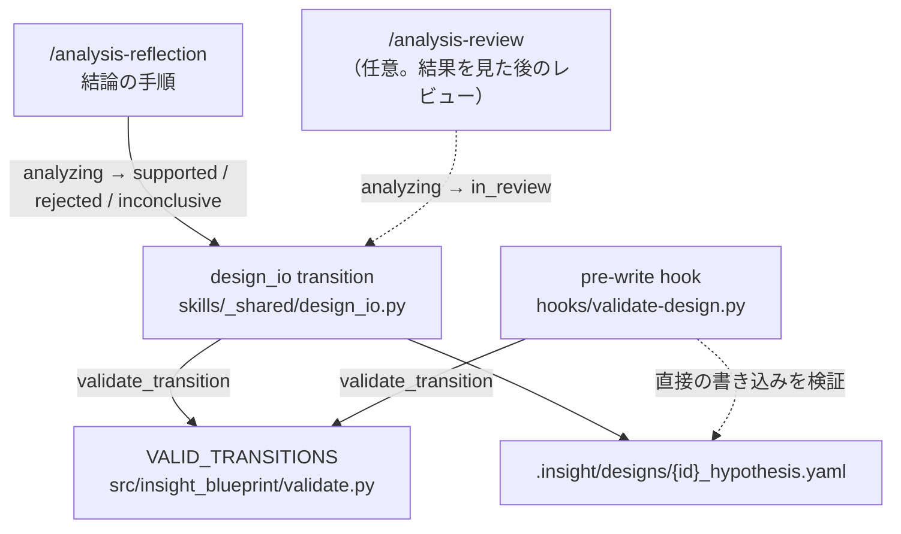
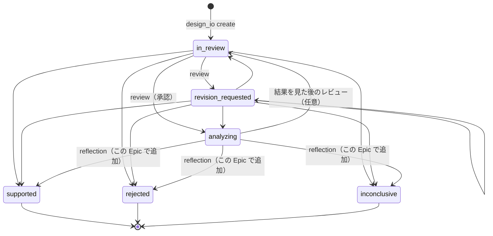
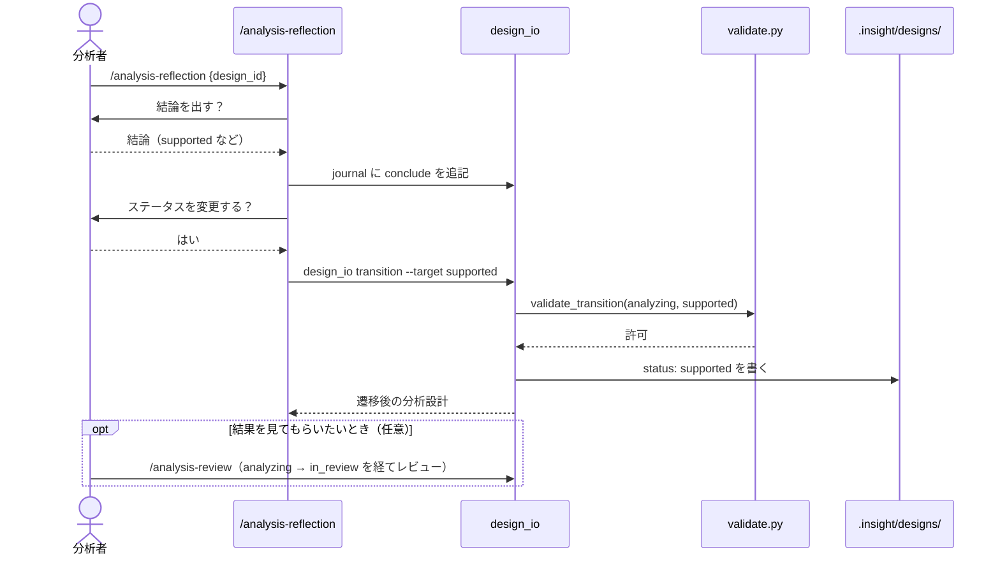

# Epic 19: analyzing から結論の status へ直接遷移する

## Background

本書がこの Epic の要求と背景の正本（[FLOW-0001](../adr/flow/0001-designdoc-owns-requirements.md)）。
Epic issue（[#146](https://github.com/etoyama/insight-blueprint-skills/issues/146)）には要約と本書へのリンクだけを置く。

- 解く課題: guided autopilot（`/analysis-auto`）の既定の巡回が、分析を終えた後の reflection で毎回止まる（[#138](https://github.com/etoyama/insight-blueprint-skills/issues/138)）。
  - 課題1: `/analysis-reflection` は結論を出すと `design_io transition` で `analyzing` から `supported` / `rejected` / `inconclusive` へ遷移させる。
    ところが `VALID_TRANSITIONS`（`src/insight_blueprint/validate.py`）は `analyzing` から `in_review` への遷移しか許さず、この遷移を拒む。
    2026-11-21 に ib-notebook でオープンデータの分析を試したとき、1巡目の reflection で拒まれた。
  - 課題2: 文書どうしが食い違っている。遷移表、`/analysis-design` の Status Flow、[docs/ARCHITECTURE.md](../ARCHITECTURE.md) は「`analyzing → supported` は拒む」と定める。
    `/analysis-reflection` の注記は「結論へ遷移するには `analyzing` が必要」と逆を書く。`/analysis-auto` には、分析の後に `in_review` へ戻す手順が無い。
  - 課題3: 拒まれた分析者は `/analysis-review` を走らせて `in_review` を経てから閉じるしかない。結果を見る必要の無いレビューを1回挟むことになり、status は実際に起きたことを表さなくなる。
- PRD の要件: [docs/PRD.md](../PRD.md) の守る核「分析設計、journal / reflection」。reflection で結論を出し、分析設計を閉じられること。PRD は review を守る核に入れていない。
- 既存手段が不十分な理由: `/analysis-auto` の Step 3 の review は分析の前に行う設計レビューで、通れば `analyzing` になる。分析の後に review を挟む手順はどの skill にも無い。
  そのため、SKILL.md の手順を足すだけでは直らない。遷移表を変えるか、巡回に手順を足すかを決める必要がある（[ADR-0029](../adr/0029-analyzing-reaches-conclusion-directly.md)）。

## User Stories

AC の正本はここ。

### US-1: 分析者が分析を終えた分析設計にそのまま結論を出せる

分析者として、分析を終えた分析設計に reflection で結論を出したら、レビューを挟まずに結論の status へ閉じたい。結果を見てもらいたいときだけ `/analysis-review` を使えればよい。

- [x] AC 1: `design_io transition` は、`analyzing` から `supported` / `rejected` / `inconclusive` への遷移を受け付ける。`analyzing → in_review` も引き続き受け付ける。`analyzing → revision_requested` は引き続き拒む。
- [x] AC 2: pre-write hook も `*_hypothesis.yaml` を直接書き換えて `analyzing` から結論の status にする書き込みを受け付ける（遷移表は1つ）。
- [x] AC 3: `/analysis-design` の Status Flow と [docs/ARCHITECTURE.md](../ARCHITECTURE.md) の状態遷移ガードの記述が、`analyzing` から行ける status として遷移表と同じものを示す。
- [x] AC 4: `/analysis-reflection` の結論の手順は `analyzing` から結論の status へ直接遷移できること、結果を見た後の `/analysis-review` は任意であることを書く。どの skill も結論の前に `in_review` へ戻す手順を求めない。

## Stories

| Story issue | User Story | 扱う AC |
|---|---|---|
| [#147](https://github.com/etoyama/insight-blueprint-skills/issues/147) | US-1 | AC 1〜4 |

## Ubiquitous Language

語は増やさない。「状態」（`DesignStatus`）と「terminal status」の定義は変わらない。

## Scope

[docs/PRD.md](../PRD.md) の守る核「分析設計、journal / reflection」と、[docs/ARCHITECTURE.md](../ARCHITECTURE.md) の Validation library（状態遷移ガード）を前進させる。

- Epic 範囲内:
  - `src/insight_blueprint/validate.py` の `VALID_TRANSITIONS`。
  - `/analysis-design` の Status Flow、`/analysis-reflection` の結論の手順の注記。
  - [docs/ARCHITECTURE.md](../ARCHITECTURE.md) の状態遷移ガードの記述。
  - ADR-0029（遷移表に辺を足す決定）。
- Epic 範囲外:
  - 結果を見た後のレビューを必須にすること（ADR-0029 で落とした）。
  - `review-batch` が受け付ける遷移先。レビューは `in_review` か `revision_requested` から記録するもので、変えない。
  - `analyzing → revision_requested` の辺。必要とした人がいない。

## Architecture

## Domain Model

model のクラスは変えない。変わるのは `DesignStatus` の遷移で、`AnalysisDesign` の不変条件「`status` は `VALID_TRANSITIONS` の遷移でだけ変わる」は変わらない。

| 型 | 種類 | 不変条件 |
|---|---|---|
| `DesignStatus` | 列挙 | `analyzing` から行けるのは `in_review`・`supported`・`rejected`・`inconclusive`。terminal status からはどこへも遷移しない |

## Sequence Diagram

## Decisions

### Decision: make-issue-138-a-small-epic

- What: #138 を直す Epic issue（#146）と Story issue（#147）を新しく起票する。Story は1本にする。
- Why: 遷移表を変えるのは振る舞いの変更で、単発の PR では扱えない（[ADR-0012](../adr/0012-single-pr-scope.md)）。AC は4つで、1本の Story に収まる。
- Criteria: 振る舞いの変更が DesignDoc を伴うこと（Must、ADR-0012）。
- Affected modules: なし（進め方）
- Alternatives considered: #138 をそのまま Epic issue にする案。#138 は不具合の報告で、原因の記述を訂正して残したほうが経緯を追いやすい。
- Consequences: #138 は Epic #146 にリンクし、本文の原因の誤り（`/analysis-auto` の review が任意だから）を訂正した。

### Cross-epic decisions (links to ADR)

- [ADR-0029: analyzing から結論の status へ直接遷移できるようにする](../adr/0029-analyzing-reaches-conclusion-directly.md)

## Test Design Matrix

| Story \ Layer | Unit | Integration | E2E |
|---|---|---|---|
| US-1 analyzing から結論へ | ✓（`tests/test_validate.py`: `test_analyzing_reaches_each_conclusion_directly`、`test_analyzing_can_still_go_back_to_in_review`、`test_message_lists_sorted_valid_targets`。`tests/skills/test_direct_conclusion_structure.py`: `TestAnalysisDesignStatusFlow`、`TestArchitectureStateGuard`、`TestReflectionConcludesFromAnalyzing`） | ✓（`tests/test_design_io.py`: `test_analyzed_design_concludes_without_a_review`。`tests/test_validate_hook.py`: `test_conclusion_from_analyzing_via_inplace_edit_passes`。hook を subprocess で動かす） | —（headless 実行の E2E は ADR-0010 で必須にしていない。`bin/design_io` を通した手動確認を Story Timeline に残す） |

完了時に ✓ を付ける。自動テストがない層には「—（理由）」を書く（[ADR-0010](../adr/0010-skill-tdd-structure-tests.md)）。

## Story Timeline

- 2026-11-22 — 人間が decision-analysis で案 B（`analyzing` から結論の status への辺を足す）に決めた。判断は ADR-0029 に残す。
- 2026-11-22 — DesignDoc 初版。Epic #146 と Story #147 を起票し、#138 の原因の記述を訂正した。
- 2026-11-22 — Story #147 completed: `VALID_TRANSITIONS` の `analyzing` の行に結論の status を足し、`/analysis-design` の Status Flow、`/analysis-reflection` の結論の手順の注記、ARCHITECTURE の状態遷移ガードを表に合わせた。
  `analyzing → supported` を拒むことを前提にしたテスト（`tests/test_validate.py` に3本、`tests/test_design_io.py` と `tests/test_validate_hook.py` に1本ずつ）は、拒む例を `analyzing → revision_requested` に替えた。仕様の変更として、新しいテストとは別のコミットにした。
  構造テストは、prose が述べる遷移を遷移表と照らす形にした。`/analysis-review`（`analyzing` なら `in_review` に戻してから記録する）と `/analysis-auto`（分析の後に `in_review` へ戻す手順は無い）は、表と食い違わないので直していない。
- 2026-11-22 — 手動確認（US-1 AC 1）: 空のプロジェクトで `bin/design_io` を使い、`create` → `transition --target analyzing` → `transition --target supported` を実行した。`*_hypothesis.yaml` は `status: supported` になった。
  確かめていないこと: `/analysis-auto` を通した巡回。
