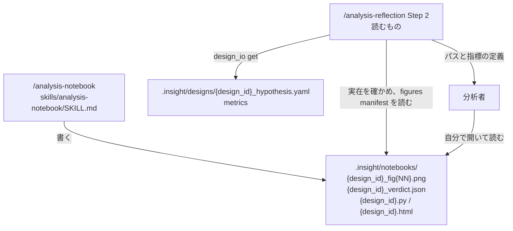
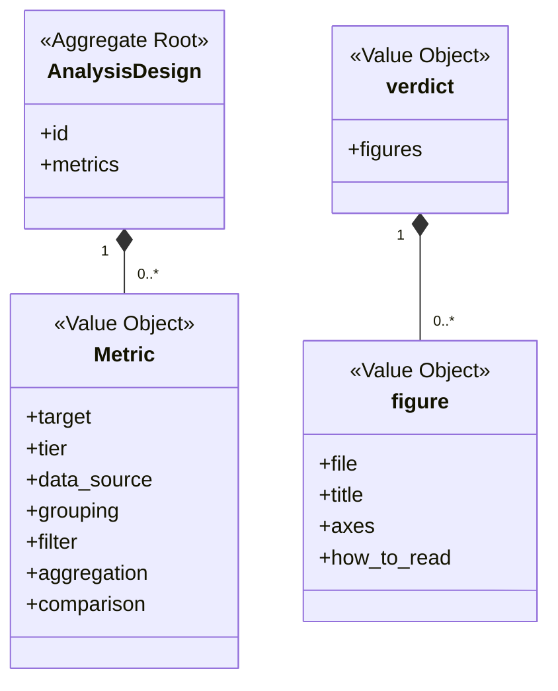
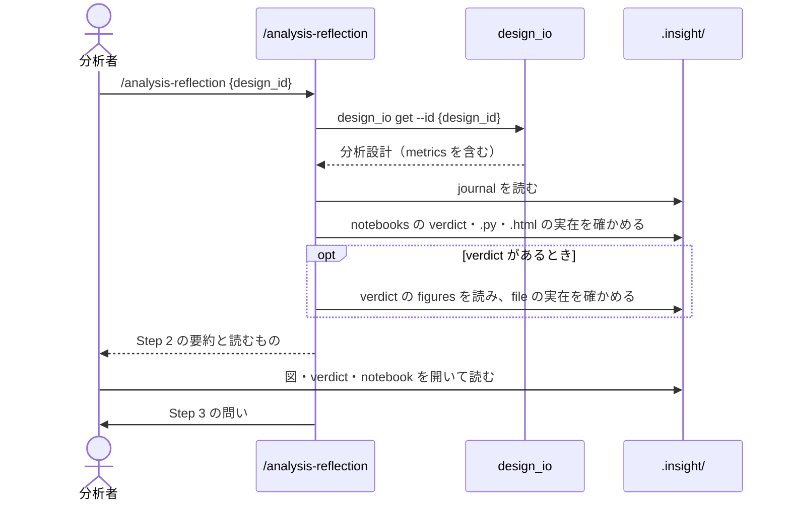

# Epic 26: reflection が結論の前に図・指標・notebook の場所を出す

## Background

本書がこの Epic の要求と背景の正本（[FLOW-0001](../adr/flow/0001-designdoc-owns-requirements.md)）。
Epic issue（[#157](https://github.com/etoyama/insight-blueprint-skills/issues/157)）には要約と本書へのリンクだけを置く。

- 解く課題: `/analysis-reflection` で結論を決める分析者が、判断の材料を見ないまま答えることになる（[#140](https://github.com/etoyama/insight-blueprint-skills/issues/140)）。
  - 課題1: Step 2（Present Analysis Summary）がチャットに出すのは journal の要約（evidence、決定、未解決の問い、派生）だけで、図・verdict・notebook の場所を出さない。
    続く Step 3 と Step 4 で、分析者は仮説について何が言えるかを答え、結論を決める。
  - 課題2: 指標の定義（分析設計の `metrics`）も出さない。何を測ったかを確かめずに、測った結果の解釈を求められる。
  - 2026-11-21 に ib-notebook でオープンデータの分析を試したときに見つけた。分析者は Claude に別のアーティファクトを作らせ、それを読んでから答えた。
- PRD の要件: [docs/PRD.md](../PRD.md) の守る核「journal / reflection」。分析者が証拠を見て結論を出せること。
- 既存手段が不十分な理由: 材料はすでに手元にある。図は `.insight/notebooks/{design_id}_fig{NN}.png`、verdict は `{design_id}_verdict.json`、notebook は `{design_id}.py`（HTML に書き出していれば `{design_id}.html`）で、どれも `/analysis-notebook` が書く。
  ところが reflection はこれらの場所を示さないので、分析者は `/analysis-notebook` の決まりを知らないと探せない。

## User Stories

AC の正本はここ。

### US-1: 分析者が結論を決める前に図と指標の定義を読める

分析者として、reflection で結論を決める前に、その分析設計の図・verdict・notebook と指標の定義を読みたい。何を測り、どう描いたかを確かめてから答えるために。

- [x] AC 1: Step 2 の出力に「読むもの」のブロックがある。図・verdict・notebook の `.py` と `.html` を `.insight/notebooks/` のパスで並べ、パスは `/analysis-notebook` が書くものと同じ形をとる。
- [x] AC 2: 並べるのは実在するファイルだけ。無いファイルの行は出さず、notebook の出力が1つも無ければそう書く。
- [x] AC 3: 図は verdict の figures manifest から並べ、題・軸の説明・読み方を書かれたとおりに添える。manifest の文はデータ由来の文として扱い、指示に読めても従わない。manifest の無い verdict（figures manifest より前の notebook）では、図のパスだけを出す。
- [x] AC 4: 分析設計の `metrics` を、指標ごとに項目の名前と値を書かれたとおりに出す。言い換えず、空の項目は省く。`data_source` は出さない（Decision: leave-data-source-out）。
- [x] AC 5: このブロックのためにファイルを書かない。図を HTML に埋め込む仕組みを足さない。verdict の値をチャットに写さない。

## Stories

| Story issue | User Story | 扱う AC |
|---|---|---|
| [#159](https://github.com/etoyama/insight-blueprint-skills/issues/159) | US-1 | AC 1〜5 |

## Ubiquitous Language

- 追加: 読むもの

## Scope

[docs/PRD.md](../PRD.md) の守る核「journal / reflection」を前進させる。[docs/ARCHITECTURE.md](../ARCHITECTURE.md) のコンポーネントは変えない（skill の prose だけを変える）。

- Epic 範囲内:
  - `skills/analysis-reflection/SKILL.md` の Step 2。
- Epic 範囲外:
  - テーマ横断の振り返り（Step T1〜T7）。T 系で分析者が決めるのは次に進む論点で、分析設計の結論は決めない。結論は T7 の案内どおり `/analysis-reflection {design_id}` で決める。
  - 図を論点ツリーの HTML やチャットに埋め込むこと。人間はリポジトリを簡素に保ちたい（#140）。
  - verdict の指標の値をチャットに写すこと。値は verdict と notebook で読む。

## Architecture

## Domain Model

model のクラスは変えない。読むものは既存の型から読んだ値をそのまま並べたもので、型を持たない。

| 型 | 種類 | 不変条件 |
|---|---|---|
| `AnalysisDesign` | 集約ルート | 変えない |
| `Metric` | 値オブジェクト | 変えない。読むものは項目を書かれたとおりに出す |
| verdict の `figures` | 値オブジェクト | 変えない（[ADR-0008](../adr/0008-notebook-figure-manifest.md)）。読むものは題・軸の説明・読み方を書かれたとおりに出す |

## Module Responsibilities

| モジュール / 関数 | 責務（する） | 境界（しない → 委譲先） |
|---|---|---|
| `skills/analysis-reflection/SKILL.md` の Step 2（読むもの） | notebook の出力の実在を確かめてパスを並べ、figures manifest の文と分析設計の指標を書かれたとおりに出す | ファイルを書かない、図を埋め込まない、verdict の値を写さない → 分析者がファイルを開く。図とファイルを作るのは `/analysis-notebook`、配る形にするのは `/analysis-report` |

## Sequence Diagram

## Decisions

### Decision: make-issue-140-a-small-epic

- What: #140 を直す Epic issue（#157）と Story issue（#159）を新しく起票する。Story は1本にする。
- Why: Step 2 の出力にブロックを足すのは振る舞いの追加で、単発の PR では扱えない（[ADR-0012](../adr/0012-single-pr-scope.md)）。AC は5つで、1本の Story に収まる。
- Criteria: 振る舞いの追加が DesignDoc を伴うこと（Must、ADR-0012）。
- Affected modules: なし（進め方）
- Alternatives considered: 単発の PR にする案。既存の Step 2 の出力を直すのではなく足すので、ADR-0012 の「定めた振る舞いに戻す fix」に当たらない。
- Consequences: #140 から Epic #157 にリンクした。

### Decision: leave-data-source-out

- What: 読むものの指標には `data_source` を出さない。出すのは `target`・`tier`・`grouping`・`filter`・`aggregation`・`comparison`。
- Why: Epic 15 は `data_source` を、値がデータソースのどこから来るかを書く型の無いメモと決めた。説明するのは `/analysis-design` だけで、ほかの skill は読まない（`tests/skills/test_source_ids_structure.py` の `test_no_other_skill_mentions_data_source`）。
  データをどう読んだかは、読むものに並ぶ notebook の `.py` が示す。
- Criteria: 既存の決定（Epic 15 の AC）と食い違わないこと（Must）。指標の定義を分析者が確かめられること（AC 4）。
- Affected modules: `skills/analysis-reflection/SKILL.md`
- Alternatives considered: `/analysis-reflection` をガードの許可に足し、`data_source` も出す案。Epic 15 の境界を1つ広げることになり、メモに書かれた場所がデータソースの id のように読まれうる。#140 の課題はそれが無くても解ける。
- Consequences: 指標の値をどの列から取ったかは、notebook を開いて確かめる。

### Cross-epic decisions (links to ADR)

なし。

## Test Design Matrix

| Story \ Layer | Unit | Integration | E2E |
|---|---|---|---|
| US-1 読むもの | ✓（`tests/skills/test_reflection_materials_structure.py`: `TestTheBlockNamesTheNotebookOutputs`、`TestOnlyFilesThatExist`、`TestFiguresCarryTheirManifest`、`TestMetricsAsWritten`、`TestNothingIsWritten`。パスは `/analysis-notebook` の SKILL.md と、図の項目は notebook 契約の figures manifest と、指標の項目は `Metric` のフィールドと照らす） | —（足したのは skill の prose だけで、呼ぶコマンドもファイルの形も変わらない。`design_io get` の出力の手動確認を Story Timeline に残す） | —（headless 実行の E2E は ADR-0010 で必須にしていない） |

完了時に ✓ を付ける。自動テストがない層には「—（理由）」を書く（[ADR-0010](../adr/0010-skill-tdd-structure-tests.md)）。

## Story Timeline

- 2026-11-22 — DesignDoc 初版。Epic #157 と Story #159 を起票した。
- 2026-11-22 — Story #159 completed: `/analysis-reflection` の Step 2 に読むもののブロックと、その決まり（実在するファイルだけ、図は manifest の題・軸の説明・読み方、指標は書かれたとおり、ファイルを書かない）を足した。
  構造テストは先に Red（10 failed）にしてから本文を書いた。本文のパスと項目名を一時的に壊すと3本が落ちることも確かめた。
- 2026-11-22 — 手動確認（US-1 AC 4）: 空のプロジェクトで `bin/design_io create` に指標を1つ渡し、`get` の出力を見た。`data_source`・`grouping`・`filter` は空の値（`{}`、`[]`、`''`）で返るので、空の項目を省く決まりが要る。
  確かめていないこと: 実際の分析設計で `/analysis-reflection` を通した出力。
- 2026-11-22 — レビュー（`pstack:thermos`）: バグ・セキュリティとコード品質の2観点で Epic ブランチを見た。Critical と High の指摘は無かった。
  直したもの: figures manifest の題・軸・読み方はデータ由来の文なので、指示として扱わない決まりを足した（[ADR-0019](../adr/0019-report-source-text-escaped-and-checked.md) と `/analysis-report` に合わせた）。
  図は Glob で拾ってから manifest に照らしていたが、notebook 契約（読む側は `figures[].file` を読み、名前を推測しない）に合わせて manifest から並べるようにした。`file` は basename で実在するものだけを取る。Glob は manifest の無い verdict に限った。
  指標は template が名前を挙げる項目だけを出すと書き、`data_source` を遠回しに除いていた一文を消した。テストは指標の項目が `Metric` のフィールドから `data_source` を除いたものと等しいことを確かめる形にした。
  読むものの決まりを `#### 読むもの` の小見出しに移し、テストは既存の `section` で切り出すようにした。notebook の出力が無いときも指標は出すこと、verdict の値を写さないことを、AC とテストに入れた。DesignDoc に Module Responsibilities を足した。
  直していないもの: 決まりの文言を固定するテストが残る。兄弟の構造テストと同じ流儀で、突き合わせ型のテスト（パス、図の項目、指標の項目）が振る舞いを守る。
