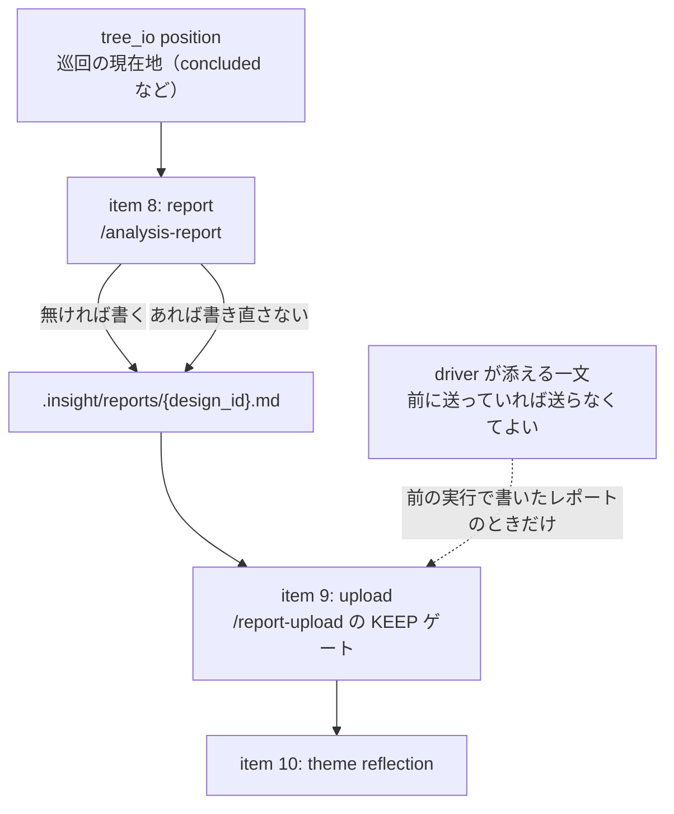
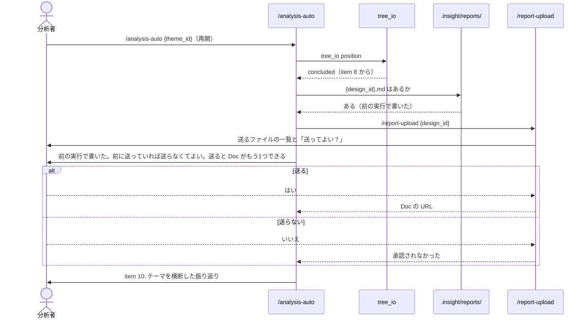

# Epic 27: /analysis-auto を再開したときも、レポートを送るかを聞く

## Background

本書がこの Epic の要求と背景の正本（[FLOW-0001](../adr/flow/0001-designdoc-owns-requirements.md)）。
Epic issue（[#156](https://github.com/etoyama/insight-blueprint-skills/issues/156)）には要約と本書へのリンクだけを置く。

- 解く課題: guided autopilot（`/analysis-auto`）を中断して再開すると、レポートの送り漏れに気づけない（[#139](https://github.com/etoyama/insight-blueprint-skills/issues/139)）。
  - 課題1: 巡回の item 8（report）は、レポートが既にあれば書き直さず、`/report-upload` は分析者が打つものだと知らせるだけで進む。
    item 9（upload）は「item 8 がレポートを書いたとき」しか起動しない。結論を出した直後に中断した巡回を再開すると（巡回の現在地は `concluded`）、送るかを一度も聞かれないままテーマを横断した振り返りへ進む。
  - 課題2: `/report-upload` は送った記録を残さず、毎回新しい Doc を作る。driver には、前の実行で送ったかどうかを知る手段が無い。
  - 課題3: 承認は持ち越さない（[ADR-0016](../adr/0016-approval-before-external-send.md)）。前の実行で承認したことを、今回の承認の代わりにはできない。
- PRD の要件: [docs/PRD.md](../PRD.md) の guided autopilot。KEEP ゲートでだけ止まり、分析者は `/command` を打たずに巡回を終えられること。
- 既存手段が不十分な理由: item 8 の知らせは分析者に `/report-upload` を打たせる。guided autopilot は分析者に `/command` を打たせないための実行で、知らせは読み飛ばされやすい。

## User Stories

AC の正本はここ。

### US-1: 分析者が再開した後もレポートの送り漏れに気づける

分析者として、中断した `/analysis-auto` を再開したときも、レポートを送るかを聞かれたい。前に送っていたかを自分で思い出せれば、二度送らずに済ませたい。

- [x] AC 1: 巡回にレポートがあれば、前の実行で書いたものでも、item 8 は書き直さずに item 9 へ進み、item 9 は `/report-upload` を起動して KEEP ゲートまで進む。巡回にレポートが無いときだけ item 9 を飛ばす。
- [x] AC 2: 前の実行で書いたレポートのときは、ゲートと同じメッセージに「前に送っていれば送らなくてよい。送ると Doc がもう1つできる」と添える。この一文は問いではなく、ゲートが upload についての唯一の問いのまま残る。
- [x] AC 3: driver は送った記録を持たない。前の実行で出した承認は今回の承認の代わりにならない（ADR-0016）。
- [x] AC 4: Gate policy の upload の行、Chaining の行、Step 1 の計画の知らせ、Step 4 の要約が、前の実行で書いたレポートも upload の対象にすることと食い違わない。

## Stories

| Story issue | User Story | 扱う AC |
|---|---|---|
| [#158](https://github.com/etoyama/insight-blueprint-skills/issues/158) | US-1 | AC 1〜4 |

## Ubiquitous Language

語は増やさない。「巡回」「巡回の現在地」「KEEP ゲート」の定義は変わらない。

## Scope

[docs/PRD.md](../PRD.md) の guided autopilot と、[docs/ARCHITECTURE.md](../ARCHITECTURE.md) の Skill layer（`/analysis-auto`）を前進させる。

- Epic 範囲内:
  - `skills/analysis-auto/SKILL.md` の Gate policy の upload の行、Step 1 の計画の知らせ、Step 3 の item 8・9、Step 4 の要約、Chaining。
- Epic 範囲外:
  - 送った記録を持つこと（Decisions `keep-no-record-of-the-upload` で落とした）。
  - `/report-upload` の KEEP ゲートの文言。添える一文は driver が出す。`/report-upload` を単独で打ったときは、分析者が自分で送ると決めているので添えない。
  - 送ったレポートを再び承認したときに Doc が2つできること。文言で抑えるだけにする。

## Architecture



## Domain Model

model のクラスは変えない。driver は送った記録を持たないので、新しい状態も増えない。
item 9 へ進むかは、レポートのファイルがあるかだけで決まる。

```mermaid
classDiagram
    class AnalysisDesign {
        <<Aggregate Root>>
        status
    }
    class Report {
        <<Entity>>
        .insight/reports/{design_id}.md
    }
    AnalysisDesign "1" --> "0..1" Report : terminal status で書く
```

| 型 | 種類 | 不変条件 |
|---|---|---|
| `Report` | エンティティ（ファイル） | 一度書いたら guided autopilot は書き直さない。送ったかどうかはどこにも残さない |

## Sequence Diagram



driver の一文と `/report-upload` の一覧は同じメッセージに並ぶ。図では別の矢印にしたが、分析者が答えるのはゲートの1回だけである。

## Decisions

### Decision: keep-no-record-of-the-upload

- What: 再開したときにレポートがあれば、毎回 `/report-upload` の KEEP ゲートまで進め、送るかを聞く。ゲートと同じメッセージに「前に送っていれば送らなくてよい」と添える。送った記録は持たない（案 C）。
- Why: 課題1（再開すると送り漏れに気づけない）を、新しい状態を増やさずに解く。
- Criteria: 人間が decision-analysis で決めた（2026-11-22、issue #139 のコメント）。

  | # | 基準 | 区分 | 分類 | 重み（決めた人） | 出典 |
  |---|---|---|---|---|---|
  | M1 | 承認を持ち越さない | Must | - | - | ADR-0016 |
  | W1 | 再開した後に送り漏れに気づける | Want | 解決 | 高（人間） | 課題1 |
  | W2 | 送ったレポートを二度送らない | Want | 解決 | 中（人間） | 課題2 |
  | W3 | 新しい状態を増やさない | Want | 費用 | 高（人間） | 課題2、YAGNI |

  | Want | A. 知らせを目立たせるだけ | B. 送った記録を持つ | C. 毎回ゲートまで進める |
  |---|---|---|---|
  | W1 | 知らせは読み飛ばされうる | 送っていなければ聞ける | 毎回聞かれる |
  | W2 | 二度送らない | 二度送らない | 承認すると Doc が2つできる。文言で抑える |
  | W3 | 増えない | 記録の置き場所・形・テストが増え、Epic と ADR が要る | 増えない |

  決め手は W1 と W3。何もしない案は W1 を満たさない。
- Affected modules: `skills/analysis-auto/SKILL.md`
- Alternatives considered: 上の表の A・B と、何もしない案。
- Consequences: 送った後に再開すると、もう一度ゲートで聞かれる。送ったことを覚えていない分析者が承認すると、Doc がもう1つできる（W2 の穴）。

### Decision: the-note-comes-from-the-driver

- What: 「前に送っていれば送らなくてよい」の一文は、`/report-upload` のゲートの文言ではなく、driver が同じメッセージに添える。
- Why: 一文が要るのは、前の実行で書いたレポートを driver が upload に回すときだけである。`/report-upload` は、レポートがいつ書かれたかを知らない。
- Criteria: 単独で打ったときに不要な一文を出さないこと。並行する #103（PR #154）が `skills/report-upload/SKILL.md` を直していて、同じ文言を触ると衝突すること。
- Affected modules: `skills/analysis-auto/SKILL.md`
- Alternatives considered: `/report-upload` の Step 3 の文言に常に一文を足す案。単独で打った分析者にも毎回出るうえ、#154 と衝突する。
- Consequences: 一文は driver の問いではなく、ゲートの補足である。Gate policy の「driver adds no question of its own」は変わらない。

### Decision: make-issue-139-a-small-epic

- What: #139 を直す Epic issue（#156）と Story issue（#158）を新しく起票する。Story は1本にする。
- Why: `/analysis-auto` の振る舞いを変えるので、単発の PR では扱えない（[ADR-0012](../adr/0012-single-pr-scope.md)）。AC は4つで、1本の Story に収まる。
- Criteria: 振る舞いの変更が DesignDoc を伴うこと（Must、ADR-0012）。
- Affected modules: なし（進め方）
- Alternatives considered: #139 をそのまま Epic issue にする案。#139 は不具合の報告で、Epic 19 と同じく分けて残したほうが経緯を追いやすい。
- Consequences: #139 は Epic #156 にリンクした。

### Cross-epic decisions (links to ADR)

なし。効果は `/analysis-auto` の巡回の中で閉じ、ADR-0016 の決まり（承認を持ち越さない）をそのまま守る。

## Test Design Matrix

| Story \ Layer | Unit | Integration | E2E |
|---|---|---|---|
| US-1 再開でも upload の段へ | ✓（`tests/skills/test_resume_upload_structure.py`: `TestAnExistingReportGoesToTheUpload`、`TestTheGateSaysASentReportNeedsNoUpload`、`TestNothingIsCarriedOver`、`TestTheRestOfTheSkillAgrees`。仕様の変更として `tests/skills/test_upload_wiring_structure.py::test_no_report_means_no_upload` と `tests/skills/test_auto_walk_structure.py::test_a_report_from_an_earlier_run_is_kept_and_goes_to_the_upload` を直した） | —（Python のテストからは driver を動かせない。SKILL.md の文だけが対象で、結合する層が無い） | —（headless 実行の E2E は ADR-0010 で必須にしていない） |

完了時に ✓ を付ける。自動テストがない層には「—（理由）」を書く（[ADR-0010](../adr/0010-skill-tdd-structure-tests.md)）。

## Story Timeline

- 2026-11-22 — 人間が decision-analysis で案 C（送った記録は持たず、再開でも毎回ゲートまで進める）に決めた。判断は Decisions `keep-no-record-of-the-upload` に残す。
- 2026-11-22 — DesignDoc 初版。Epic #156 と Story #158 を起票し、#139 を Epic にリンクした。
- 2026-11-22 — Story #158 completed: `/analysis-auto` の item 8 は既にあるレポートを item 9 へ回し、item 9 は巡回にレポートがあれば `/report-upload` を起動する。前の実行で書いたレポートのときは、ゲートと同じメッセージに一文を添える。
  旧仕様を固めていた構造テスト2本は、仕様の変更として新しいテストとは別のコミットで直した。
  確かめていないこと: 実際に `/analysis-auto` を中断・再開した巡回。
