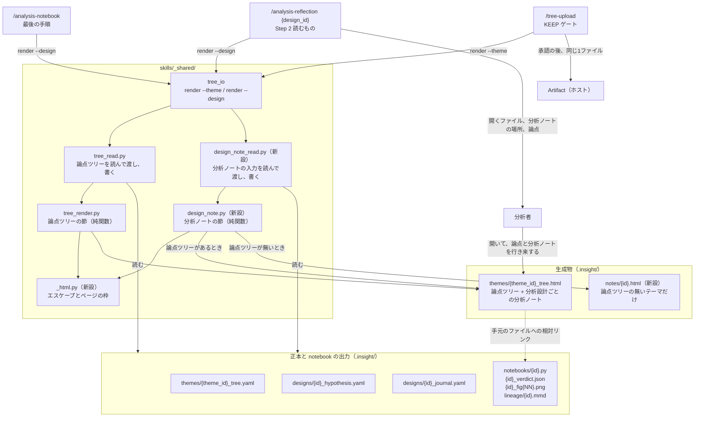
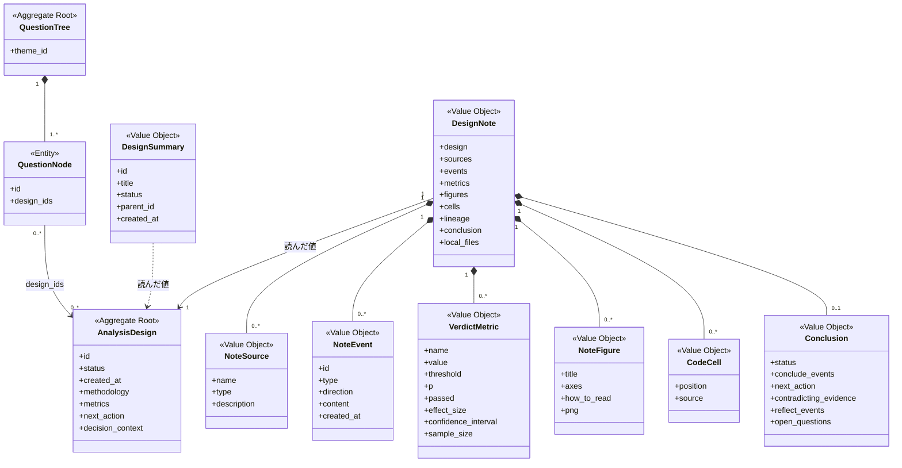
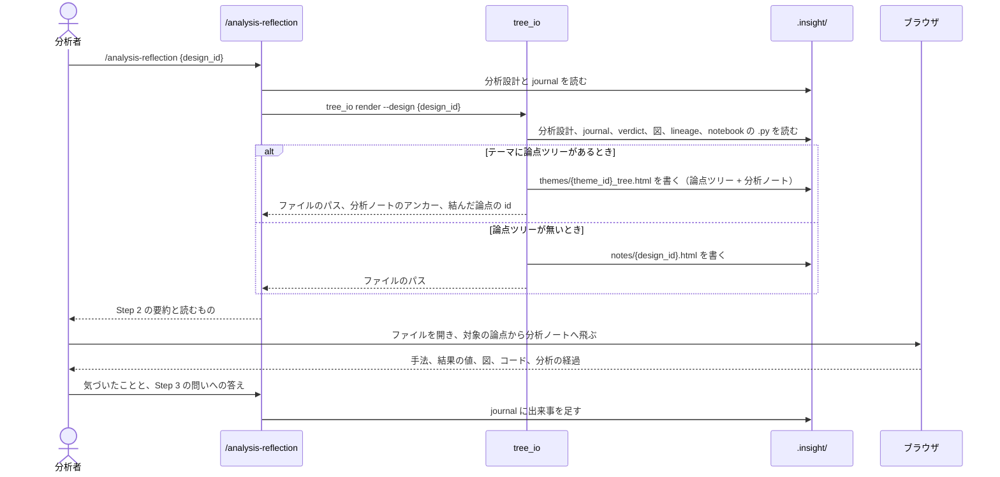
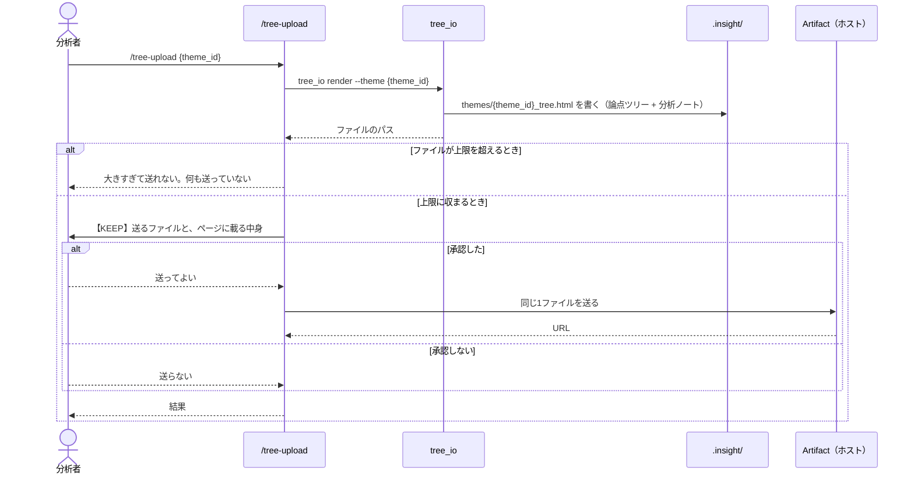

# Epic 28: 論点ツリーの HTML を、分析者と AI が分析を進める共通の入口にする

## Background

本書がこの Epic の要求と背景の正本（[FLOW-0001](../adr/flow/0001-designdoc-owns-requirements.md)）。
Epic issue（[#173](https://github.com/etoyama/insight-blueprint-skills/issues/173)）には要約と本書へのリンクだけを置く。

- 解く課題: 分析者は AI に判断を求められたとき、根拠になる分析結果や図表をすぐに確かめられない（人間の課題認識、2026-11-22）。
  実際に使うと分析の流れは円滑だったが、結論の確定や分析の修正を聞かれた時点で、根拠がどこにあるかを自分で探すことになった。
  - 課題1: 論点ツリーの HTML から、論点に対応する成果物へたどれない。HTML のリンクはページの中のアンカーだけである。
  - 課題2: 成果物に、人が1か所で読める形が無い。手法と指標は分析設計の YAML に、結果は verdict の JSON に、図は PNG に、コードは notebook の `.py` に、経過は journal の YAML にある。
  - 課題3: 判断を求める段のうち、論点ツリーの HTML を示すのはテーマの振り返りだけである。結論を決める分析設計の振り返りは、ファイルのパスをチャットに並べる。
  - 課題4: 論点ツリーの HTML を作り直すのは、テーマの段だけである。notebook を実行した後や分析をやり直した後は、古いままになる。
  - 課題5: Artifact で論点ツリーを受け取った人は、根拠へたどれない。
  - 課題6: 読む人にとって、結論の前に読む文書とレポートは、同じ分析設計の同じ文書である。2つに分かれていると迷う。
- PRD の要件: [docs/PRD.md](../PRD.md) のコアバリュー「論点ツリー」と「journal / reflection」。分析者が証拠を見て結論を出せること。
  製品の成功基準（論点ツリーの表示を渡された読み手が、現在地と次の一手を説明できる）にもかかわる。
- 既存手段が不十分な理由: `/analysis-reflection` の読むもの（[Epic 26](epic-26-reflection-materials.md)）は、図・verdict・notebook のパスをチャットに並べる。
  分析者はファイルを1つずつ開くことになり、論点との対応は自分で追う。notebook の HTML の書き出しは任意で、journal と指標の定義を載せない。

### 求める運用（人間、issue #173）

- 論点ツリーの HTML を、人間と AI が分析を進めるための共通の入口にする。
- 各論点から、その論点に対応する最新の成果物にたどれる。分析方法とデータの集計内容、分析結果・図表・集計表、分析ノート、分析過程と実装を確かめられるコードである。
- 論点ツリーの HTML は全体像を見渡せる軽量なものに保つ。
- AI が結論の確定や分析の修正について判断を求めるときは、最新の論点ツリーの HTML と対象の論点を示す。人間はそこから根拠を確かめ、判断や修正の指示を返す。
- 分析をやり直した後も、同じ入口から最新の成果物にたどれる。
- アップロードすれば他者に渡せる Artifact になり、途中の段階では手元で同じものを確かめられる（人間、2026-11-22、見本を見る前の発言）。

### 前提にした事実（main、2026-11-22）

- `tree_io render`（`skills/_shared/tree_read.py` の `render`、`skills/_shared/tree_render.py`）が書く `.insight/themes/{theme_id}_tree.html` のリンクは、`_link` が作るページの中のアンカーだけである。
  論点のカードの「根拠を開く」には、現時点の答えの文、引用した journal の出来事の本文、結んだ分析設計の id・題・状態が出る。
- `tree_io render` を呼ぶのは、`/analysis-framing`、`/analysis-reflection {theme_id}`（T4 の後と T7 の後）、`/tree-upload` の3つである。
- 成果物のファイル名は分析設計の id で決まる。やり直すと同じパスに上書きされる。派生の分析設計は別の id になる（[ADR-0033](../adr/0033-derived-design-inherits-the-nodes-of-its-source.md)）。

| 成果物 | 今ある場所 | 書く skill |
|---|---|---|
| 手法と指標の定義 | `.insight/designs/{id}_hypothesis.yaml` | `/analysis-design` |
| 分析の経過 | `.insight/designs/{id}_journal.yaml` | `/analysis-journal`、`/analysis-notebook`、`/analysis-reflection` |
| 結果の値 | `.insight/notebooks/{id}_verdict.json` | `/analysis-notebook` |
| 図 | `.insight/notebooks/{id}_fig{NN}.png`（題・軸・読み方は verdict の figures manifest） | `/analysis-notebook` |
| データ加工の履歴 | `.insight/lineage/{id}.mmd` | `/analysis-notebook` |
| 分析コード | `.insight/notebooks/{id}.py` | `/analysis-notebook` |
| notebook の HTML | `.insight/notebooks/{id}.html`（書き出しは任意） | `/analysis-notebook` |
| レポート | `.insight/reports/{id}.md`（terminal status の分析設計だけ） | `/analysis-report` |

- `/analysis-auto` の KEEP ゲートのうち、結果が在る段は「reflection（分析設計）」と「theme reflection T7」の2つである。
  framing・design・premortem は notebook の実行より前にある。
- Artifact の中で通る移り方は同じページの中のアンカーだけである。別の HTML へのリンクはスマホのアプリで開けず、デスクトップでは元のページに戻れなかった。
  論点ツリーと分析ノートを1ファイルにまとめた見本は、どちらでも行き来できた（合成シナリオの見本を Artifact に出し、人間が確かめた）。
- 分析ノートの形を決めるために確かめたほかの事実（`marimo export html` の振る舞い、cell の切り出し、lineage の書き出しの中身、レポートの節の元）は、[ADR-0036](../adr/0036-design-note-is-a-generated-page-per-design.md) の Context にある。

## User Stories

AC の正本はここ。

### US-1: 分析者が、分析設計ごとの分析ノートで、結果までの事実を1か所で読める

分析者として、判断の前に根拠を確かめるために、分析設計の手法・指標の定義・結果の値・図を1つの文書で読みたい。

- [x] AC 1: `tree_io render --design {design_id}` は、その分析設計の分析ノートを作り、開くファイルのパスを返す。テーマに論点ツリーが無ければ、単独のページ（`.insight/notes/{design_id}.html`）を書く。
  分析設計が無ければエラーにして、何も書かない。
- [x] AC 2: 分析ノートはレポートの前半と同じ並びで、仮説と背景、決定の文脈、手法、指標の定義、説明変数、データソースの名前・種類・説明、結果を出す。
  結果は journal の `observe` と `evidence`（`direction` で分ける）と、verdict の指標の値である。値は書かれたとおりに出し、計算しない。接続情報は読まず、出さない。
- [x] AC 3: 図は verdict の figures manifest の順に、分析ノートに埋め込んで出し、題・軸の説明・読み方を添える。出すのは、`file` がファイル名だけで、`.insight/notebooks/` に実在する図に限る。
- [x] AC 4: notebook をまだ実行していない分析設計でも作る。無い節にはまだ無いことを書く。分析ノートの冒頭に、分析設計の状態、載せた journal の最後の出来事の時刻、verdict の有無を出す。
- [x] AC 5: 分析ノートは自己完結である。script を持たず、外部を読まず、生成した時刻と絶対パスを入れない。同じ入力（分析設計、journal、notebook の出力）からは同じ HTML ができる。分析ノートに入る文字はすべてエスケープする。

### US-2: 分析者が、分析ノートの中で分析コードと経過を確かめられる

分析者として、結果がどう作られたかを確かめるために、分析ノートの中で分析コードと分析の経過を読みたい。

- [ ] AC 1: notebook の `.py` を cell ごとに切り出し、開閉できる形で出す。
- [ ] AC 2: データ取得の cell は載せず、手元の `.py` で読むことを書く。notebook が契約の形でなく、データ取得の cell を特定できないときは、コードを1つも載せない。
- [ ] AC 3: 「分析の経過」の節に、verdict の `conclusion` と journal のすべての出来事を、時刻の順に、種類の言葉を付けて畳んで出す。節の冒頭に、分析中の判断と解釈の記録であることを書く。
- [ ] AC 4: lineage の Mermaid の文字を、畳んで出す。図としては描かない。
- [ ] AC 5: 「手元のファイル」の節に、notebook の `.py`・verdict・lineage・notebook の HTML・レポートのうち、在るものへの相対リンクを出す。節の冒頭に、手元で開いたときだけ開けることを書く。

### US-3: 分析者と読み手が、結論の後は同じ分析ノートで結論まで読める

分析者として、結論の前に読む文書と結論の文書を行き来せずに済むように、分析ノートが分析の進みに合わせて埋まってほしい。

- [ ] AC 1: 分析設計が terminal status のとき、分析ノートに結論の節を出す。節の最初に、terminal status ごとの決まった文（レポートの Abstract の最初の文と同じ）を出す。
- [ ] AC 2: 結論の節に、journal の `conclude` の本文を、書かれたとおりに出す。
- [ ] AC 3: 結論の節に、分析設計の `next_action` と決定の文脈（勧め）、仮説に反する証拠、`reflect` の本文、未解決の問いを、書かれたとおりに出す。無いものは省く。
- [ ] AC 4: terminal status でない分析設計の分析ノートには、結論の節を出さず、まだ結論が出ていないことを書く。モデルが書く文章は、どの節にも載せない。
- [ ] AC 5: 結論の節の項目（決まった文、勧めの元、未解決の問いの定義）が、レポートのテンプレートと食い違わないことを、構造テストで照らす。

### US-4: 分析者が、論点ツリーの HTML の中で、論点と分析ノートを行き来できる

分析者として、論点から根拠へ少ない手数でたどるために、論点のカードから、その論点に結んだ分析設計の分析ノートへ飛びたい。

- [ ] AC 1: `tree_io render --theme {theme_id}` は、論点ツリーの下に、テーマの分析設計すべての分析ノートを並べた1ファイル（`.insight/themes/{theme_id}_tree.html`）を書く。分析ノートを1つでも作れなければエラーにして、理由を出す。
- [ ] AC 2: 論点のカードの「結んだ分析設計」と、「分析設計の派生」の節の各分析設計に、分析ノートへ飛ぶアンカーを出す。分析ノートの冒頭と末尾に、論点ツリーへ戻るアンカーを出す。別の HTML へのリンクは出さない。
- [ ] AC 3: 論点のカードは結んだ分析設計を、終わっていないものを先に、終わったものを後に並べる。それぞれの中は `created_at` の新しい順で、同じなら id の大きい順である。
- [ ] AC 4: 論点ツリーの HTML は同じ入力（正本、分析設計、journal、notebook の出力）からは同じ HTML になる。script と stylesheet を読まない。
  テーマに論点ツリーがあるとき、`tree_io render --design {design_id}` はこのファイルを書き直し、パスと、分析ノートのアンカーと、分析設計を結んだ論点の id を返す。
- [ ] AC 5: 読み方の節に、「分析ノートを開く」の説明を書く。

### US-5: 分析者が、結論を求められたときに入口を示される

分析者として、結論を決める前に最新の根拠を確かめるために、`/analysis-reflection` が結論を聞く前に、分析ノートと対象の論点を示してほしい。

- [ ] AC 1: `/analysis-reflection {design_id}` の Step 2 は読むものを出す直前に `tree_io render --design {design_id}` を呼ぶ。手順は、テーマに論点ツリーがあるかどうかで分かれない。
- [ ] AC 2: 読むものは開くファイルのパスと、分析ノートの場所と、分析設計を結んだ論点の id である。論点ツリーが無いか、どの論点にも結んでいなければ、分析ノートのパスだけを出す。図・verdict・notebook のパスと指標の定義は、チャットに並べない。
- [ ] AC 3: `/analysis-notebook` は、結果を journal に書いた後に `tree_io render --design {design_id}` を呼び、分析ノートの場所を伝える。
- [ ] AC 4: 読むものに、気づいたことをチャットで返せば journal に残せることを書く。残すのは既存の journal の出来事で、新しい種類は足さない。
- [ ] AC 5: `/analysis-auto` の Gate policy と手順が reflection の段で分析ノートと論点を示すことと食い違わない。skill は分析ノートを読まず、正本を読む。テーマの振り返り（T7）は変えない。

### US-6: 論点ツリーを受け取った人が、Artifact でも分析ノートまで読める

分析者として、定例報告やレビューで根拠まで見せるために、分析ノートを含む論点ツリーの HTML を Artifact で渡したい。

- [ ] AC 1: `/tree-upload` は、`tree_io render --theme` が書いた1ファイルを、今までどおり書き換えずに送る。添えるファイルは送らない。
- [ ] AC 2: KEEP ゲートの承認の文に、ページに載る中身を書く。論点ツリーに加えて、分析設計ごとの分析ノート（手法、指標の値、図、journal のすべての出来事、分析コード、結論の後は結論と振り返りの本文）である。
  分析ノートを含まない論点ツリーだけを送る手段が無いことも書く。
- [ ] AC 3: ファイルが Artifact の上限（16MB）を超えるときは、承認を聞く前にそう伝え、何も送らない。
- [ ] AC 4: notebook の `.py`・verdict・Markdown のレポート・notebook の HTML は送らない。
- [ ] AC 5: README、[docs/ARCHITECTURE.md](../ARCHITECTURE.md)（`.insight/` の構成、KEEP ゲートの一覧、シーケンス図）、[docs/UBIQUITOUS_LANGUAGE.md](../UBIQUITOUS_LANGUAGE.md)（アップロード、分析ノートのコード上の名前）、`/analysis-auto` の tree-upload の行が、実装と食い違わない。

## Stories

Story は親のセッションが起票した（2026-11-22）。「触る所」が重なる Story は並行で進めない。

| Story issue | User Story | 扱う AC | 触る所 | 前提 |
|---|---|---|---|---|
| [#179](https://github.com/etoyama/insight-blueprint-skills/issues/179)（28.1 分析ノートを作る） | US-1 | AC 1, AC 2, AC 3, AC 4, AC 5 | `skills/_shared/design_note.py`（新設）、`skills/_shared/tree_read.py`、`skills/_shared/tree_io.py`、`tests/` | なし |
| [#180](https://github.com/etoyama/insight-blueprint-skills/issues/180)（28.2 コードと経過を載せる） | US-2 | AC 1, AC 2, AC 3, AC 4, AC 5 | `skills/_shared/design_note.py` | 28.1 |
| [#181](https://github.com/etoyama/insight-blueprint-skills/issues/181)（28.3 結論の後の節を埋める） | US-3 | AC 1, AC 2, AC 3, AC 4, AC 5 | `skills/_shared/design_note.py`、`tests/skills/` | 28.2 |
| [#182](https://github.com/etoyama/insight-blueprint-skills/issues/182)（28.4 論点ツリーの HTML に並べる） | US-4 | AC 1, AC 2, AC 3, AC 4, AC 5 | `skills/_shared/tree_render.py`、`skills/_shared/tree_read.py`、`skills/_shared/tree_io.py` | 28.1 |
| [#183](https://github.com/etoyama/insight-blueprint-skills/issues/183)（28.5 結論の段で示す） | US-5 | AC 1, AC 2, AC 3, AC 4, AC 5 | `skills/analysis-reflection/SKILL.md`、`skills/analysis-notebook/SKILL.md`、`skills/analysis-auto/SKILL.md`、`tests/skills/`、`docs/UBIQUITOUS_LANGUAGE.md` | 28.4 |
| [#184](https://github.com/etoyama/insight-blueprint-skills/issues/184)（28.6 分析ノートを含めて送る） | US-6 | AC 1, AC 2, AC 3, AC 4, AC 5 | `skills/tree-upload/SKILL.md`、`skills/analysis-auto/SKILL.md`、`README.md`、`docs/ARCHITECTURE.md`、`docs/UBIQUITOUS_LANGUAGE.md` | 28.5 |

- 28.1 → 28.2 → 28.3 はどれも `design_note.py` を触るので直列にする。
- 28.4 は 28.1 の後なら、28.2・28.3 と並行で進められる。触るファイルが重ならない。分析ノートの節が増えても、論点ツリーの側は分析ノートを作る関数を呼ぶだけである。
- 28.1 と 28.4 はどちらも `tree_read.py` と `tree_io.py` を触る。28.5 と 28.6 はどちらも `skills/analysis-auto/SKILL.md` と `docs/UBIQUITOUS_LANGUAGE.md` を触る。この2組は直列にする。

## Ubiquitous Language

この Epic で追加・変更した語。定義の正本は [docs/UBIQUITOUS_LANGUAGE.md](../UBIQUITOUS_LANGUAGE.md)。

- 追加: 分析ノート（[ADR-0036](../adr/0036-design-note-is-a-generated-page-per-design.md)。コード上の名前 `design_note` は、28.1 で実装と同じコミットで用語表に足す）
- 変更: 読むもの（ADR-0036。28.5 で用語表を改める）
- 変更: アップロード（[ADR-0037](../adr/0037-tree-upload-sends-the-design-notes.md)。28.6 で用語表を改める）

## Scope

[docs/PRD.md](../PRD.md) のコアバリュー「論点ツリー」と「journal / reflection」を前進させる。
[docs/ARCHITECTURE.md](../ARCHITECTURE.md) では、Skill layer（`/analysis-reflection`・`/analysis-notebook`・`/analysis-auto`・`/tree-upload`）と、`tree_io` の表示を前進させる。

- Epic 範囲内:
  - 分析ノートを作ること。論点ツリーのあるテーマでは論点ツリーの HTML の中に並べ、無いテーマでは単独のページにする。
  - 論点のカードから分析ノートへ飛ぶアンカーと、結んだ分析設計の並び。
  - 結論の後に、分析ノートの結論の節を記録から埋めること。
  - 分析設計の振り返りと notebook の最後で、分析ノートを作り直して示すこと。
  - `/tree-upload` の承認の文と、大きさの上限の扱い。
- Epic 範囲外:
  - 図を動かして確かめられる形で出すこと（[#175](https://github.com/etoyama/insight-blueprint-skills/issues/175)）。
  - notebook を marimo で書くのをやめるか（[#176](https://github.com/etoyama/insight-blueprint-skills/issues/176)）。notebook の HTML の書き出しは任意のままにする。
  - Markdown のレポートを分析ノートに一本化するか（[#177](https://github.com/etoyama/insight-blueprint-skills/issues/177)）。`/analysis-report` と `/report-upload` は変えない。モデルが書く含意の文章は、分析ノートに載せない。
  - ツリーの決定の理由に出来事を引用させること（[#137](https://github.com/etoyama/insight-blueprint-skills/issues/137)）。同じ `tree_render.py` を触るが、モデルの変更で、引き継ぎの試行の証拠を待っている。
  - 論点のカードとチャットに、図や表を埋め込むこと（Epic 26 の決定のまま）。
  - journal に、返信のための新しい出来事の種類を足すこと。
  - framing・design・review・premortem の KEEP ゲートで、分析ノートを示すこと。
  - lineage を図として描くこと。論点ツリーの HTML は script を持たない。
  - 分析ノートを含まない論点ツリーだけを Artifact に送ること。論点ツリーの無いテーマの分析ノートを送ること。
  - 分析設計と図の多いテーマで、ファイルの大きさを抑える手段。
  - 引き継ぎの試行の型（[docs/HANDOFF_TRIAL.md](../HANDOFF_TRIAL.md)）に分析ノートを足すこと。

## Architecture

- `tree_io render --theme` は、論点ツリーと、テーマの分析設計すべての分析ノートを、1ファイルに書く。
- `tree_io render --design` は、テーマに論点ツリーがあればそのファイルを書き直し、無ければ単独のページを書く。どちらのときも、開くファイルのパスを返す。
- モジュールの分け方は 28.1 で決めた（Decision `note-reads-live-apart-and-markup-is-shared`）。28.1 の時点では、`tree_io render --design` は論点ツリーの有無にかかわらず単独のページを書く。論点ツリーがあるときの分は 28.4 で作る。

## Domain Model

`src/insight_blueprint/models/` のクラスは変えない。分析ノートは既存の型と notebook の出力から読んだ値を並べた生成物である。
下の図の `DesignNote`・`NoteSource`・`NoteEvent`・`VerdictMetric`・`NoteFigure`・`CodeCell`・`Conclusion` は `skills/_shared/` に置く表示のための型で、保存しない。
名前は 28.1 で確定した（Decision `note-types-are-parsed-at-the-reader`）。`CodeCell` は 28.2、`Conclusion` は 28.3 で実装する。

| 型 | 種類 | 不変条件 |
|---|---|---|
| `QuestionTree`、`QuestionNode` | 集約ルート、エンティティ | 変えない。分析ノートへのアンカーは保存せず、`design_ids` から導く |
| `AnalysisDesign` | 集約ルート | 変えない |
| `DesignSummary` | 値オブジェクト（表示の入力） | `created_at` を足す。並びは状態と `created_at` と id だけで決まる |
| `DesignNote` | 値オブジェクト（表示の入力） | 保存しない。同じ入力からは同じ HTML ができる。接続情報を持たない。`metrics` が無い（`None`）ことが、notebook をまだ実行していないことを表す。`cells`・`lineage`・`conclusion`・`local_files` は 28.2 と 28.3 で足す |
| `NoteSource` | 値オブジェクト | データソースの名前・種類・説明だけを持つ。接続情報を入れる所が無い |
| `NoteEvent` | 値オブジェクト | journal の出来事の1件。本文と時刻は書かれたとおりの文字 |
| `VerdictMetric` | 値オブジェクト | verdict の指標の1件。数は verdict の JSON に書かれた文字のまま持つ。`effect_size` と `confidence_interval` は、項目が欠けていれば無いものとする（ADR-0013） |
| `NoteFigure` | 値オブジェクト | figures manifest の1件。`file` がファイル名だけで、`.insight/notebooks/` に実在する PNG に限る。シンボリックリンクは載せない |
| `CodeCell` | 値オブジェクト | notebook の cell の1つ。データ取得の cell は含めない。契約の形でない notebook からは1つも作らない |
| `Conclusion` | 値オブジェクト | terminal status の分析設計にだけ在る。中身は記録の写しで、生成した文を持たない |

## Sequence Diagram

分析設計の振り返りで、結論を聞く前に入口を示す。

分析ノートを含む論点ツリーの HTML を、Artifact で渡す。

境界: `tree_io` が読むのは `.insight/` の中だけで、ネットワークには出ない。外へ出るのは `/tree-upload` の承認の後だけである（[ADR-0016](../adr/0016-approval-before-external-send.md)）。

## Decisions

Epic-scoped な決定。人間の判断は 2026-11-22 の DesignDoc 初版のセッションで得た。

### Decision: the-card-jumps-only-to-the-design-note

- What: 論点のカードには、結んだ分析設計ごとに、分析ノートへ飛ぶアンカーを1つだけ出す。図・verdict・notebook・レポートへは、分析ノートからたどる。
  分析ノートはテーマの分析設計すべてに作る。notebook をまだ実行していない分析設計にも作る。
- Why: 論点から根拠へたどる手数を減らしつつ、論点のカードを軽く保つ（issue #173 の求める運用）。
- Criteria: 論点のカードから飛んだ先が必ず在ること（Must、課題1）。論点から根拠までの手数（高、人間）。論点のカードが軽いこと（高、人間）。決め手は後の2つ。
  最初は「論点ツリーの HTML が正本だけで決まる」ことも基準にして、分析ノートを別ファイルにした。見本で、Artifact では別ファイルへ移れないと分かり、1ファイルにまとめる形に改めた（ADR-0036）。
- Affected modules: `skills/_shared/tree_render.py`、`skills/_shared/tree_read.py`。
- Alternatives considered: カードから図・verdict・notebook・レポートへも直接リンクする。カードがリンクで埋まり、図だけを開いても題と読み方が無い。
- Consequences: 論点ツリーの HTML は notebook の出力でも変わる。Epic 18 の US-5 AC 1 の文言は ADR-0036 で改める。ページが長くなるので、分析ノートの冒頭に節へ飛ぶアンカーを並べる。

### Decision: render-right-before-showing

- What: 論点ツリーの HTML（分析ノートを含む）は、パスを示す直前に作り直す。作り直すのは、`/analysis-reflection {design_id}` の Step 2 と、`/analysis-notebook` の最後である。
  今ある3か所（framing、テーマの振り返り、`/tree-upload`）は、`tree_io render --theme` が分析ノートも書くので、手順を変えない。
  分析ノートは分析設計だけで作れる。論点ツリーの無いテーマでも、単独のページとして作る。
- Why: 判断を求める時点で、示すページが最新であればよい（課題4）。render を呼ぶ SKILL.md を増やすと、同じ手順の書き写しが増える（[#143](https://github.com/etoyama/insight-blueprint-skills/issues/143) で減らしたばかり）。
- Criteria: 判断を求める時点で最新であること（Must、課題4）。render を呼ぶ箇所の数（高、人間、#143）。分析者が自分で開いたときも新しいこと（中、Claude の推測）。
  論点ツリーの無い分析設計でも根拠を読めること（中、Claude の推測。Epic 18 の Decision `ask-once-for-treeless-design` が、ツリーを作らない道を残している）。決め手は呼ぶ箇所の数。
- Affected modules: `skills/analysis-reflection/SKILL.md`、`skills/analysis-notebook/SKILL.md`、`skills/_shared/tree_io.py`。
- Alternatives considered:
  - 分析設計・journal・notebook の出力を書く skill すべてが、書いた後に作り直す。6つ以上の SKILL.md に同じ手順が入る。
  - 論点ツリーのあるテーマでだけ分析ノートを作る。SKILL.md に「ツリーが無いときは」の分岐が要り、モデルが取り違える（ADR-0033 の Risks に前例）。
- Consequences: 示した段の間に journal を足すと、次に示すまで分析ノートは古い。分析ノートの冒頭に、載せた journal の最後の出来事の時刻と verdict の有無を出して、読む人が古さに気づけるようにする。
  時刻はデータから決まる値なので、同じ入力から同じ HTML ができる決まりと両立する。

### Decision: show-the-entry-at-the-conclusion-gate

- What: 入口を示すのは、分析設計の振り返り（結論の段）である。テーマの振り返り（T7）は今のままにする。`/analysis-notebook` の最後は作り直したパスを伝えるだけで、ゲートにはしない。
  チャットの読むものは開くファイルのパスと、分析ノートの場所と、対象の論点に置き換える。図と指標の列挙はやめる。
- Why: issue の「結論の確定や分析の修正」は、分析設計の振り返りにあたる（課題3）。読む面が2つあると、どちらが正か迷う（ADR-0024 のときの人間の判断）。
- Criteria: 結論を決める段で、分析ノートと対象の論点が示されること（Must、課題3）。示したページに、その判断の根拠が載っていること（高、Claude の推測）。変える SKILL.md の数（高、人間、#143）。
  読む面が1つであること（高、人間）。決め手は、根拠が載っていることと、読む面が1つであること。framing・design・premortem は notebook の実行より前で、分析ノートには分析設計の中身しか出ない。
- Affected modules: `skills/analysis-reflection/SKILL.md`、`skills/analysis-notebook/SKILL.md`、`skills/analysis-auto/SKILL.md`、`tests/skills/test_reflection_materials_structure.py`。
- Alternatives considered:
  - review の判定と premortem の HIGH でも示す。その時点では結果が無い。
  - すべての KEEP ゲートで示す。framing と design では、確かめる対象がまだ書かれていない。
  - 読むものの列挙を残し、パスを足す。同じ図の説明を、チャットと分析ノートで2度出す。
- Consequences: HTML を開けない環境では、チャットから根拠の概要が分からない。パスは出るので、ファイルは開ける。Epic 26 の読むものの AC は、この Epic で置き換わる。

### Decision: unfinished-designs-come-first

- What: 論点のカードは結んだ分析設計を、終わっていないもの（terminal status でないもの）を先に、終わったものを後に並べる。それぞれの中は `created_at` の新しい順で、同じなら id の大きい順である。
- Why: 派生（ADR-0033）で1つの論点に分析設計が複数結ばれると、今の判断の対象がカードで分からない。issue の「最新」を、並びで表す。
- Criteria: 今動いている分析設計が先に目に入ること（高、人間）。終わった分析設計の根拠も辿れること（中、Claude の推測）。並びが入力だけで決まること（中、Claude の推測）。決め手は最初の1つ。
- Affected modules: `skills/_shared/tree_render.py`、`skills/_shared/tree_read.py`。
- Alternatives considered:
  - `created_at` の新しい順に並べる。古い分析設計を後から結んだときに、今のものが先頭に来ない。
  - 最新の1つだけ出し、残りは畳む。結論の根拠になった古い分析設計が隠れる。
- Consequences: やり直し（refine）は同じ id に上書きするので、飛んだ先は並びと関係なく最新になる。「分析設計の派生」の節の並び（id の順）と、ページの下に分析ノートを並べる順（id の順）は、この並びに合わせない。

### Decision: replies-go-through-the-journal

- What: 分析者が根拠を読んで返す言葉は、今ある経路で journal に残す。分析設計の振り返りでは Step 3 の答えが `reflect` と `conclude` になり、ほかの時点では `/analysis-journal` が出来事を足す。
  返信のための新しい出来事の種類は足さない。読むものに、チャットで返せば journal に残せることを書く。
- Why: 論点ツリーの HTML は script を持たないので、ページからは書けない。分析ノートは journal から作るので、残した言葉は次に作り直したときに載る。
- Criteria: 返した言葉が記録に残り、分析ノートに出ること（高、人間）。足すモデルと手順の量（高、人間）。決め手は後者。
- Affected modules: `skills/analysis-reflection/SKILL.md`。
- Alternatives considered: 返信のための出来事の種類を足し、分析ノートに分けて出す。journal の出来事の種類を足すには ADR、モデル、検証、レポートのテンプレートの変更が要る。
- Consequences: 分析者の言葉か AI の観察かは、出来事の種類から読む。見分けにくければ、後の Epic で種類を足す。

### Decision: marimo-figures-and-the-report-wait

- What: この Epic は入口と分析ノートだけを扱う。図を動かせる形で出すこと（#175）、notebook を marimo で書くのをやめるか（#176）、Markdown のレポートを分析ノートに一本化するか（#177）は、issue に起こして別に決める。
  notebook の HTML の書き出しは必須にしない。`/analysis-report` と `/report-upload` は変えない。
- Why: 人間は、分析ノートでコードを読めるなら marimo に期待していることは満たせると述べた。分析ノートとレポートは同じもので、進捗で埋まる所が違うとも述べた。
  分析ノートは marimo の HTML にも Markdown のレポートにも頼らないので、入口の課題を先に解いても、後で作り直すものが出ない。
- Criteria: 入口の課題が早く解けること（高、人間、issue）。図を動かして確かめられること（高、人間）。1つの Epic を一度に読んで精査しきれること（高、Claude の推測、[docs/WORKFLOW.md](../WORKFLOW.md) §3）。
  作ったものを後で捨てないこと（中、Claude の推測）。決め手は最初の1つと3つめ。
- Affected modules: なし（進め方）。
- Alternatives considered:
  - 図の契約の拡張もこの Epic に入れる。notebook の契約と既定の許可リストの ADR に触り、Epic が読み切れる大きさを超える。
  - notebook の作り直しを先にやる。入口の課題が待たされる。
  - レポートの文章を分析ノートに取り込む。Markdown を HTML にするライブラリが要り、モデルが書いた文章が、記録に無い文を確かめないまま分析ノートに載る。
- Consequences: この Epic が終わっても、図は静止画のままである。結論の後の節とレポートで、同じ結論が2つの形で在る。

### Decision: the-mock-settled-how-notes-reach-an-artifact

- What: 初版を承認する前に、合成シナリオ（公共図書館の予約本）で論点ツリー・分析ノート・レポートの見本を作り、Artifact に出して人間と確かめた。その結果で、初版の案を3か所改めた。
  分析ノートは別ファイルではなく、論点ツリーの HTML の中に並べる。`/tree-upload` は添えるファイルを送らず、同じ1ファイルを送る。分析ノートは結論の後の節も持つ。
- Why: 初版の案は、Artifact が添える HTML を開けるという、ツールの説明だけに頼っていた。未確認のまま Story の最初に回すと、28.1 から 28.3 の作り（置き場所、リンクの向き、図の埋め込み）を後から変えることになる。
- Criteria: 確かめられる事実は人間に聞かずに確かめる（Claude の進め方）。人間は成果物を見てから DesignDoc を見極めたいと述べた（人間）。
- Affected modules: なし（進め方）。見本を作ったスクリプトは使い捨てで、リポジトリには入れていない。
- Alternatives considered: リンクの確認を Story の最初の AC にする（初版の US-5 AC 1）。通らなかったときに、分析ノートを送る件が次の Epic に回る。
- Consequences: 見本は notebook を契約どおりに書いて実際に走らせたので、図・verdict・lineage は本物の出力である。論点ツリーへのアンカーの差し込みと分析ノートの組み立ては、見本用のコードで行った。
  製品のコードは Story で TDD で書き、見本のコードは写さない。確かめたのは 2026-11-22 のスマホのアプリとデスクトップで、Artifact の作りが変われば結果も変わりうる。

### Decision: note-reads-live-apart-and-markup-is-shared

- What: 分析ノートのモジュールを3つに分ける（Story 28.1）。
  - `skills/_shared/_html.py`: エスケープする `el`、信頼する markup の型 `Html`、`join`、土台の CSS（`BASE_CSS`）、ページの枠（`page`）。`tree_render.py` から移し、論点ツリーと分析ノートの2つの表示で共有する。
  - `skills/_shared/design_note.py`: 表示の型と、分析ノートを組み立てる純関数。`render_note` は分析ノート1つ分の `<section>` を返し、`render_note_page` は単独のページを返す。
  - `skills/_shared/design_note_read.py`: 分析設計・journal・catalog・verdict・図を読んで `DesignNote` を作る `load_design_note` と、単独のページを書く `render_design_note`。`tree_read.py` には置かない。
- Why: 28.4 は分析ノートの markup を論点ツリーのページの中に置く。信頼する markup の型が表示ごとに別だと、論点ツリーの側の `el` が分析ノートの markup をもう一度エスケープする。
  28.2 は分析ノートの読み取り（notebook の `.py`、lineage）を足し、28.4 は `tree_read.py` を触る。この2つは並行で走る。
- Criteria: 分析ノートを論点ツリーのページに置けること（Must、US-4 AC 1）。28.2 と 28.4 が同じファイルを触らないこと（高、親のセッションの段取り、Stories 表）。
  `tree_render.py` を膨らませないこと（高、親のセッションのブリーフ。746 行が 681 行になった）。エスケープの実装が1つであること（高、Claude の推測、US-1 AC 5）。決め手は最初の2つ。
- Affected modules: `skills/_shared/_html.py`、`skills/_shared/design_note.py`、`skills/_shared/design_note_read.py`、`skills/_shared/tree_render.py`、`skills/_shared/tree_io.py`。
- Alternatives considered:
  - エスケープの関数を `design_note.py` に写す（Rule of Three では2回目は写す）。型が2つになり、28.4 で分析ノートを論点ツリーのページに置けない。
  - 読む関数を `tree_read.py` に置く。28.2 と 28.4 が同じファイルを触る。
  - 読む関数を `design_note.py` に置く。表示が純関数でなくなり、ファイル無しでテストできない。
- Consequences: `tree_render.py` の出力は切り出しの前後で同じバイト列である（切り出しの前に書いたページと `cmp` で比べた）。28.2 が触るファイルに `design_note_read.py` が加わる。
  28.4 は `load_design_note` と `render_note` を呼ぶ。`render_design_note` と `tree_read.render` のどちらを呼ぶかは、`tree_io.py` の `_render` が決める。

### Decision: note-types-are-parsed-at-the-reader

- What: 表示の型の名前を確定する（Story 28.1）。`DesignNote`・`NoteFigure`・`CodeCell`・`Conclusion` は初版のままにし、`NoteSource`・`NoteEvent`・`VerdictMetric` を足す。
  `DesignNote` の `verdict` は `metrics` に改める。verdict のファイルが無いときは `None`、在って指標が無いときは空である。
  verdict の数は、JSON に書かれた文字のまま読む（`json.loads` の `parse_float=str` と `parse_int=str`）。
- Why: 「値は書かれたとおりに出し、計算しない」（US-1 AC 2）を、表示の関数の注意ではなく型で守る。数を float で持つと、`0.00010` が `0.0001` に、`0.00001` が `1e-05` に変わる。
  データソースを辞書のまま渡すと、接続情報が表示まで届きうる。
- Criteria: 値が書かれたとおりに出ること（Must、US-1 AC 2）。接続情報が表示に届かないこと（Must、US-1 AC 2、ADR-0022）。未実行を表す方法が1つであること（中、Claude の推測、US-1 AC 4）。
  今要らない型と項目を作らないこと（高、YAGNI）。決め手は最初の2つ。
- Affected modules: `skills/_shared/design_note.py`、`skills/_shared/design_note_read.py`。
- Alternatives considered:
  - verdict を辞書のまま `DesignNote` に持たせる。表示の関数が、形の崩れた verdict を毎回確かめることになる。
  - `Conclusion` を `NoteConclusion` に改める。verdict の `conclusion` と紛れるが、Domain Model 図の変更が増える。28.3 が実装するときに決められる。
- Consequences: Domain Model 図に型を3つ足し、`DesignNote` の項目を変えた。図の変更は人間の承認を待っている。
  信頼区間の水準は `0.95` のように書かれたとおりに出し、レポートのように `95%` には直さない。
  分析設計が `source_ids` に挙げたデータソースが catalog に無いとき、分析ノートには出ず、無いことも書かない。

### Decision: the-standalone-page-returns-only-its-path

- What: `tree_io render` は `--theme` か `--design` のどちらか1つを取る。`render --design {design_id}` は `.insight/notes/{design_id}.html` を書き、`{"path": "..."}` を返す（Story 28.1）。
  キーは `render --theme` と同じ `path` だけである。分析設計が無ければ exit 1 で、`notes/` も作らない。
  図として埋め込むのは、`file` が `[A-Za-z0-9_.-]+` に合い、`..` を含まず、`.insight/notebooks/` に実在し、シンボリックリンクでなく、PNG の署名で始まるファイルに限る。
- Why: US-5 AC 2 は、論点ツリーが無いときは分析ノートのパスだけを出すと決めている。呼ぶ側が `path` を読む手順は、論点ツリーの有無で変わらない。
  figures manifest は notebook が書いたデータである。ファイル名だけの検査では、manifest が notebook の `.py`（接続情報の値が入る）を指すと、その中身が分析ノートに埋まる。
- Criteria: 呼ぶ側の手順が論点ツリーの有無で分かれないこと（高、US-5 AC 1）。分析ノートに接続情報が入らないこと（Must、US-1 AC 2、ADR-0022。コミットの後のセキュリティレビューの指摘）。決め手は後者。
- Affected modules: `skills/_shared/tree_io.py`、`skills/_shared/design_note_read.py`。
- Alternatives considered:
  - 単独のページでもアンカー（`note-{design_id}`）を返す。US-5 AC 2 はパスだけを求めていて、使う所が無い。
  - 図のファイル名を `{design_id}_fig{NN}.png` に限る。notebook の契約は名前を勧めているだけで、US-1 AC 3 はファイル名だけであることを求めている。
- Consequences: 28.4 は、論点ツリーがあるときの返す形に `anchor` と `node_ids` を足す。アンカーは `design_note.note_anchor` が作る。
  28.1 の時点では、論点ツリーのあるテーマでも単独のページを書く。28.4 で論点ツリーの HTML に切り替えた後、前に書いた `notes/{design_id}.html` が残ることがある。
  US-1 AC 3 の「実在する図」は、PNG の署名で始まる、リンクでないファイルと読んだ。

### Cross-epic decisions (links to ADR)

- [ADR-0036: 分析ノートは、分析設計ごとにコードが生成し、論点ツリーの HTML の中に並べる](../adr/0036-design-note-is-a-generated-page-per-design.md): 分析ノートの中身と決まり、置き方、結論の後の節、Epic 18 の US-5 AC 1 の文言の変更、読むものの意味の変更。
- [ADR-0037: `/tree-upload` は、分析ノートを含む論点ツリーの HTML を、1ファイルのまま Artifact に送る](../adr/0037-tree-upload-sends-the-design-notes.md): 送る物と承認の文。最初に答えた「手元だけ」を改めた経緯。

## Test Design Matrix

初版では計画だけを書く。Story の実装に合わせて ✓ と「—（理由）」を付ける（[ADR-0010](../adr/0010-skill-tdd-structure-tests.md)）。

| Story \ Layer | Unit | Integration | E2E |
|---|---|---|---|
| 28.1 分析ノートを作る | ✓（`tests/test_design_note.py`。表示の純関数。エスケープ、決定性、無い節） | ✓（`tests/tree_io/test_render_design.py`。合成シナリオの fixture で `tree_io render --design` を回す） | —（自動の E2E は無い。built-in browser の手動確認を Story Timeline に書いた） |
| 28.2 コードと経過を載せる | ☐（cell の切り出し、データ取得の cell を載せない、契約の形でない notebook） | ☐ | ☐ |
| 28.3 結論の後の節を埋める | ☐（terminal status の有無、記録の写し。レポートのテンプレートとの突き合わせ） | ☐ | ☐ |
| 28.4 論点ツリーの HTML に並べる | ☐（アンカー、並び、別の HTML へのリンクが無いこと） | ☐（`tree_io render --theme` が書いた HTML のアンカーの飛び先が、すべて同じファイルに在る） | ☐（built-in browser で、論点から分析ノートの図とコードまで行き来する手動確認） |
| 28.5 結論の段で示す | ☐（SKILL.md の構造テスト） | ☐ | ☐ |
| 28.6 分析ノートを含めて送る | ☐（SKILL.md の構造テスト） | ☐ | ☐（Artifact で行き来できるかの手動確認。スマホのアプリとデスクトップ） |

## Story Timeline

- 2026-11-22 — DesignDoc 初版。人間と7件の判断を決め、ADR-0036 と ADR-0037 を書いた。範囲の外に回した件を #175 と #176 に起こした。
- 2026-11-22 — 手動確認（見本）: 人間が承認の前に成果物の見本を求めた。合成シナリオに結論待ちの分析設計を足し、notebook を契約どおりに書いて走らせ、論点ツリー・分析ノート・レポートの見本を Artifact に出した。
  別の HTML へのリンクはスマホのアプリで開けず（リンクの向きを変えても同じ）、デスクトップでは移れたが戻れなかった。新しいタブ、枠での埋め込み、script での読み込みも、スマホのアプリでは通らなかった。同じページの中のアンカーだけが通った。
  1ファイルにまとめた見本は、スマホのアプリとデスクトップで行き来でき、人間がイメージと合っていると答えた。
- 2026-11-22 — 見本を受けて初版を改めた。分析ノートを論点ツリーの HTML の中に並べる。`/tree-upload` は同じ1ファイルを送る。分析ノートは結論の後の節も記録から埋める（人間の判断）。
  Markdown のレポートの一本化を #177 に起こした。Story の分割の案は5本から6本になった。
- 2026-11-22 — Story 28.1 completed: `tree_io render --design` が分析ノートの単独のページ（`.insight/notes/{design_id}.html`）を書く。US-1 の AC 1〜5。
  モジュールを `_html.py`・`design_note.py`・`design_note_read.py` に分け、表示の型に `NoteSource`・`NoteEvent`・`VerdictMetric` を足した（Domain Model 図の変更は人間の承認待ち）。
- 2026-11-22 — 手動確認（28.1）: 合成のプロジェクト（分析設計、catalog、journal、verdict、図2枚）で `bin/tree_io render --design LIB-H01` を2回通し、同じバイト列になった。
  built-in browser で開き、script が0件、外部への要求が0件、図が2枚とも出ること、幅 375px でページが横にはみ出さないことを見た。列の多い表は、表の枠の中で横に送れる。
