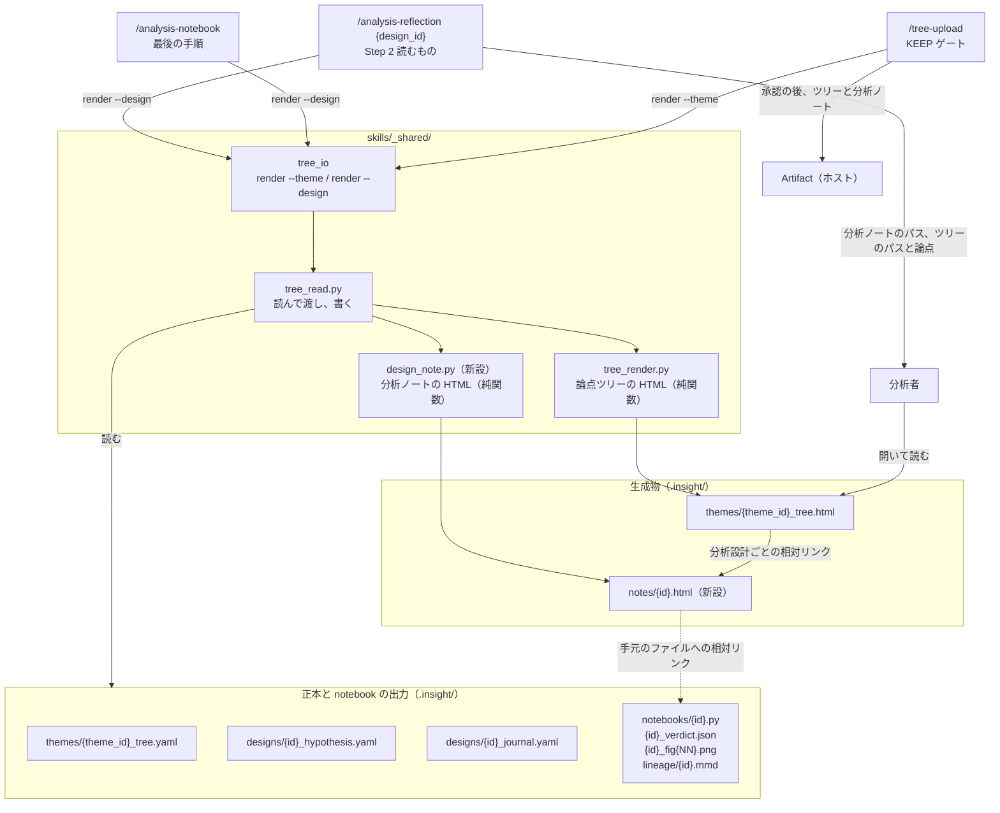
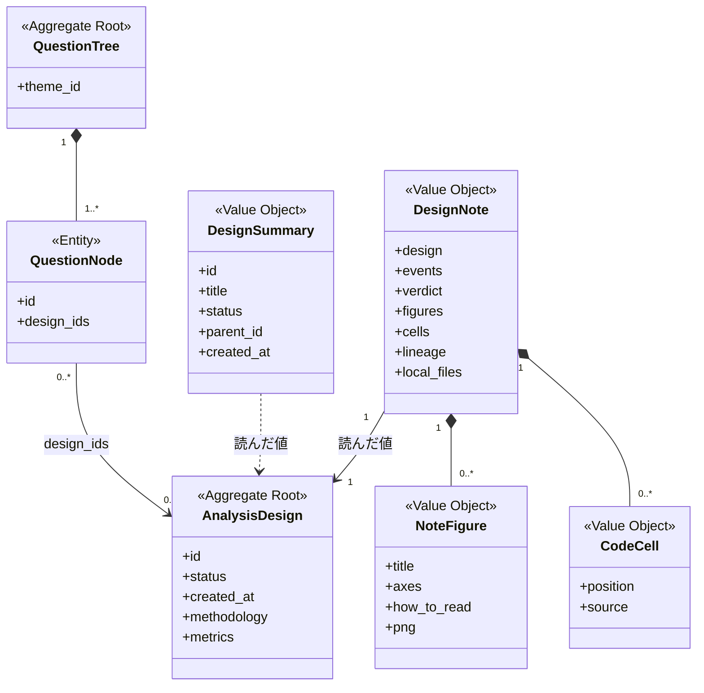
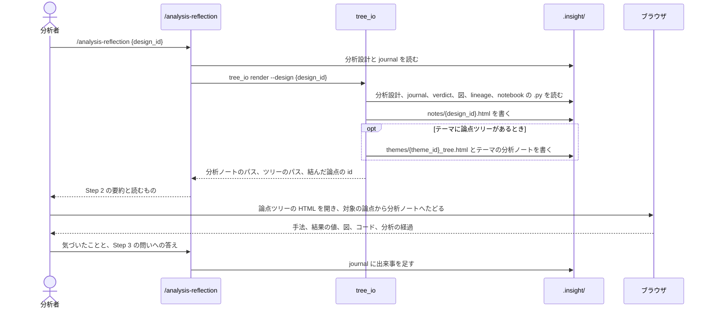
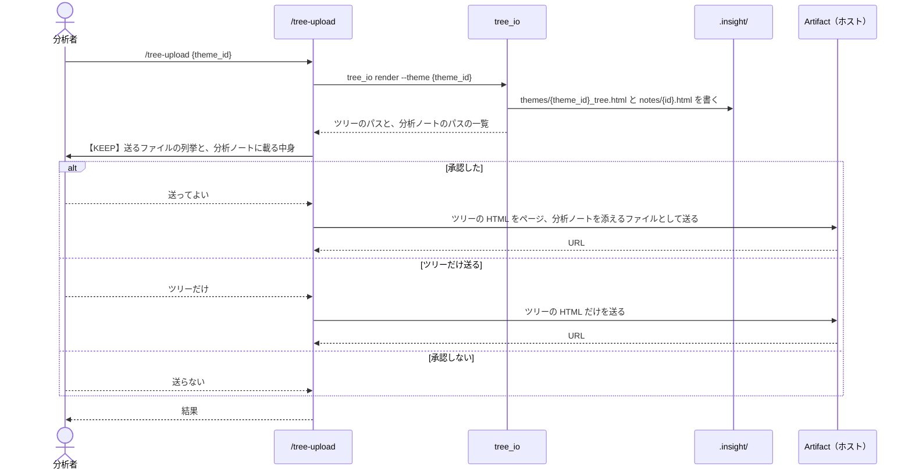

# Epic 28: 論点ツリーの HTML を、分析者と AI が分析を進める共通の入口にする

## Background

本書がこの Epic の要求と背景の正本（[FLOW-0001](../adr/flow/0001-designdoc-owns-requirements.md)）。
Epic issue（[#173](https://github.com/etoyama/insight-blueprint-skills/issues/173)）には要約と本書へのリンクだけを置く。

- 解く課題: 分析者は AI に判断を求められたとき、根拠になる分析結果や図表をすぐに確かめられない（人間の課題認識、2026-11-22）。
  実際に使うと分析の流れは円滑だったが、結論の確定や分析の修正を聞かれた時点で、根拠がどこにあるかを自分で探すことになった。
  - 課題1: 論点ツリーの HTML から、論点に対応する成果物へたどれない。HTML のリンクはページの中のアンカーだけである。
  - 課題2: 成果物に、人が1か所で読める形が無い。手法と指標は分析設計の YAML に、結果は verdict の JSON に、図は PNG に、コードは notebook の `.py` に、経過は journal の YAML にある。
  - 課題3: 判断を求める段のうち、論点ツリーの HTML を示すのはテーマの振り返りだけである。結論を決める分析設計の振り返りは、ファイルのパスをチャットに並べる。
  - 課題4: 論点ツリーの HTML を作り直すのは、テーマの段だけである。notebook を実行した後や分析をやり直した後は、古いままになる。
  - 課題5: Artifact で論点ツリーを受け取った人は、根拠へたどれない。
- PRD の要件: [docs/PRD.md](../PRD.md) のコアバリュー「論点ツリー」と「journal / reflection」。分析者が証拠を見て結論を出せること。
  製品の成功基準（論点ツリーの表示を渡された読み手が、現在地と次の一手を説明できる）にもかかわる。
- 既存手段が不十分な理由: `/analysis-reflection` の読むもの（[Epic 26](epic-26-reflection-materials.md)）は、図・verdict・notebook のパスをチャットに並べる。
  分析者はファイルを1つずつ開くことになり、論点との対応は自分で追う。notebook の HTML の書き出しは任意で、journal と指標の定義を載せない。

### 求める運用（人間、issue #173）

- 論点ツリーの HTML を、人間と AI が分析を進めるための共通の入口にする。
- 各論点から、その論点に対応する最新の成果物にたどれる。分析方法とデータの集計内容、分析結果・図表・集計表、分析ノート、分析過程と実装を確かめられるコードである。
- 論点ツリーの HTML は全体像を見渡せる軽量なものに保つ。詳細はリンクで参照する。
- AI が結論の確定や分析の修正について判断を求めるときは、最新の論点ツリーの HTML と対象の論点を示す。人間はそこから根拠を確かめ、判断や修正の指示を返す。
- 分析をやり直した後も、同じ入口から最新の成果物にたどれる。

### 前提にした事実（main、2026-11-22）

- `tree_io render`（`skills/_shared/tree_read.py` の `render`、`skills/_shared/tree_render.py`）が書く `.insight/themes/{theme_id}_tree.html` のリンクは、`_link` が作るページの中のアンカーだけである。
  論点のカードの「根拠を開く」には、現時点の答えの文、引用した journal の出来事の本文、結んだ分析設計の id・題・状態が出る。
- `tree_io render` を呼ぶのは、`/analysis-framing`、`/analysis-reflection {theme_id}`（T4 の後と T7 の後）、`/tree-upload` の3つである。
- 成果物のファイル名は分析設計の id で決まる。やり直すと同じパスに上書きされる。派生の分析設計は別の id になる（[ADR-0033](../adr/0033-derived-design-inherits-the-nodes-of-its-source.md)）。

| 成果物 | 今ある場所 | 書く skill |
|---|---|---|
| 手法と指標の定義 | `.insight/designs/{id}_hypothesis.yaml` | `/analysis-design` |
| 分析の経過 | `.insight/designs/{id}_journal.yaml` | `/analysis-journal`、`/analysis-notebook`、`/analysis-reflection` |
| 結果の値 | `.insight/notebooks/{id}_verdict.json` | `/analysis-notebook` |
| 図 | `.insight/notebooks/{id}_fig{NN}.png`（題・軸・読み方は verdict の figures manifest） | `/analysis-notebook` |
| データ加工の履歴 | `.insight/lineage/{id}.mmd` | `/analysis-notebook` |
| 分析コード | `.insight/notebooks/{id}.py` | `/analysis-notebook` |
| notebook の HTML | `.insight/notebooks/{id}.html`（書き出しは任意） | `/analysis-notebook` |
| レポート | `.insight/reports/{id}.md`（terminal status の分析設計だけ） | `/analysis-report` |

- `/analysis-auto` の KEEP ゲートのうち、結果が在る段は「reflection（分析設計）」と「theme reflection T7」の2つである。
  framing・design・premortem は notebook の実行より前にある。
- 分析ノートの形を決めるために確かめた事実（`marimo export html` の振る舞い、cell の切り出し、lineage の書き出しの中身）は、[ADR-0036](../adr/0036-design-note-is-a-generated-page-per-design.md) の Context にある。

## User Stories

AC の正本はここ。

### US-1: 分析者が、分析設計ごとの分析ノートで、結果までの事実を1か所で読める

分析者として、判断の前に根拠を確かめるために、分析設計の手法・指標の定義・結果の値・図を1つのページで読みたい。

- [ ] AC 1: `tree_io render --design {design_id}` は、分析ノート（`.insight/notes/{design_id}.html`）を作り、そのパスを返す。論点ツリーの無いテーマの分析設計でも作る。
  分析設計が無ければエラーにして、何も書かない。
- [ ] AC 2: 分析ノートはレポートの前半と同じ並びで、仮説と背景、決定の文脈、手法、指標の定義、説明変数、データソースの名前・種類・説明、結果を出す。
  結果は journal の `observe` と `evidence`（`direction` で分ける）と、verdict の指標の値である。値は書かれたとおりに出し、計算しない。接続情報は読まず、出さない。
- [ ] AC 3: 図は verdict の figures manifest の順に、ページに埋め込んで出し、題・軸の説明・読み方を添える。出すのは、`file` がファイル名だけで、`.insight/notebooks/` に実在する図に限る。
- [ ] AC 4: notebook をまだ実行していない分析設計でも作る。無い節にはまだ無いことを書く。ページの冒頭に、分析設計の状態、載せた journal の最後の出来事の時刻、verdict の有無を出す。
- [ ] AC 5: 分析ノートは自己完結である。script を持たず、外部を読まず、生成した時刻と絶対パスを入れない。同じ入力（分析設計、journal、notebook の出力）からは同じ HTML ができる。ページに入る文字はすべてエスケープする。

### US-2: 分析者が、分析ノートの中で分析コードと経過を確かめられる

分析者として、結果がどう作られたかを確かめるために、分析ノートの中で分析コードと分析の経過を読みたい。

- [ ] AC 1: notebook の `.py` を cell ごとに切り出し、開閉できる形で出す。
- [ ] AC 2: データ取得の cell は載せず、手元の `.py` で読むことを書く。notebook が契約の形でなく、データ取得の cell を特定できないときは、コードを1つも載せない。
- [ ] AC 3: 「分析の経過」の節に、verdict の `conclusion` と journal のすべての出来事を、時刻の順に、種類の言葉を付けて畳んで出す。節の冒頭に、分析中の判断と解釈の記録であることを書く。
- [ ] AC 4: lineage の Mermaid の文字を、畳んで出す。図としては描かない。
- [ ] AC 5: 「手元のファイル」の節に、notebook の `.py`・verdict・lineage・notebook の HTML・レポートのうち、在るものへの相対リンクを出す。節の冒頭に、手元で開いたときだけ開けることを書く。

### US-3: 分析者が、論点ツリーの HTML から分析ノートへたどれる

分析者として、論点から根拠へ少ない手数でたどるために、論点のカードから、その論点に結んだ分析設計の分析ノートを開きたい。

- [ ] AC 1: 論点のカードの「結んだ分析設計」と、「分析設計の派生」の節の各分析設計に、分析ノートへの相対リンクを1つ出す。図・verdict・notebook へのリンクは、論点ツリーの HTML に出さない。
- [ ] AC 2: `tree_io render --theme {theme_id}` は、論点ツリーの HTML と、テーマの分析設計すべての分析ノートを書き、それぞれのパスを返す。分析ノートを1つでも作れなければエラーにして、理由を出す。
- [ ] AC 3: 論点のカードは結んだ分析設計を、終わっていないものを先に、終わったものを後に並べる。それぞれの中は `created_at` の新しい順で、同じなら id の大きい順である。
- [ ] AC 4: 論点ツリーの HTML は正本・分析設計・journal だけで決まる。notebook の出力の有無では変わらない。script と stylesheet を読まない（Epic 18 の US-5 AC 1 のまま）。
- [ ] AC 5: 読み方の節に、分析ノートへのリンクの説明を書く。分析ノートが同じ場所に無いと開けないことも書く。

### US-4: 分析者が、結論を求められたときに入口を示される

分析者として、結論を決める前に最新の根拠を確かめるために、`/analysis-reflection` が結論を聞く前に、分析ノートと対象の論点を示してほしい。

- [ ] AC 1: `/analysis-reflection {design_id}` の Step 2 は読むものを出す直前に `tree_io render --design {design_id}` を呼ぶ。手順は、テーマに論点ツリーがあるかどうかで分かれない。
- [ ] AC 2: 読むものは分析ノートのパスと、論点ツリーのパスと分析設計を結んだ論点の id である。論点ツリーが無いか、どの論点にも結んでいなければ、分析ノートのパスだけを出す。図・verdict・notebook のパスと指標の定義は、チャットに並べない。
- [ ] AC 3: `/analysis-notebook` は、結果を journal に書いた後に `tree_io render --design {design_id}` を呼び、分析ノートのパスを伝える。
- [ ] AC 4: 読むものに、気づいたことをチャットで返せば journal に残せることを書く。残すのは既存の journal の出来事で、新しい種類は足さない。
- [ ] AC 5: `/analysis-auto` の Gate policy と手順が reflection の段で分析ノートと論点を示すことと食い違わない。skill は分析ノートを読まず、正本を読む。テーマの振り返り（T7）は変えない。

### US-5: 論点ツリーを受け取った人が、Artifact でも分析ノートへたどれる

分析者として、定例報告やレビューで根拠まで見せるために、論点ツリーと一緒に分析ノートを Artifact で渡したい。

- [ ] AC 1: 論点ツリーの HTML をページ、分析ノートを添えるファイルとして Artifact に送ると、論点ツリーのリンクから分析ノートが開けることを、最初に確かめる。
  開けなければ、この US の AC 2〜4 を落とし、論点ツリーの HTML だけを送る今の手順のまま、読み方に「分析ノートへのリンクは手元でだけ開ける」と書く（[ADR-0037](../adr/0037-tree-upload-sends-the-design-notes.md)）。
- [ ] AC 2: `/tree-upload` は、`tree_io render --theme` が返した論点ツリーの HTML と分析ノートのパスを列挙し、KEEP ゲートで承認を待つ。
  承認の文に、分析ノートに載る中身（図、指標の値、journal のすべての出来事、分析コード）を書く。分析者が「ツリーだけ送る」と答えたら、論点ツリーの HTML だけを送る。
- [ ] AC 3: 送るのは `tree_io render` が書いたファイルそのものである。notebook の `.py`・verdict・レポート・notebook の HTML は送らない。
- [ ] AC 4: Artifact が添えるファイルを受けないホストでは、承認を聞く前にそれを伝え、列挙を論点ツリーの HTML だけにする。
- [ ] AC 5: README、[docs/ARCHITECTURE.md](../ARCHITECTURE.md)（`.insight/` の構成、KEEP ゲートの一覧、シーケンス図）、[docs/UBIQUITOUS_LANGUAGE.md](../UBIQUITOUS_LANGUAGE.md)（読むもの、アップロード、分析ノートのコード上の名前）、`/analysis-auto` の tree-upload の行が、実装と食い違わない。

## Stories

Story は未起票で、分割の案である。起票は親のセッションが行う。「触る所」が重なる Story は並行で進めない。

| Story issue | User Story | 扱う AC | 触る所 | 前提 |
|---|---|---|---|---|
| 未起票（28.1 分析ノートを作る） | US-1 | AC 1, AC 2, AC 3, AC 4, AC 5 | `skills/_shared/design_note.py`（新設）、`skills/_shared/tree_read.py`、`skills/_shared/tree_io.py`、`tests/` | なし |
| 未起票（28.2 コードと経過を載せる） | US-2 | AC 1, AC 2, AC 3, AC 4, AC 5 | `skills/_shared/design_note.py` | 28.1 |
| 未起票（28.3 論点ツリーからリンクする） | US-3 | AC 1, AC 2, AC 3, AC 4, AC 5 | `skills/_shared/tree_render.py`、`skills/_shared/tree_read.py`、`skills/_shared/tree_io.py` | 28.1 |
| 未起票（28.4 結論の段で示す） | US-4 | AC 1, AC 2, AC 3, AC 4, AC 5 | `skills/analysis-reflection/SKILL.md`、`skills/analysis-notebook/SKILL.md`、`skills/analysis-auto/SKILL.md`、`tests/skills/`、`docs/UBIQUITOUS_LANGUAGE.md` | 28.1 |
| 未起票（28.5 分析ノートも送る） | US-5 | AC 1, AC 2, AC 3, AC 4, AC 5 | `skills/tree-upload/SKILL.md`、`skills/analysis-auto/SKILL.md`、`README.md`、`docs/ARCHITECTURE.md`、`docs/UBIQUITOUS_LANGUAGE.md` | 28.3、28.4 |

- 28.2 と 28.3 は、触るファイルが重ならないので並行で進められる。28.4 は SKILL.md だけを触るので、28.2・28.3 と並行で進められる。
- 28.1 と 28.3 は、どちらも `tree_read.py` と `tree_io.py` を触る。28.4 と 28.5 は、どちらも `skills/analysis-auto/SKILL.md` と `docs/UBIQUITOUS_LANGUAGE.md` を触る。この2組は直列にする。
- US-5 AC 1 の確認は、分析ノートの配置（リンクの向き、図の埋め込み）が正しいかを決める。28.1 の後すぐに、合成シナリオの HTML で試すとよい。

## Ubiquitous Language

この Epic で追加・変更した語。定義の正本は [docs/UBIQUITOUS_LANGUAGE.md](../UBIQUITOUS_LANGUAGE.md)。

- 追加: 分析ノート（[ADR-0036](../adr/0036-design-note-is-a-generated-page-per-design.md)。コード上の名前 `design_note` は、28.1 で実装と同じコミットで用語表に足す）
- 変更: 読むもの（ADR-0036。28.4 で用語表を改める）
- 変更: アップロード（[ADR-0037](../adr/0037-tree-upload-sends-the-design-notes.md)。28.5 で用語表を改める）

## Scope

[docs/PRD.md](../PRD.md) のコアバリュー「論点ツリー」と「journal / reflection」を前進させる。
[docs/ARCHITECTURE.md](../ARCHITECTURE.md) では、Skill layer（`/analysis-reflection`・`/analysis-notebook`・`/analysis-auto`・`/tree-upload`）と、`tree_io` の表示を前進させる。

- Epic 範囲内:
  - 分析ノートを作ること（`.insight/notes/{design_id}.html`）。
  - 論点ツリーの HTML から分析ノートへのリンクと、結んだ分析設計の並び。
  - 分析設計の振り返りと notebook の最後で、分析ノートを作り直して示すこと。
  - `/tree-upload` が分析ノートも送ること。
- Epic 範囲外:
  - 図を動かして確かめられる形で出すこと（[#175](https://github.com/etoyama/insight-blueprint-skills/issues/175)）。
  - notebook を marimo で書くのをやめるか（[#176](https://github.com/etoyama/insight-blueprint-skills/issues/176)）。notebook の HTML の書き出しは任意のままにする。
  - ツリーの決定の理由に出来事を引用させること（[#137](https://github.com/etoyama/insight-blueprint-skills/issues/137)）。同じ `tree_render.py` を触るが、モデルの変更で、引き継ぎの試行の証拠を待っている。
  - 論点ツリーの HTML とチャットに、図や表を埋め込むこと（Epic 26 の決定のまま）。
  - journal に、返信のための新しい出来事の種類を足すこと。
  - framing・design・review・premortem の KEEP ゲートで、分析ノートを示すこと。
  - lineage を図として描くこと。分析ノートは script を持たない。
  - 分析ノートから論点ツリーへ戻るリンク。
  - 引き継ぎの試行の型（[docs/HANDOFF_TRIAL.md](../HANDOFF_TRIAL.md)）に分析ノートを足すこと。
  - レポートと分析ノートを同じコードで組み立てること。レポートは今までどおり `/analysis-report` が書く。

## Architecture

- `tree_io render --theme` は、論点ツリーの HTML とテーマの分析設計すべての分析ノートを書く。
- `tree_io render --design` は、その分析設計の分析ノートを書く。テーマに論点ツリーがあれば、論点ツリーの HTML とテーマの分析ノートも書き直し、分析設計を結んだ論点の id を返す。
- モジュールの分け方（読む関数を `tree_read.py` に置くか、分析ノートの側に分けるか。エスケープの関数を2つの表示で共有するか）は、28.1 で決めて Decisions に残す。

## Domain Model

`src/insight_blueprint/models/` のクラスは変えない。分析ノートは、既存の型と notebook の出力から読んだ値を並べた生成物である。
下の図の `DesignNote`・`NoteFigure`・`CodeCell` は、`skills/_shared/` に置く表示のための型で、保存しない。名前は 28.1 で確定する。

| 型 | 種類 | 不変条件 |
|---|---|---|
| `QuestionTree`、`QuestionNode` | 集約ルート、エンティティ | 変えない。分析ノートへのリンクは保存せず、`design_ids` から導く |
| `AnalysisDesign` | 集約ルート | 変えない |
| `DesignSummary` | 値オブジェクト（表示の入力） | `created_at` を足す。並びは状態と `created_at` と id だけで決まる |
| `DesignNote` | 値オブジェクト（表示の入力） | 保存しない。同じ入力からは同じ HTML ができる。接続情報を持たない |
| `NoteFigure` | 値オブジェクト | figures manifest の1件。`file` がファイル名だけで、実在する図に限る |
| `CodeCell` | 値オブジェクト | notebook の cell の1つ。データ取得の cell は含めない。契約の形でない notebook からは1つも作らない |

## Sequence Diagram

分析設計の振り返りで、結論を聞く前に入口を示す。

論点ツリーと分析ノートを Artifact で渡す。

境界: `tree_io` が読むのは `.insight/` の中だけで、ネットワークには出ない。外へ出るのは `/tree-upload` の承認の後だけである（[ADR-0016](../adr/0016-approval-before-external-send.md)）。

## Decisions

Epic-scoped な決定。人間の判断は、2026-11-22 の DesignDoc 初版のセッションで得た。

### Decision: the-card-links-only-to-the-design-note

- What: 論点のカードには、結んだ分析設計ごとに分析ノートへのリンクを1つだけ出す。図・verdict・notebook・レポートへは、分析ノートからたどる。
  分析ノートは、テーマの分析設計すべてに作る。notebook をまだ実行していない分析設計にも作る。
- Why: 論点から根拠へたどる手数を減らしつつ、論点ツリーの HTML を軽く保つ（issue #173 の求める運用）。
- Criteria: 論点ツリーの HTML のリンクが切れないこと（Must、課題1）。論点から根拠までの手数（高、人間）。論点ツリーの HTML が軽いこと（高、人間）。
  論点ツリーの HTML が正本だけで決まること（中、Claude の推測、Epic 18 の US-5 AC 1）。決め手は最後の1つ。カードから成果物へ直接リンクすると、論点ツリーの HTML がファイルの有無で変わる。
- Affected modules: `skills/_shared/tree_render.py`、`skills/_shared/tree_read.py`。
- Alternatives considered: カードから図・verdict・notebook・レポートへも直接リンクする。カードがリンクで埋まり、notebook を実行するたびに論点ツリーの HTML も作り直すことになる。
- Consequences: Epic 18 の US-5 AC 1 は改めない。分析ノートが長くなると、根拠を探しにくい。節の見出しをページの中のリンクで並べて抑える。

### Decision: render-right-before-showing

- What: 分析ノートと論点ツリーの HTML は、パスを示す直前に作り直す。作り直すのは、`/analysis-reflection {design_id}` の Step 2 と、`/analysis-notebook` の最後である。
  今ある3か所（framing、テーマの振り返り、`/tree-upload`）は、`tree_io render --theme` が分析ノートも書くので、手順を変えない。
  分析ノートは分析設計だけで作れる。論点ツリーの無いテーマでも作る。
- Why: 判断を求める時点で、示すページが最新であればよい（課題4）。render を呼ぶ SKILL.md を増やすと、同じ手順の書き写しが増える（[#143](https://github.com/etoyama/insight-blueprint-skills/issues/143) で減らしたばかり）。
- Criteria: 判断を求める時点で最新であること（Must、課題4）。render を呼ぶ箇所の数（高、人間、#143）。分析者が自分で開いたときも新しいこと（中、Claude の推測）。
  論点ツリーの無い分析設計でも根拠を読めること（中、Claude の推測。Epic 18 の Decision `ask-once-for-treeless-design` が、ツリーを作らない道を残している）。決め手は呼ぶ箇所の数。
- Affected modules: `skills/analysis-reflection/SKILL.md`、`skills/analysis-notebook/SKILL.md`、`skills/_shared/tree_io.py`。
- Alternatives considered:
  - 分析設計・journal・notebook の出力を書く skill すべてが、書いた後に作り直す。6つ以上の SKILL.md に同じ手順が入る。
  - 論点ツリーのあるテーマでだけ分析ノートを作る。SKILL.md に「ツリーが無いときは」の分岐が要り、モデルが取り違える（ADR-0033 の Risks に前例）。
- Consequences: 示した段の間に journal を足すと、次に示すまで分析ノートは古い。ページの冒頭に、載せた journal の最後の出来事の時刻と verdict の有無を出して、読む人が古さに気づけるようにする。
  時刻はデータから決まる値なので、同じ入力から同じ HTML ができる決まりと両立する。

### Decision: show-the-entry-at-the-conclusion-gate

- What: 入口を示すのは、分析設計の振り返り（結論の段）である。テーマの振り返り（T7）は今のままにする。`/analysis-notebook` の最後は、作り直したパスを伝えるだけで、ゲートにはしない。
  チャットの読むものは、分析ノートのパスと、論点ツリーのパスと対象の論点に置き換える。図と指標の列挙はやめる。
- Why: issue の「結論の確定や分析の修正」は、分析設計の振り返りにあたる（課題3）。読む面が2つあると、どちらが正か迷う（ADR-0024 のときの人間の判断）。
- Criteria: 結論を決める段で、分析ノートと対象の論点が示されること（Must、課題3）。示したページに、その判断の根拠が載っていること（高、Claude の推測）。変える SKILL.md の数（高、人間、#143）。
  読む面が1つであること（高、人間）。決め手は、根拠が載っていることと、読む面が1つであること。framing・design・premortem は notebook の実行より前で、分析ノートには分析設計の中身しか出ない。
- Affected modules: `skills/analysis-reflection/SKILL.md`、`skills/analysis-notebook/SKILL.md`、`skills/analysis-auto/SKILL.md`、`tests/skills/test_reflection_materials_structure.py`。
- Alternatives considered:
  - review の判定と premortem の HIGH でも示す。その時点では結果が無い。
  - すべての KEEP ゲートで示す。framing と design では、確かめる対象がまだ書かれていない。
  - 読むものの列挙を残し、パスを足す。同じ図の説明を、チャットと分析ノートで2度出す。
- Consequences: HTML を開けない環境では、チャットから根拠の概要が分からない。パスは出るので、ファイルは開ける。Epic 26 の読むものの AC は、この Epic で置き換わる。

### Decision: unfinished-designs-come-first

- What: 論点のカードは、結んだ分析設計を、終わっていないもの（terminal status でないもの）を先に、終わったものを後に並べる。それぞれの中は `created_at` の新しい順で、同じなら id の大きい順である。
- Why: 派生（ADR-0033）で1つの論点に分析設計が複数結ばれると、今の判断の対象がカードで分からない。issue の「最新」を、並びで表す。
- Criteria: 今動いている分析設計が先に目に入ること（高、人間）。終わった分析設計の根拠も辿れること（中、Claude の推測）。並びが正本だけで決まること（中、Claude の推測）。決め手は最初の1つ。
- Affected modules: `skills/_shared/tree_render.py`、`skills/_shared/tree_read.py`。
- Alternatives considered:
  - `created_at` の新しい順に並べる。古い分析設計を後から結んだときに、今のものが先頭に来ない。
  - 最新の1つだけリンクし、残りは畳む。結論の根拠になった古い分析設計が隠れる。
- Consequences: やり直し（refine）は同じ id に上書きするので、リンク先は並びと関係なく最新になる。「分析設計の派生」の節の並び（id の順）は変えない。

### Decision: replies-go-through-the-journal

- What: 分析者が根拠を読んで返す言葉は、今ある経路で journal に残す。分析設計の振り返りでは Step 3 の答えが `reflect` と `conclude` になり、ほかの時点では `/analysis-journal` が出来事を足す。
  返信のための新しい出来事の種類は足さない。読むものに、チャットで返せば journal に残せることを書く。
- Why: 論点ツリーの HTML と分析ノートは script を持たないので、ページからは書けない。分析ノートは journal から作るので、残した言葉は次に作り直したときに載る。
- Criteria: 返した言葉が記録に残り、分析ノートに出ること（高、人間）。足すモデルと手順の量（高、人間）。決め手は後者。
- Affected modules: `skills/analysis-reflection/SKILL.md`。
- Alternatives considered: 返信のための出来事の種類を足し、分析ノートに分けて出す。journal の出来事の種類を足すには ADR、モデル、検証、レポートのテンプレートの変更が要る。
- Consequences: 分析者の言葉か AI の観察かは、出来事の種類から読む。見分けにくければ、後の Epic で種類を足す。

### Decision: marimo-and-interactive-figures-wait

- What: この Epic は入口と分析ノートだけを扱う。図を動かせる形で出すこと（#175）と、notebook を marimo で書くのをやめるか（#176）は、issue に起こして別に決める。notebook の HTML の書き出しは必須にしない。
- Why: 人間は、分析ノートでコードを読めるなら marimo に期待していることは満たせると述べた。分析ノートは marimo の HTML に頼らないので、入口の課題を先に解いても、後で作り直すものが出ない。
- Criteria: 入口の課題が早く解けること（高、人間、issue）。図を動かして確かめられること（高、人間）。1つの Epic を一度に読んで精査しきれること（高、Claude の推測、[docs/WORKFLOW.md](../WORKFLOW.md) §3）。
  作ったものを後で捨てないこと（中、Claude の推測）。決め手は最初の1つと3つめ。
- Affected modules: なし（進め方）。
- Alternatives considered:
  - 図の契約の拡張もこの Epic に入れる。notebook の契約と既定の許可リストの ADR に触り、Epic が読み切れる大きさを超える。
  - notebook の作り直しを先にやる。入口の課題が待たされる。
- Consequences: この Epic が終わっても、図は静止画のままである。

### Cross-epic decisions (links to ADR)

- [ADR-0036: 分析ノートは、分析設計ごとにコードが生成する HTML にする](../adr/0036-design-note-is-a-generated-page-per-design.md): 分析ノートの中身と決まり、論点ツリーの HTML からのリンク、読むものの意味の変更。
- [ADR-0037: `/tree-upload` は、論点ツリーと一緒に分析ノートを Artifact に送る](../adr/0037-tree-upload-sends-the-design-notes.md): 送るファイルの範囲と承認の文。最初に答えた「手元だけ」を改めた経緯。

## Test Design Matrix

初版では計画だけを書く。Story の実装に合わせて ✓ と「—（理由）」を付ける（[ADR-0010](../adr/0010-skill-tdd-structure-tests.md)）。

| Story \ Layer | Unit | Integration | E2E |
|---|---|---|---|
| 28.1 分析ノートを作る | ☐（表示の純関数。エスケープ、決定性、無い節） | ☐（合成シナリオの fixture で `tree_io render --design` を回す） | ☐ |
| 28.2 コードと経過を載せる | ☐（cell の切り出し、データ取得の cell を載せない、契約の形でない notebook） | ☐ | ☐ |
| 28.3 論点ツリーからリンクする | ☐（リンク、並び、notebook の出力で変わらないこと） | ☐（`tree_io render --theme` が書いた HTML のリンク先が、すべて実在する） | ☐（built-in browser で、論点から分析ノートの図とコードまでたどる手動確認） |
| 28.4 結論の段で示す | ☐（SKILL.md の構造テスト） | ☐ | ☐ |
| 28.5 分析ノートも送る | ☐（SKILL.md の構造テスト） | ☐ | ☐（Artifact でリンクが開けるかの手動確認） |

## Story Timeline

- 2026-11-22 — DesignDoc 初版。人間と7件の判断を決め、ADR-0036 と ADR-0037 を書いた。範囲の外に回した件を #175 と #176 に起こした。
