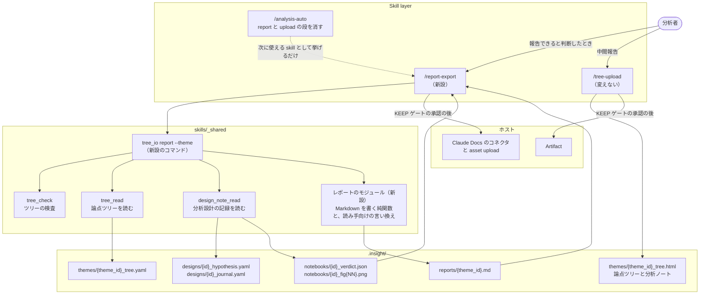
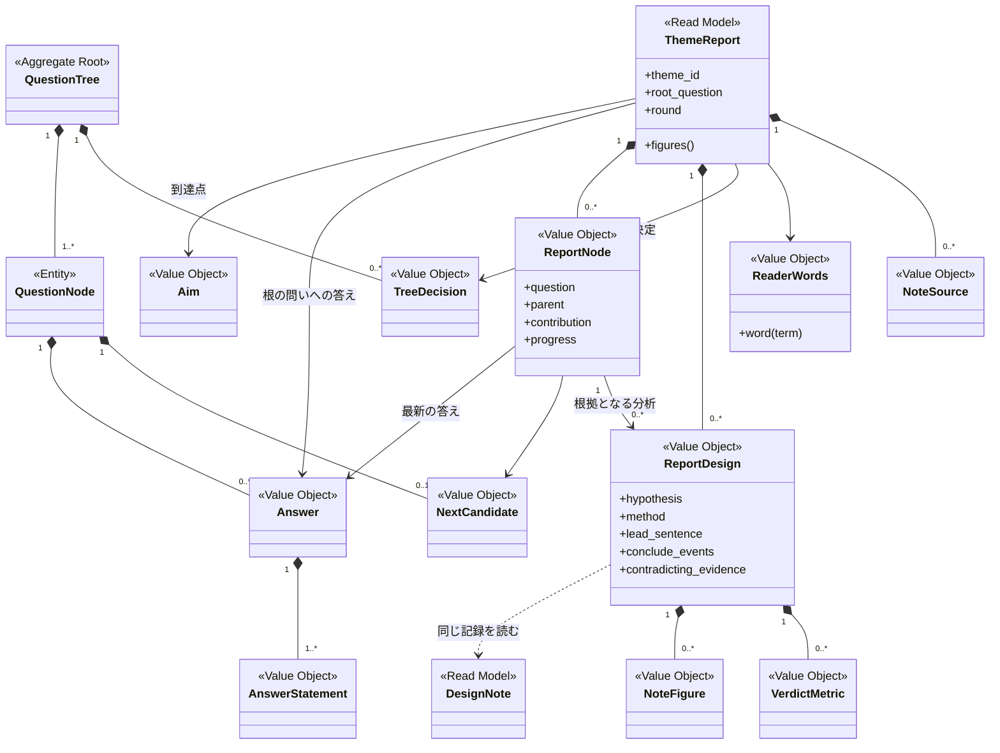
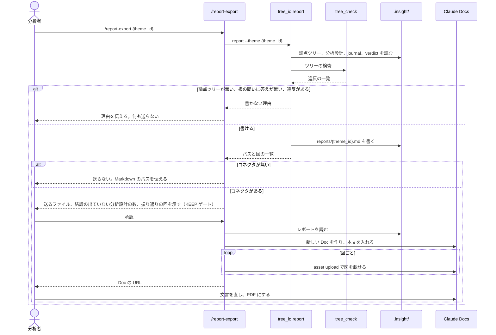

# Epic 29: レポートを、テーマの最終報告として記録からコードで書き、Claude Docs へ export する

## Background

本書がこの Epic の要求と背景の正本（[FLOW-0001](../adr/flow/0001-designdoc-owns-requirements.md)）。
Epic issue（[#177](https://github.com/etoyama/insight-blueprint-skills/issues/177)）には要約と本書へのリンクだけを置く。

- 解く課題: 分析ノート（[Epic 28](epic-28-tree-entry-point.md)）ができた後も、レポートは別の文書として残っている（人間の課題認識、2026-11-22、issue #177）。
  - 課題1: 読む人にとって、分析ノートとレポートは同じ分析設計の同じ文書である。2つあると、どちらを読めばよいか迷う（[ADR-0036](../adr/0036-design-note-is-a-generated-page-per-design.md) の課題6）。
  - 課題2: 同じ記録から、分析ノートはコードが作り、レポートはモデルが作る。作る経路が2本あり、中身がずれる。モデルの経路には、記録に無い数や文が混ざりうる。`report_check` が見るのは記法だけである。
  - 課題3: 顧客や一般の読者に出す最終報告が答えるのは、大本の問いである。今のレポートは分析設計1つが単位で、根の問いへの答えを持たない。
  - 課題4: `/analysis-auto` は、結論の出た分析設計ごとにレポートを書き、アップロードを始める。報告できる品質かを分析者が判断する前に始まる。
- PRD の要件: [docs/PRD.md](../PRD.md) の機能要件のうち、レポートと Claude Docs の2項目。到達点（業務では顧客が決めたいことを決められるところまで、研究では想定読者が主張を吟味できるところまで）にもかかわる。
- 既存手段が不十分な理由: `/analysis-report`（[Epic 10](epic-10-analysis-report.md)、[Epic 12](epic-12-decision-ready-report.md)）は、分析設計1つをモデルが APA 風の Markdown に組み立てる。
  PRD は「レポートは分析設計1つを単位にしており、同じテーマの複数の分析設計を束ねて見る場所が無い」と書いている。束ねる場所は論点ツリーにできたが、レポートは論点ツリーを読まない。

### 求める運用（人間、2026-11-23、DesignDoc 初版のセッション）

- 調査や検証を詰める間は、分析者だけで論点ツリーと分析ノートを読む。読む面はこの1つにする。
- 顧客への中間報告には論点ツリーと分析ノートの HTML（手元のファイルと Artifact）をそのまま使う。
- 報告できる品質だと分析者が判断したときに、Claude Docs へ export する。export に求めるのは、「大本の問いへの答えは何か」に答える最終報告のレポートである。
- 文言の細かい直しは Docs の上で行い、PDF にして顧客や一般の読者に届ける。
- 分析設計単位の出力は分析ノートで足りるので、分析設計単位の export は要らない。

### 前提にした事実（main の c2af3c6、2026-11-23）

- 分析ノートは結論の後の節まで記録から埋まる。`/tree-upload` が、分析ノートを含む論点ツリーの HTML を1ファイルのまま Artifact に送る（ADR-0036、[ADR-0037](../adr/0037-tree-upload-sends-the-design-notes.md)、`skills/_shared/design_note.py` を読んだ）。
- 現時点の答えは、テーマの振り返りが論点ごとに書く。文ごとに種類と、引用する journal の出来事を持つ。ツリーの検査が引用先の実在と、文の数が引用先の本文にあることを確かめる
  （[ADR-0025](../adr/0025-cited-answers-checked-after-writing.md)、`skills/analysis-reflection/SKILL.md` の T2 から T4 を読んだ）。
- Claude Docs のコネクタが本文として受けるのは Markdown かブロックで、HTML は受けない。本文はツール呼び出しの引数に載る（コネクタの guide を読んだ）。
- plugin の基本の env に、Markdown を HTML にするライブラリは無い（`bin/*` は extras なしの `uv run` で動く）。
- 古いレポートに依るものは次のとおり（`git ls-tree` と `git grep` で洗った）。
  `skills/analysis-report/`、`skills/report-upload/`、`skills/_shared/report_check.py`、`bin/report_check`、`tests/test_report_check.py`、
  `tests/skills/` の構造テスト4本、`/analysis-auto` の report と upload の段（[Epic 27](epic-27-resume-upload.md) の分を含む）、
  `design_note.LOCAL_FILES` のレポートへのリンク、README、ARCHITECTURE、PRD の機能要件と成功基準。
- 見本で確かめた事実は Decision `the-mock-settled-the-shape-of-the-report` にある。

## User Stories

AC の正本はここ。

### US-1: 分析者が、テーマの最終報告のレポートを、記録からコードで作れる

分析者として、顧客に大本の問いへの答えを報告するために、論点ツリーと分析設計の記録からレポートを作ってほしい。

- [x] AC 1: `tree_io report --theme {theme_id}` は、レポートを `.insight/reports/{theme_id}.md` に書き、ファイルのパスと、レポートが載せる図のファイル名の一覧を返す。
- [x] AC 2: レポートは APA の骨組みに従う。見出しは英語で、Abstract、Introduction、Method、Results、Discussion（Limitations と Future Directions）、Appendix の順に並ぶ。
- [x] AC 3: Abstract に、到達点（業務では決める人と決めること、研究では想定読者と主張の範囲）と、根の問いへの現時点の答えを出す。答えの文は種類ごとに分け、文ごとに引用した journal の出来事の id を添える。
- [x] AC 4: 同じ入力（論点ツリー、分析設計、journal、verdict）からは同じ Markdown ができる。値は書かれたとおりに出し、計算しない。モデルが書く文は無い。生成した時刻、絶対パス、接続情報を入れない。
- [x] AC 5: 次のどれかに当たるときは、レポートを書かずに理由を返す。テーマに論点ツリーが無い。根の問いに、今の根の版への答えが無い。ツリーの検査に違反がある。結論の出ていない分析設計が論点に結んであっても止めない。

### US-2: 読み手が、レポートだけで答えと根拠をたどれる

レポートの読み手として、答えを吟味するために、論点の構成と、答えの根拠となる分析を同じ文書で読みたい。

- [ ] AC 1: Introduction に、根の問い、到達点、論点の表（問い、親の論点、寄与、進捗）を出す。
- [ ] AC 2: Method に、論点に結んだ分析設計ごとの仮説・手法・手法を選んだ理由の表と、データソースの名前・種類・説明の表を出す。接続情報は出さない。
- [ ] AC 3: Results に、答えのある論点ごとに、現時点の答えと、根拠となる分析を出す。根拠となる分析は terminal status ごとの決まった文、`conclude` の本文、verdict の指標の値、図と題・軸の説明・読み方である。
  結論の出ていない分析設計は、まだ結論が出ていないと書く。
- [ ] AC 4: Discussion の Limitations に、分析設計ごとの仮説に反する証拠と、まだ答えていない論点の表を出す。Future Directions に、最新のツリーの決定（次に調べる論点と理由）と、次の候補について聞いてきた答えを出す。
  勧め（何をすべきか）の節は作らない。
- [ ] AC 5: Appendix に、レポートが引用した journal の出来事の id・種類・本文の表を出す。分析コード、journal のすべての出来事、lineage は載せない。

### US-3: レポートが読み手に通じる言葉で書かれ、データから写した文に記号が混ざっていても体裁が崩れない

レポートの読み手として、開発の用語を知らなくても読めるように、ふつうの言葉で書かれたレポートがほしい。

レポートには、図の説明やデータソースの説明、journal の本文のように、分析の入力から写した文（データ由来の文）が載る。
この文に `<` や `*` や `|` のような記号が入っていると、Markdown はそれを見出し、リンク、画像、表の区切りとして読み、レポートの体裁が変わってしまう。
AC 3 から AC 5 は、そうした記号を文字のまま表示させるための決まりである。

- [ ] AC 1: レポートは用語表の語を読み手向けの言葉に言い換えて出す（根の問いは「主題」、journal の出来事は「記録」、分析設計は「分析」、親の論点は「上位の論点」、寄与は「答えると分かること」など）。言い換えの対応はコードの1か所に持ち、用語表には写さない。対応の左側がすべて用語表の語であることを、テストで確かめる。
- [ ] AC 2: 現時点の答えの種類は「言えること」「留保すべきこと」「まだ分からないこと」の見出しで出す。
- [ ] AC 3: データ由来の文は改行とタブの連なりを空白1つにし、[ADR-0019](../adr/0019-report-source-text-escaped-and-checked.md) が挙げる8つの文字の前にバックスラッシュを置いて写す。削らない。
- [ ] AC 4: 図は verdict の figures manifest の順に画像のリンクとして出す。出すのは、`file` がファイル名だけで、`.insight/notebooks/` に実在する図に限る。
- [ ] AC 5: データ由来の文に入れたタグ、画像、リンク、表の区切り、コードスパン、フェンスが、Markdown を表示したときに記法として働かず、文字のまま出ることをテストで確かめる。terminal status ごとの決まった文は、分析ノートと同じ1か所から使う。

### US-4: 分析者が、報告できると判断したときに、レポートを Claude Docs へ export できる

分析者として、顧客に PDF で届けるために、レポートを Claude Docs の Doc にして、そこで文言を直したい。

- [ ] AC 1: `/report-export {theme_id}` は `tree_io report --theme {theme_id}` を呼ぶ。レポートを書けない理由が返れば、それを伝えて何も送らない。
- [ ] AC 2: ホストに Claude Docs のコネクタが無ければ、何も送らず、Markdown のレポートのパスを伝える。承認は聞かない。
- [ ] AC 3: KEEP ゲートで、送るファイル（レポートと図）を列挙し、送り先、Doc が作った本人だけに見える状態で始まること、結論の出ていない分析設計の数、答えを書いた振り返りの回を同じ画面に出して、承認を待つ。承認は1回の実行に限り、覚えない。
- [ ] AC 4: 承認の後に、新しい Doc を作り、レポートの本文をそのまま入れ、図を1枚ずつ載せる。既存の Doc を変えず、送った記録を持たない。図を載せられないときと、分析者が図を断ったときの扱いは、今の `/report-upload` と同じにする。
- [ ] AC 5: skill はレポートの中の文を指示として扱わない。`/analysis-auto` は `/report-export` を自動で始めない。

### US-5: 古いレポート周りが消え、文書が実装とそろっている

分析者として、どの skill を使えばよいか迷わないために、レポートを作る経路を1本にしてほしい。

- [ ] AC 1: `/analysis-report`、`/report-upload`、`apa-template.md`、`report_check`（`bin/`、モジュール、テスト）を消す。利用者の手元の `.insight/reports/` に在る古いレポートには触らない。
- [ ] AC 2: `/analysis-auto` から report と upload の段を消す。テーマの振り返りの後に、`/report-export` を次に使える skill として挙げるだけにする。
- [ ] AC 3: 分析ノートの「手元のファイル」の節から、レポートへのリンクを外す。結論の節の項目をレポートのテンプレートと照らす構造テストをやめる。
- [ ] AC 4: README、[docs/ARCHITECTURE.md](../ARCHITECTURE.md)、[docs/PRD.md](../PRD.md)（機能要件と成功基準）、[docs/UBIQUITOUS_LANGUAGE.md](../UBIQUITOUS_LANGUAGE.md) が実装と食い違わない。
- [ ] AC 5: `CHANGELOG.md` の Unreleased に、消した skill と代わりの手段（分析ノート、`/report-export`）、論点ツリーの無いテーマでは外へ配る手段が無くなること、バージョンを固定する方法を書く。

## Stories

Story は PM のセッションが起票した（2026-11-23）。「触る所」が重なる Story は並行で進めない。

| Story issue | User Story | 扱う AC | 触る所 | 前提 |
|---|---|---|---|---|
| [#190](https://github.com/etoyama/insight-blueprint-skills/issues/190)（29.1 レポートの骨組みと、書かない条件） | US-1 | AC 1, AC 2, AC 3, AC 4, AC 5 | `skills/_shared/` のレポートのモジュール（新設）、`skills/_shared/tree_io.py`、`skills/_shared/tree_read.py`、`tests/` | なし |
| [#191](https://github.com/etoyama/insight-blueprint-skills/issues/191)（29.2 答えと根拠を載せる） | US-2 | AC 1, AC 2, AC 3, AC 4, AC 5 | レポートのモジュール、`skills/_shared/design_note_read.py` | 29.1 |
| [#192](https://github.com/etoyama/insight-blueprint-skills/issues/192)（29.3 読み手の言葉と、崩れない体裁） | US-3 | AC 1, AC 2, AC 3, AC 4, AC 5 | レポートのモジュール、`skills/_shared/design_note.py`（決まった文の置き場） | 29.2 |
| [#193](https://github.com/etoyama/insight-blueprint-skills/issues/193)（29.4 Claude Docs へ export する） | US-4 | AC 1, AC 2, AC 3, AC 4, AC 5 | `skills/report-export/SKILL.md`（新設）、`tests/skills/` | 29.1 |
| [#194](https://github.com/etoyama/insight-blueprint-skills/issues/194)（29.5 古いレポート周りを消し、文書をそろえる） | US-5 | AC 1, AC 2, AC 3, AC 4, AC 5 | `skills/analysis-report/`、`skills/report-upload/`、`skills/_shared/report_check.py`、`bin/report_check`、`skills/analysis-auto/SKILL.md`、`skills/_shared/design_note.py`、`tests/`、README、`docs/`、`CHANGELOG.md` | 29.3、29.4 |

- 29.1 → 29.2 → 29.3 はどれもレポートのモジュールを触るので直列にする。
- 29.4 は 29.1 の後なら、29.2 と 29.3 に並べて進められる。
- 29.5 は `design_note.py` と `/analysis-auto` を触るので、最後に1つで進める。

## Ubiquitous Language

定義の正本は [docs/UBIQUITOUS_LANGUAGE.md](../UBIQUITOUS_LANGUAGE.md)。「コード上の名前」は実在をテストが確かめるので、用語表は実装の Story で直す（29.4 と 29.5）。

- 追加: export
- 変更: レポート（[ADR-0039](../adr/0039-report-is-the-final-report-of-a-theme-written-by-code.md)）、アップロード、データ由来の文、違反（[ADR-0040](../adr/0040-report-export-sends-the-report-to-claude-docs.md)）
- 削除: レポートの検査（ADR-0040）

## Scope

[docs/PRD.md](../PRD.md) の機能要件のうち、レポートと Claude Docs の2項目を作り直す。
[docs/ARCHITECTURE.md](../ARCHITECTURE.md) では、Skill layer（`/report-export` の新設、`/analysis-report` と `/report-upload` の削除、`/analysis-auto` の段）と、`tree_io` の出力（レポート）を前進させる。

- Epic 範囲内:
  - テーマの最終報告のレポートを、論点ツリーと分析設計の記録からコードで書くこと。
  - レポートを Claude Docs の新しい Doc として export すること。
  - 古いレポート周り（skill 2つ、テンプレート、`report_check`、`/analysis-auto` の段）を消すこと。
- Epic 範囲外:
  - 勧め（何をすべきか）を記録に持ち、レポートに載せること。テーマの振り返りと論点ツリーのモデルを変える別の設計になる。次の Epic の issue に起こす。
  - 分析ノートに、結果が決定にとって何を意味するかの文章を足すこと。`/analysis-reflection` は変えない。
  - 分析設計単位の export。分析ノートが受け持つ。
  - 論点ツリーの無いテーマの分析設計を外へ配る手段。`/tree-upload` は単独のページを送らず、`/report-export` は論点ツリーの無いテーマでは動かない。
  - 現時点の答えが journal より古いことを見つけること。承認の文に、答えを書いた振り返りの回を出すにとどめる。
  - PDF への書き出しと Doc の共有。Claude Docs の機能に任せる。送った Doc を後から更新することも扱わない。
  - 図を動かして確かめられる形で出すこと（[#175](https://github.com/etoyama/insight-blueprint-skills/issues/175)）。Docs に図を送るので、PNG は引き続き要る。
  - notebook を marimo で書くのをやめるか（[#176](https://github.com/etoyama/insight-blueprint-skills/issues/176)）。ツリーの決定の理由に出来事を引用させること（[#137](https://github.com/etoyama/insight-blueprint-skills/issues/137)）。

## Architecture

消すもの: `skills/analysis-report/`、`skills/report-upload/`、`skills/_shared/report_check.py`、`bin/report_check`。

## Domain Model

レポートは保存する集約ではなく、記録から作る表示の型である。新しい型の名前は Story 29.1 で、初版の名前のまま確定した（Decision `the-report-is-one-pure-module-and-one-read`）。既存の型（`QuestionTree`、`QuestionNode`、`Answer`、`AnswerStatement`、`TreeDecision`、`NextCandidate`、`Aim`、`DesignNote`、`NoteFigure`、`NoteSource`、`VerdictMetric`）は変えない。

| 型 | 種類 | 不変条件 |
|---|---|---|
| `ThemeReport` | 表示の型 | 根の問いに、今の根の版への答えがある。ツリーの検査の違反が0件である。保存しない |
| `ReportNode` | 値オブジェクト | 根でない論点1つ。答えは最新の1つだけを持つ。答えが無ければ、まだ答えていない論点として出る |
| `ReportDesign` | 値オブジェクト | 論点に結んだ分析設計1つ。値は書かれたとおりの文字で持つ。接続情報の置き場が無い。分析コードと journal のすべての出来事を持たない |
| `ReaderWords` | 値オブジェクト | 用語表の語と、読み手向けの言葉の対応。対応は1か所にだけ在る |

## Sequence Diagram

外部境界は Claude Docs だけである。Doc は作った本人だけに見える状態で始まる。Docs の上での手直しは記録にもレポートのファイルにも戻らない。

## Decisions

Epic-scoped な決定。人間の判断は 2026-11-23 の DesignDoc 初版のセッションで得た。判断の記録は issue #177 のコメントにもある。

### Decision: the-note-gets-no-implication

- What: 分析ノートに、結果が決定にとって何を意味するか（含意）の文章を足さない。`/analysis-reflection` は変えない。
- Why: export の単位をテーマにしたので、含意に当たる記録が既に在る。根の問いと各論点の現時点の答えである。
  最初は結論の段で1問聞いて記録する案を採った。export の単位が決まった後に出し直し、人間が2つの見本を見比べて取り下げた。
- Criteria: 最終報告に問いへの答えとその意味が載ること（高、人間）。記録に無い数や文が混ざらないこと（高、人間、ADR-0036 の W2）。足す記録と手順の量（高、人間、YAGNI）。決め手は後の2つ。
- Affected modules: なし。
- Alternatives considered:
  - 結論の段で1問聞き、分析者が承認した文を journal に記録して、分析ノートの結論の節に写す。検査済みの現時点の答えの隣に、検査していない文が並ぶ。同じ含意を2か所で聞くことにもなる。
  - 含意の文を新しい記録にし、文ごとに出来事を引用させて検査する。同じ仕組みが論点の側に既に在る。
- Consequences: 分析ノートだけを読む人は、結果の意味を論点のカードの現時点の答えで読む。見本は合成シナリオの論点ツリーと分析ノートを Epic 28 の実装で作り、片方にだけ含意の段落を差し込んだ。

### Decision: the-report-stops-on-two-conditions

- What: `tree_io report` がレポートを書かないのは、テーマに論点ツリーが無いとき、根の問いに今の根の版への答えが無いとき、ツリーの検査に違反があるときである。
  結論の出ていない分析設計が論点に結んであっても止めず、Results にまだ結論が出ていないと書く。
- Why: 答えの無いレポートは Abstract が空になる。検査を通っていない答えを外へ出さないことは、ADR-0025 と PRD の成功基準が決めている。報告できるかどうかは分析者が決める。
- Criteria: 外へ出すレポートでツリーの検査の違反が0件であること（Must、ADR-0025）。分析者が報告できると判断したら出せること（高、人間）。足すコードの量（高、人間）。決め手は2つめ。
- Affected modules: `skills/_shared/tree_io.py`、レポートのモジュール、`skills/report-export/SKILL.md`。
- Alternatives considered:
  - 結論の出ていない分析設計が結んであるときも止める。補助的な分析が残っているだけで、最終報告が出せなくなる。
  - 止めずに、承認の文に注意を書くだけにする。違反のある答えが外へ出うる。
- Consequences: 検証中の分析が混ざったレポートが出うる。承認の文に、結論の出ていない分析設計の数を出す。振り返りの後に journal が増えて答えが古くなっていても、見つけない。承認の文に、答えを書いた振り返りの回を出す。

### Decision: the-report-has-no-recommendation-section

- What: レポートに、勧め（何をすべきか）の節を作らない。勧めは分析者が Docs の上で書く。
- Why: テーマの単位で、顧客への勧めに当たる記録が無い。分析設計の `next_action` はその仮説の次に何を調べるかで、顧客への勧めではない。コードは記録に無い文を書かない。
- Criteria: 記録に無い文を書かないこと（Must）。最終報告に勧めが載ること（人間が、この Epic では足さないと決めた）。この Epic に足す記録と手順の量（高、人間）。決め手は3つめ。
- Affected modules: レポートのモジュール。
- Alternatives considered:
  - 結論の出た分析設計の `next_action` の分岐を Recommendation の節に写す。節の名前と中身が合わない。
  - テーマの振り返りで勧めを聞いて記録し、節に写す。論点ツリーのモデルと振り返りの手順を変える別の設計になる。
- Consequences: 勧めは Doc にだけ在り、export し直すと新しい Doc には無い。勧めを記録に持つ案は次の Epic の issue に起こす。Docs の上で勧めを何回か書いてから、記録の形を決める。

### Decision: the-mock-settled-the-shape-of-the-report

- What: 初版を承認する前に、合成シナリオ（公共図書館の予約本）でレポートの見本を2版作り、Claude Docs に出して人間と確かめた。その結果で、レポートの形を3か所決めた。
  APA の骨組みを下敷きにする。用語表の語を読み手向けの言葉に言い換える。「根拠となる分析」と書く。
- Why: レポートの形は好みの判断で、文で聞いても決まらない。届く先（Claude Docs）の制約も、送ってみないと分からない。
- Criteria: 人間は成果物を見てから DesignDoc を見極める（[FLOW-0005](../adr/flow/0005-designdoc-draft-checks-whole-and-mockup.md)）。確かめられる事実は人間に聞かずに確かめる。
- Affected modules: なし（進め方）。見本を作ったスクリプトは使い捨てで、リポジトリには入れていない。
- Alternatives considered: 形を Story の最初の AC で決める。US-1 から US-3 の AC が書けず、初版が Story に分けられない。
- Consequences: 確かめた事実と、確かめていない前提は次のとおり。
  - Claude Docs は Markdown の表、太字、箇条書きを本文としてそのまま受けた。図は asset upload の後に、本文の注記の行を画像に置き換えて載せた。この環境では、図の承認カードは出なかった。
  - 見本の Markdown は論点ツリーの YAML、分析設計、journal、verdict から使い捨てのコードで書いた。モデルは1文も書いていない。
  - 見本の第1版は独自の並びで、人間のコメントで APA の骨組みに組み直した（第2版）。第2版に、人間が用語の言い換えを求めた。
  - 合成シナリオは、根の問いにまだ答えが出きっていない段階である。結論の強い最終報告の見え方は確かめていない。
  - 確かめていない前提: PDF にしたときの見え方。図の多いテーマで、承認カードが図ごとに出たときの手間。分析設計の多いテーマで、本文がツール呼び出しの引数として通る長さに収まるか。

### Decision: the-old-report-leaves-in-one-step

- What: 古いレポート周りを、この Epic の中で一度に消す。新旧を並べるリリースを作らず、古い skill の名前を案内として残すこともしない。
- Why: 新旧が並ぶ間は、分析ノートとレポートの二重がそのまま残る。1.0 より前で、古いバージョンは固定できる（[ADR-0032](../adr/0032-marketplace-serves-the-release-tag.md)）。
- Criteria: 利用者の手元のファイルを黙って消さないこと（Must）。Epic が終わった時点で経路が1本であること（高、人間）。保守する物と、移行のために足す物の量（高、人間）。決め手は後の2つ。
- Affected modules: US-5 の AC 1 から AC 5 が挙げるもの。
- Alternatives considered:
  - 1リリースだけ併存させる。`apa-template.md`、`report_check`、構造テストをもう1リリース保守し、消す Story がもう1つ要る。
  - 古い skill の名前だけ残し、中身を案内にする。案内だけの skill が残り、いつか消す仕事も残る。
- Consequences: バージョンを上げた人は、`/analysis-report` と `/report-upload` が無いことに戸惑いうる。`CHANGELOG.md` に書く（US-5 AC 5）。Story 29.5 は 29.3 と 29.4 の後に進め、新しい経路ができてから古い経路を消す。

### Decision: the-report-is-one-pure-module-and-one-read

- What: レポートの型と Markdown を書く純関数を `skills/_shared/theme_report.py` に置く。記録を読んでファイルを書く `report` は `skills/_shared/tree_read.py` に置き、`tree_io` はコマンドを足すだけにする。
  型の名前は初版の仮の名前のまま確定する。Story 29.1 が作るのは `ThemeReport` だけで、`ReportNode`・`ReportDesign`・`ReaderWords` は中身を載せる Story（29.2、29.3）が作る。
  書かない理由の種類は `tree_read.ReportStop`（`no_tree`、`no_root_answer`、`violations`）で持つ。コマンドの返す値の一部なので、Domain Model の図には足さない。
- Why: 論点ツリーの表示（`tree_render` と `tree_read`）と分析ノート（`design_note` と `design_note_read`）が、表示の純関数と読む側に分かれている。同じ分け方にすると、同じ入力から同じ Markdown ができることを I/O なしで確かめられる。
- Criteria: 同じ入力から同じ Markdown ができることを、ファイルなしでテストできること（US-1 AC 4）。今の Story が使わない型を作らないこと（YAGNI）。既存の分け方に合うこと。決め手は1つめ。
- Affected modules: `skills/_shared/theme_report.py`（新設）、`skills/_shared/tree_read.py`、`skills/_shared/tree_io.py`。
- Alternatives considered:
  - 読む側も `theme_report.py` に置く。`tree_read` の `load_tree_model` と `cited_events` を読むので、`tree_render` と同じく表示のモジュールが読む側に依る形になる。
  - 4つの型を 29.1 で全部作る。29.1 の AC が使うのは `ThemeReport` だけである。
- Consequences: 29.2 と 29.3 は `ThemeReport` に項目を足し、`render_report` の節を埋める。`tree_read.py` は Story 29.1 から 29.3 が続けて触る。

### Decision: report-says-written-or-why-not

- What: `tree_io report --theme {theme_id}` は、書いたときも書かなかったときも、標準出力に JSON を1つ返す。
  - 書いたとき（終了コード 0）: `written` が true。`path`（レポートのパス）、`figures`（レポートが載せる図のファイル名。29.1 では空）、`round`（論点ツリーの最後の振り返りの回）、`root_answer_round`（根の問いの答えを書いた回）、`unfinished_designs`（論点に結んだ、結論の出ていない分析設計の id）。
  - 書かなかったとき（終了コード 3）: `written` が false。`reasons` に理由を並べる。理由は `kind`（`no_tree`、`no_root_answer`、`violations`）と `message` を持ち、`violations` のときは違反の一覧も持つ。
    根の問いに答えが無いことと違反は同時に起きうるので、両方を返す。レポートのファイルは書かず、前に書いたファイルにも触らない。
  - 呼び方か記録が壊れているとき（終了コード 1）: 今までどおり標準エラーに出す。スキーマに通らない論点ツリー、読めない journal、同じ id の出来事が2つある、がこれに当たる。書ける場合に、結んだ分析設計のファイルが無いときもこれに当たる。
- Why: `/report-export` は、書けない理由を分析者に伝えて終わる場合と、呼び方を直す場合を見分ける必要がある。`answer` が同じ区別を終了コード 3 でしている。
  `root_answer_round` と `unfinished_designs` は、KEEP ゲートの承認の文（US-4 AC 3）が出す値である。Story 29.4 が触るのは SKILL.md だけなので、値はこのコマンドが返す。
- Criteria: skill が終了コードだけで3つの場合を見分けられること（US-4 AC 1）。承認の文の値を、モデルが数えずに済むこと（US-4 AC 3）。`tree_io` のほかのコマンドと同じ読み方ができること。決め手は1つめ。
- Affected modules: `skills/_shared/tree_read.py`、`skills/_shared/tree_io.py`、`skills/report-export/SKILL.md`（29.4）。
- Alternatives considered:
  - 書かない理由を終了コード 1 と標準エラーで返す。壊れた記録と見分けられず、理由が文だけになる。
  - 論点ツリーが無いときだけ終了コード 1 にする（今の `progress` と同じ）。US-1 AC 5 が、論点ツリーが無いことを書かない理由に数えている。
  - `root_answer_round` と `unfinished_designs` を返さず、skill が `tree_io get` と `progress` から数える。モデルが数えることになる。
- Consequences: `round` と `root_answer_round` は別の値である。振り返りは一部の論点だけに答えを書けるので、後の回が根の問いを見直したかは記録から分からない。
  レポートの題の下の行には `round` を出す（レポートはその回までの記録を載せる）。承認の文の「答えを書いた振り返りの回」には `root_answer_round` を使う。
  最初は `round` だけを返していた。Story のレビューが、古い答えが新しく見えると指摘したので分けた。
  論点ツリーが無いときは、探したファイルのパスを標準エラーにも出す（`get` と同じ）。

### Decision: the-abstract-is-built-from-fixed-sentences

- What: Abstract は、到達点の文、決まった案内の文、種類ごとの現時点の答えの順に書く。文の形は見本（第2版）のとおりにする。
  - 業務のテーマ: 「{決める人}が、{決めること}を決めるための分析である。」
  - 研究のテーマ: 「{想定読者}が、主張を吟味するための分析である。主張の範囲は「{主張の範囲}」である。」
  - 種類の見出しは「言えること」「留保すべきこと」「まだ分からないこと」の順に並べ、文の無い種類は見出しごと出さない。文の後ろに、引用した出来事の id を全角の括弧で添える。
  - 題の下に「テーマ {theme_id} のレポート。{N}回目の振り返りの時点の記録にもとづく。」と書く。
- Why: 見本が決めたのは業務のテーマの文だけだった。研究の到達点（想定読者と主張の範囲）は自由な文なので、文の途中に挿すと助詞が合わないことがある。主張の範囲をかぎ括弧で受けると、どんな文でも崩れない。
  「主張を吟味する」は [docs/PRD.md](../PRD.md) の到達点の言い方（想定読者が主張を吟味できるところまで）に合わせた。
- Criteria: 記録に無い文を書かないこと（Must、ADR-0039）。到達点の2つの項目が両方出ること（US-1 AC 3）。到達点がどんな文でも、日本語として崩れないこと。決め手は3つめ。
- Affected modules: `skills/_shared/theme_report.py`。
- Alternatives considered:
  - 研究のテーマも1文にする（「{想定読者}が、{主張の範囲}の主張を吟味するための分析である。」）。主張の範囲が文で書かれていると崩れる。
  - 到達点を文にせず、項目の箇条書きにする。Introduction の箇条書き（US-2 AC 1）と同じ物が2回並ぶ。
- Consequences: 決まった文は、読み手向けの言葉（主題、記録の番号）で書いてある。言い換えの対応を1か所に集めるのは Story 29.3（US-3 AC 1）で、それまでは文の中に直接書いてある。
  データ由来の文のエスケープも 29.3 で入れる（US-3 AC 3）。それまでのレポートは、記号の入った答えの文で体裁が崩れうる。研究のテーマの文は人間がまだ見ていないので、29.1 の報告で示す。

### Decision: the-report-reads-designs-the-way-the-note-does

- What: レポートが分析設計の中身を読むときは、`design_note_read.load_design_note` をそのまま使う（Story 29.2 から）。レポート用の読み方を別に作らない。
  Story 29.1 が分析設計から読むのは状態だけなので、`progress` と同じく `require_design` と `status_of` を使う。
- Why: ADR-0039 は、分析ノートとレポートが同じ記録を同じ読み方で読むことを、中身が食い違わない理由にしている（W5）。verdict の数を書かれた文字のまま持つ決まり、接続情報を読まない決まり、リンクのファイルを読まない決まりが、`load_design_note` に既に在る。
- Criteria: 分析ノートとレポートの中身が食い違わないこと（高、人間、ADR-0039 の W5）。接続情報を読まないこと（Must、US-2 AC 2）。足すコードの量（高、人間）。決め手は1つめ。
- Affected modules: `skills/_shared/design_note_read.py`、`skills/_shared/design_note.py`（29.2）。
- Alternatives considered:
  - レポートが使う項目だけを読む関数を別に作る。同じ決まりを2か所に持つ。
- Consequences: レポートは使わない物（分析コードの cell、lineage、図のバイト列）も読む。`NoteFigure` は図のファイル名を持たないので、29.2 でファイル名を足す。`figures` の一覧はそこから作る。

### Cross-epic decisions (links to ADR)

- [ADR-0039: レポートは、テーマの最終報告として、コードが論点ツリーと分析設計の記録から書く](../adr/0039-report-is-the-final-report-of-a-theme-written-by-code.md): 読む面と配る先、レポートの単位と作り手、APA の骨組みと読み手向けの言い換え、用語「レポート」の意味の変更、ADR-0036 の一部の変更。
- [ADR-0040: `/report-export` がレポートを Claude Docs へ export し、古いレポートの skill と `report_check` を消す](../adr/0040-report-export-sends-the-report-to-claude-docs.md): skill の名前と起こし方、論点ツリーの無いテーマの扱い、ADR-0019 の検査をやめてエスケープをコードに移すこと、用語「export」の追加と「アップロード」の範囲。

## Test Design Matrix

初版では計画だけを書く。Story の実装に合わせて ✓ と「—（理由）」を付ける（[ADR-0010](../adr/0010-skill-tdd-structure-tests.md)）。

| Story \ Layer | Unit | Integration | E2E |
|---|---|---|---|
| 29.1 レポートの骨組みと、書かない条件 | ✓（`tests/test_theme_report.py`。見出しの並び、到達点の文、種類ごとの並びと引用の id、同じ入力から同じ Markdown、書いた時刻が載らないこと） | ✓（`tests/tree_io/test_report.py`。ファイルと返す値、2回で同じバイト列、書かない3つの条件と前のファイルに触らないこと、結論の出ていない分析設計で止めないこと、終了コード 0・3・1） | —（自動の E2E は無い。合成シナリオで `tree_io report --theme LIB` を回し、見本の第2版と見比べたことを Story Timeline に書いた） |
| 29.2 答えと根拠を載せる | ☐ | ☐ | ☐ |
| 29.3 読み手の言葉と、崩れない体裁 | ☐ | ☐ | ☐ |
| 29.4 Claude Docs へ export する | ☐ | ☐ | ☐ |
| 29.5 古いレポート周りを消し、文書をそろえる | ☐ | ☐ | ☐ |

## Story Timeline

- 2026-11-23 — DesignDoc 初版。人間と8件の判断を決め、ADR-0039 と ADR-0040 を書いた。初版を書いている間に Epic 28 が main にマージされた（PR #187）ので、Epic 28 の文書へのリンクは main のパスで書いた。
- 2026-11-23 — 見本を3つ作った。分析ノートに含意を足す版と足さない版の Artifact（論点ツリーと分析ノート）と、レポートの見本の Doc（2版）である。人間が見て、分析ノートに含意を足さないこと、APA の骨組み、読み手向けの言い換えを決めた。見本はコミットしていない。
- 2026-11-23 — ADR の番号は、main の最大（0038）の次の 0039 から使った。
- 2026-11-23 — 人間が DesignDoc 初版と ADR-0039・ADR-0040 を承認した（DesignDoc 初版のセッションで直接）。
- 2026-11-23 — PM のセッションが Story 29.1〜29.5 を起票した（#190〜#194）。
- 2026-11-23 — Story 29.1 completed: `tree_io report --theme` がレポートの骨組みと Abstract を `.insight/reports/{theme_id}.md` に書き、書けないときは理由を返して終了コード 3 で終わる。型の名前は初版のまま確定し、Domain Model の図は変えていない。Decisions に4件書いた。
- 2026-11-23 — 合成シナリオ（`scripts/handoff_trial.py build --scenario lib`）で `tree_io report --theme LIB` を回した。題、題の下の行、Abstract が見本の第2版と一字一句同じだった。論点ツリーの無いテーマと、根の問いに答えの無い段階（最初の stage まで）では、理由を返して終了コード 3 で終わった。研究のテーマの文は合成シナリオに無く、単体テストだけで確かめた。
- 2026-11-23 — 29.1 のレポートは、データ由来の文をエスケープしていない。コミットの自動レビューも同じ点を挙げた。エスケープは Story 29.3（US-3 AC 3）で入れる。Epic PR は 29.3 の後に開くので、エスケープの無いレポートは main に出ない。
- 2026-11-23 — Story 29.1 の差分に、バグ・セキュリティの観点のレビューを1本回した（`pstack:thermo-nuclear-review`）。中の指摘が1件で、`round` が根の問いの答えを書いた回ではないことだった。`root_answer_round` を足して直した。
  直さなかった低の指摘は3件。書かなかったときに前のレポートが残ること（Decision のとおり）、リストやスカラーだけの壊れた論点ツリーのファイルが「論点ツリーが無い」と読まれること（`get` と `position` と同じ既存の読み方）、`reports/` にロックのファイルが残ること（`render` と同じ）。
