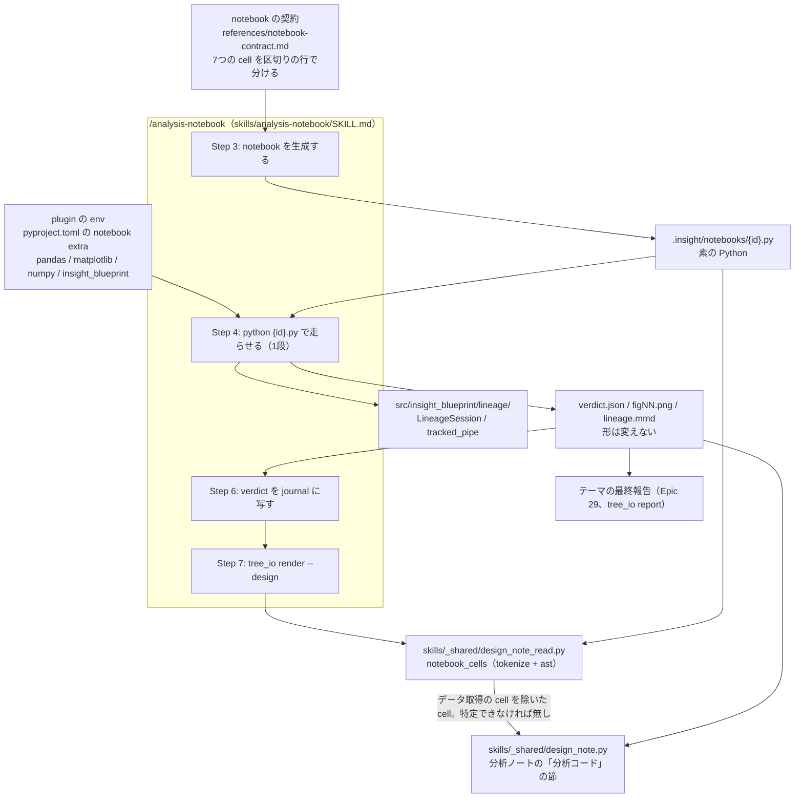
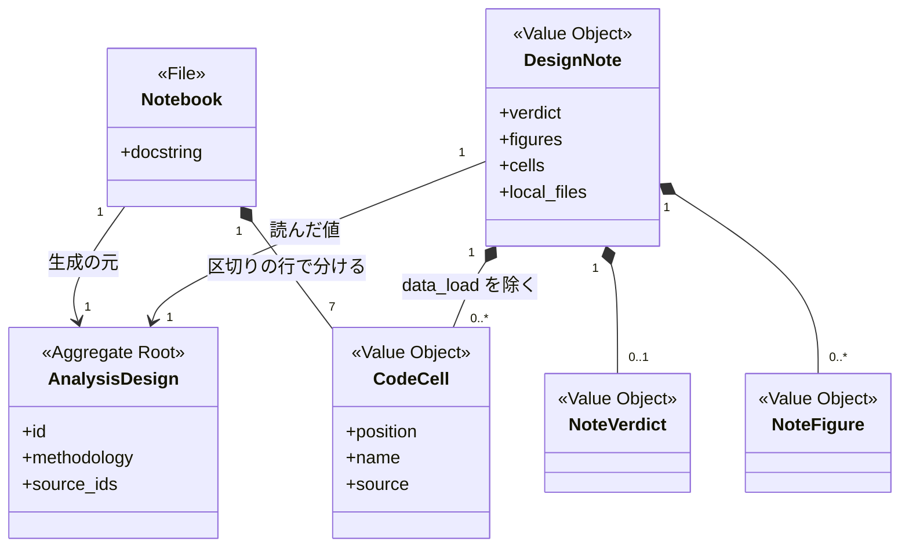
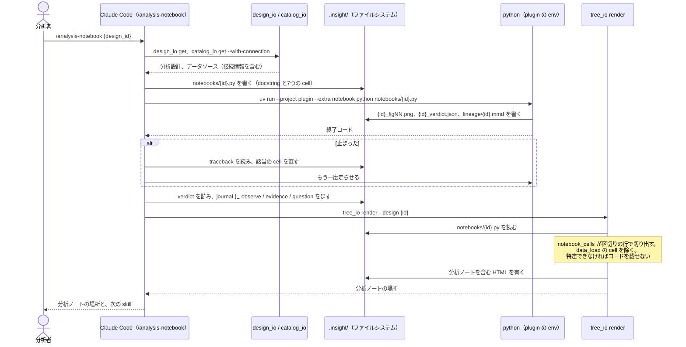

# Epic 30: notebook を `# %%` で区切る素の Python にし、marimo を外す

## Background

本書がこの Epic の要求と背景の正本（[FLOW-0001](../adr/flow/0001-designdoc-owns-requirements.md)）。
Epic issue（[#176](https://github.com/etoyama/insight-blueprint-skills/issues/176)）には要約と本書へのリンクだけを置く。

- 解く課題: notebook の契約が分析者の使っていない marimo に結びついている。分析者が読む面は Epic 28 で分析ノートになった。
  分析者は `marimo edit` も、`marimo export html` の HTML も使っていない（人間、2026-11-23）。
  - 課題1: 生成した notebook が分析の中身と関係のない marimo の決まり（契約の marimo rules の 1〜9）で止まる。直すのは AI と分析者で、分析の手戻りになる。
  - 課題2: 実行が2段（`marimo export script` の後に `python {id}_flat.py`）で、誰も読まない `{id}_flat.py` が `.insight/notebooks/` に残る。
  - 課題3: 分析者はいざというときに、手元の `.py` を開いて分析コードを確かめる。その `.py` はデコレータと、引数と戻り値の tuple に包まれている。
  - 課題4: plugin の env と既定の許可リストが、どの分析も使わない画面のためのパッケージを抱えている。
  - 課題5: 図を動かせる形で出す Epic（[#175](https://github.com/etoyama/insight-blueprint-skills/issues/175)）は、notebook の契約を変える。marimo を外すかを先に決めないと、契約を二度書き直す。
- PRD の要件: [docs/PRD.md](../PRD.md) のコアバリュー「marimo notebook 契約 & lineage」。データ加工の透明性と追跡可能性を保ったまま、契約から marimo を外す。
- 既存手段が不十分な理由: marimo の書式のまま実行だけを1段にしても、課題1・3・4 が残る（[ADR-0045](../adr/0045-notebook-is-plain-python-with-percent-cells.md) の案 A'）。

### 前提にした事実（main 08505cf、2026-11-23）

- 分析者は `marimo edit` も、`marimo export html` の HTML も使っていない（人間、2026-11-23、PM のセッションで直接）。
- `marimo export script` が出す flat script も `import marimo as mo` し、`mo.md` と `mo.mermaid` を呼ぶ。その表示はどこにも出ない。実行のときも、marimo はライブラリとして要る。
- 見本の notebook を3つの形式に書き直して走らせた。`verdict.json` と `lineage.mmd` は形式に依らずバイト単位で同じだった。
- 同じ変数を2つの cell で代入した marimo notebook は、`MultipleDefinitionError` で止まる（終了コード 1）。
- marimo 0.21.1 は site-packages で 114MB を占め、直下の依存は17個ある。
- 分析ノートは notebook の `.py` を `ast` で読み、`@app.cell` の付いた関数を cell として切り出す。`raw_df` を代入する cell がちょうど1つのときだけ、その cell を除いて載せる
  （`skills/_shared/design_note_read.py` の `notebook_cells`、[ADR-0036](../adr/0036-design-note-is-a-generated-page-per-design.md)）。
- marimo に結びついていないもの。`src/insight_blueprint/lineage/`（`LineageSession`、`tracked_pipe`）、verdict の形、figures manifest、テーマの最終報告（`tree_io report`。Epic 29 で `/analysis-report` を置き換えた）。
- Epic 29（[#177](https://github.com/etoyama/insight-blueprint-skills/issues/177)）は `epic/177-theme-report-export` にあり、まだ main に入っていない。
  `skills/_shared/design_note_read.py` と `design_note.py` に `NoteFigure.file` を足し、figures manifest を読む消費者を1つ増やす。cell の切り出しには触っていない。
- 確かめ方と、形式ごとの比較は [ADR-0045](../adr/0045-notebook-is-plain-python-with-percent-cells.md) と [ADR-0046](../adr/0046-marimo-leaves-the-plugin-env-and-the-default-allowlist.md) の Context にある。

## User Stories

AC の正本はここ。

### US-1: 分析者と AI が、marimo の決まりに縛られずに notebook を作って走らせられる

分析者として、分析が形式の決まりで止まらないように、notebook を上から下へ走る素の Python で生成して実行したい。

- [x] AC 1: notebook の契約が7つの cell（`imports`・`data_load`・`data_prep`・`analysis`・`viz`・`verdict`・`lineage`）を `# %% <名前>` の行で区切る形を定めている。
  冒頭の docstring に分析設計の id・題・仮説・intent を書くこと、最初の区切りより前には docstring だけを書くこと、契約の変数をその cell だけで代入することも定めている。
  契約は marimo rules の節を持たず、`import marimo` を書かせない。
- [x] AC 2: 契約の見本の notebook を `python {id}.py` の1つのコマンドで走らせると、`verdict.json`、図の PNG、`lineage.mmd` ができる。
  verdict の形は変わらない。結合テストが verdict・figures manifest・指標の任意の項目について確かめていることは、同じ内容のまま通る。
- [x] AC 3: 契約と `/analysis-notebook` の SKILL.md の実行の手順が1段になっている。`marimo export` と `{id}_flat.py` と `{id}.html` を書いていない。

### US-2: 分析者が、新しい形の notebook の分析コードを、分析ノートで cell ごとに読める

分析者として、判断の前に実装を確かめるために、分析ノートで分析コードを cell の名前つきで読みたい。接続情報は載ってほしくない。

- [ ] AC 1: 契約の形の notebook からは、データ取得の cell を除いた cell が、ファイルの順に、cell の名前を添えて分析ノートに出る。出るのは `.py` に書かれたとおりの文字である。
- [ ] AC 2: 次のどれかに当たる notebook からは、コードが1つも出ない。`data_load` という名前の cell が無いか、2つ以上ある。`raw_df` を、`data_load` のほかの cell か、最初の区切りより前で代入している。
  `data_load` の cell が `raw_df` を代入していない。区切りの行が文の途中にある。最初の区切りより前に、docstring のほかの文がある。区切りが1つも無い。Python として読めない。
- [ ] AC 3: 文字列の中に書かれた `# %%` は区切りとして扱わない。
- [ ] AC 4: marimo の書式の notebook からは、コードが1つも出ない。分析ノートは、notebook が契約の形でないことと、`/analysis-notebook` で作り直すと載ることを示す。
- [ ] AC 5: `@app.cell` を見分けるコードが `skills/_shared/` に残っていない。

### US-3: plugin の env と既定の許可リストに、使わない marimo が残らない

plugin を入れる分析者として、使わないパッケージを抱えないために、env と既定の許可リストから marimo を外したい。

- [x] AC 1: `pyproject.toml` の `notebook` extra と開発用の依存に、marimo が無い。`uv.lock` にも無い。
- [x] AC 2: 契約の既定の許可リストが `insight_blueprint`・`pandas`・`matplotlib`・`numpy` である。
  構造テストが、既定の許可リスト、契約の `imports` の cell の import、plugin の env の3つが一致することを確かめている。
- [ ] AC 3: CHANGELOG の `[Unreleased]` に、更新した利用者に起きること2つと直し方が書いてある。
  旧形式の notebook は分析ノートにコードが出なくなること。旧形式の notebook を手で走らせるには、パッケージ許可リストに `marimo: marimo` を足し、`--with marimo` を付けること。

### US-4: 文書が、新しい notebook の形を指している

コントリビュータと AI として、古い決まりで notebook を書かないために、正本の文書が新しい形を指していてほしい。

- [ ] AC 1: PRD のコアバリューが「notebook 契約 & lineage」になっている。
- [ ] AC 2: 用語表の「notebook」と「データ取得の cell」の定義が、新しい形を指している。「cell」が用語表に在る。`.yomiyasu-words/` が用語表と一致している。
- [ ] AC 3: ARCHITECTURE の構成図、`.insight/` の構成、パス解決の表、2本のシーケンス図に、marimo と `{id}_flat.py` が無い。Epic マッピングにこの Epic の行が在る。
- [ ] AC 4: README が notebook を marimo notebook と呼んでいない。ADR の索引の ADR-0006・0021・0027・0036 の Status に、この Epic の ADR が改めた所が書いてある。

## Stories

Story は PM のセッションが起票した（2026-11-23）。「触る所」が重なる Story は並行で進めない。
どの Story も、Epic 29 が main に入り、epic ブランチに取り込まれてから始める。

| Story issue | User Story | 扱う AC | 触る所 | 前提 |
|---|---|---|---|---|
| #200（30.1 契約と実行と env） | US-1、US-3 | US-1 AC 1, AC 2, AC 3、US-3 AC 1, AC 2 | `skills/analysis-notebook/references/notebook-contract.md`、`skills/analysis-notebook/SKILL.md`、`tests/integration/fixtures/sample_notebook.py`、`tests/integration/test_analysis_notebook_contract.py`、`pyproject.toml`、`uv.lock`、`tests/skills/test_default_allowlist_structure.py`、`tests/skills/test_connection_boundary_structure.py`、`tests/skills/test_lineage_calls_structure.py`、`CHANGELOG.md` | Epic 29 が main に入る |
| #201（30.2 分析ノートの切り出し） | US-2 | AC 1, AC 2, AC 3, AC 4, AC 5 | `skills/_shared/design_note_read.py`、`skills/_shared/design_note.py`、`tests/test_design_note_read.py`、`tests/test_design_note.py`、`tests/tree_io/test_render_design.py`、`CHANGELOG.md` | Epic 29 が main に入る |
| #202（30.3 文書） | US-4、US-3 | US-4 AC 1, AC 2, AC 3, AC 4、US-3 AC 3 | `docs/PRD.md`、`docs/UBIQUITOUS_LANGUAGE.md`、`.yomiyasu-words/`、`docs/ARCHITECTURE.md`、`README.md`、`docs/adr/README.md`、`CHANGELOG.md`、`tests/docs/test_canonical_docs.py` | 30.1、30.2 |

- 波 1 は 30.1 と 30.2 で、並行で進められる。重なるのは `CHANGELOG.md` だけで、どちらも `[Unreleased]` に1行を足す。push の前に取り込んで、両方の行を残す。
- 30.1 が契約と env をまとめて扱うのは、構造テストが3つ（既定の許可リスト、契約の import、plugin の env）を等号で照らしているからである。契約から `import marimo` を消すと、同じコミットで既定の許可リストと `notebook` extra も直すことになる。
- 30.2 は契約の文を読まない。切り出しの決まりは [ADR-0045](../adr/0045-notebook-is-plain-python-with-percent-cells.md) の Decision にある。
- 波 2 は 30.3 である。CHANGELOG の2行がそろっていることを、ここで確かめる。

## Ubiquitous Language

この Epic で追加・変更する語。定義の正本は [docs/UBIQUITOUS_LANGUAGE.md](../UBIQUITOUS_LANGUAGE.md)。用語表は 30.3 で直す。

- 変更: notebook（[ADR-0045](../adr/0045-notebook-is-plain-python-with-percent-cells.md)。「分析設計の手法から生成して実行する Python のスクリプト。`# %%` で区切った7つの cell の契約に従う」）
- 変更: データ取得の cell（ADR-0045。コード上の名前を `data_load` にする。「`data_load` という名前の cell。`raw_df` を作る。`data_load` の cell が1つに決まらないか、ほかの所で `raw_df` を代入している notebook からは、分析ノートにコードを1つも載せない」）
- 追加: cell（ADR-0045。コード上の名前は `CodeCell`。「notebook の中の、`# %% <名前>` の行から次の区切りの前までのコード」）
- 変えない: 既定の許可リスト（定義は変えない。中身から marimo が抜ける。[ADR-0046](../adr/0046-marimo-leaves-the-plugin-env-and-the-default-allowlist.md)）

## Scope

[docs/PRD.md](../PRD.md) のコアバリュー「marimo notebook 契約 & lineage」を前進させ、名前を「notebook 契約 & lineage」に改める。
PRD の改訂案は次のとおりで、30.3 で直す。

| 所 | 今 | 改訂案 |
|---|---|---|
| コアバリューの1行目 | marimo notebook 契約 & lineage — データ加工の透明性・追跡可能性 | notebook 契約 & lineage — データ加工の透明性・追跡可能性 |
| 成功基準の「移行期（達成済み）」の4行目 | コアバリュー（marimo 契約 / 分析設計 / journal・reflection / premortem）が維持される | 直さない。達成した時点の記録である |

[docs/ARCHITECTURE.md](../ARCHITECTURE.md) では、Skill layer（`/analysis-notebook`）、構成図の「marimo + lineage」、`.insight/notebooks/` の構成、分析ノートの読み取りを前進させる。

- Epic 範囲内:
  - notebook の契約を、`# %%` で区切る素の Python に書き直すこと。実行を1段にすること。
  - 分析ノートの cell の切り出しを、新しい形に替えること。
  - plugin の env と既定の許可リストから marimo を外すこと。
  - PRD・用語表・ARCHITECTURE・README・ADR の索引を、新しい形に合わせること。
- Epic 範囲外:
  - 図を動かして確かめられる形で出すこと（[#175](https://github.com/etoyama/insight-blueprint-skills/issues/175)）。描画ライブラリ、figures manifest の項目、分析ノートでの見せ方は、#175 で決める。
  - verdict・figures manifest・lineage の形を変えること。分析ノートとテーマの最終報告（Epic 29）が読むので、変えない。
  - 旧形式の notebook を新しい形に書き換える手順やコマンド。要ると分かってから足す。
  - 旧形式の notebook のコードを、分析ノートに出すこと。
  - 既にある `{id}_flat.py` と `{id}.html` を消すこと。作らなくなるだけで、在るファイルには触らない。
  - `raw_df` のほかの契約の変数について、多重の代入をコードで検査すること。
  - `/analysis-auto` と `/premortem` の、パッケージ許可リストの照らし方。
  - Epic 07 の DesignDoc と ADR-0001〜0008 の本文を直すこと（凍結。[ADR-0009](../adr/0009-adopt-repo-template-flow.md)）。

## Architecture

- 変わるのは、契約、生成される `.py` の形、実行の段数、env の中身、`notebook_cells` の読み方である。
- 変わらないのは、lineage のライブラリ、notebook の出力の形と置き場、分析ノートのほかの節、テーマの最終報告である。
- `marimo export script` と `{id}_flat.py` の経路は、図から無くなる。

## Domain Model

`src/insight_blueprint/models/` のクラスは変えない。変えるのは、`skills/_shared/design_note.py` に在る表示のための型 `CodeCell` だけである。cell の名前を持たせる。
notebook そのものは `.py` のファイルで、型を持たない。下の図の `Notebook` は、契約が定めるファイルの形を表す。コード上のクラスではない。

| 型 | 種類 | 不変条件 |
|---|---|---|
| `AnalysisDesign` | 集約ルート | 変えない |
| `Notebook`（ファイルの形） | 型を持たない | 冒頭に docstring、その後に7つの cell が契約の順に並ぶ。最初の区切りより前には docstring だけが在る。`data_load` の cell はちょうど1つで、`raw_df` を代入するのはこの cell だけである。契約の変数は、それを作る cell だけで代入する。`import marimo` を持たない |
| `DesignNote` | 値オブジェクト（表示の入力） | 項目は変えない。`cells` が無い（`None`）ことは、notebook が無いか、データ取得の cell を特定できないことを表す。旧形式の notebook でも `None` になる |
| `CodeCell` | 値オブジェクト | notebook の cell の1つ。`position` はファイルの中の cell の順番（1から）、`name` は区切りの行に書かれた名前（無ければ空）、`source` は区切りの行を含む、書かれたとおりの文字。`data_load` の cell は含めない |
| `NoteVerdict`、`NoteFigure` | 値オブジェクト | 変えない（`NoteFigure.file` を足すのは Epic 29） |

## Sequence Diagram

- 境界は2つある。plugin の env（`uv run --project`）は、実行の環境だけを貸す。cwd は分析者のプロジェクトのままである（[ADR-0006](../adr/0006-plugin-execution-model.md)）。
- 接続情報の値は、`notebooks/{id}.py` の `data_load` の cell にだけ入る。`tree_io render` はその cell を HTML に出さない（[ADR-0022](../adr/0022-connection-reaches-only-the-notebook.md)）。
- `marimo export script` の段と `{id}_flat.py` は無い。

## Decisions

### Decision: the-notebook-html-link-stays-for-files-that-exist

- What: 分析ノートの「手元のファイル」の「notebook の HTML」（`notebooks/{id}.html`）へのリンクは、消さずに残す。
- Why: 分析ノートは、在るファイルにだけリンクを張る（ADR-0036）。新しい notebook は HTML を作らないので、リンクは出ない。既に HTML を書き出した分析設計では、今までどおり出る。
- Criteria: 動いていたものを止めないこと（FLOW-0008）と、変える量（YAGNI）。決め手は、残しても新しい notebook には何も出ないこと。
- Affected modules: `skills/_shared/design_note.py`（`LOCAL_FILES`。変えない）
- Alternatives considered: リンクを消す。既にある HTML へたどれなくなるだけで、得るものが無い。
- Consequences: `LOCAL_FILES` に、新しく作られることのないファイルの行が残る。

### Decision: the-cut-checks-only-the-data-load-cell

- What: 分析ノートの切り出しは、`data_load` の cell を特定できるかだけを確かめる。ほかの cell の名前、数、順は確かめない。
- Why: 切り出しが守るのは、接続情報を載せないことである（ADR-0022）。契約どおりの7つかどうかは、分析ノートの読み手の害にならない。分析者が cell を足した notebook でも、コードを読める。
- Criteria: 接続情報を載せないこと（ADR-0022）と、分析コードを読めること（ADR-0036 の課題4）。決め手は前者を満たしたうえで、後者を狭めないこと。
- Affected modules: `skills/_shared/design_note_read.py`
- Alternatives considered: 7つの名前と順を確かめ、合わなければ載せない。契約から外れた notebook を早く見つけられるが、コードを読めなくなる。
- Consequences: 契約から外れた notebook に、分析ノートは気づかない。

### Decision: the-docstring-escapes-backslashes-and-double-quotes

- What: 冒頭の docstring に分析設計の文を書くとき、`\` を `\\` に、`"` を `\"` にする（契約の「File layout」）。
- Why: 題や仮説の文に `"""` が入ると docstring がそこで終わり、notebook が Python として読めなくなる。`\` が入ると、エスケープとして読まれて文字が変わる。
- Criteria: notebook が必ず読めること（US-1 AC 2、ADR-0045 の切り出しの決まり「Python として読める」）と、docstring の値が元の文と同じであること。決め手は、2つの文字を置き換えるだけで両方を満たすこと。
  scratchpad で、`"""`・`"`・`\` を含む題と仮説を書いた notebook を走らせ、`ast.get_docstring` の値が元の文と同じになることを確かめた。
- Affected modules: `skills/analysis-notebook/references/notebook-contract.md`
- Alternatives considered: raw の docstring（`r"""`）。`\` は守れるが `"""` で終わる。`'''` で囲む。文に `'''` が入ると同じ問題が起きる。
- Consequences: `"` を含む文は、`.py` の上では `\"` と見える。分析ノートは docstring を載せないので、読み手には出ない。

### Decision: every-import-lives-in-the-imports-cell

- What: import はすべて `imports` の cell に書く。データソースのクライアントのライブラリと、手法に固有のパッケージも含む。`imports` の cell では、`pyplot` を読み込む前に `matplotlib.use("Agg")` を呼ぶ。
- Why: SQL のデータソースの notebook を scratchpad で書くと、クライアントの import を `data_load` の cell に書きたくなる。その cell は分析ノートに出ないので、notebook が何を import したかが読み手から見えなくなる。marimo rules の9（import は1つの cell で）が消えるので、その意図を契約に残す。
  `Agg` は、素の `python` の実行で窓を開かないためである。marimo のときは marimo が描画を引き受けていた。
- Criteria: パッケージ許可リストの照らし（ADR-0021）と分析ノートの読み手に、import が見えること。決め手は、データ取得の cell を隠す決まり（ADR-0022）と両立すること。
- Affected modules: `skills/analysis-notebook/references/notebook-contract.md`、`skills/analysis-notebook/SKILL.md`、`tests/integration/fixtures/sample_notebook.py`
- Alternatives considered: import の場所を決めない。`data_load` の import が分析ノートから消える。
- 併せて、接続情報の値（パス、テーブル名、project id、ホスト、それを受け取るクライアントの生成）は `data_load` の cell にだけ書く、と契約と SKILL.md に命令の文で書いた。分析ノートが隠すのは `data_load` の cell だけで、ほかの cell の値は出る。import を `imports` の cell に寄せると、クライアントの生成もそこに書かれやすくなるので、レビューの指摘で足した。
- Consequences: ruff の E402（モジュールの import が先頭にない）が、`matplotlib.use` の後の import に出る。生成された notebook は lint しないので、利用者には影響しない。見本は `noqa` で抑えた。

### Cross-epic decisions (links to ADR)

- [ADR-0045: notebook は `# %%` で cell を区切る素の Python にし、marimo の書式をやめる](../adr/0045-notebook-is-plain-python-with-percent-cells.md): 形式、7つの cell、実行の1段、分析ノートの切り出しの決まり、旧形式の notebook を読まないこと。
- [ADR-0046: plugin の env と既定の許可リストから marimo を外す](../adr/0046-marimo-leaves-the-plugin-env-and-the-default-allowlist.md): `notebook` extra・開発用の依存・既定の許可リストから外すことと、旧形式を走らせ直す道。

## Test Design Matrix

初版では計画だけを書く。Story の実装に合わせて ✓ と「—（理由）」を付ける（[ADR-0010](../adr/0010-skill-tdd-structure-tests.md)）。

| Story \ Layer | Unit | Integration | E2E |
|---|---|---|---|
| 30.1 契約と実行と env | ✓（`tests/skills/test_notebook_contract_structure.py`、`test_default_allowlist_structure.py`、`test_connection_boundary_structure.py`。契約の cell の表と File layout、既定の許可リストの3つの一致と env と `uv.lock`、実行のコマンド） | ✓（`tests/integration/test_analysis_notebook_contract.py`。見本が契約の形であることと、見本を `python` の1つのコマンドで走らせた出力） | —（plugin を入れた分析者の環境で `/analysis-notebook` を走らせる経路は自動のテストが無い。scratchpad で、SQL のデータソースと図が2枚の notebook を同じコマンドで走らせて確かめた） |
| 30.2 分析ノートの切り出し | ☐（`tests/test_design_note_read.py`。契約の形、崩れた形、旧形式。`tests/test_design_note.py` の cell の名前と案内の文） | ☐（`tests/tree_io/test_render_design.py`） | ☐ |
| 30.3 文書 | ☐（`tests/docs/test_canonical_docs.py`） | ☐ | ☐ |

## Story Timeline

- 2026-11-23 — DesignDoc 初版。人間と3件の判断を決め、ADR-0045 と ADR-0046 を書いた。notebook の形式は `# %%` で区切る素の Python、旧形式の notebook は分析ノートが読まない、marimo は env と既定の許可リストから外す。
- 2026-11-23 — 全体の整合: 3件の判断と AC・Scope・既存の ADR を照らした。ADR-0006 の実行の行、ADR-0021 と ADR-0027 の既定の許可リストの中身、ADR-0036 の cell の形と notebook の HTML の書き出し、Epic 28 の Decision `the-data-load-cell-is-the-one-that-binds-raw-df` が古くなる。どれも ADR-0045 と ADR-0046 に書いた。
  契約から `import marimo` を消すコミットは、構造テストのために既定の許可リストと `notebook` extra も直すことになる。これを 30.1 にまとめた。verdict・figures manifest・lineage の形は変えないので、Epic 29 とは `design_note_read.py` と `design_note.py` の行が重なるだけである。
- 2026-11-23 — 見本: 合成シナリオ（公共図書館の予約本）で、新しい形の notebook を1本書いて `python` で走らせた。`verdict.json`、図の PNG、`lineage.mmd` が出た。
  その `.py` を試作の切り出しに通し、今の `render_design_note` で分析ノートを作って Artifact に出した。見本はコミットしていない。
  分かった事実。データ取得の cell と、そこに書いたデータの場所は、分析ノートに出なかった。cell の中に関数の定義（空行を含む）を書いても、cell は正しく切り出せた。分析ノートは 25KB だった。
  確かめていない前提。cell の見出しの書き方（見本では「cell 3 · data_prep」）は仮のもので、30.2 で決める。SQL のデータソースと、図が複数の notebook は走らせていない。エディタが `# %%` を cell として扱うことも確かめていない。
- 2026-11-23 — 人間が見本を見て、初版と Domain Model の図（`CodeCell` に `name` を足す）を承認した。
- 2026-11-23 — Story 30.1 completed: 契約を7つの `# %%` の cell と冒頭の docstring に書き直し、marimo rules の節を消した。実行は `python {id}.py` の1段にした。見本の notebook を新しい形にし、`notebook` extra・開発用の依存・`uv.lock`・既定の許可リストから marimo を外した。
  scratchpad で、SQL のデータソース（sqlite）と図が2枚の notebook を新しい形で書いて走らせた。`verdict.json`、図の PNG 2枚、`lineage.mmd` が出た。分かったことを Decisions の2つに書いた。
  日本語の軸ラベルは、matplotlib の既定のフォントで字が出ない（警告だけで止まらない）。marimo のときも同じで、この Epic では扱わない。
  Story の差分に thermo-nuclear-review を1本回した。致命的な指摘は無かった。中くらいの1件（接続情報の値を `data_load` だけに書く命令が契約に無い）と、低い3件（見本の区切りの行の後ろに文がある、置き方のテストが pandas の無い env で一緒に skip される、テストの名前の古い言い方）を、この Story の中で直した。
