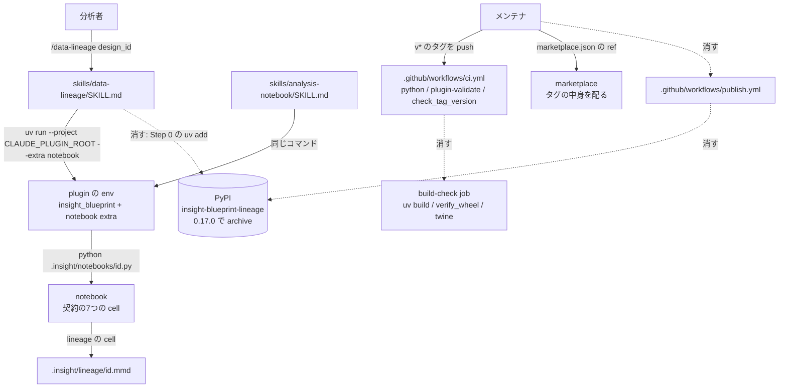
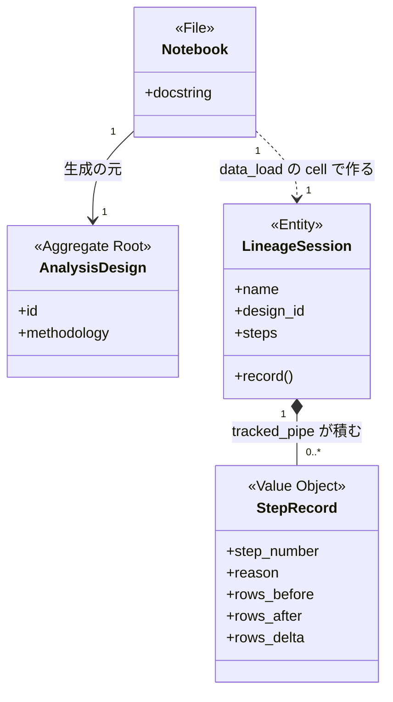
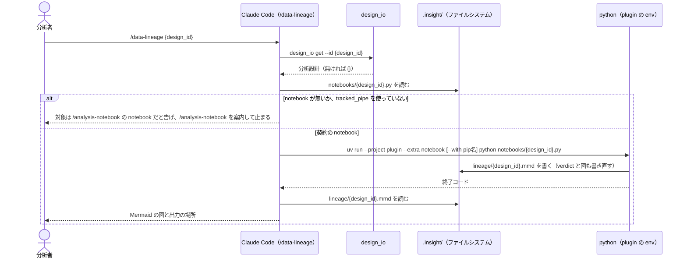

# Epic 31: PyPI への公開をやめ、/data-lineage を plugin の env で走らせる

## Background

本書がこの Epic の要求と背景の正本（[FLOW-0001](../adr/flow/0001-designdoc-owns-requirements.md)）。
Epic issue（[#207](https://github.com/etoyama/insight-blueprint-skills/issues/207)）には要約と本書へのリンクだけを置く。起票したときの本文は下の「起票の経緯」に移した。

- 解く課題: plugin は手元のソースから env を作るので、PyPI を使わない（[ADR-0006](../adr/0006-plugin-execution-model.md)）。それでも同じソースを `insight-blueprint-lineage` として PyPI に出し続けている。
  - 課題1: `/data-lineage` の Step 0 が plugin の外へ `insight_blueprint` を入れる入口になっている。公開をやめた後は、古い 0.17.0 を入れ続ける入口になる。
  - 課題2: `/data-lineage` の Mode B と Mode C は notebook をどの env で走らせるかを書いていない。`/analysis-notebook` の notebook は `insight_blueprint` を import するので、利用者の env では走らない。
  - 課題3: wheel を外に出しているかぎり、model の形が公開の契約になる（[ADR-0020](../adr/0020-design-declares-sources-in-source-ids.md)、[ADR-0023](../adr/0023-catalog-holds-no-credentials.md)）。次の Epic（[#217](https://github.com/etoyama/insight-blueprint-skills/issues/217)）が `src/insight_blueprint/models/design.py` を変えられない。
  - 課題4: PyPI に出すためだけの検査が CI とリリースの手順の手間になり、失敗の元にもなっている。
- PRD の要件: [docs/PRD.md](../PRD.md) のコアバリュー「notebook 契約 & lineage」。lineage を plugin の中で完結させ、データ加工の透明性を保つ。
- 既存手段が不十分な理由: README は「何も入れなくてよい」と書きながら、同じ README で `uv add "insight-blueprint-lineage[notebook]"` を勧めている。`/data-lineage` も `uv add` を勧める。公開をやめても、この2つが残れば利用者は外の古い版を入れ続ける。

### 起票の経緯（#207 の本文から移した）

v0.17.0 の後に README と skill を読み直し、PyPI の公開がまだ要るかを Decision Analysis で比べた。
人間は「plugin の外で `insight-blueprint-lineage` を `uv add` して使う分析者はいない」と答え、公開をやめる案に決めた（2026-11-23、Epic 30 の PM セッションで直接）。
振る舞いを変える変更なので、[ADR-0012](../adr/0012-single-pr-scope.md) により Epic にした。
この Epic が `main` に入ってから #217 を始める、と人間が決めた（2026-11-25）。

### 前提にした事実（main 7cdf83a、2026-11-25）

- PyPI を使う道は `skills/data-lineage/SKILL.md` の Step 0 と、README の2か所だけである。凍結した文書を除いて `grep` で確かめた。
- 利用者のプロジェクトの env と plugin の env では、互いのパッケージが見えない。plugin の env で走らせる notebook に、利用者が自分のプロジェクトに入れたパッケージは無い。`--with` で足せば見える（scratchpad で確かめた。[ADR-0047](../adr/0047-stop-publishing-to-pypi.md) の Context）。
- `/analysis-notebook` が作る notebook は必ず `tracked_pipe` を使い、`lineage` の cell が `.insight/lineage/{id}.mmd` を書く。`.mmd` から step の記録は読み戻せない。
- 構造テストが今の文言を固定している。`tests/test_plugin_structure.py` の `test_data_lineage_has_prerequisites_check`・`test_data_lineage_mentions_uv_add`（Step 0）と `test_readme_has_optional_python_package`（README）。
  `tests/docs/test_canonical_docs.py` の RELEASE.md のテストのうち、`test_retag_keeps_one_plugin_content_under_the_version`・`test_preflight_covers_the_publish_action`・`test_troubleshooting_covers_a_rejected_metadata_version` の3つ。
  `tests/skills/test_skill_structure.py` が `data-lineage` の版を `1.1.0` に固定している。
- PyPI に出すためだけの道具は、`.github/workflows/publish.yml`、`ci.yml` の `build-check` job、poe の `verify-wheel` と `release-dry-run`、`scripts/verify_wheel.py`、`tests/test_verify_wheel.py`、`tests/test_packaging.py` である。
- GitHub の ruleset の `protect-main` は `build-check` を必須のチェックにしている。`protect-release-tags` は `v*` のタグを消すことと動かすことを止めている。
- 配布名 `insight-blueprint-lineage` は、notebook の契約の既定の許可リストと `src/insight_blueprint/__init__.py` が参照する。既定の許可リストのパッケージは plugin の env に入っているので、`--with` で PyPI から取ることはない。
- git のタグからは入れられる。scratchpad のプロジェクトで `uv add "insight-blueprint-lineage @ git+https://github.com/etoyama/insight-blueprint-skills@v0.17.0"` を実行すると、`insight_blueprint.__version__` は `0.17.0` になった。
- 手元の分析リポジトリには `insight-blueprint-lineage` に頼るものが無かった（PM が確かめた）。

## User Stories

AC の正本はここ。

### US-1: 分析者が plugin の外に何も入れずに、notebook の lineage を出し直して見直せる

分析者として、lineage の図を出し直したり加工の手順を見直したりするために、`/data-lineage` を plugin を入れただけで使いたい。

- [x] AC 1: `skills/data-lineage/SKILL.md` に、Step 0（import を試して入れることを勧める段）、`uv add`、`pip install`、Mode A（setup）が無い。
- [x] AC 2: Mode B と Mode C は `.insight/notebooks/{id}.py` を `/analysis-notebook` と同じコマンド（`uv run --project "${CLAUDE_PLUGIN_ROOT}" --extra notebook python .insight/notebooks/{id}.py`）で走らせると書いている。パッケージ許可リストにあって `notebook` extra に無いパッケージを `--with` で足すことも書いている。
- [x] AC 3: 対象が `/analysis-notebook` の作った notebook であると書いている。`.insight/notebooks/{id}.py` が無いか、`tracked_pipe` を使っていない notebook を渡されたら、対象を告げ、`/analysis-notebook` を案内して止まる。
- [x] AC 4: CHANGELOG の `[Unreleased]` の Upgrade note に、`/data-lineage setup` が無くなったことを書いている。Step 0 に従って `uv add insight-blueprint-lineage` したプロジェクトは `uv remove insight-blueprint-lineage` で外せることも書いている。

### US-2: メンテナがリリースでタグを打つだけで済み、PyPI に出す道具を抱えない

メンテナとして、使わない検査でリリースが止まらないように、PyPI に出す道具を消したい。タグの打ち間違いには今までどおり CI で気づきたい。

- [x] AC 1: `publish.yml`、`ci.yml` の `build-check` job、poe の `verify-wheel` と `release-dry-run`、`scripts/verify_wheel.py`、`tests/test_verify_wheel.py`、`tests/test_packaging.py` が無い。
- [x] AC 2: `ci.yml` が `v*` のタグの push で `scripts/check_tag_version.py` を回す。`check_tag_version.py`、`tests/test_check_tag_version.py`、poe の `check-tag-version` は残っている。
- [x] AC 3: `docs/RELEASE.md` が plugin 1つを配る手順になっている。PyPI、twine、publish の action、wheel の検証の手順が無い。Step 2 でタグの push の前に `check_tag_version` を回す。
  Troubleshooting に、照合が落ちたらタグを動かさず patch の版を上げて打ち直すことを書いている。

### US-3: 外で使っていた人とコントリビュータが PyPI をやめたことと次の道を知れる

外で `insight-blueprint-lineage` を使っていた人とコントリビュータとして、古い記述に従って古い版を入れないように、文書から PyPI の公開を前提にした記述が消えていてほしい。

- [x] AC 1: README に、PyPI のバッジ、「Optional: Python package」の節、`uv add insight-blueprint-lineage`、`uv add "insight-blueprint-lineage[notebook]"` が無い。
  ARCHITECTURE と `pyproject.toml` の `notebook` extra のコメントは、PyPI のパッケージと書いていない。
- [x] AC 2: CHANGELOG の `[Unreleased]` の Upgrade note に、次の3つを書いている。PyPI は 0.17.0 で止まり archive されること。
  plugin の外で使い続けるなら、git のタグから入れること（`uv add "insight-blueprint-lineage @ git+https://github.com/etoyama/insight-blueprint-skills@vX.Y.Z"`）。model の形が公開の契約でなくなること。

## Stories

2本は触るファイルが `CHANGELOG.md` でだけ重なるので、並行で進められる。
どちらも `[Unreleased]` の Upgrade note に行を足すので、push の前に取り込んで両方の行を残す。

| Story issue | User Story | 扱う AC | 触る所 | 前提 |
|---|---|---|---|---|
| #219（31.1 /data-lineage を plugin の env で走らせる） | US-1 | AC 1, AC 2, AC 3, AC 4 | `skills/data-lineage/SKILL.md`（版を上げる）、`tests/test_plugin_structure.py` の `TestDataLineagePrerequisites`、`tests/skills/test_skill_structure.py` の版、`CHANGELOG.md` | 無し。`skills/analysis-notebook/SKILL.md` には触らない |
| #220（31.2 PyPI の公開を消す） | US-2、US-3 | US-2 AC 1, AC 2, AC 3、US-3 AC 1, AC 2 | `.github/workflows/publish.yml`、`.github/workflows/ci.yml`、`pyproject.toml`（poe タスクと42行目のコメント）、`scripts/verify_wheel.py`、`tests/test_verify_wheel.py`、`tests/test_packaging.py`、`docs/RELEASE.md`、`README.md`、`docs/ARCHITECTURE.md`、`tests/docs/test_canonical_docs.py`、`tests/test_plugin_structure.py` の `TestReadme`、`CHANGELOG.md` | 無し |

- 31.1 は `/analysis-notebook` の実行の節と同じコマンドを写す。`skills/analysis-notebook/SKILL.md` は単発の PR（#215）が触っているので、この Epic では変えない。
- 31.2 の `tests/test_plugin_structure.py` の変更は `TestReadme` の中だけで、31.1 の `TestDataLineagePrerequisites` とは重ならない。

## Ubiquitous Language

この Epic で追加・変更する語は無い。定義の正本は [docs/UBIQUITOUS_LANGUAGE.md](../UBIQUITOUS_LANGUAGE.md)。

- 変えない: lineage（定義は「notebook の中のデータ加工の履歴と、その Mermaid 図」で、notebook は `/analysis-notebook` が生成するもの。`/data-lineage` の対象を契約の notebook に絞ると、skill がこの定義に合う）。
- PyPI、wheel、plugin の env は実装の名前なので、用語表に載せない。

## Scope

[docs/PRD.md](../PRD.md) のコアバリュー「notebook 契約 & lineage」を前進させる。lineage を plugin の中だけで完結させる。
[docs/ARCHITECTURE.md](../ARCHITECTURE.md) では、不変条件のリリースの行、notebook + lineage のコンポーネント、ディレクトリ構成の `src/insight_blueprint/` の行を直す。

- Epic 範囲内:
  - `/data-lineage` の対象を契約の notebook に絞り、plugin の env で走らせること。Step 0 と Mode A を消すこと。
  - PyPI に出す道具を消し、タグと版の照合を `ci.yml` に移すこと。
  - README・ARCHITECTURE・RELEASE.md・`pyproject.toml` のコメントから、PyPI の公開を前提にした記述を消すこと。
  - CHANGELOG の Upgrade note に、外で使っていた人とメンテナ向けの直し方を書くこと。
- Epic 範囲外:
  - model の形を変えること（#217）。
  - lineage の API、`.mmd` の形、notebook の契約。
  - 配布名と `pyproject.toml` の `[project]` のメタデータ（classifier、URL）。
  - 自分で書いた notebook に `tracked_pipe` を足す手伝い。要ると分かってから足す。
  - 人間の作業（下の「人間の作業」）。
  - Epic 09 までの DesignDoc と ADR-0001〜0008 の本文を直すこと（凍結。[ADR-0009](../adr/0009-adopt-repo-template-flow.md)）。

### 人間の作業

AI は行わない。Epic PR のマージの前後に、人間が次の順で行う（[ADR-0047](../adr/0047-stop-publishing-to-pypi.md) の Decision）。

1. Epic PR のマージの前に、ruleset の `protect-main` の必須のチェックから `build-check` を外す。外さないとマージできない。
2. マージの後に、GitHub の `pypi` の environment を消す。
3. PyPI の trusted publisher の設定を消す。
4. PyPI の project を archive する。最後の版は出さず、yank もしない。

## Architecture

この Epic の後の、lineage の走らせ方とリリースの流れ。破線は消すものである。

## Domain Model

この Epic は型を変えない。`src/insight_blueprint/models/` も `src/insight_blueprint/lineage/` も今のままである。
変わるのは、model の形が公開の契約でなくなることだけである（[ADR-0047](../adr/0047-stop-publishing-to-pypi.md)）。下の図は lineage にかかわる型を、今の形のまま描く。
`Notebook` はファイルの形で、コード上のクラスではない。

| 型 | 種類 | 不変条件 |
|---|---|---|
| `AnalysisDesign` | 集約ルート | 変えない |
| `Notebook`（ファイルの形） | 型を持たない | 変えない（[ADR-0045](../adr/0045-notebook-is-plain-python-with-percent-cells.md)） |
| `LineageSession` | エンティティ | 変えない。notebook を1回走らせる間だけ在り、ファイルには `.mmd` だけが残る |
| `StepRecord` | 値オブジェクト | 変えない |

## Sequence Diagram

`/data-lineage {design_id}`（Mode B、図の出し直し）の流れ。Mode C（refactor）は、最後に図を見せる代わりに、step の行数から見直しの型を当てて示す。

notebook を走らせ直すと、データの取得、verdict、図もやり直しになる。`.mmd` から step の記録は読み戻せないので、図だけを書き直す道は無い。

## Decisions

この Epic の判断は3つとも cross-epic なので、[ADR-0047](../adr/0047-stop-publishing-to-pypi.md) に置いた。

### Cross-epic decisions (links to ADR)

- [ADR-0047: `insight-blueprint-lineage` を PyPI に公開するのをやめ、`/data-lineage` を plugin の env で走らせる](../adr/0047-stop-publishing-to-pypi.md): model の形は公開の契約でなくなる。
  `/data-lineage` の対象は契約の notebook だけにする（d1）。wheel の道具は消し、タグと版の照合は残す（d2）。PyPI は archive だけを行う（d3）。

## Test Design Matrix

初版では計画だけを書く。Story の実装に合わせて ✓ と「—（理由）」を付ける（[ADR-0010](../adr/0010-skill-tdd-structure-tests.md)）。

| Story \ Layer | Unit | Integration | E2E |
|---|---|---|---|
| 31.1 /data-lineage を plugin の env で走らせる | ✓（`tests/test_plugin_structure.py` の `TestDataLineagePrerequisites`。Step 0・`uv add`・`pip install`・Mode A と argument-hint の `setup` が無いこと、走らせるコマンドが `/analysis-notebook` と同じこと、`--with`、対象外のときの案内。版は `tests/skills/test_skill_structure.py`） | —（notebook を走らせて `.mmd` を書く道は `/analysis-notebook` の Step 4 と同じで、`tests/integration/test_analysis_notebook_contract.py` が契約の見本で確かめている。違うのは `uv run --project` の包みだけで、その文字列は Unit のテストが確かめる。テストで uv を呼ぶと遅く、ネットワークに依る。実物では走らせて確かめた） | —（skill の文書だけの変更で、E2E の層を持たない） |
| 31.2 PyPI の公開を消す | ✓（`tests/docs/test_canonical_docs.py` の `TestReleaseProcedure` と `TestPypiPublishingStopped`、`tests/test_plugin_structure.py` の `TestReadme`、`tests/test_release_tooling.py`。`ci.yml` の `tag-version` job がタグの push だけで `check_tag_version` を回すこと、消した道具が無いこと） | —（`tag-version` job はタグの push でしか走らない。代わりに手元で `uv run poe check-tag-version` を `v0.17.0` と `v0.17.1` で回し、終了コードがそれぞれ 0 と 1 になるのを確かめた） | —（リリースはタグを打つだけになり、通しで確かめるのは RELEASE.md の Step 4 の手作業である。GitHub と PyPI の設定は人間の作業） |

## Story Timeline

- 2026-11-25 — DesignDoc 初版。人間と3件の判断を決め、ADR-0047 を書いた。`/data-lineage` の対象は契約の notebook だけ、wheel の道具は消してタグと版の照合は残す、PyPI は archive だけ。
- 2026-11-25 — 全体の整合: 3件の判断を、AC・Scope・ADR-0006・0020・0021・0023・0027・0032・用語表と照らした。判断どうしの矛盾は無かった。
  GitHub の ruleset から2つの事実が分かり、ADR-0047 に書き戻した。
  `protect-main` が `build-check` を必須のチェックにしているので、マージの前にそれを外す作業を人間の作業に足した。
  `protect-release-tags` が `v*` のタグを動かせなくしているので、照合が落ちたときの直し方を「タグを打ち直す」から「patch の版を上げる」に改めた。
  d2 の結論は変わらない（照合の値は「気づける」ことで、直し方には依らない）。ADR-0032 の Decision の4つ目は、publish が無くなるので ADR-0047 が改めた。
  既定の許可リストの `insight_blueprint: insight-blueprint-lineage` は、plugin の env に入っているので `--with` で PyPI から取られない。配布名は残してよい。
  Mode A を消すことは使えていた場面を失わせる（FLOW-0008）。人間は d1 のリスクの表でそれを見て A を選んだ。
- 2026-11-25 — 見本: `/data-lineage` のやり取りの文言を2通り、チャットで示した。契約の notebook を走らせ直して図を出す場合と、対象外の notebook（`setup` を含む）で `/analysis-notebook` を案内して止まる場合である。見本はコミットしていない。
  確かめていない前提が1つある。見本の notebook は実際に走らせていない。走らせ方は `/analysis-notebook` の実行の節と同じコマンドである。
- 2026-11-25 — 人間が見本と、全体の整合を確かめて直した所を見て、初版と ADR-0047 を承認した。Domain Model の図は型を変えない図で、ARCHITECTURE からの変更は無い。版は 0.18.0（minor）を推奨として書いた。決めるのはリリースのとき。
- 2026-11-25 — PM が Story を起票した（31.1 は #219、31.2 は #220）。epic ブランチに `main`（#218）を取り込んだ。
- 2026-11-25 — Story 31.2 completed: PyPI に出す道具（`publish.yml`、`build-check`、`verify_wheel`、poe の2つのタスク、テスト2つ）を消し、`ci.yml` に `tag-version` job を足した。RELEASE.md を plugin 1つを配る手順に書き直し、README と ARCHITECTURE から PyPI の記述を消した。`uv sync --all-extras` の後も、plugin の env で `insight_blueprint` を import できる。
- 2026-11-25 — Story 31.1 completed: `/data-lineage` から Step 0 と Mode A を消し、Mode B と Mode C を `/analysis-notebook` と同じコマンドで走らせる形にした。SKILL.md の版は 1.2.0。
  実物で確かめた。scratchpad に契約の形の notebook を置き、SKILL.md のコマンドで走らせると `.insight/lineage/{id}.mmd` ができた。許可リストに足した `tabulate` を import すると、`--with tabulate` が無いときは止まり、あるときは通った。対象外の2つ（ファイルが無い、`tracked_pipe` が無い）は、SKILL.md に書いた確かめ方でどちらも止まった。
  初版で確かめていなかった前提（見本の notebook を走らせていない）は、これで確かめた。
  Integration のテストは置かない（Test Design Matrix に理由）。計画に無かった小さな判断が2つある。
  1つ目は構造テストで `setup` の語を一律に禁じず、Mode A と argument-hint に絞ったこと。`setup` を渡されたら止まる、と本文に書くためである。
  2つ目は Chaining に `/analysis-notebook` への行を足さなかったこと。足すと `skills/analysis-notebook/SKILL.md` に逆向きの行が要り、この Epic では触らない。案内は When NOT to Use と Target の節に置いた。
  バグ・セキュリティの観点のレビューで出た指摘6件を、すべて直した。主なものは3つある。
  CHANGELOG の `uv remove` に、自分のスクリプトが `insight_blueprint` を import していれば残す、という条件を足した。
  AC 3 の構造テストを Target の節の中だけで確かめる形にし、Mode B と Mode C がどちらも対象を確かめてから走らせることもテストにした。
  SKILL.md の Target の節を、シーケンス図のとおり `design_io get` から始めた。
