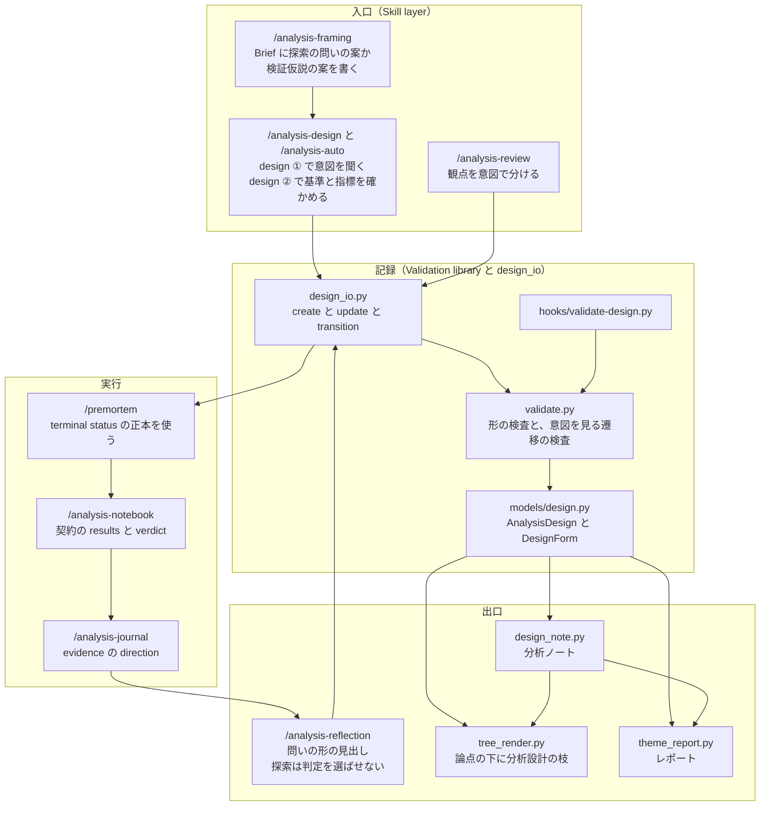
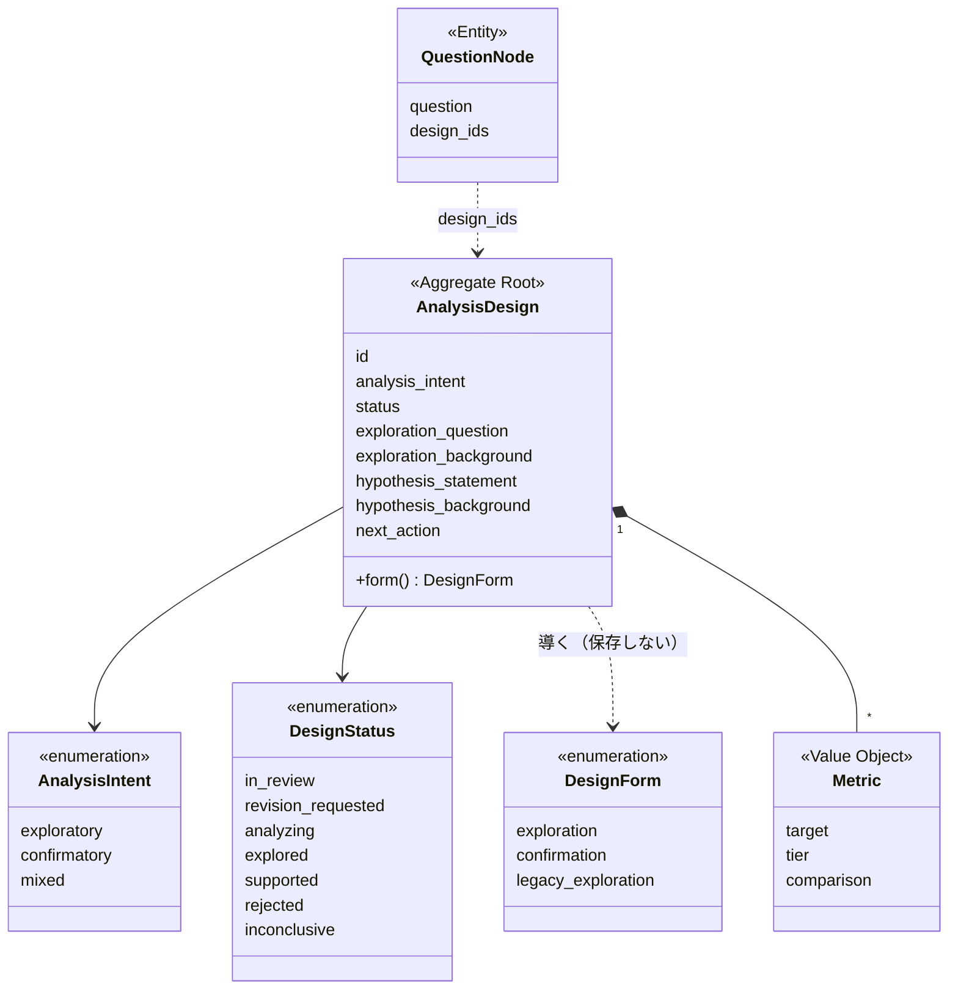
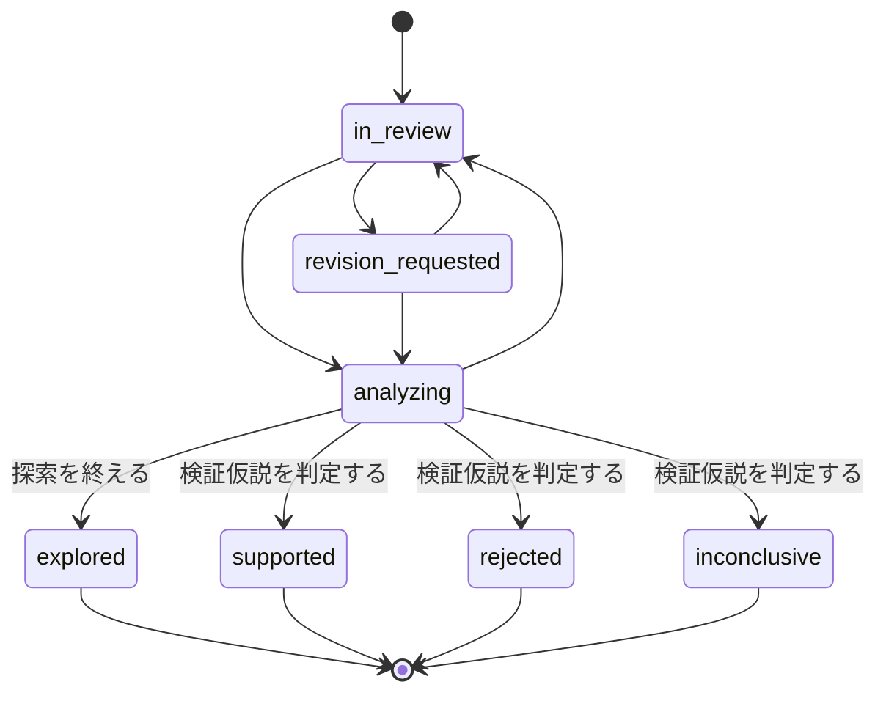
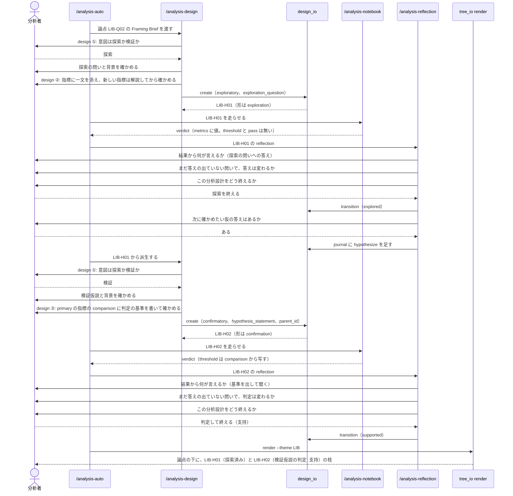

# Epic 32: 探索と検証の区別を分析設計の入口から出口まで効かせる

## Background

本書がこの Epic の要求と背景の正本（[FLOW-0001](../adr/flow/0001-designdoc-owns-requirements.md)）。
Epic issue（[#217](https://github.com/etoyama/insight-blueprint-skills/issues/217)）には要約と本書へのリンクだけを置く。起票したときの本文は下の「起票の経緯」に移した。

- 解く課題: 分析者と読み手が、論点（問い）と分析設計の仮説を取り違える。探索の分析にも仮説と判定が付き、論点が却下されたように読める。
  - 課題1: 分析設計は意図にかかわらず仮説を必ず持つ。開いた問い（どれだけ違うか）を測る探索でも、分析者は仮説を書かされ、終わりに `supported` / `rejected` / `inconclusive` のどれかを付ける。
  - 課題2: 論点ツリーの表示は論点の「根拠を開く」の中に「状態: rejected」と出す。読み手は、論点が却下されたと読む。実際は、分析設計の仮説が棄却され、論点には「説明できない」という答えが出ている。
  - 課題3: 検証は基準を先に固定して判定するものなのに、分析設計に基準を書く場所が決まっていない。閾値は notebook の中で初めて数字になり、notebook を書く AI が決めることがある。
  - 課題4: `/analysis-reflection` の3つの問いは Q1〜Q3 と呼ばれ、論点の id と紛れる。問いの範囲と、問いどうしの違いが文から読めず、分析者が聞き返す（[#211](https://github.com/etoyama/insight-blueprint-skills/issues/211)）。
  - 課題5: `/analysis-design` は、初めて出る指標を YAML とコメントで並べただけで分析者に確かめる。分析者は判断できない（[#210](https://github.com/etoyama/insight-blueprint-skills/issues/210)）。
- PRD の要件: [docs/PRD.md](../PRD.md) のコアバリュー「分析設計」「journal / reflection」「論点ツリー」と、非機能要件「分析者に届く数と結論は、記録に書いてあるものに限る」。
- 既存手段が不十分な理由: 分析の意図（`exploratory` / `confirmatory` / `mixed`）は fork 前からある。しかし意図で変わるのは notebook の契約の `analysis` cell の文だけで、分析設計の形・状態・reflection・表示はどれも意図を見ない。意図で分岐する Python のコードは無い。

### 設計思想（人間が決めた。2026-11-25）

1. 論点と分析設計の記録は分けたままにする。論点ツリーの表示で、分析設計を論点の下に入れ子で出す。
2. 論点はいつも問いである。仮説は問いに先に置く仮の答えで、検証のときだけ置く。
   探索は測って答え、判定しない。検証は基準を先に固定して判定する。探索で見つけたことが、次の論点と検証の仮説を生む。
3. 探索の分析設計には仮説にあたるものを置かない。見込みも置かない。残すなら journal に書く。
4. 検証の分析設計が持つ仮説の呼び名は造語にする。別の意味が浸透した既存の語（作業仮説）は避ける。

### 起票の経緯（#217 の本文から移した）

e-Stat の実データ試行（テーマ FRN、リポジトリ `ib-notebook`）の後に、人間が次のように述べた（2026-11-25）。

- 論点ツリーの見出しになっている Q 系と、分析設計に対応する H 系の概念が混乱している。論点の疑問文はそのまま「仮説」として分析者や読者に受け取られる（自分がそうだった）。
- イメージは、論点ツリーの中に H 系がノードとして表示される形。
- 探索と検証を分けるという整理は、自分のメンタルモデルと合う。設計思想として残したい。

FRN の記録から分かった事実（issue の記載。本書を書いたセッションは `ib-notebook` を読んでいない）。

- Yes/No の論点は仮説の疑問形になっている。FRN-Q03「受給率の差は、年齢構成と世帯類型の違いで説明できるか」と、結んだ FRN-H02 の仮説「率比は、年齢構成をそろえると 1 に近づく」は、同じ主張で文末だけが違う。
- FRN の3件はすべて `exploratory` だが、どれも仮説の文を持ち、判定が付いた。FRN-H01 は開いた問いを測る分析なのに、「振れ幅 1.5」という閾値を作って判定している。FRN-H02 は FRN-H01 の値から生まれた仮説の検証で、形は合っている。
- 探索から次の論点が生まれる道は、今の構造にある（journal の `hypothesize` と、論点の発見元）。

### 前提にした事実（main aec5a4c、2026-11-25）

- 仮説・判定の語を持つ面は13ある。記録の形（`src/insight_blueprint/models/design.py`、`src/insight_blueprint/validate.py`、`skills/_shared/design_io.py`、`hooks/validate-design.py`）、framing、design、auto、review、premortem、notebook の契約、journal、reflection、分析ノート、論点ツリー、レポート。`grep` で数えた。
- `hypothesis_statement` と `hypothesis_background` は必須の `str` である。今ある探索の分析設計はすべて仮説を持つ。
- 分析設計を読む道はどれも model の検査を通る（`design_io.py`、`design_note_read.py`）。hook も書き込みのたびに同じ検査をする。検査は1通りである。
- 分析設計が1つでも読めないと、そのテーマの論点ツリーのページ全体がエラーになる（Epic 28 の決定）。
- terminal status の集合を使う箇所は7つある。`models/tree.py`（進捗）、`tree_read.py` の2か所（巡回の現在地、レポートの未完の一覧）、`design_note_read.py`、`tree_render.py`、`tree_io.py`、`premortem/lib/risk_evaluator.py`（自前の写し）。どれも集合に入っているかだけを見る。
- 遷移の検査 `validate_transition(current, target)` は意図を受け取らない。呼ぶのは `design_io.py` の2か所だけである。
- `hypothesis_direction` は notebook の中の `results` の項目で、保存される verdict JSON には入らない。Python で読む箇所も無い。
- 分析ノートは、`direction` の無い evidence を「向きの無い証拠」の群に入れる道を持つ。指標の表は `threshold`・`p`・`pass` が無くても描ける。
- 分析設計の `Metric` で基準に使えるのは自由記述の `comparison` だけである。`/analysis-design` の SKILL.md に、閾値を書く場所の記述は無い。`metrics` は任意である。
- 分析設計は論点への参照を持たない。結ぶ側は論点の `design_ids` で、1つの分析設計を複数の論点に結べる。論点ツリーの無いテーマでも分析設計は作れる。
- `next_action` は `if_supported` / `if_rejected` の形で、判定を前提にする。
- 分析設計の id（`{theme}-H{nn}`）は、journal の出来事の id、論点の `design_ids`・発見元・引用、notebook・verdict・図・lineage のファイル名に埋まっている。`models/tree.py` は論点に結ぶ id を `{theme}-H\d+` で検査する。
- model の形は公開の契約ではない。守るのは、`.insight/` に保存済みの YAML が読めることと、plugin の中の呼び出し側だけである（[ADR-0047](../adr/0047-stop-publishing-to-pypi.md)）。
- 合成シナリオ（`tests/fixtures/handoff/lib/`）の LIB-H01「期限切れの数え方」は、開いた問いに仮説と `supported` を付けた形で、FRN-H01 と同じ型である。見本を作るために今のページを出して分かった。

## User Stories

AC の正本はここ。

### US-1: 分析者が入口で意図を選び、探索なら探索の問いを、検証なら検証仮説を書く

分析者として、開いた問いに作り物の仮説を書かずに済むように、分析設計を作る最初に意図を選び、意図に合うものだけを書きたい。

- [ ] AC 1: `/analysis-design` の Step 2 と `/analysis-auto` の design ① が、最初に意図（探索か検証か）を聞く。探索なら探索の問いと背景を、検証なら検証仮説と背景を確かめる。design ② は意図を聞かない。`mixed` を選択肢に出さない。
- [ ] AC 2: `/analysis-design` に、意図を選ぶ目安が書いてある。先に置ける仮の答えがあり、判定の基準を今固定できるなら検証で、そうでなければ探索である。Yes/No で答えられる論点でも、基準を固定できなければ探索になる。
- [ ] AC 3: `/analysis-framing` の Framing Brief の推奨方向は、探索では探索の問いの案を、検証では検証仮説の案を書く。探索の Brief に「仮説の方向性」の行が無い。
- [ ] AC 4: 検証では、design ② が primary の指標の `comparison` に判定の基準を書いて、分析者に確かめる。
- [ ] AC 5: `/analysis-review` の観点が意図で分かれる。探索は、探索の問いが論点より狭く、測るものが分かるかと、仮説や基準が紛れていないかを見る。検証は、検証仮説が反証できるかと、判定の基準が書かれているかを見る。決定の文脈は探索も持てる。「支持と棄却で選択が変わるか」の観点は検証だけに当てる。

### US-2: 分析設計の記録の形と終わり方が、意図で決まる

分析者として、探索の記録に判定の語が残らないように、分析設計の形と結論の状態が意図で決まっていてほしい。今ある記録は手を入れずに読めてほしい。

- [ ] AC 1: `design_io create` は、探索では `exploration_question` と `exploration_background` を必須にし、`hypothesis_statement`・`hypothesis_background`・`next_action` を拒む。検証では `hypothesis_statement` と `hypothesis_background` を必須にし、探索の2項目を拒む。`mixed` の作成と、検証仮説を持つ探索の作成を拒む。
- [ ] AC 2: 探索の分析設計が結論で進める状態は `explored` だけで、`supported`・`rejected`・`inconclusive` へは進めない。検証と旧形式の探索は `explored` へ進めない。
- [ ] AC 3: `design_io update` で意図を変えられるのは、状態が `in_review` か `revision_requested` の間だけである。変えた後の記録は新しい意図の形を満たす。例外は1つで、旧形式の探索を `confirmatory` に直すことは、どの状態でもできる。検証仮説と状態は変わらず、意図だけが変わる。
- [ ] AC 4: 保存済みの記録が手を入れずに検査に通る。対象は、旧形式の探索（`exploratory` で検証仮説を持つ）、`mixed`、`analysis_intent` を持たない記録の3つである。これらの状態と遷移は今までどおりである。
- [ ] AC 5: `explored` が terminal status の正本に入る。進捗は分析済みに、巡回の現在地は `concluded` に、premortem は `SKIP` になる。premortem は自前の集合を持たず、正本を使う。

### US-3: 探索の notebook は予想を持たず、測った値を残す

分析者として、探索で「予想した方向」を書かされずに、測った値が記録に残るようにしたい。検証では、閾値が notebook で初めて現れないようにしたい。

- [ ] AC 1: notebook の契約の探索の `results` に、`hypothesis_direction`・`decision_reason`・`threshold`・`pass` が無い。`metrics` は値を持ち、任意で効果量・信頼区間・標本サイズを持つ。verdict の `metrics` に残る。
- [ ] AC 2: 探索の verdict から作る journal の `evidence` は `direction` を持たない。契約に「予想に合う / 反する」で向きを付ける規則が無い。
- [ ] AC 3: 契約に、検証の `threshold` は分析設計の `comparison` から写し、notebook が作らないと書いてある。
- [ ] AC 4: notebook の docstring は、探索では探索の問いを、検証では検証仮説を書く。どちらも題と同じエスケープを当てる。
- [ ] AC 5: `/analysis-journal` に、`direction` は検証仮説に対する向きで、探索の途中の見込みは `hypothesize` に残すと書いてある。

### US-4: 読み手が論点ツリーで、分析設計を論点の下に見て、判定が誰のものかを読める

読み手として、判定を論点の却下と読み違えないように、分析設計が論点の下の枝に出て、意図と状態が役割つきの言葉で書かれていてほしい。

- [ ] AC 1: 論点ツリーの HTML で、論点に結んだ分析設計が、その論点の下の枝に、論点と形の違うカードで出る。カードは id、題、意図、探索の問いか検証仮説、状態の言葉、分析ノートへのリンクを持つ。
- [ ] AC 2: 状態の言葉は探索では「探索済み（判定はしない）」、検証では「検証仮説の判定: 支持 / 棄却 / 結論できず」、結論の前は「レビュー中 / 修正待ち / 分析中」である。凡例に、YAML の値との対応が出る。論点のカードには、答えの文の上に「現時点の答え」の見出しが出る。
- [ ] AC 3: 複数の論点に結んだ分析設計は、2つ目の論点からは、id・状態の言葉・最初に出た論点へのリンクだけの短い行で出る。
- [ ] AC 4: 旧形式の探索は仮説と判定を書かれたとおりに出し、意図を「探索（旧形式）」と出す。保存済みの `mixed` は「探索と検証（旧形式）」と出す。
- [ ] AC 5: 合成シナリオが探索と検証の分析設計を両方持つ。検証仮説の判定と、論点への現時点の答えが違う論点が1つある。引き継ぎの試行のテストが、新しい合成シナリオと正解の鍵で通る。q3 の鍵は、根の現時点の答えが引用する出来事を、journal の `direction` ではなく、引用した文の種類で分ける。「言えること」が引用する出来事が支える証拠、「弱める証拠と留保」が引用する出来事が弱める証拠である。`docs/HANDOFF_TRIAL.md` の採点の表も同じ分け方になる。

### US-5: 読み手が分析ノートとレポートで、探索に判定の言葉を見ない

読み手として、探索の結果を判定と読まないように、分析ノートとレポートの定型文が意図で分かれていてほしい。

- [ ] AC 1: 分析ノートの冒頭の節は探索では「探索の問いと背景」、検証では「検証仮説と背景」である。証拠は、探索では1群（「証拠」）、検証では「検証仮説を支持する証拠」と「検証仮説に反する証拠」に分かれる。
- [ ] AC 2: 結論の冒頭の定型文は探索では「探索を終えた。判定はしていない。」、検証では「検証仮説は支持された。」「検証仮説は棄却された。」「検証仮説を支持するとも棄却するとも結論できなかった。」である。分析ノートとレポートで同じ文が出る。
- [ ] AC 3: 探索の分析ノートとレポートの指標の表に、測った値が出る。閾値と合否の列は出ないか、「—」になる。
- [ ] AC 4: レポートの分析設計の表は意図の列と「探索の問い / 検証仮説」の列を持つ。探索の分析設計には「仮説に反する証拠」の節を出さない。探索の問いは、データ由来の文としてエスケープする。
- [ ] AC 5: 旧形式の探索は分析ノートとレポートで今の文（「仮説は支持された。」など）のまま出し、「旧形式の探索」の注記を出す。

### US-6: 分析者が reflection の問いに、聞き返さずに答えられる

分析者として、何を答えればよいか迷わないように、`/analysis-reflection` の問いが役割の分かる見出しを持ち、範囲と前の問いとの違いを先に言ってほしい。探索では判定を選ばされたくない。

- [ ] AC 1: Step 3 の3つの段の見出しが問いの形である。「結果から何が言えるか」「まだ答えの出ていない問いで、判定は変わるか」（探索では「答えは変わるか」）「この分析設計をどう終えるか」。Q1〜Q3 の表記が無い。
- [ ] AC 2: 検証の1つ目の段は分析設計の `comparison` の基準を出してから聞く。2つ目の段は、その分析設計の journal の未解決の問いを並べ、問いごとに、答えがどうなら判定が変わるかを示してから聞く。3つ目の段は「ふつうは1つ目の答えのとおりに終える。変わるのは、2つ目で『ある』と答えたときだけ」と先に言う。
- [ ] AC 3: 探索の段は判定を選ばせない。1つ目の段は探索の問いへの答えを聞き、3つ目の段の選択肢は「探索を終える」と「調べ足す」である。終えると状態は `explored` になる。
- [ ] AC 4: 探索を終えるときに、次に確かめたい仮の答えがあるかを聞く。あれば journal の `hypothesize` に残し、検証の分析設計を派生で起こす道を案内する。分析者は飛ばせる。
- [ ] AC 5: 判定（答え）が変わらない未解決の問いは、根の問いへの留保として、テーマの振り返りで扱うと添える。分析者に見せる文に「響く」を使わない。

### US-7: 分析者が、初めて出る指標を理解してから方法を決められる

分析者として、判断できないまま方法を承認しないように、`/analysis-design` が新しい指標を解説してから聞いてほしい（#210）。

- [ ] AC 1: design ② はすべての指標に「何を表す数か」の一文を添える。
- [ ] AC 2: 2つ以上の量から計算して作る指標（標準化、期待値との差、比の比、モデルの係数、合成した指数）で、そのテーマの既存の分析設計にまだ出ていないものには、5項目の解説を付けてから聞く。5項目は、何を表す数か、作り方、実データを使った具体例、迷いやすい点と扱いを変えると何が変わるか、その数が言えないこと。
- [ ] AC 3: 具体例の数字は、journal に既にある数字か、別の群を同じ作り方で計算した数字を使う。これから判定する結果を使わない。概算なら概算と書く。
- [ ] AC 4: 検証では、判定の基準を持つ primary の指標に、基準の意味と、扱いを変えると判定がどう変わるかを付ける。
- [ ] AC 5: 分析者はどの指標にも解説を求められる、と聞く前に添える。`/analysis-auto` の design ② の行に、同じ手順を1行で書く。

### US-8: 文書が、探索と検証の区別を指している

コントリビュータと分析者として、古い定義に従わないように、用語と正本の文書が新しい形を指していてほしい。

- [ ] AC 1: `docs/UBIQUITOUS_LANGUAGE.md` に、検証仮説・探索の問い・探索の問いの背景・旧形式の探索・分析設計の形がある。仮説・分析設計・指標・手法・派生・terminal status・分析の意図・notebook・verdict の定義が、探索と検証の両方に合う。分析設計の id の `H` は通し番号の記号だと書いてある。Context の文も探索と検証の両方を言う。
- [ ] AC 2: 「使わない言い換え」に、分析設計の項目を指す素の「仮説」と素の「問い」が入り、`.yomiyasu-words/` に出る。
- [ ] AC 3: `docs/PRD.md` のビジョンとコアバリューが、探索と検証の区別を書いている。`docs/ARCHITECTURE.md` の Domain Model 図と不変条件の表、分析ワークフローのシーケンスが、新しい形と一致する。
- [ ] AC 4: CHANGELOG の `[Unreleased]` の Upgrade note に、次の3つがある。旧形式の探索は読めて「探索（旧形式）」と出ること。実質が検証なら `design_io update` で意図を `confirmatory` に直せること。`mixed` は新しく作れないこと。

## Stories

Story は PM のセッションが起票する。下は初版の案で、起票したら issue の番号を書く。「触る所」が重なる Story は並行で進めない。

| Story issue | User Story | 扱う AC | 触る所 | 前提 |
|---|---|---|---|---|
| 32.1 土台（未起票） | US-2 | AC 1, AC 2, AC 3, AC 4, AC 5 | `src/insight_blueprint/models/design.py`、`src/insight_blueprint/validate.py`、`skills/_shared/design_io.py`、`skills/premortem/lib/risk_evaluator.py`、`skills/premortem/SKILL.md`、`docs/ARCHITECTURE.md` の Domain Model 図（テストが model と照らす）、`tests/test_design_models.py`、`tests/test_validate.py`、`tests/test_design_io.py` | 無し |
| 32.2 用語と文書（未起票） | US-8 | AC 1, AC 2, AC 3, AC 4 | `docs/UBIQUITOUS_LANGUAGE.md`、`.yomiyasu-words/`、`docs/PRD.md`、`docs/ARCHITECTURE.md`、`CHANGELOG.md`、`tests/docs/test_canonical_docs.py` | 32.1 |
| 32.3 入口（未起票） | US-1 | AC 1, AC 2, AC 3, AC 4, AC 5 | `skills/analysis-design/SKILL.md`、`skills/analysis-auto/SKILL.md`、`skills/analysis-framing/SKILL.md`、`skills/analysis-review/SKILL.md`、`tests/skills/` | 32.1 |
| 32.4 notebook と journal（未起票） | US-3 | AC 1, AC 2, AC 3, AC 4, AC 5 | `skills/analysis-notebook/references/notebook-contract.md`、`skills/analysis-notebook/SKILL.md`、`skills/analysis-journal/SKILL.md`、`tests/integration/fixtures/sample_notebook.py`、`tests/integration/test_analysis_notebook_contract.py` | 32.1 |
| 32.5 分析ノートとレポート（未起票） | US-5 | AC 1, AC 2, AC 3, AC 4, AC 5 | `skills/_shared/design_note.py`、`skills/_shared/design_note_read.py`、`skills/_shared/theme_report.py`、`tests/test_design_note.py`、`tests/test_theme_report.py` | 32.1 |
| 32.6 論点ツリー（未起票） | US-4 | AC 1, AC 2, AC 3, AC 4, AC 5 | `skills/_shared/tree_render.py`、`skills/_shared/tree_read.py`、`tests/fixtures/handoff/lib/`、`tests/test_tree_render.py`、`tests/test_handoff_trial.py`、`docs/HANDOFF_TRIAL.md` | 32.5 |
| 32.7 reflection（未起票） | US-6 | AC 1, AC 2, AC 3, AC 4, AC 5 | `skills/analysis-reflection/SKILL.md`、`skills/analysis-auto/SKILL.md` の reflection の行、`tests/skills/` | 32.3、32.4 |
| 32.8 新しい指標の解説（未起票） | US-7 | AC 1, AC 2, AC 3, AC 4, AC 5 | `skills/analysis-design/SKILL.md`、`skills/analysis-auto/SKILL.md` の design ② の行、`tests/skills/` | 32.3 |

- 波 1 は 32.1 である。分析設計の形（下の Domain Model の `DesignForm`）と `explored` を、ほかの Story が読む。
- 波 2 は 32.2・32.3・32.4・32.5 で、並行で進められる。重なるのは `CHANGELOG.md` だけである。
- 波 3 は 32.6・32.7・32.8 である。32.6 は、状態の言葉と定型文を 32.5 が置いた所から読む。32.7 と 32.8 は、32.3 が直した `skills/analysis-auto/SKILL.md` と `skills/analysis-design/SKILL.md` の別の節を触る。32.7 と 32.8 は `skills/analysis-auto/SKILL.md` で重なるので、順に進める。
- PM の仮の形（6本）から2本増えた。文書（32.2）を土台から分けたのは、土台だけで AC が5つになるからである。表示を2本（32.5、32.6）に分けたのも、AC が10になるからである。

## Ubiquitous Language

この Epic で追加・変更する語。定義の正本は [docs/UBIQUITOUS_LANGUAGE.md](../UBIQUITOUS_LANGUAGE.md) で、表は Story 32.2 が直す
（コード上の名前が実在することをテストが確かめるので、32.1 の後になる）。意味の変更は [ADR-0048](../adr/0048-intent-decides-the-form-and-the-end-of-a-design.md) が決めた。

- 追加: 検証仮説（`hypothesis_statement`）、探索の問い（`exploration_question`）、探索の問いの背景（`exploration_background`）、旧形式の探索、分析設計の形（`DesignForm`）
- 変更: 仮説（問いに先に置く仮の答え。journal の `hypothesize` が記録する。分析設計の項目は検証仮説と呼ぶ）
- 変更: 仮説の背景（検証仮説の背景）、分析設計、指標、手法、派生、terminal status（`explored` を足す）、分析の意図（`mixed` は新しく作れない）、notebook、verdict、reflection
- 変えない: 論点、現時点の答え、未解決の問い。分析設計の id の `H` とファイル名の `_hypothesis.yaml` は変えず、`H` は通し番号の記号だと書く

## Scope

[docs/PRD.md](../PRD.md) のコアバリュー「分析設計」「journal / reflection」「論点ツリー」「notebook 契約 & lineage」を前進させる。
[docs/ARCHITECTURE.md](../ARCHITECTURE.md) では、Validation library、Skill layer、`tree_io render` と `tree_io report` の表示、Domain Model を直す。

- Epic 範囲内:
  - 仮説・判定の語を持つ13の面すべてを、意図で分けること（人間が決めた。下の Decision `all-thirteen-surfaces-and-no-migration-tool`）。
  - 分析設計の形と状態（[ADR-0048](../adr/0048-intent-decides-the-form-and-the-end-of-a-design.md)）、旧形式の探索の読み方（[ADR-0049](../adr/0049-legacy-exploration-stays-readable-and-is-marked.md)）、notebook の契約と基準の置き場（[ADR-0050](../adr/0050-exploration-keeps-values-and-confirmation-fixes-its-criterion.md)）、表示（[ADR-0051](../adr/0051-designs-nest-under-their-question-and-state-is-worded-by-role.md)）。
  - `/analysis-reflection` の問いの見出しと文（#211）。
  - `/analysis-design` の design ② で新しい指標を解説する手順（#210）。
  - `/rq-problematization` と `/premortem` の、判定の語を挙げている案内の文言を直すこと。
- Epic 範囲外:
  - 既存の記録を新しい形へ書き換える道具。対象が少ないうちは作らない。
  - 分析設計の id の記号とファイル名を変えること。
  - 検証の基準が書かれているかを機械で検査すること。書き忘れが実際に起きてから足す。
  - 論点の文の書き方（Yes/No の論点を開いた問いに直させること）。
  - テーマを横断する振り返り（現時点の答えを書く側）の形。
  - [#137](https://github.com/etoyama/insight-blueprint-skills/issues/137)、[#212](https://github.com/etoyama/insight-blueprint-skills/issues/212)、[#213](https://github.com/etoyama/insight-blueprint-skills/issues/213)。
  - Epic 10 までの DesignDoc と ADR-0001〜0008 の本文を直すこと（凍結。[ADR-0009](../adr/0009-adopt-repo-template-flow.md)）。

## Architecture

意図が入口から出口までのどの面で何を変えるかを示す。

図の読み方: 箱は1つの skill かモジュールで、2行目からがこの Epic で変わること。矢印は呼ぶか読む向きを表す。
`DesignForm` は分析設計の形で、記録から導く。出口の3つの表示は形を見て言葉を選ぶ。状態の言葉と定型文は `design_note.py` に置き、`tree_render.py` と `theme_report.py` がそこから読む（今の `LEAD_SENTENCES` と同じ置き方）。

## Domain Model

[docs/ARCHITECTURE.md](../ARCHITECTURE.md) の全体図からの差分だけを描く（[ADR-0011](../adr/0011-domain-model-overview-in-architecture.md)）。

図の読み方: 箱は1つのクラスで、下段はこの Epic に関わる項目だけを載せた。
足すのは `exploration_question`、`exploration_background`、`DesignStatus` の `explored`、`DesignForm` の4つである。
`hypothesis_statement` と `hypothesis_background` は必須から任意に変わる。`Metric` と `QuestionNode` は変えない。
破線の矢印は型で結ばれていない関係で、`DesignForm` は保存せず、意図と項目から導く。

| 型 | 種類 | 不変条件 |
|---|---|---|
| `AnalysisDesign` | 集約ルート | 形は意図と項目から1つに決まる。決まらない記録（探索の問いと検証仮説の両方を持つ、どちらも持たない）は不正である |
| `DesignForm.exploration` | 導く値 | `exploratory` で探索の問いを持つ。探索の問いと背景は空でない。検証仮説・その背景・`next_action` を持てない。結論の状態は `explored` だけ |
| `DesignForm.confirmation` | 導く値 | `confirmatory` か `mixed` で検証仮説を持つ。検証仮説と背景は空でない。探索の問いとその背景を持てない。結論の状態は `supported`・`rejected`・`inconclusive` だけ |
| `DesignForm.legacy_exploration` | 導く値 | `exploratory` で検証仮説を持つ（旧形式の探索）。検査と遷移は `confirmation` と同じ。新しく作れない |
| `AnalysisIntent` | enum | 新しく作れるのは `exploratory` と `confirmatory` だけ。`mixed` は保存済みの記録を読むために残す。意図は `in_review` か `revision_requested` の間だけ変えられる。旧形式の探索を `confirmatory` に直すことだけは、どの状態でもできる |
| `DesignStatus` | enum | terminal status は `explored`・`supported`・`rejected`・`inconclusive` の4つ。どれからも遷移できない |
| `Metric` | 値オブジェクト | 型は変えない。検証では、primary の指標の `comparison` に判定の基準を書く（文の決まりで、機械では検査しない） |

### State Diagram

図の読み方: 箱は状態、矢印は遷移を表す。結論の前の遷移は今と同じである。
`explored` へ進めるのは形が `exploration` の分析設計だけで、`supported`・`rejected`・`inconclusive` へ進めるのは `confirmation` と `legacy_exploration` だけである。
図は `analyzing` からの結論だけを描いた。今の `VALID_TRANSITIONS` は `in_review` と `revision_requested` からも結論の状態へ進めるので、その道にも同じ決まりを当てる。
意図を変えられるのは `in_review` と `revision_requested` の間である。

## Sequence Diagram

探索の分析設計を1つ終え、そこから検証の分析設計を派生で起こして判定し、論点ツリーに並ぶまでを描く。

図の読み方: 縦の線は参加者、矢印は呼び出しか問いかけ、破線の矢印は答えを表す。上から下へ時間が進む。
review、premortem、journal への verdict の記録は、今と同じなので省いた。
`design_io` の先にはファイルシステム（`.insight/designs/`）がある。検査は `validate.py` が行い、通らなければ書かない。

## Decisions

### Decision: all-thirteen-surfaces-and-no-migration-tool

- What: 仮説・判定の語を持つ13の面すべてを、この Epic で意図で分ける。既存の記録を書き換える道具は作らない。
- Why: 一部の面だけ直すと、同じ分析設計を面ごとに違う言葉で呼ぶことになり、混同が形を変えて残る（課題1、課題2）。
- Criteria: 探索の分析設計が作成から表示まで通ること（Must）。読み手に届く面で探索に判定の言葉が出ないこと（Want、高、人間。issue の題「入口から出口まで」）。Epic の大きさ（Want、中）。決め手は2つ目。
- Affected modules: Stories の表の「触る所」のすべて。
- Alternatives considered: 核だけ直し、framing・review・premortem・レポートを次の Epic に回す案。探索が仮説を持たなくなれば、レポートと分析ノートは落ちないように結局触るので、軽くならない。移行の道具を作る案は、対象が FRN の3件のうちは要らない。
- Consequences: Story は8本になる。旧形式の記録は `design_io update` で検証に直すか、印を付けたまま残す（[ADR-0049](../adr/0049-legacy-exploration-stays-readable-and-is-marked.md)）。

### Decision: reflection-asks-in-the-form-of-questions

- What: `/analysis-reflection` の Step 3 の3つの段を、番号ではなく問いの形の見出しで呼ぶ。「結果から何が言えるか」「まだ答えの出ていない問いで、判定（探索では答え）は変わるか」「この分析設計をどう終えるか」。探索も3段にし、判定を選ばせない。分析者に見せる文は比喩を使わず「答えが出ると変わる」と書く。
- Why: Q1〜Q3 は論点の id と紛れる。問いの範囲と、問いどうしの違いが読めず、分析者が聞き返した（課題4、#211）。
- Criteria: 探索の reflection が判定を選ばせないこと（Must）。呼び名が論点の id と紛れないこと（Want、高、人間）。分析者が聞き返さずに答えられること（Want、高、人間）。決め手は3つ目で、人間が「証拠の読み」などの名詞の見出しと「響く」を、初見で分からないとして退けた。
- Affected modules: `skills/analysis-reflection/SKILL.md`、`skills/analysis-auto/SKILL.md`。
- Alternatives considered: 記号だけ変える案（R1〜R3）。することの形の見出し（「結果を読む」）。探索を2段にする案。
- Consequences: journal の出来事は `reflect` のままで、見出しは用語集に足さない。用語集の「未解決の問い」は分析者に見せる文では「まだ答えの出ていない問い」と開いて書く。

### Decision: explain-a-composite-metric-that-is-new-to-the-theme

- What: design ② はすべての指標に一文を添える。5項目の解説は、2つ以上の量から計算して作る指標で、そのテーマの既存の分析設計にまだ出ていないものに付ける。分析者はどの指標にも解説を求められる。
- Why: 初めて出る指標を並べただけでは、分析者は判断できない（課題5、#210）。すべての指標を毎回5項目で解説すると、肝心の指標が埋もれる。
- Criteria: 分析者が知らない指標が解説なしで聞かれないこと（Want、高、人間）。解説の長さ（Want、中）。書く側が線引きを迷わず当てはめられること（Want、中）。決め手は1つ目と2つ目の両立。
- Affected modules: `skills/analysis-design/SKILL.md`、`skills/analysis-auto/SKILL.md`。
- Alternatives considered: 常に全部の指標を解説する案。先に「解説が要る指標はあるか」を分析者に聞く案。
- Consequences: 単一の列の指標でも馴染みの無いもの（分位点など）は、一文だけで出る。分析者が解説を求めれば付く。

### Cross-epic decisions (links to ADR)

- [ADR-0048: 分析の意図が、分析設計の形と終わり方を決める](../adr/0048-intent-decides-the-form-and-the-end-of-a-design.md): 探索は探索の問いを持って `explored` で終わり、検証は検証仮説を持って判定で終わる。`mixed` は新しく作れない。意図は分析の前だけ変えられる。id の `H` は変えない。
- [ADR-0049: 旧形式の探索は読めるままにし、印を付ける](../adr/0049-legacy-exploration-stays-readable-and-is-marked.md): 検証仮説を持つ探索は書かれたとおりに出し、意図を「探索（旧形式）」と出す。新しく作る道は新しい形だけを書く。
- [ADR-0050: 探索は予想を持たずに測った値を残し、検証は基準を分析設計に書く](../adr/0050-exploration-keeps-values-and-confirmation-fixes-its-criterion.md): notebook の契約と journal の `direction`、検証の基準の置き場。
- [ADR-0051: 論点ツリーは分析設計を論点の下の枝に出し、状態を役割つきの言葉で言う](../adr/0051-designs-nest-under-their-question-and-state-is-worded-by-role.md): 入れ子の表示、状態の言葉、分析ノートとレポートの定型文。

## Test Design Matrix

初版では計画だけを書く。Story の実装に合わせて ✓ と「—（理由）」を付ける（[ADR-0010](../adr/0010-skill-tdd-structure-tests.md)）。

| Story \ Layer | Unit | Integration | E2E |
|---|---|---|---|
| 32.1 土台 | ☐ | ☐ | ☐ |
| 32.2 用語と文書 | ☐ | ☐ | ☐ |
| 32.3 入口 | ☐ | ☐ | ☐ |
| 32.4 notebook と journal | ☐ | ☐ | ☐ |
| 32.5 分析ノートとレポート | ☐ | ☐ | ☐ |
| 32.6 論点ツリー | ☐ | ☐ | ☐ |
| 32.7 reflection | ☐ | ☐ | ☐ |
| 32.8 新しい指標の解説 | ☐ | ☐ | ☐ |

## Story Timeline

- 2026-11-25 — DesignDoc 初版。人間と11件の判断（範囲、分析設計の形、用語、意図、状態、証拠の形、id とファイル名、既存の記録、表示の言葉、reflection、#210 の線引き）を、範囲から先に決めた。ADR-0048〜0051 を書いた。
  人間が言葉を直した所が2つある。reflection の段の見出しは、名詞の見出し（「証拠の読み」など）をやめて問いの形にした。「響く」は「答えが出ると変わる」に置き換えた。
- 2026-11-25 — 全体の整合: 11件の判断を、AC・Scope・ADR-0013・0014・0019・0024・0025・0029・0033・0035・0036・0047 と照らした。決め直した点が2つある。
  1つ目は、意図を変えられるのは分析の前だけという決まりと、実質が検証の旧形式を検証に直せるという決まりのぶつかりである。結論済みの記録は意図を変えられなかった。旧形式の探索を `confirmatory` に直すことだけは、どの状態でも `design_io update` でできる、と人間が決めた。
  2つ目は引き継ぎの試行の q3 の鍵である。今の鍵は journal の `direction` で分けるが、探索の evidence は `direction` を持たなくなる。現時点の答えの文の種類で分ける、と人間が決めた。
  聞かずに足した補足が4つある。探索の問いをデータ由来の文としてエスケープすること、決定の文脈は探索も持てること、用語集の Context の文も直すこと、派生の分析設計が派生元の論点に結ばれる決まり（ADR-0033）は入れ子の表示と合うこと。
- 2026-11-25 — 見本: 論点の下に分析設計を入れ子で出した論点ツリーを、合成シナリオで Artifact に作った。今のページ（`python -m scripts.handoff_trial build --scenario lib`）の stylesheet と骨組みをもとにした。探索と検証と旧形式の探索を入れ、分析ノートとレポートの定型文の抜粋も載せた。人間は入れ子の形と状態の言葉を、切り替えで見比べて選んだ。見本はコミットしていない。
  分かった事実は2つある。合成シナリオの LIB-H01 は開いた問いに仮説と `supported` を付けた形だった（Background に書いた）。1つの論点に判定が2つ並び、論点の答えは未判別という場面を作れた（US-4 AC 5 に書いた）。
  確かめていない前提は2つある。見本は手で書いた HTML で、`tree_render.py` が出したものではない。直した後の表示で、引き継ぎの試行は回していない。
