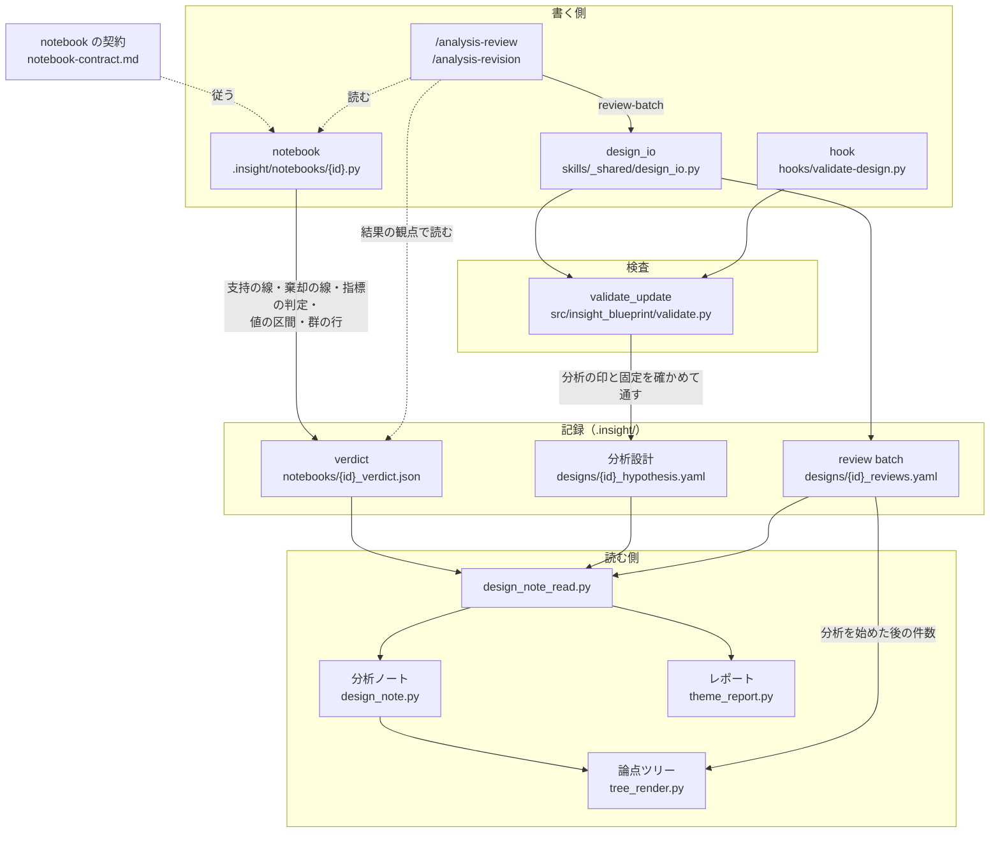
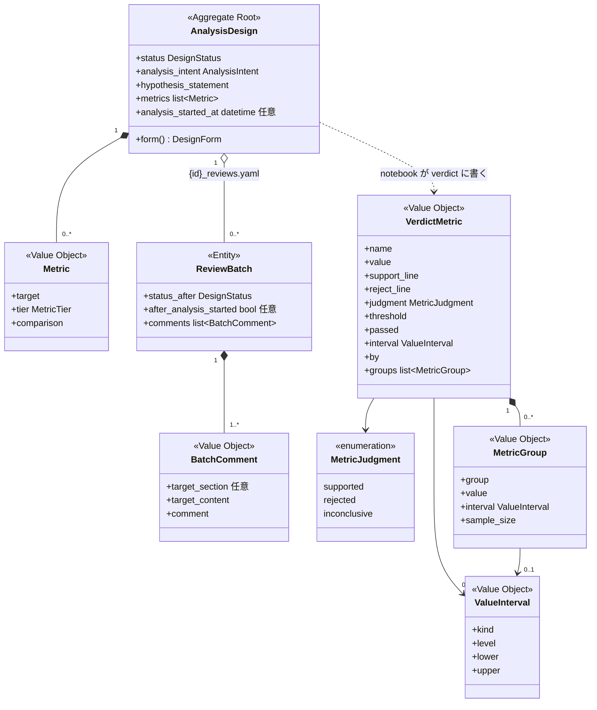
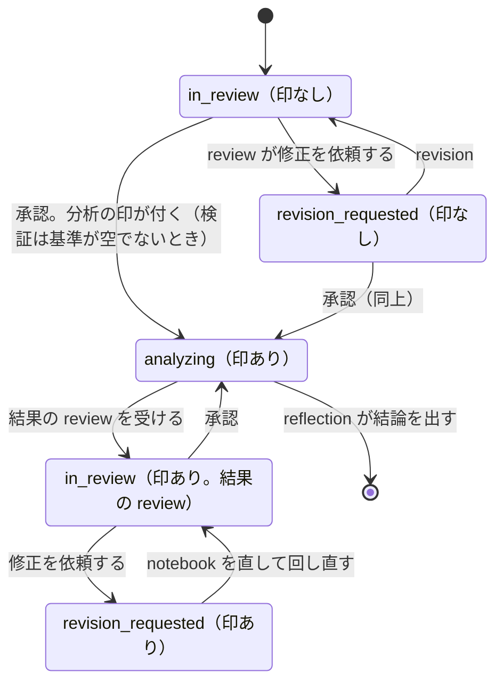
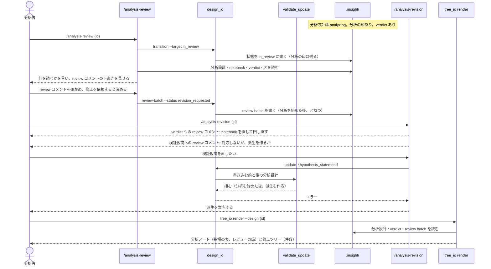

# Epic 33: 検証の判定を記録で守る

## Background

本書がこの Epic の要求と背景の正本（[FLOW-0001](../adr/flow/0001-designdoc-owns-requirements.md)）。
Epic issue（[#242](https://github.com/etoyama/insight-blueprint-skills/issues/242)）には要約と本書へのリンクだけを置く。

- 解く課題: Epic 32 は「検証は基準を先に固定して判定する」と決めた。しかし、記録の上ではその決まりを破れる。分析者と読み手は、判定がどの基準で出たか、基準が結果の前に置かれたかを、記録から確かめられない。
  - 課題1: verdict の指標は基準の線を1本（`threshold`）と合否（`pass`）しか持てない。基準が「2.0 日以上なら支持。1.0 日未満なら棄却。その間は結論しない」のとき、棄却の線が表に出ない。`pass: false` が棄却なのか、結論しないなのかも読めない（[#235](https://github.com/etoyama/insight-blueprint-skills/issues/235)）。
  - 課題2: verdict の区間は `confidence_interval` という名前で、種類を書く場所が無い。ベイズの HDI を入れると、分析ノートは「信頼区間」と出す（[#237](https://github.com/etoyama/insight-blueprint-skills/issues/237) の F17）。
  - 課題3: 群ごとに値を持つ指標は群を名前に入れて平たく並べるしかない。分析ノートの指標の表が101行になった（#237 の F09）。
  - 課題4: 分析を始めた後でも、検証仮説と判定の基準と意図を書き換えられる。結果の review で `in_review` に戻すと、Epic 32 が入れた意図の固定も外れる（[#234](https://github.com/etoyama/insight-blueprint-skills/issues/234)）。
  - 課題5: reflection が結果の review として勧める `/analysis-review` は、分析設計の項目しか見ない。notebook が基準を正しく写したかを、どの観点も拾わない（#237 の F19）。
  - 課題6: 記録した review コメントは `{id}_reviews.yaml` にだけ残る。読み手には判定だけが届く（#237 の F21）。
- PRD の要件: [docs/PRD.md](../PRD.md) のコアバリュー「notebook 契約 & lineage」「分析設計」「journal / reflection」と、非機能要件「分析者に届く数と結論は、記録に書いてあるものに限る」。
- 既存手段が不十分な理由: Epic 32（[ADR-0048](../adr/0048-intent-decides-the-form-and-the-end-of-a-design.md)、[ADR-0050](../adr/0050-exploration-keeps-values-and-confirmation-fixes-its-criterion.md)）は、基準を書く場所と意図の固定を決めた。固定は状態だけを見るので、結果の review で外れる。verdict の形は Epic 32 の前のままである。

### 起票の経緯

Epic 32 の Epic PR の前に、人間が ib-notebook の実データ（テーマ FRN）で使用感を確かめた（2026-11-25）。
そこで見つかった気づきのうち、Epic 32 の範囲の外のものが #235 と #237 になった。#234 は Story 32.1 のレビューで見つかり、人間が後で決めると言った。
人間は 2026-11-25 に、#235・#234 と、#237 の F21・F19・F17・F09 を1つの Epic にまとめると決めた。

### 前提にした事実（main 09fc48a、2026-11-25）

- verdict を書くのは notebook だけである。notebook は契約（`skills/analysis-notebook/references/notebook-contract.md`）の文に従って AI が生成する。`src/insight_blueprint/validate.py` は verdict を検査しない。
- verdict を読むのは `skills/_shared/design_note_read.py` の `_metric` だけである。読んだ値は `VerdictMetric`（`skills/_shared/design_note.py`）になり、分析ノートの表とレポートの表（`skills/_shared/theme_report.py`）が出す。読み手は計算しない（[ADR-0013](../adr/0013-verdict-metric-optional-items.md)）。
- 保存済みの verdict には次の形がある。`metrics` が無い。`p` と `p_value` のどちらかを持つ。任意の3項目が無いか、欠けている。探索なのに `threshold` と `pass` を持つ。`threshold` が数・文字・その他の JSON である。`pass` が真偽でない。`mixed` と意図なしの分析設計の verdict である。
- ib-notebook の FRN の verdict 5本は、`value`・`threshold`（数）・`pass`・`confidence_interval`・`sample_size` だけを持つ（実物を読んだ）。FRN-H05 の guardrail は `pass` だけを持つ。
- FRN-H05 の基準は「ρ の 95% HDI の上端が 0.70 未満なら支持。HDI の下端が 0.90 を超えるなら棄却。それ以外は結論できず」である。線に当てるのは、値ではなく区間の端である。
- `analyzing` は review の承認で入る状態で、notebook を回す前に付く。結果の review（[ADR-0029](../adr/0029-analyzing-reaches-conclusion-directly.md)）は `analyzing → in_review` に戻す。
- `validate_update`（`validate.py`）は、意図と形の変更だけを状態で止める。変えられるのは `in_review` と `revision_requested` の間である。検証仮説・背景・指標の `comparison` は、どの状態でも書き換えられる。
- hook（`hooks/validate-design.py`）は `design_io` と同じ `validate_update` を使う（Epic 32 の Decision `hook-checks-updates-like-design-io`）。hook が守るのは `_hypothesis.yaml` と `_tree.yaml` だけで、verdict は守らない。
- 分析は notebook を通さず、`/analysis-journal` だけでも進められる。そのとき verdict は無い。
- `{id}_reviews.yaml` を読むのは、`skills/_shared/design_io.py` と、それを呼ぶ `/analysis-revision` と `/knowledge-extract` だけである。分析ノート・レポート・論点ツリーは読まない（`grep` で確かめた）。
- `ALLOWED_TARGET_SECTIONS`（`design_io.py`）は分析設計の12項目の閉じた集合である。
- FRN の H01〜H03 は1つのコミットで入っている。分析の後に検証仮説を書き換えた記録があるかは、git の履歴からは分からない（未確認）。
- model の形は公開の契約ではない。守るのは、`.insight/` に保存済みの YAML と verdict が読めることである（[ADR-0047](../adr/0047-stop-publishing-to-pypi.md)）。

## User Stories

AC の正本はここ。

### US-1: 読み手が、検証の基準の2本の線と指標の判定を表から読める

読み手として、判定がどの基準で出たかを確かめるために、支持の線・棄却の線・指標の判定を、分析ノートとレポートの表で読みたい。

- [x] AC 1: notebook の契約は検証の notebook に次を書かせる。判定の基準を持つ primary の指標は、`comparison` から写した支持の線と棄却の線（`support_line`・`reject_line`。少なくとも一方）と、指標の判定（`judgment`。`supported`・`rejected`・`inconclusive` のどれか）を持つ。3つの判定を `pass` で表さない。
- [x] AC 2: secondary と guardrail の指標は、合否を `threshold` と `pass` で持つ。探索の指標は線も判定も合否も持たない。
- [ ] AC 3: 分析ノートの指標の表は支持の線・棄却の線・判定を、それぞれの列に出す。判定は「支持」「棄却」「結論しない」と出す。
- [ ] AC 4: レポートの指標の表はAC 3 と同じ列と言葉で出す。
- [ ] AC 5: 新しい項目を持たない保存済みの verdict は、この Epic の前と同じ列と値で出る。

### US-2: 読み手が、区間の種類と群ごとの値を表から読める

読み手として、区間を取り違えず、群ごとの値を見比べるために、区間の種類と、群を軸にした表を読みたい。

- [x] AC 1: notebook の契約は指標の値の区間を `interval`（`kind`・`level`・`lower`・`upper`）に書かせる。`kind` は区間の種類の名前で、open string である。
- [ ] AC 2: 分析ノートとレポートの表は、区間を「区間」の列に、種類と水準を添えて出す。保存済みの `confidence_interval` は信頼区間として出す。
- [x] AC 3: notebook の契約は群ごとに値を持つ指標を、軸の名前（`by`）と群の行（`groups`）で書かせる。群の行は値と任意の項目を持ち、判定と合否を持たない。群を指標の名前に埋めない。
- [ ] AC 4: 分析ノートは群を持つ指標を指標ごとの表に出す。軸が2つで、群の行が値だけを持つときは、軸を縦と横に置く。それ以外は群の列を持つ縦の表にする。値は並べ替えるだけで、計算しない。
- [ ] AC 5: レポートは群を持つ指標を AC 4 と同じ分け方で出す。

### US-3: 分析を始めた検証の分析設計は、検証仮説・判定の基準・意図が変わらない

読み手として、基準が結果の前に置かれたと信じられるように、分析を始めた後は、検証仮説と判定の基準と意図が記録の上で変わらないでほしい。

- [ ] AC 1: 分析設計が初めて `analyzing` か terminal status に入るとき、分析の印（`analysis_started_at`）が分析設計に残る。印は、状態が `in_review` や `revision_requested` に戻っても残り、消す書き込みも変える書き込みも通らない。
- [ ] AC 2: 分析を始めた検証・旧形式の探索・`mixed` の分析設計では、検証仮説、primary の指標の組（`target` と `comparison`。足す・消す・`tier` を変えることを含む）、意図を変える書き込みが通らない。拒む文は派生の分析設計を作るよう案内する。分析を始めた探索の分析設計では、意図と形を変える書き込みが通らない。
- [ ] AC 3: 分析を始めた後でも、AC 2 に挙げていない項目（背景、secondary と guardrail の指標、説明変数、図の仕様、手法、決定の文脈、`next_action`）を変える書き込みは通る。
- [ ] AC 4: 検証・旧形式の探索・`mixed` の分析設計が `analyzing` に入る書き込みは、primary の指標があり、その `comparison` が空でないときだけ通る。
- [ ] AC 5: AC 1〜AC 4 は`design_io` と直書き（hook）の両方に同じ検査で効く。分析の印を持たない保存済みの分析設計は読め、状態が `analyzing` か terminal status なら、分析を始めたものとして扱う。旧形式の探索を `confirmatory` に直す例外（[ADR-0049](../adr/0049-legacy-exploration-stays-readable-and-is-marked.md) の6）は残る。

### US-4: 結果の review が notebook・verdict・図を見て、review コメントが読み手に届く

分析者として、結果の review が何を見るかを聞き返さずに分かり、notebook・verdict・図への review コメントを記録したい。読み手として、判定と並んで review コメントを読みたい。

- [ ] AC 1: review コメントは分析設計の項目に加えて、notebook・verdict・図（`notebook`・`verdict`・`figures`）を対象にできる。review batch は分析を始めた後に書かれたかどうかを自分で持つ。保存済みの `{id}_reviews.yaml` は読める。
- [ ] AC 2: `/analysis-review` は、verdict があるとき、結果の観点で読む。観点は、支持の線・棄却の線・指標の判定が `comparison` と合うか、値と判定が食い違わないか、図の軸の説明と読み方、guardrail の合否、cell ごとの責務である。批評の前に、何を読むかを分析者に言う。
- [ ] AC 3: 結果の review が `revision_requested` で終わったとき、`/analysis-revision` は、notebook・verdict・図への review コメントでは、notebook を直して回し直す道を案内する。US-3 が固定する項目への review コメントでは、分析設計を直さず、理由を付けて対応しないか、派生を作るかを選ばせる。
- [ ] AC 4: 分析ノートは「レビュー」の節に、すべての review batch を新しい順に出す。batch ごとに、時刻、分析を始めた後かどうか、review の後の状態、review コメントと対象を、書かれたとおりに出す。分析を始めた後かどうかを持たない保存済みの batch では、その表示を出さない。
- [ ] AC 5: 論点ツリーは分析設計の行に、分析を始めた後の review batch の review コメントの件数を出す。0件のときは出さない。

## Stories

Story は PM のセッションが起票した（2026-11-25）。「触る所」が重なる Story は同じ波に置かない。

| Story issue | User Story | 扱う AC | 触る所 | 前提 |
|---|---|---|---|---|
| #243 33.1 verdict の契約と読み | US-1、US-2 | US-1 AC 1, AC 2, AC 5、US-2 AC 1, AC 3 | `skills/analysis-notebook/references/notebook-contract.md`、`skills/analysis-notebook/SKILL.md`、`skills/_shared/design_note_read.py`、`skills/_shared/design_note.py` の `VerdictMetric`、`tests/integration/fixtures/sample_notebook.py`、`tests/integration/test_analysis_notebook_contract.py`、`tests/test_design_note_read.py`、`docs/UBIQUITOUS_LANGUAGE.md`、`.yomiyasu-words/` | — |
| #245 33.2 分析ノートの表 | US-1、US-2 | US-1 AC 3, AC 5、US-2 AC 2, AC 4 | `skills/_shared/design_note.py` の指標の表、`tests/test_design_note.py`、`tests/tree_io/test_render_*.py` | 33.1 |
| #246 33.3 レポートの表 | US-1、US-2 | US-1 AC 4, AC 5、US-2 AC 2, AC 5 | `skills/_shared/theme_report.py`、`tests/test_theme_report.py`、`tests/tree_io/test_report.py` | 33.1 |
| #244 33.4 分析の印と固定 | US-3 | AC 1, AC 2, AC 3, AC 4, AC 5 | `src/insight_blueprint/models/design.py`、`src/insight_blueprint/validate.py`、`skills/_shared/design_io.py` の update と遷移、`skills/analysis-design/SKILL.md`、`skills/analysis-reflection/SKILL.md`、`docs/ARCHITECTURE.md`、`tests/test_validate.py`、`tests/test_validate_hook.py` | — |
| #247 33.5 結果の review | US-4 | AC 1, AC 2, AC 3 | `skills/analysis-review/SKILL.md`、`skills/analysis-revision/SKILL.md`、`skills/_shared/design_io.py` の review batch、`src/insight_blueprint/models/review.py`、`tests/skills/`、`docs/UBIQUITOUS_LANGUAGE.md`、`.yomiyasu-words/` | 33.4 |
| #248 33.6 review コメントの表示 | US-4 | AC 4, AC 5 | `skills/_shared/design_note_read.py`、`skills/_shared/design_note.py`、`skills/_shared/tree_render.py`、`skills/_shared/tree_read.py`、`tests/test_design_note.py`、`tests/test_tree_render.py` | 33.2、33.5 |

- 波 1 は 33.1 と 33.4 で、並行で進められる。触る所は重ならない。
- 波 2 は 33.2・33.3・33.5 で、並行で進められる。33.2 と 33.3 は、33.1 が広げた `VerdictMetric` を読む。33.5 は、33.4 が入れた分析の印を review batch に写す。
- 波 3 は 33.6 である。33.2 が直した `design_note.py` に節を足し、33.5 が広げた review batch を読む。
- どの Story も `CHANGELOG.md` の `[Unreleased]` に1行足す。重なるのはそこだけである。
- 用語集は 33.1（verdict の語）と 33.5（分析の印と review の語）が直す。コード上の名前が実在することをテストが確かめるので、名前を入れた Story の後になる。分析の印の語は、33.4 が名前を入れた後の 33.5 で足す。
- PM の仮の形（6本）のままである。波ごとの本数も変わらない。

## Ubiquitous Language

この Epic で追加・変更する語。定義の正本は [docs/UBIQUITOUS_LANGUAGE.md](../UBIQUITOUS_LANGUAGE.md) で、表は Story 33.1 と 33.5 が直す。
語は人間が選んだ（2026-11-25）。別の意味が浸透した既存の語を避け、分析者に見せる語は比喩を避けた。

- 追加: 支持の線（`support_line`）、棄却の線（`reject_line`）、結論しない範囲、指標の判定（`judgment`）、値の区間（`interval`）、群の行（`groups`）、分析の印（`analysis_started_at`）
- 変更: 信頼区間（値の区間の種類の1つ。保存済みの `confidence_interval` の読み方）、verdict、review（結果も対象にする）、review コメント（notebook・verdict・図を指せる）、review batch（分析を始めた後かどうかを持つ）、検証仮説（分析を始めた後は変わらない）、分析の意図（変えられる間の境目が分析の印になる）
- 変えない: しきい値と合否（secondary と guardrail の指標の、1本の線と通ったかどうか）

## Scope

[docs/PRD.md](../PRD.md) のコアバリュー「notebook 契約 & lineage」「分析設計」「journal / reflection」を前進させる。
[docs/ARCHITECTURE.md](../ARCHITECTURE.md) では、Validation library、Skill layer（`/analysis-notebook`・`/analysis-review`・`/analysis-revision`）、`tree_io render` と `tree_io report` の表示を直す。

- Epic 範囲内:
  - verdict の指標の形（[ADR-0052](../adr/0052-verdict-holds-two-lines-a-judgment-an-interval-kind-and-groups.md)）と、分析ノートとレポートの表。
  - 分析の印と、分析を始めた後の固定（[ADR-0053](../adr/0053-a-started-confirmation-keeps-its-hypothesis-criterion-and-intent.md)）。
  - 結果の review と、review コメントの表示（[ADR-0054](../adr/0054-review-covers-the-result-and-its-comments-reach-the-reader.md)）。
- Epic 範囲外:
  - #237 の F03・F10・F11・F15。#237 に残す。
  - 分析設計の `comparison` を構造化すること。notebook は今までどおり文から線を写す。写しを機械で照らす検査は、写しまちがいが実際に起きてから足す（人間が決めた。ADR-0052）。
  - review コメントをレポートに出すこと。レポートは読み手に届く文書で、型と escape の検査を触ることになる。要るなら別の Epic で扱う（人間が決めた。ADR-0054）。
  - review コメントへの対応の状況（直した、直さない）を分析ノートに出すこと。
  - 探索の問いと背景を、分析を始めた後に固定すること。探索は判定しない。
  - 手法と、secondary・guardrail の指標を、分析を始めた後に固定すること。
  - review を必須にすること（ADR-0029 のまま任意）。
  - verdict 全体の判定（`results` の `hypothesis_direction`）を verdict に持たせること。
  - 実データで使ってみる段をどこで回すか。PM のセッションが人間に聞く。
- 触らない所:
  - `hooks/validate-design.py`（理由: hook は `design_io` と同じ `validate_update` を使う。検査を `validate.py` に足せば、hook の I/O は変えずに効く。verdict を hook で守らないと決めたので、守るファイルも増えない）。
  - `skills/_shared/tree_io.py` の `answer` と `tree_check`（理由: 現時点の答えの引用と検査は、review コメントを読まない）。
  - `skills/analysis-journal/SKILL.md`（理由: evidence の向きと探索の記録は Epic 32 が決めたままで、verdict の新しい項目を journal に写す決まりは足さない）。
  - Epic 32 までの DesignDoc（理由: 閉じた Epic の DesignDoc には追記しない。[ADR-0009](../adr/0009-adopt-repo-template-flow.md)）。

## Architecture

- 検査は `validate_update` の1か所に足す。`design_io` と hook の両方に効く。
- verdict を読むのは `design_note_read.py` だけで、分析ノートとレポートは同じ `VerdictMetric` を出す。
- review batch を読む道が、`design_note_read.py`（分析ノートの節）と論点ツリー（件数）に増える。

## Domain Model

`VerdictMetric` は verdict の JSON を読んだ値で、保存する model ではない。`MetricJudgment`・`ValueInterval`・`MetricGroup` と `after_analysis_started` は、この Epic が足す名前の案で、Story が確定する。

| 型 | 種類 | 不変条件 |
|---|---|---|
| `AnalysisDesign` | 集約ルート | 分析の印は、初めて `analyzing` か terminal status に入るときに付き、消えず、変わらない。分析を始めた検証・旧形式の探索・`mixed` は、検証仮説・primary の指標の組・意図が変わらない。分析を始めた探索は、意図と形が変わらない。検証・旧形式の探索・`mixed` は、primary の指標の `comparison` が空でないときだけ `analyzing` に入る |
| `Metric` | 値オブジェクト | `tier` が `primary` の指標の `comparison` が、判定の基準を文で持つ（ADR-0050 のまま） |
| `ReviewBatch` | エンティティ | 状態の遷移を1回だけ起こす。分析を始めた後かどうかは、書かれた時点で決まり、後から変わらない。古い batch は持たない |
| `BatchComment` | 値オブジェクト | 対象は、分析設計の12項目か、`notebook`・`verdict`・`figures` のどれか。対象を指すときは、指した内容も持つ |
| `VerdictMetric` | 値オブジェクト | 線と判定を持つのは、検証の primary の指標だけである。判定は3つの値のどれかで、それ以外は無いものとして読む。値を1つ持つか、群の行を持つかのどちらかである。数は verdict に書かれた文字のまま持つ |
| `ValueInterval` | 値オブジェクト | 4つの項目がそろって初めて有効である。保存済みの `confidence_interval` は、種類が信頼区間の値の区間として読む |
| `MetricGroup` | 値オブジェクト | 群の名前の数は、軸の名前（`by`）の数と同じである。判定と合否を持たない |

### State Diagram

分析の印が付く所と、固定が効く範囲を示す。状態の集合と遷移は Epic 32 のままで、変えない。

印なしの間は、意図と項目を直せる。印ありの間は、状態が `in_review` や `revision_requested` に戻っていても、検証仮説・判定の基準・意図は変わらない。
図は主な道だけを描いた。`in_review` と `revision_requested` から terminal status へ進む道（ADR-0029）も残り、そのときも分析の印が付く。

## Sequence Diagram

結果の review を受け、review コメントが分析ノートと論点ツリーに出るまでを示す。

- 外部境界はファイルシステム（`.insight/`）だけである。ネットワークは使わない。
- 直書きのときは、`design_io` の代わりに hook が `validate_update` を呼ぶ。拒む文は同じである。

## Decisions

### Decision: first-edition-choices-of-epic-33

- What: 初版で人間が選んだことを、3つの ADR に分けて書いた。verdict の形（ADR-0052）、分析の印と固定（ADR-0053）、結果の review と表示（ADR-0054）である。
- Why: どれも記録の形か、受け付ける書き込みを変えるので、効果がこの Epic を超える。
- Criteria: 人間の選択（2026-11-25、このセッションで直接）。範囲の判断（分析の印、固定、review の対象、表示）を先に聞き、中身の判断（verdict の形、用語）を見本と一緒に聞いた（[FLOW-0009](../adr/flow/0009-designdoc-decisions-scope-first.md)）。
- Affected modules: 上の Stories 表の「触る所」。
- Alternatives considered: 各 ADR の Decision Analysis にある。
- Consequences: 全体の整合の段で、基準を書かずに `analyzing` へ進んだ検証が固定で行き止まると分かった。人間が、`analyzing` に入る書き込みで基準が空でないことを確かめると決めた（ADR-0053 の4。ADR-0050 の5を改める）。

### Decision: a-batch-holds-whether-it-came-after-the-analysis

- What: review batch が分析を始めた後に書かれたかどうかは、batch 自身が書かれた時点で持つ。分析の印の時刻と batch の時刻を比べて導かない。
- Why: 分析の印を持たない保存済みの分析設計には、次の遷移で印が付く。その時刻は付けた時刻で、分析を始めた時刻ではない。時刻を比べると、それより前に書かれた結果の review（FRN-H05 の RB-f39e8e67）を「分析を始める前」と誤って出す。
- Criteria: 表示は記録に書いてあることだけを言う（PRD の非機能要件）。全体の整合の段で分かり、人間に知らせた。
- Affected modules: `src/insight_blueprint/models/review.py`、`skills/_shared/design_io.py`、`skills/_shared/design_note.py`、`skills/_shared/tree_render.py`。
- Alternatives considered: 時刻を比べる案（上の理由で落とした）。
- Consequences: 古い batch は分析を始めた後かどうかを出さず、論点ツリーの件数にも数えない。

### Decision: the-reader-holds-one-interval-and-the-tables-wait-for-the-kind

- What: `VerdictMetric` の `confidence_interval` を `interval`（`ValueInterval`）に置き換えた。保存済みの `confidence_interval` は、種類が `confidence` の値の区間として同じ項目に読む。分析ノートとレポートの表は、33.2 と 33.3 が列を直すまで、種類が `confidence` の値の区間だけを「信頼区間」の列に出す。
- Why: 区間を2つの項目で持つと、表が「どちらを出すか」を毎回決めることになる。1つにすれば、ADR-0052 の7（両方があれば `interval` を読む）は読み手の1か所で済む。列の見出しは 33.2 と 33.3 の領分なので、ここで直さない。直すまでの間に HDI を「信頼区間」の列に出すと、#237 の F17 と同じ誤りを Epic ブランチの上に作る。
- Criteria: Domain Model（`VerdictMetric` は `interval` を1つ持つ。人間が承認した）。PRD の非機能要件「分析者に届く数と結論は、記録に書いてあるものに限る」。決め手は後者で、出さないほうが、誤った名前で出すより害が小さい。
- Affected modules: `skills/_shared/design_note.py`、`skills/_shared/design_note_read.py`、`skills/_shared/theme_report.py`（表の1行ずつ）。
- Alternatives considered: `confidence_interval` を残して `interval` を足す（表が2つの項目を見比べることになる）。種類を問わず今の列に出す（HDI が「信頼区間」と出る）。
- Consequences: 33.2 と 33.3 が入るまで、種類が `confidence` でない値の区間・支持の線・棄却の線・指標の判定・群の行は、表に出ない。群だけを持つ指標は、値が「—」の行になる。Epic PR の前に 33.2 と 33.3 が直す。新しい項目には既定値（無い）を付けたので、表のテストが組む `VerdictMetric` は項目名の置き換えだけで通る。

### Decision: groups-that-do-not-fit-their-axes-read-as-no-groups

- What: 読み手は群の行を、全部読めるか、1つも読まないかのどちらかにする。`by` が名前の並びでない、`groups` が空か並びでない、行が object でない、行の `group` の数が `by` と違う、名前が `null` か入れ子、のどれかが1つでもあれば、その指標は `by` も `groups` も持たないものとして読む。群の名前と軸の名前は、文字・数・真偽を書かれた文字のまま読む。
- Why: 合わない行だけを落とすと、表は欠けたまま、そろった表に見える。読み手は何が落ちたかを知る手段を持たない。ADR-0013 の「項目がそろわなければ無いものとして読む」と同じ扱いにした。
- Criteria: Domain Model の不変条件（群の名前の数は、軸の名前の数と同じ）。PRD の非機能要件（届く数は、記録に書いてあるものに限る）。ADR-0013 の先例。決め手は不変条件で、破れた記録を部分的に出さない。
- Affected modules: `skills/_shared/design_note_read.py`。
- Alternatives considered: 合わない行だけを落とす（上の理由で落とした）。verdict 全体をエラーにする（1つの指標の書きまちがいで、分析ノートが作れなくなる）。
- Consequences: 行が1つ合わないと、その指標の群の値は表に出ない。指標が `value` も持っていれば、その値だけが出る。拾うのは結果の review（33.5）である。読み手は、指標が `value` と `groups` の両方を持っていても、書かれたとおりに両方を読む。どう出すかは 33.2 と 33.3 が決める。

### Decision: a-design-without-a-criterion-is-sent-by-where-it-stands

- What: 基準の無い検証を止めるときの案内を、分析設計の状態で分けた。まだ `in_review` の分析設計は `/analysis-design` で基準を書く。分析を始めた分析設計は基準を足せないので、派生を作る。契約の「`results` shape」は後者だけを言い、`/analysis-notebook` の Step 1 は両方を言う。
- Why: 33.4 の後、分析を始めた分析設計は primary の指標の組を変えられない（ADR-0053 の3）。「`/analysis-design` で書く」は行き止まりの案内になる。一方、Step 1 の検査は `analyzing` へ進める前に走るので、まだ直せる分析設計にも当たる。
- Criteria: 初版の引き継ぎ（案内を「派生を作る」に直す）。ADR-0053 の3と4。
- Affected modules: `skills/analysis-notebook/SKILL.md`、`skills/analysis-notebook/references/notebook-contract.md`。
- Alternatives considered: どちらも「派生を作る」だけにする（まだ直せる分析設計に、要らない派生を作らせる）。
- Consequences: 案内は 33.4 の検査を前提にする。33.4 が入る前の Epic ブランチでも、文は誤りにならない。

### Cross-epic decisions (links to ADR)

- [ADR-0052: verdict の指標は支持の線と棄却の線、指標の判定、値の区間の種類、群の行を持つ](../adr/0052-verdict-holds-two-lines-a-judgment-an-interval-kind-and-groups.md): #235・F17・F09 の形を1本にまとめた。
- [ADR-0053: 分析を始めた検証の分析設計は、検証仮説・判定の基準・意図を変えない](../adr/0053-a-started-confirmation-keeps-its-hypothesis-criterion-and-intent.md): 分析の印を残し、書き換えを機械で拒む。ADR-0048 の5と ADR-0050 の5を改める。
- [ADR-0054: review は結果も対象にし、review コメントを分析ノートと論点ツリーに出す](../adr/0054-review-covers-the-result-and-its-comments-reach-the-reader.md): 同じ skill と同じ batch に対象を足す。レポートには出さない。

## Test Design Matrix

| Story \ Layer | Unit | Integration | E2E |
|---|---|---|---|
| Story 33.1 | ✓（`tests/test_design_note_read.py`: 線・判定・値の区間・群の行の読み。`tests/skills/test_notebook_contract_structure.py`: 契約と SKILL.md の規則と例。`tests/docs/test_canonical_docs.py`: 用語） | ✓（`tests/integration/test_analysis_notebook_contract.py`: 検証と探索の fixture を走らせ、verdict を分析ノートの読み手で読み戻す。`tests/test_saved_verdicts.py`: 保存済みの verdict の8例が、Epic の前と同じ表で出る） | —（notebook を生成するのは AI で、構造テストが契約と SKILL.md の文を照らす。検証の fixture を契約のコマンド（`uv run --project … --extra notebook python`）で走らせ、verdict の JSON を読み手で読み戻して確かめた） |
| Story 33.2 | ☐ | ☐ | ☐ |
| Story 33.3 | ☐ | ☐ | ☐ |
| Story 33.4 | ☐ | ☐ | ☐ |
| Story 33.5 | ☐ | ☐ | ☐ |
| Story 33.6 | ☐ | ☐ | ☐ |

完了時に ✓ を付ける。このマトリクスが Epic PR のレビューゲート。

## Story Timeline

- 2026-11-25 — 初版: 範囲の判断（分析の印、固定、review の対象、表示）と中身の判断（verdict の形、用語）を人間が選んだ。全体の整合で、基準なしの検証が行き止まる穴と、review batch の前後の持ち方を直した。
- 2026-11-25 — 初版: 見本を Artifact で見せた（分析ノートの指標の表の案 A と案 B、値の区間、群の表、レビューの節、論点ツリーの行）。題材は合成シナリオで、コミットしていない。分かった事実: 線が数だけでも、同じページの `comparison` と並べれば読める、と人間が判断した。確かめていない前提: 実際の分析ノートの幅で、列が増えた表が読めるか。群の軸が3つ以上のときの表。
- 2026-11-25 — 初版を人間が承認した（Domain Model 図を含む。このセッションで直接）。
- 2026-11-25 — Story を起票した: #243（33.1）、#244（33.4）、#245（33.2）、#246（33.3）、#247（33.5）、#248（33.6）。
- 2026-11-25 — Story 33.1 completed: notebook の契約に支持の線・棄却の線・指標の判定・値の区間・群の行を足し、読み手（`VerdictMetric`）が読むようにした。US-1 AC 1・AC 2 と US-2 AC 1・AC 3 を満たした。US-1 AC 5 は、読み手と今の表について満たした（保存済みの verdict の8例を、Epic の前のコードが出す行で固定した）。新しい列が入った後の AC 5 は 33.2 と 33.3 が確かめるので、チェックは付けていない。
  Domain Model 図は変えていない。`MetricJudgment`・`ValueInterval`・`MetricGroup` は案の名前のまま使った。図が省いている項目は実装にもある（`VerdictMetric` の `p`・`effect_size`・`sample_size`、`MetricGroup` の `p`・`effect_size`）。
  計画外の判断は2件で、Decisions に書いた（値の区間を1つの項目で持ち、表は種類の表示を待つ。軸に合わない群の行は、群を持たないものとして読む）。案内の分け方（`in_review` は基準を書く、分析を始めた後は派生）も Decisions に書いた。
  Epic 32 のテストのうち、契約の文と fixture の形を固定していたものを、新しい契約に合わせて書き換えた（primary の `threshold` と `pass`、`confidence_interval`、基準が無いときの案内）。ADR-0052 が仕様を変えたためである。
  残したこと: `docs/ARCHITECTURE.md` の `.insight/` の表は、verdict の任意の項目を「効果量・信頼区間・標本サイズ」と書いたままである。33.4 が同じファイルを触るので、ここでは直していない。
