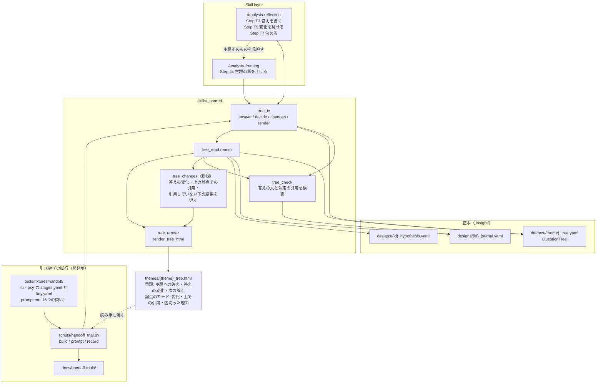
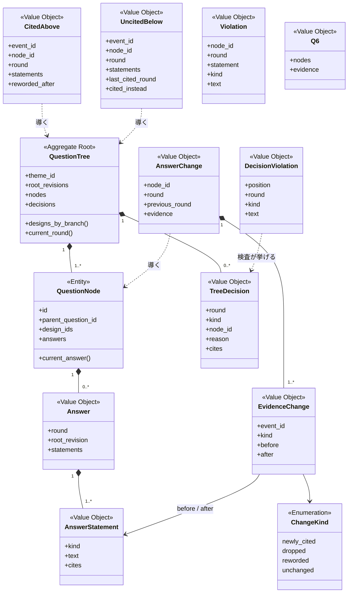
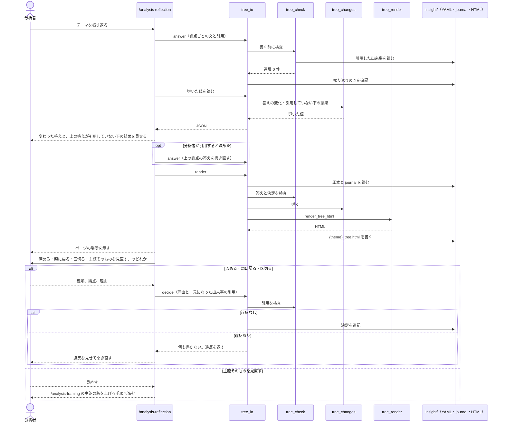

# Epic 34: 後から届いた結果で何が変わったかを、論点ツリーでたどれるようにする

## Background

本書がこの Epic の要求と背景の正本（[FLOW-0001](../adr/flow/0001-designdoc-owns-requirements.md)）。
Epic issue（[#249](https://github.com/etoyama/insight-blueprint-skills/issues/249)）には要約と本書へのリンクだけを置く。

- 解く課題: 論点ツリーで複数の論点を調べると、後から届いた論点の結果が、先に出た結果の使われ方を変えることがある。
  たとえば、論点 B の結果「同じ人で 0.30 上がった」を、主題の答えは「上司支援が効く根拠」として引用していた。
  後から論点 C の結果「その変化の 78% は業務負荷も下がった部署」が届く。B の数値は変わらない。変わるのは、主題の答えが B の結果を引用する文である。
  論点ツリーを開いた人（分析者本人と、引き継いだ読み手）は、今の表示ではこの変化をたどれない。
  - 課題1: 先に調べた論点のカードは、前の回の答えのままである。上の論点がその結果を引用する文を変えても、カードには何も出ない。読み手は古い読み方のまま数値を持ち帰る。
  - 課題2: 答えが変わった回の印は「回 N で変わった」だけである。何が変わったかは、前の回の答えと今の答えを目で比べるしかない。引用をやめた証拠は今の答えから消え、消えたことは表示に出ない。
  - 課題3: 差が出なかった分析の回では、上の論点の答えが書き直されないことがある。そのとき、結果を上の答えに突き合わせたのかが読めない。「回 N で変わった」の印も、回が進むと消える。
  - 課題4: 途中で止めた分析の論点は「検証中」「まだ答えていない」のまま残る。止めた理由は離れた「ツリーの決定」の一覧にしか無い。
  - 課題5: 主題のカードは「進捗: 未着手」と出る。下の論点が分析済みで、主題の答えが書いてあっても変わらない。
  - 課題6: ツリーの決定の理由は文だけで、どの journal の出来事を根拠にしたかを持たない。HTML だけの読み手は根拠を「発見元」の表示から推し量って取り違える（[#137](https://github.com/etoyama/insight-blueprint-skills/issues/137)）。
  - 課題7: 決める場面の選択肢は深める・親に戻る・区切るの3つである。調べた結果、主題そのものが違っていたと分かったときの道が並んでいない。
  - 課題8: 分析者に見せる「根の問い」「根の版」「根の変更前の答え」が伝わらない（[#262](https://github.com/etoyama/insight-blueprint-skills/issues/262)）。
  - 課題9: 今の合成シナリオ（公共図書館）では、表示を変える前から読み手がほぼ満点を取る。この Epic の表示が効いたかを測れない。
- PRD の要件: [docs/PRD.md](../PRD.md) のコアバリュー「journal / reflection」と、成功基準「引き継ぎの試行」。非機能要件「分析者に届く数と結論は、記録に書いてあるものに限る」。
- 既存手段が不十分な理由: Epic 18（[ADR-0024](../adr/0024-question-tree-yaml-and-generated-html.md)、[ADR-0025](../adr/0025-cited-answers-checked-after-writing.md)）は、答えの文ごとに引用を持たせ、検査で守った。
  回ごとの答えは全部 YAML に残っている。しかし表示は最新の回の答えと、畳んだ中の前の回の答えを並べるだけで、差を出さない。

### 起票の経緯

利用者は論点をまとめてエージェントに任せ、人間の確認を減らしたい（続きの issue [#250](https://github.com/etoyama/insight-blueprint-skills/issues/250)・[#251](https://github.com/etoyama/insight-blueprint-skills/issues/251)）。
その前提として、戻ってきた結果を上の論点の答えに突き合わせる表示を先に強くする。それがこの Epic である。
巡回は今の逐次のままで、表示と検査だけを扱う。#250 と #251 の中身はこの Epic に入れない。

利用者と PM のセッションは見本（画面3）で絵を合わせた（2026-11-26）。同じ見本で「根の問い」「枝」「証拠の重なり」「呼び戻す」「反対側から読む」が伝わらなかった。
初版の判断の途中でも、「読み直し」という語が伝わらなかった。本書と表示は、その語を使わず、起きることをそのまま文にする。

初版の見本を人間が読み、7件のコメントを付けた（2026-11-26）。6件は言葉でつまずいた所だった。「言えること」は主題を支持する結果と読まれた。「引用する」「出来事」「下の論点」は意味が取れなかった。
残る1件は設計の指摘だった。前は根拠にしていて今は外した分析結果と、まだ一度も答えに入れていない分析結果を、1つの欄に混ぜていた。
本書は内側の用語（引用、journal の出来事）と、分析者に見せる言葉（根拠にする、分析結果）を分けて書く。対応は US-5 の表にある。

### 前提にした事実（epic ブランチ dc785c4、2026-11-26）

実測は`scripts/handoff_trial.py` の `Scenario` と `build` に、リポジトリの外の stages.yaml を通して行った。題材は心理的安全性の架空例で、数値はすべて架空である。

- 論点 A・B・C を順に調べるシナリオを通した。issue #249 の下調べ（v0.19.0）の差分のうち、課題1・2・5・6 は Epic 33 の後も残る。Epic 33 が論点ツリーに足したのは、分析設計のカードの review コメントの件数と、検証仮説の判定の言葉だけである。
- 論点 B の答えに論点 C の出来事を引用すると、`tree_io answer` は `unlinked-design` を返し、何も書かない。主題はツリー全体の出来事を引用できる（`QuestionTree.designs_by_branch`）。
- 差が出なかった分析を回 4 に足し、主題の答えを書き直さないシナリオを通した。主題のカードから「回 3 で変わった」の印が消えた。印は最新の回の答えにだけ付く（`tree_render` の `marks_of`）。回 4 の証拠を主題の答えが引用していないことは、どこにも出ない。
- 分析設計を `analyzing` のままにして、ツリーの決定で区切るシナリオを通した。論点のカードは「進捗: 検証中」「まだ答えていない」のままだった。
- 1つの回で、C の2つの証拠が A と B の両方の引用のされ方を変えるシナリオを通した。主題の答えには両方を書けた。A と B のカードには何も出ない。
- 進捗は論点に直接結んだ分析設計の状態から導く（`Progress.of`）。下の論点は見ない。
- `TreeDecision` は `round`・`kind`・`node_id`・`reason`・`created_at` を持ち、知らない項目を拒む。既定値つきの項目を足せば、保存済みの YAML はそのまま読める。
- `tree_io revise-root` は今も主題の版を上げられる。分析者に聞く手順は `/analysis-framing` にある。`/analysis-reflection` の決める場面はその道を最後の案内の1行で示すだけである。
- 引き継ぎの試行の記録は 9 本ある（sonnet・haiku・opus 各3回、`docs/handoff-trials/`）。問い 1〜4 は 9 本とも正しい。問い 5 は 7 本が正しく、外れた 2 本はどちらも sonnet である。
- レポート（`skills/_shared/theme_report.py`）は、読み手向けにすでに「主題」と出している。「根の」が残るのは、論点ツリーの HTML、skill 4本、問いの紙、用語集、PRD、ARCHITECTURE、HANDOFF_TRIAL である。
- 確かめていないこと: どの分析が同じデータを使うか（[#236](https://github.com/etoyama/insight-blueprint-skills/issues/236)）。2本目の合成シナリオで、今の表示の読み手が何問外すか。#137 の原因（引用が無いから取り違える）。人の読み手での試行。

## User Stories

AC の正本はここ。

### US-1: 読み手が、答えが変わった回で何が変わったかを、目で比べずに読める

読み手として、答えがなぜ今の形なのかを確かめるために、前の回の答えと今の答えの違いを、証拠ごとに並べて読みたい。

- [ ] AC 1: 論点の現時点の答えに前の回の答えがあるとき、表示は答えが引用する出来事ごとに1行を出す。行は出来事の本文と、前の回でその出来事を引用した文と、今の回の文を並べる。出来事は新しく引用した、引用をやめた、同じ出来事を引用する文が変わった、変わっていない、の4つに分ける。1つの回で複数の出来事が変わっても、出来事ごとに1行ずつ出る。欄の初めに、前の回の答えを読んだ人がどこを読み直せばよいかを1文で書く。
- [ ] AC 2: 分け方は引用する出来事の id と、文の種類と本文の一致だけで決まる。表示は記録に無い解釈の言葉を足さない。
- [ ] AC 3: 答えの変化は保存しない。同じ論点ツリーと journal からは、同じ表示が出る。この Epic の前に書かれた論点ツリーでも出る。
- [ ] AC 4: ページは主題への現時点の答え、その答えの変化、次に調べる論点とその理由を、読み方の説明と論点の一覧より前に出す。読み方の説明は畳んで出す。
- [ ] AC 5: 振り返りの回が進んでも、論点の最後の答えの変化は読める。答えが最新の回のものでないとき、カードは答えの回と最新の回を並べ、その後の回で書き直していないことを出す。

### US-2: 読み手が、先に調べた論点のカードから、上の論点での引用のされ方の変化に辿れる

読み手として、先に出た結果を古い読み方のまま持ち帰らないために、その結果を上の論点の答えがどう引用しているかを、論点のカードから読みたい。

- [ ] AC 1: 論点のカードは、その論点の現時点の答えが引用する出来事を、上の論点の現時点の答えが引用していれば、上の論点の id・回・文を出し、そこへ辿れる。
- [ ] AC 2: 上の論点がその出来事を引用する文を、この論点の答えより後の回で変えていれば、カードは変わった回と、この論点の答えが変わっていないことを文で出す。
- [x] AC 3: ツリーの検査は、論点が自分と下の論点に結んだ分析設計の出来事だけを引用できる決まりを保つ。
- [ ] AC 4: 直接の親でない上の論点（主題など）での引用も、同じように出る。

### US-3: 読み手が、差が出なかった分析と止めた分析を、調べた結果として読める

読み手として、調べたのに答えに現れていない結果を見落とさないために、上の答えが引用していない結果と、止めた理由を、論点のカードで読みたい。

- [ ] AC 1: 下の論点の現時点の答えが引用していて、その論点の現時点の答えが引用していない出来事を、論点のカードに、出どころの論点・回・文を添えて出す。その論点の答えが一度も引用していない出来事と、前の回までは引用していて今は引用していない出来事を、別の欄に分ける。前者は目立たせ、主題のぶんはページの冒頭にも出す。後者は控えめに出し、最後に引用した回と、引用をやめた回に新しく引用した出来事を添える。
- [ ] AC 2: 分析設計を直接結んでいない論点で、下に論点があるものは、進捗の言葉を出さず、下の論点の進捗を言葉ごとの数で出す。「進捗の数」はこの論点を数えない。分析設計を直接結んだ論点は進捗の言葉を出し、下に論点があればその数を添える。
- [ ] AC 3: その論点を指す最新のツリーの決定が「区切る」である論点は、カードに、区切った回と理由を出す。
- [ ] AC 4: reflection は変えない文を前の回のまま書く。ツリーの決定を聞く前に、上の論点の答えが引用していない下の論点の結果を分析者に見せる。引用するかは分析者が決め、引用しなくても答えは書ける。

### US-4: 読み手が決定の根拠を取り違えず、分析者が主題を見直す道を選べる

読み手として、次に調べる論点を選んだ理由の根拠を取り違えないために、決定が引用した出来事を読みたい。
分析者として、主題そのものが違っていたと分かったときに、決める場面でその道を選びたい。

- [x] AC 1: ツリーの決定は理由の根拠にした journal の出来事の id を0個以上持てる。引用を持たない保存済みの論点ツリーは、そのまま読める。
- [x] AC 2: 引用を持つ決定は書く前に検査する。引用先が journal に無い、論点ツリーのどの論点にも結んでいない分析設計の出来事である、理由の数が引用先の本文に無い、のどれかなら書かない。
- [ ] AC 3: 表示は決定の理由の下に、引用した出来事の id・分析設計・本文を出す。引用を持たない決定は引用していないことを文で出す。最初の論点を選ぶ決定にはその文を出さない。
- [x] AC 4: reflection は、分析者が挙げた理由の元になった出来事があれば、決定の引用に入れる。根拠の出来事が無い決定は、引用なしで書く。
- [x] AC 5: reflection の決める場面は、深める・親に戻る・区切るに並べて「主題そのものを見直す」を出す。選ぶと、今ある主題の版を上げる手順へ進む。ツリーの決定の種類は4つのままである。

### US-5: 分析者が、論点ツリーを内側の用語ではなく、伝わる言葉で読む

分析者として、論点ツリーの言葉でつまずかないために、記録の作りの言葉ではなく、起きていることをそのまま言う言葉で読みたい。

- [x] AC 1: 論点ツリーの表示と、skill が分析者に出す文は、親を持たない論点を「主題」、その版を「主題の版」、古い版への答えを「見直す前の主題への答え」と呼ぶ。
- [x] AC 2: 論点ツリーの表示、skill が分析者に出す文、レポートは、答えの文の種類を下の「用語を変えた語」の言葉で出す。
- [x] AC 3: コード上の名前と YAML の項目名と値は変わらず、保存済みの論点ツリーはそのまま読める。
- [x] AC 4: 用語集は「主題」「主題の版」を用語にし、「根の問い」「根の版」を使わない言い換えに置く。答えの文の種類も下の「用語を変えた語」の3語を用語にし、旧い3語を使わない言い換えに置く。
- [x] AC 5: この Epic が足す欄と直す欄は、下の表の「分析者に見せる言葉」で書く。答えが引用した出来事のうち、人に聞いた答え（`hearing`）は「分析結果」と呼ばず、「人に聞いた答え」と出す。

用語を変えた語。文書・コード・テストも、分析者に見せる文も、右の語を使う（2026-11-26、人間が PM のセッションで決めた。ADR-0055 の 7）。YAML の項目名と値、コード上の名前は変えない。

- 根の問い → 主題
- 根の版 → 主題の版
- 根の変更前の答え → 見直す前の主題への答え
- 言えること（`claim`） → これまでわかっていること
- 弱める証拠と留保（`weakening`） → 注意すべきこと
- 未判別（`undetermined`） → まだ決められないこと

内側と画面で言葉が違う語。文書・コード・テストは左の列、分析者に見せる文は右の列を使う。

| 内側の用語（文書・コード） | 分析者に見せる言葉 |
|---|---|
| 引用する（`cites`） | 根拠にする |
| 答えが引用した journal の出来事 | 分析結果（`hearing` は「人に聞いた答え」） |
| 下の論点 | 使わない。「分析結果のうち」のように、分析結果を主語にして言う |
| 引用していない下の結果のうち、一度も引用していないもの | まだ答えに入れていない分析結果 |
| 引用していない下の結果のうち、前は引用していたもの | 前は答えの根拠にしていて、今は外している分析結果 |

### US-6: 開発者が、表示が効いたかを、変える前と後で比べられる

開発者として、この Epic の表示が読み手の判断を助けたかを確かめるために、同じ合成シナリオを変える前と後で読ませて比べたい。

- [x] AC 1: 合成シナリオが2本ある。2本目は、差が出なかった分析と、答えも数値も変わらないまま上の論点での引用のされ方が変わる論点を含む。
- [x] AC 2: 問いの紙は全シナリオ共通で、6つ目の問い（答えも数値も変わっていないのに、上の論点の答えがその証拠を引用する文が変わった論点と、その証拠）を持つ。
- [x] AC 3: 正解の鍵は、作った論点ツリーからテストが導き直す。6つ目の問いも、該当する論点が無いシナリオの「該当なし」も導く。決定が引用を持つシナリオでは、問い 5 の理由の出来事も導く。
- [x] AC 4: 表示を変える前に、2本目の合成シナリオを今の表示で読ませた試行の記録が残る。
- [ ] AC 5: 表示を変えた後に、2本の合成シナリオを読ませた試行の記録が残り、前の記録と並べて読める。過去の試行の記録は書き換えない。

## Stories

Story は仮の分割で、起票は PM のセッションが行う。「触る所」が重なる Story は同じ波に置かない。

| Story | User Story | 扱う AC | 触る所 | 前提 |
|---|---|---|---|---|
| 34.1 分析者に見せる言葉の言い換え | US-5 | AC 1, AC 2, AC 3, AC 4, AC 5 | `skills/_shared/tree_render.py` の言葉の表（`_KIND_WORDS`、`_MARK_WORDS`、`_header`、`_root_history`、`_legend`）、`skills/_shared/theme_report.py` の答えの文の種類の言葉、`tests/test_theme_report.py`、`skills/analysis-framing/SKILL.md`、`skills/analysis-reflection/SKILL.md`、`skills/report-export/SKILL.md`、`skills/tree-upload/SKILL.md`、`docs/UBIQUITOUS_LANGUAGE.md`、`.yomiyasu-words/`、`docs/PRD.md`、`docs/ARCHITECTURE.md`、`tests/test_tree_render.py`、`tests/tree_io/`、`tests/skills/` | — |
| 34.2 2本目の合成シナリオと6つ目の問い | US-6 | AC 1, AC 2, AC 3, AC 4 | `tests/fixtures/handoff/psy/`（新規）、`tests/fixtures/handoff/prompt.md`、`tests/fixtures/handoff/lib/key.yaml`、`scripts/handoff_trial.py`（`Q6`、`Answers`、`KeyAnswers`、`QUESTIONS`）、`tests/test_handoff_trial.py`、`docs/HANDOFF_TRIAL.md`、`tests/docs/test_handoff_trial_doc.py`、`docs/handoff-trials/` | 基準を取る段だけ 34.1 の後 |
| 34.3 答えの変化を導き、カードと冒頭に出す | US-1 | AC 1, AC 2, AC 3, AC 4, AC 5 | `skills/_shared/tree_changes.py`（新規）、`skills/_shared/tree_render.py`、`skills/_shared/tree_io.py` の読む命令、`tests/test_tree_changes.py`（新規）、`tests/test_tree_render.py`、`tests/tree_io/test_render*.py` | 34.1 |
| 34.4 ツリーの決定の引用（正本・検査・skill） | US-4、US-2 | US-4 AC 1, AC 2, AC 4, AC 5、US-2 AC 3 | `src/insight_blueprint/models/tree.py`、`skills/_shared/tree_io.py` の `decide`、`skills/_shared/tree_check.py`、`skills/analysis-reflection/SKILL.md` の Step T7、`skills/analysis-auto/SKILL.md`、`docs/ARCHITECTURE.md`、`docs/UBIQUITOUS_LANGUAGE.md`、`tests/test_tree_models.py`、`tests/test_tree_check.py`、`tests/tree_io/` | 34.1 |
| 34.5 上の論点での引用と、引用していない下の結果 | US-2、US-3 | US-2 AC 1, AC 2, AC 4、US-3 AC 1 | `skills/_shared/tree_changes.py`、`skills/_shared/tree_render.py`、`tests/test_tree_changes.py`、`tests/test_tree_render.py`、`docs/UBIQUITOUS_LANGUAGE.md` | 34.3 |
| 34.6 進み具合と決定の表示、reflection の案内 | US-3、US-4、US-6 | US-3 AC 2, AC 3, AC 4、US-4 AC 3、US-6 AC 3（問い 5 の鍵） | `skills/_shared/tree_render.py`、`skills/_shared/tree_read.py` の `render`、`skills/analysis-reflection/SKILL.md` の Step T3 と Step T5、`tests/skills/`、`tests/fixtures/handoff/lib/`、`tests/fixtures/handoff/psy/`、`tests/test_handoff_trial.py`、`docs/HANDOFF_TRIAL.md` | 34.4、34.5 |
| 34.7 表示を変えた後の引き継ぎの試行 | US-6 | AC 5 | `docs/handoff-trials/`、`docs/HANDOFF_TRIAL.md`、`docs/PRD.md` の成功基準、`docs/UBIQUITOUS_LANGUAGE.md` の試行の語 | 34.6 |

- 波 1 は 34.1 と 34.2 で、並行で進められる。問いの紙・HANDOFF_TRIAL・図書館の鍵にある「根」と答えの文の種類の言い換えは、同じファイルを触る 34.2 が行う。US-5 AC 5 は欄を足す 34.3・34.5・34.6 も守る。PRD の成功基準の6つ目の項目と、用語集の試行の語は、34.1 と重ならないように 34.7 が直す。決定が引用を持つ前なので、34.2 の2本目の鍵は、問い 5 の理由の出来事を人が決める。34.6 が2本の合成シナリオの決定に引用を足し、鍵を導き直す。34.2 は、34.1 が epic ブランチに入った後に、今の表示で基準の試行を取る。
- 波 2 は 34.3 と 34.4 で、並行で進められる。34.3 は表示、34.4 は正本と検査と skill で、触る所は重ならない。
- 波 3 は 34.5、波 4 は 34.6、波 5 は 34.7 である。34.3・34.5・34.6 はどれも `tree_render.py` を触るので、順に進める。
- 34.2 の基準で、今の表示の読み手が2本目の合成シナリオでも満点を取ったら、PM のセッションは波 2 の前に人間に知らせる。そのときは、表示の効果を Claude の試行では示せない。 34.2 の基準は満点で、PM のセッションが人間に知らせた。人間は止めずに波 2 を進めると決めた（Decisions の `keep-the-display-before-the-change-and-review-after-34-3`）。
- どの Story も `CHANGELOG.md` の `[Unreleased]` に1行足す。重なるのはそこだけである。
- 用語集は、コード上の名前を入れた Story が直す（名前が実在することをテストが確かめる）。

Story が使う既存の helper（作り直さない）。

| ほしいもの | 既にある所 |
|---|---|
| 合成シナリオを通して HTML を作る | `scripts/handoff_trial.py` の `Scenario`・`build`・`load_scenario`・`load_key`・`score`。step 名は `tree_io`・`design_io` の関数名と同じ |
| 論点とその下の論点に結んだ分析設計 | `QuestionTree.designs_by_branch()`（`models/tree.py`） |
| 上の論点を近い順に辿る | `_ancestors`（`models/tree.py`） |
| 引用した出来事の本文を読む | `tree_read.cited_events`、`tree_render.CitedEvent` |
| 文の数を引用先と照らす | `tree_check.numbers_in`、`_statement_problems` |
| 答えを書く前に検査して、違反なら書かない | `tree_io.answer`（`_checked`・`_save`）。`decide` も同じ形にする |
| 出来事を HTML に出す | `tree_render._cited_event`、`_statement`、`_link` |
| 表示の言葉と凡例を1つの表で持つ | `tree_render` の `PROGRESS_WORDS`・`_KIND_WORDS`・`_MARK_WORDS`・`_DECISION_LABELS` |
| 表示のテストの道具 | `tests/tree_io/_support.py`、`tests/tree_io/conftest.py`、`tests/test_tree_render.py` |
| 鍵をツリーから導き直すテスト | `tests/test_handoff_trial.py` の `TestTheKeyHoldsForTheTree` |
| 主題の版を上げる手順 | `tree_io revise-root`、`skills/analysis-framing/SKILL.md` の Step 4c |

## Ubiquitous Language

この Epic で追加・変更する語。定義の正本は [docs/UBIQUITOUS_LANGUAGE.md](../UBIQUITOUS_LANGUAGE.md) で、表は名前を入れた Story が直す。
分析者に見せる語は比喩と、意味の取れない名詞句を避けた。

- 追加: 答えの変化（`AnswerChange`）、証拠の変わり方（`ChangeKind`）、上の論点での引用（`CitedAbove`）、引用していない下の結果（`UncitedBelow`）
- 変更: 主題（「根の問い」から改名。[ADR-0055](../adr/0055-the-root-question-is-shown-as-the-subject.md)）、主題の版（「根の版」から改名）、進捗（分析設計を直接結ばない論点の出し方）、ツリーの決定（引用を持てる）、ツリーの検査と違反（決定の引用も見る）、現時点の答え（文の種類の言葉と、定義の中の「根」の言い換え）、到達点・親の論点・論点ツリー（定義の中の「根」の言い換え）、合成シナリオ（2本になる）、引き継ぎの試行・正解の鍵・試行の記録（問いが6つになる）
- 使わない: 枝、読み直し、根の問い、根の版。分析者に見せる文では引用、出来事、下の論点も使わない（US-5 の表）

## Scope

[docs/PRD.md](../PRD.md) のコアバリュー「journal / reflection」と、成功基準「引き継ぎの試行」を前進させる。
[docs/ARCHITECTURE.md](../ARCHITECTURE.md) では、Question tree（`tree_io render` の表示、`tree_check`、`TreeDecision`）と、Skill layer（`/analysis-reflection`）を直す。

- Epic 範囲内:
  - 答えの変化、上の論点での引用、引用していない下の結果を正本から導き、論点ツリーの表示に出す（[ADR-0056](../adr/0056-answer-changes-are-derived-from-cites-and-shown-on-both-cards.md)）。
  - 分析設計を直接結ばない論点の進み具合と、区切った論点の理由の表示（[ADR-0057](../adr/0057-a-question-without-a-design-shows-the-progress-below-it.md)）。
  - ツリーの決定の引用と、決める場面の「主題そのものを見直す」（[ADR-0058](../adr/0058-a-tree-decision-may-cite-the-events-behind-its-reason.md)）。
  - 「根の問い」から「主題」への言い換えと、答えの文の種類など、分析者に見せる言葉の言い換え（[ADR-0055](../adr/0055-the-root-question-is-shown-as-the-subject.md)）。
  - 2本目の合成シナリオと、6つ目の問い（[ADR-0059](../adr/0059-the-handoff-trial-has-a-second-scenario-and-a-sixth-question.md)）。
- Epic 範囲外:
  - 論点をまとめて任せること、論点ごとの分析の状態、次に調べる論点の候補の一覧。#250 に委ねる。
  - 任せた確認と、答えを書いたのとは別のモデルによる確認。#251 に委ねる。
  - どの分析が同じデータを使うかの表示。#236 に委ねる。
  - 答えの文に、前の回の文の言い換えであることを示す項目を足すこと。試行で言い換えの雑音が多いと分かってから足す（ADR-0056）。
  - 引用を持たない決定の理由に書いた数の検査と、主題を見直した理由（`RootRevision.reason`）の引用（ADR-0058）。
  - 答えの変化をレポートに出すこと。レポートはテーマの最終報告で、回ごとの変化を載せない。
  - US-5 の表に無い言葉（検証中、寄与、発見元、`type`、`direction`）の見直し。この Epic が触らない欄の言葉は直さない。見つけたら issue に書く。
  - 分析結果を答えの根拠から外した理由と、答えに入れないと決めたことを記録する項目。試行と実データで要ると分かってから足す（ADR-0056）。
  - 人の読み手での引き継ぎの試行を、いつ誰が行うか。PM のセッションが人間に聞く。
- 触らない所:
  - `tree_check` の `unlinked-design` が見る範囲（理由: 読み方の変化は上の論点の答えに書き、表示が逆向きに出す。検査を緩めると、無関係な分析の数値を引いた答えが通る。ADR-0056）。
  - `Answer` と `AnswerStatement` の形（理由: 答えの変化は引用の差から導くので、書き手に項目を足させない。ADR-0056）。
  - `RootRevision`・`root_revisions`・`tree_io revise-root` の名前（理由: 変えると保存済みの論点ツリーの移行が要る。ADR-0055）。
  - `TreeDecisionKind`（理由: 主題を見直すのは今ある `revise-root` で、次に調べる論点を指す決定ではない。ADR-0058）。
  - `tree_read.position` と `WalkState`（理由: 巡回は逐次のままで、現在地の導き方は変えない）。
  - `skills/_shared/theme_report.py` の、答えの文の種類の言葉のほかの所（理由: レポートはすでに「主題」と出していて、答えの変化は載せない）。
  - `docs/handoff-trials/` の過去の記録（理由: その時点の鍵での採点として残す。[ADR-0035](../adr/0035-handoff-trial-records-keep-their-score.md)）。
  - Epic 33 までの DesignDoc と、ADR-0054 までの ADR の本文（理由: 閉じた Epic の DesignDoc には追記しない。[ADR-0009](../adr/0009-adopt-repo-template-flow.md)。旧い語は、用語集の「使わない言い換え」で読み替える）。
  - `docs/WORKFLOW.md`、`docs/adr/flow/`、`.claude/skills/pm-session/`（理由: 開いている PR #241 と重なる。#241 がマージされたら理由は消える）。
  - `CHANGELOG.md` の版の節と、`pyproject.toml` の版（理由: v0.20.0 のリリース作業が進んでいる。`[Unreleased]` には書く）。

## Architecture

- `tree_changes` は純粋な関数の集まりで、ファイルを読まない。`QuestionTree` だけを受け取り、導いた値を返す。
- `tree_render` は、導いた値と、今ある入力（分析設計の要約、引用した出来事、違反）から HTML を作る。script も外部の資源も足さない（ADR-0024）。
- 正本に足すのは、`TreeDecision` の引用だけである。

## Domain Model

型を足す案と変える案。`AnswerChange`・`EvidenceChange`・`ChangeKind`・`CitedAbove`・`UncitedBelow`・`DecisionViolation`・`Q6` は新しい型である。
`TreeDecision` は項目を1つ足す。名前は案で、Story の実装で変えたら PR 説明に書いて人間の承認を得る。

| 型 | 種類 | 不変条件 |
|---|---|---|
| `TreeDecision` | 値オブジェクト（正本） | `cites` は0個以上。id の形は `{theme}-H{nn}-E{nn}`。持たない保存済みの決定は、空として読む |
| `AnswerChange` | 値オブジェクト（導く。保存しない） | 論点の最後の答えと、その1つ前の答えから導く。答えが1つの論点には無い。同じ論点ツリーからは同じ値になる |
| `EvidenceChange` | 値オブジェクト（導く） | 出来事1つにつき1つ。`before` は前の回でその出来事を引用した文、`after` は今の回の文。`newly_cited` は `before` が空、`dropped` は `after` が空 |
| `ChangeKind` | 列挙 | 出来事が前の回に無ければ `newly_cited`、今の回に無ければ `dropped`。両方にあって、引用する文（種類と本文）の集まりが違えば `reworded`、同じなら `unchanged` |
| `CitedAbove` | 値オブジェクト（導く） | 論点の現時点の答えが引用する出来事を、上の論点の現時点の答えが引用しているときにだけある。`reworded_after` は、上の論点がその出来事を引用する文を、この論点の答えより後の回で変えたときに真 |
| `UncitedBelow` | 値オブジェクト（導く） | 下の論点の現時点の答えが引用し、その論点の現時点の答えが引用していない出来事。答えがまだ無い論点では、下の論点が引用するすべての出来事。`last_cited_round` は、その論点の前の回の答えが最後に引用した回で、一度も引用していなければ無い。無いものは「まだ答えに入れていない分析結果」、あるものは「前は答えの根拠にしていて、今は外している分析結果」として出す。`cited_instead` は、引用をやめた回にその論点の答えが新しく引用した出来事で、`last_cited_round` があるときだけ持つ |
| `DecisionViolation` | 値オブジェクト（検査が挙げる） | 引用を持つ決定にだけ挙がる。種類は答えの違反と同じ3つ（`missing-event`・`unlinked-design`・`number-not-cited`） |
| `Q6` | 値オブジェクト（開発用） | 論点の id の集合と出来事の id の集合。該当が無ければ、どちらも空 |

`Answer`・`AnswerStatement`・`QuestionNode`・`Violation`・`Progress`・`TreeDecisionKind`・`RootRevision` は変えない。

## Module Responsibilities

| モジュール / 関数 | 責務（する） | 境界（しない → 委譲先） |
|---|---|---|
| `skills/_shared/tree_changes.py`（新規） | `QuestionTree` から、答えの変化、上の論点での引用、引用していない下の結果を導く | ファイルを読まない → `tree_read`。出来事の本文を持たない → `tree_render` が `CitedEvent` と合わせる。HTML を作らない → `tree_render` |
| `skills/_shared/tree_render.py` | 導いた値を、ページの冒頭と論点のカードに出す。進み具合を数で出し、区切った理由と決定の引用を出す。言葉と凡例を1つの表で持つ | 差を計算しない → `tree_changes`。違反を見つけない → `tree_check`。分析ノートを作らない → `design_note`（他 Epic 領分） |
| `skills/_shared/tree_read.py::render` | 正本を読み、決定が引用した出来事も読み、検査と導出の結果を `tree_render` に渡す | 言葉を決めない → `tree_render` |
| `skills/_shared/tree_io.py::decide` | 引用つきの決定を、検査に通ってから書く | 検査の規則を持たない → `tree_check`。決定の種類と順の規則を持たない → `models/tree.py` |
| `skills/_shared/tree_io.py` の読む命令（新規） | 導いた値を JSON で返し、reflection が分析者に見せられるようにする | 導かない → `tree_changes` |
| `skills/_shared/tree_check.py` | 答えの文に加えて、引用を持つ決定を検査する。答えの文が引用できる範囲は変えない | 書かない → `tree_io`。表示しない → `tree_render` |
| `src/insight_blueprint/models/tree.py::TreeDecision` | 引用の id の形を守る | 引用先が実在するかを見ない → `tree_check` |
| `skills/analysis-reflection/SKILL.md` | 変えない文を前の回のまま書く。引用していない下の結果を見せる。決定に引用を入れる。「主題そのものを見直す」を並べる | 主題の版を上げる聞き方を持たない → `/analysis-framing` の Step 4c |
| `scripts/handoff_trial.py` | 6つの問いの答えを読み、採点する | 過去の記録を採点し直さない（ADR-0035） |
| `tests/fixtures/handoff/` | 2本の合成シナリオと鍵、共通の問いの紙を持つ | 鍵を手で保たない → `tests/test_handoff_trial.py` が導き直す |
| `skills/_shared/theme_report.py`（他 Epic 領分） | レポートを書く。この Epic では、答えの文の種類の言葉だけを US-5 の表に合わせる | 答えの変化を載せない |

## Sequence Diagram

振り返りの回で答えを書き、表示を作り、決めるまで。

- 外部の境界はファイルシステムだけである。ネットワークには出ない。
- 表示を作る道は1本で、`tree_io render` だけが HTML を書く。reflection が分析者に文で見せる値も、同じ `tree_changes` から来る。
- 主題の版を上げた後は、同じ決める場面に戻り、新しい主題の下で次に調べる論点を選ぶ。

## Decisions

### Decision: first-edition-choices-of-epic-34

- What: 初版で人間が選んだことを、5つの ADR に分けて書いた。言い換え（ADR-0055）、答えの変化の導き方と出し方（ADR-0056）、進み具合の出し方（ADR-0057）、決定の引用（ADR-0058）、試行のシナリオと問い（ADR-0059）である。
- Why: 用語の改名、正本の形、表示の言葉の意味、成功基準を変えるので、効果がこの Epic を超える。
- Criteria: 人間の選択（2026-11-26、このセッションで直接）。聞いた順は読み方の変化を書く所、導くか書かせるか、進み具合、決定の引用、試行、言い換えの時期である。どの判断も実測した事実をもとに Decision Analysis で聞いた。
- Affected modules: 上の Stories 表の「触る所」。
- Alternatives considered: 各 ADR の Decision Analysis にある。
- Consequences: 見本（画面3）にあった「答えを動かした証拠」「消えた主張」という言い切りは、導出では出せない。表示は分析結果ごとに、前の回にそこから言っていたことと、今の回に言っていることを並べる。人間がこの後退を受け入れた（ADR-0056）。

### Decision: keep-the-display-before-the-change-and-review-after-34-3

- What: 34.2 の基準が満点でも、波 2 を止めずに進める。変える前の表示の HTML を残し、34.7 で人の読み手に変える前と後を読んでもらう。波 3 の前に、34.3 が入った実物の画面を人間が見て、34.5 と 34.6 を続けるかを決める。変える前の表示は、コミット e60678e で `scripts.handoff_trial build` した `LIB_tree.html` と `PSY_tree.html` である（同じコミットからいつでも作り直せる）。
- Why: Claude の読み手は、今の表示で2本目の合成シナリオを満点で読んだ（[基準の記録](../handoff-trials/2026-11-26-psy-baseline.md)）。表示の効果は Claude の正答では示せない。測れるのは人の時間と、人がつまずいた所である。
- Criteria: 変える前と後で比べられること、効かなかったときの無駄が小さいこと、Epic が人待ちで止まらないこと（人間が PM のセッションで決めた、2026-11-26、Decision Analysis の案B）。決め手は、前の HTML を残す費用がほぼ無く、Epic が止まらないことである。
- Affected modules: Story 34.5・34.6（34.3 の実物を見た後に止める場合がある）、Story 34.7（人の読み手での試行）。
- Alternatives considered: 計画のまま全部進める（変える前と後を比べられない）。波 2 の前に人の読み手で基準を取る（読み手が見つかるまで止まる）。表示の Story をやめる（読み方を組み立て直す負担に手を付けない）。
- Consequences: 同じ人が変える前と後を読むと慣れが混ざるので、34.7 では2本の合成シナリオを入れ替える。読み手は1〜2人で、統計にはならない。34.5 と 34.6 は、34.3 の実物を見た後に止める場合がある。

### Decision: decide-returns-the-violations-and-writes-nothing

- What: `tree_io decide` は、引用を持つ決定が検査に通らないとき、決定の代わりに `{"violations": [...]}` を返し、exit 3 で終わる。通ったときの返り値は今までどおり決定そのものである。検査するのは今書く決定だけで、読む journal もその決定が引用したものだけである。前に書いた決定の引用が今の journal と合わなくても、その journal が読めなくても、新しい決定は止めない。1つの決定は同じ出来事を2回引用できない。`tree_check` の CLI は答えの文だけを報告し、決定の違反は出さない。
- Why: ADR-0058 は「何も書かず、違反を返す」と決めたが、返す形と exit code、前の決定の扱いは決めていなかった。
- Criteria: 今の呼び出し側（skill の手順、`scripts/handoff_trial.py`、テスト）が決定をそのまま受け取っていること（コードを読んだ）。`tree_io answer` が exit 3 を「書いていない。理由は stdout」に使っていること。決め手は今の呼び出し側を変えないことである。
- Affected modules: `skills/_shared/tree_io.py::decide`、`skills/_shared/tree_check.py`、`skills/analysis-reflection/SKILL.md` の Step T7。
- Alternatives considered: いつも `{"decision", "violations"}` の形で返す（今の呼び出し側をすべて直すことになる）。前の決定の違反でも止める（journal が後から変わると、決定を1つも足せなくなる）。`tree_check` の CLI に決定の違反を足す（reflection の Step T4 の読み方が変わる。表示に出す 34.6 が、要るかを決める）。
- Consequences: 返り値の形が2通りになる。呼び出し側は `violations` があるかで見分ける。前に書いた決定の違反は、34.6 が `tree_check.find_decision_violations` を表示に使うまで、どこにも出ない。

### Cross-epic decisions (links to ADR)

- [ADR-0055: 分析者に見せる言葉を内側の用語と分け、「根の問い」を「主題」と呼ぶ](../adr/0055-the-root-question-is-shown-as-the-subject.md): 表示の言葉と用語集だけを変え、コード上の名前と YAML は変えない。
- [ADR-0056: 答えの変化は引用の差から導き、上の論点と先の論点の両方のカードに出す](../adr/0056-answer-changes-are-derived-from-cites-and-shown-on-both-cards.md): 書き手に項目を足させず、検査も緩めない。
- [ADR-0057: 分析設計を直接結ばない論点は、下の論点の進捗を数で出す](../adr/0057-a-question-without-a-design-shows-the-progress-below-it.md): 進捗の言葉の意味は変えない。区切った論点はカードに理由を出す。
- [ADR-0058: ツリーの決定は、理由の根拠にした出来事を引用できる](../adr/0058-a-tree-decision-may-cite-the-events-behind-its-reason.md): 引用は任意で、あれば検査する。決める場面に「主題そのものを見直す」を並べる。
- [ADR-0059: 引き継ぎの試行に、2本目の合成シナリオと6つ目の問いを足す](../adr/0059-the-handoff-trial-has-a-second-scenario-and-a-sixth-question.md): 表示を変える前に基準を取る。

## Test Design Matrix

| Story \ Layer | Unit | Integration | E2E |
|---|---|---|---|
| Story 34.1 | ✓ | ✓ | —（表示の言葉だけで、新しい通し道が無い。HTML は `scripts/handoff_trial.py build --scenario lib` で目で読んだ） |
| Story 34.2 | ✓ | ✓ | ✓ |
| Story 34.3 | ☐ | ☐ | ☐ |
| Story 34.4 | ✓ | ✓ | —（決定の引用を表示に出すのは 34.6。`tree_io decide` は、リポジトリの外に作った図書館のシナリオの `.insight/` で、引用つき・引用なし・3種類の違反を実際に呼んで確かめた） |
| Story 34.5 | ☐ | ☐ | ☐ |
| Story 34.6 | ☐ | ☐ | ☐ |
| Story 34.7 | ☐ | ☐ | ☐ |

完了時に ✓ を付ける。このマトリクスが Epic PR のレビューゲート。

## Story Timeline

- 2026-11-26 — 初版: A・B・C のシナリオと、差が出なかった分析・止めた分析・1回で2つの変化のシナリオを、今の epic ブランチで実測した。6つの判断（d1〜d6）を人間が選んだ。
- 2026-11-26 — 初版: 全体の整合で、波 1 の 34.1 と 34.2 がどちらも PRD と用語集を触ると分かった。PRD の成功基準と用語集の試行の語を 34.7 に移した。変えない文を前の回のまま書く決まりを US-3 AC 4 に、読み方の説明を畳むことを US-1 AC 4 に足した。
- 2026-11-26 — 初版: 見本を Artifact で見せた（うまくいった日と悪い日の2枚。題材は心理的安全性の架空例で、コミットしていない）。悪い日は、差が出なかった分析、止めた分析、1回で2つの出来事の引用のされ方が変わった回を重ねた。分かった事実: 引用していない下の結果に「前はどの回まで引用していたか」を添えると、引用をやめた証拠の行方が読める。`UncitedBelow` に `last_cited_round` を足した。確かめていない前提: 言い換えただけの文が「文が変わった」に出る量。論点が数十ある論点ツリーでの読みやすさ。前の文と今の文を並べた表の、狭い画面での幅。表示を変えて読み手の正答が上がるか。
- 2026-11-26 — 初版: 見本に人間が7件のコメントを付け、見本を直した。分析者に見せる言葉を内側の用語と分けた（US-5 の表。「これまでわかっていること」「注意すべきこと」「まだ決められないこと」「根拠にする」「分析結果」は人間が選んだ）。答えの変化の表は分析結果を行の中心に置く形にした。引用していない下の結果を、まだ答えに入れていないものと、前は根拠にしていて今は外しているものに分けた（`UncitedBelow` の `last_cited_round` と `cited_instead`）。レポートも答えの文の種類を同じ言葉で出すことにした。
- 2026-11-26 — 初版を人間が承認した（Domain Model 図を含む。このセッションで直接）。レポートも答えの文の種類を同じ言葉で出すことを、あわせて承認した。
- 2026-11-26 — Story 34.1 completed: 論点ツリーの表示・skill 4本・レポート・用語集・PRD・ARCHITECTURE を、主題・主題の版・見直す前の主題への答えと、答えの文の種類の3語に言い換えた。YAML と `revise-root` の名前は変えていない。用語集に US-5 の表を写し、DesignDoc の表と同じかをテストが確かめる。
- 2026-11-26 — Story 34.2 completed: 2本目の合成シナリオ `psy`（4回）と問い 6 を足し、鍵の q6（図書館は該当なし）をツリーから導き直す。34.1 の後の表示で取った基準は、sonnet・haiku・opus 各3回の 9 回とも 6 問すべて正しかった（[記録](../handoff-trials/2026-11-26-psy-baseline.md)）。表示の効果は Claude の試行の正答では示せない。
- 2026-11-26 — 答えの文の種類の3語（これまでわかっていること・注意すべきこと・まだ決められないこと）を、分析者に見せる言葉だけでなく用語にもすると、人間が PM のセッションで決めた（Decision Analysis の案B）。US-5 の表から用語を変えた6語を外し、「用語を変えた語」に分けた。旧い3語は用語集の「使わない言い換え」に置いた。引用と journal の出来事は内側の用語のまま（ADR-0055 の 7 と 9）。
- 2026-11-26 — 34.2 の基準が満点だったので、人間が PM のセッションで、止めずに波 2 を進めると決めた（Decision Analysis の案B）。変える前の表示の HTML を残し、34.7 で人の読み手に前と後を読んでもらう。波 3 の前に、34.3 の実物の画面を人間が見る。
- 2026-11-26 — Story 34.4 completed: `TreeDecision` に任意の `cites` を足し、`tree_io decide` は引用を持つ決定を書く前に検査する（違反は `DecisionViolation`。種類は答えの違反と同じ3つ）。reflection の決める場面は、理由の元になった出来事を引用に入れ、「主題そのものを見直す」を4つ目に並べる。引用を持たない保存済みの論点ツリーはそのまま読める。Domain Model の図は変えていない。
