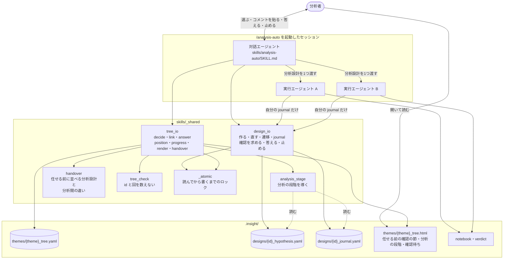
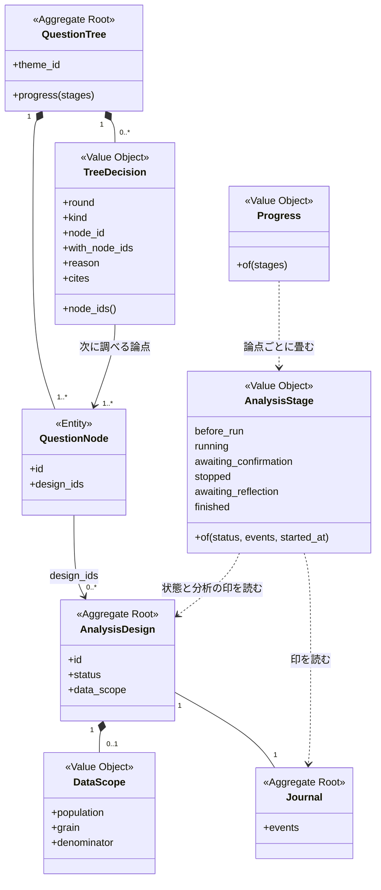
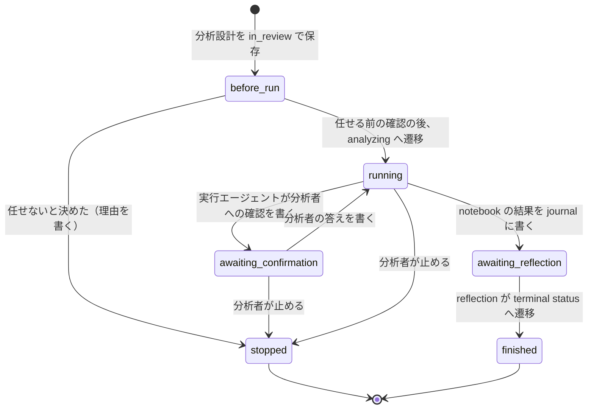
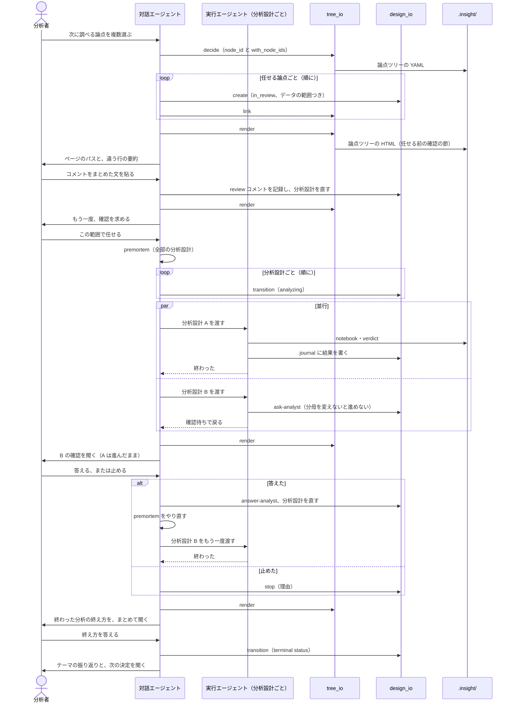

# Epic 35: 互いを待たない論点をまとめて任せて、まとめて戻る

## Background

本書がこの Epic の要求と背景の正本（[FLOW-0001](../adr/flow/0001-designdoc-owns-requirements.md)）。
Epic issue（[#284](https://github.com/etoyama/insight-blueprint-skills/issues/284)）には要約と本書へのリンクだけを置く。

- 解く課題: 分析者は `/analysis-auto` で論点を1つずつ調べる。論点を選び、分析設計を4回に分けて確かめ、結果を振り返り、次の論点を決める。
  調べたい論点が3つあると、互いの結果を待たない論点でも、この流れを3回くり返す。実データのテーマで数えると、止まる回数は約29回の見込みだった。
  分析者が1回1回の確認で読む中身は必要なものである（[ADR-0007](../adr/0007-upstream-judgment-gates.md)）。減らしたいのは読む中身ではなく、止まる回数である。
  - 課題1: 互いの結果を待たない論点でも、まとめて任せる手段が無い。論点ツリーの決定は論点を1つしか指せず、巡回の現在地も最新の決定の論点しか見ない。
    3つ任せても、記録と表示に残るのは1つである。
  - 課題2: 分析設計の確認は、分析設計ごとに4回止まる。3つで12回になる。並べて読めないので、分析設計の間で粒度や分母が違うことに気づきにくい。
  - 課題3: 任せた後、分析がどこまで進んだかを見分けられない。走っている分析も、計算が終わって振り返りを待つ分析も、論点ツリーには「検証中」と出る。
  - 課題4: 任せた後に、分析者が読んでいない抽出や分母で走らせない決まりが無い。進行中の分析を1つだけ止める手段と、止めた理由を残す所も無い。
  - 課題5: 分析を並行で走らせると、記録が黙って消える。分析設計の id が重なり、論点への結び付けが消える。
  - 課題6: 論点ツリーの決定の理由や答えの文に、論点の id や「2回目の振り返り」と書くと、根拠に無い数として拒まれる
    （[#277](https://github.com/etoyama/insight-blueprint-skills/issues/277)）。まとめて任せると、理由に複数の論点の id を書きたくなる。
  - 課題7: 分析設計は、対象・粒度・分母を書く項目を持たない。確認のときにチャットで言うだけで、記録に残らない。
- PRD の要件: [docs/PRD.md](../PRD.md) のコアバリュー「分析設計」「journal / reflection」と、非機能要件「分析者に届く数と結論は、記録に書いてあるものに限る」。
- 既存手段が不十分な理由: [ADR-0026](../adr/0026-analysis-auto-walks-the-question-tree.md) は巡回を「論点を1つ調べるひと回り」と決めた。
  1つずつ調べる前提で、決定・現在地・進捗・書き込みの全部が作られている。

### 起票の経緯

親の issue は [#250](https://github.com/etoyama/insight-blueprint-skills/issues/250)（合意した複数の論点をまとめて任せ、論点ツリーの上で進み具合と次の候補を見る）である。
人間は #250 を分け、前半をこの Epic にした（2026-11-26）。

- この Epic: 互いを待たない論点をまとめて任せて、まとめて戻る。#277 を含める。
- 次の Epic: 前の分析の結果を使う分析、次に調べる論点の候補、戻ったときに図を並べて見る場所と選ぶ画面、[#271](https://github.com/etoyama/insight-blueprint-skills/issues/271)。
- その次: [#251](https://github.com/etoyama/insight-blueprint-skills/issues/251)・[#236](https://github.com/etoyama/insight-blueprint-skills/issues/236)。

初版の途中で、範囲を削る案を人間に出した（コメント欄を次へ回す、終え方をまとめて聞くのを次へ回す、任せた後の確認と止めることを次へ回す）。
人間は削らないと決めた（2026-11-27）。

### 前提にした事実

着手前に、PM のセッションが今の skill（v0.21.0）のまま「まとめて任せる」流れを2回通した（2026-11-26）。
1回は図書館の合成シナリオで CLI を直接呼び、1回は実データのテーマでサブエージェントに実行させた。実データの値は本書に書かない。
初版では、図書館の合成シナリオで案を試した（2026-11-27）。

- 実データで止まった回数は3回だった（論点を選ぶ、横に並べた確認、振り返りと次の決定）。今の skill のまま3つの巡回に分けると、約29回の見込みである。
- 待ちの大半は分析者の確認で、計算ではない。互いを待たない2つの分析は同時に始まり、約1分半で終わった。
- `design_io` で分析設計を2プロセス同時に作ると、20回中20回、同じ id になって片方が上書きされた。
  `tree_io` で論点に同時に結ぶと、20回中20回、片方の結び付けが消えた。今のロックは書き戻す一瞬だけに掛かる（`skills/_shared/_atomic.py`）。
  読んでから書くまでをロックで囲むと、どちらも20回中0回になった。
- 親がツリーと分析設計を順に書き、サブエージェントが自分の notebook と journal だけを書く分け方では、ぶつからなかった。
  ただし `/analysis-notebook` の Step 7 が論点ツリーの HTML を書き直す。サブエージェントの1人は、指示に反してこれを走らせた。
- `tree_io position` は、片方の分析設計が終わると、もう片方が `analyzing` でも `concluded` と返した。
- `TreeDecision` に既定値つきの項目を足しても、保存済みの論点ツリーは読め、書き戻しても同じ内容になった。
- 決定が指す論点の並びを読み、分析設計の状態と journal だけから、進行中・確認待ち・止めた・振り返り待ち・終わったを導けた（試作）。
- 決定の理由に論点の id を書くと、id の数字が拒まれた。答えの文の「率比が1を超える」の 1 も拒まれた。後者は、その値を書いた出来事を根拠に足して通した。
- premortem は抽出の行数を見積もり、`.insight/config.yaml` の `static_rows_high` を超えると `HIGH` で止まる。金額や時間の上限は無い。
- `AnalysisDesign` と `Methodology` は、対象・粒度・分母の項目を持たない（`src/insight_blueprint/models/design.py` を読んだ）。
- 論点ツリーの HTML は script を持たない。人間がデスクトップアプリのペインで試作を試すと、ボタンでクリップボードには入らず、ページに出た文は手でコピーできた。
- 確かめていないこと: 分析設計3つぶんを、分析者が1回で読み切れるか。確認待ちが実際にどのくらい出るか（手で通した2回では0回）。
  ロックを待つ時間が実際の分析で気になるか。

## User Stories

AC の正本はここ。

本書は、分析者と話す側と、分析を実行する側を次の語で呼ぶ（人間が選んだ、2026-11-27）。

- 対話エージェント: `/analysis-auto` を起動したセッションの Claude。分析者と話し、任せ、記録を書く。
- 実行エージェント: 対話エージェントが分析設計を1つ渡して実行させるサブエージェント。

### US-1: 分析者が、互いを待たない論点をまとめて選んで任せられる

分析者として、止まる回数を減らすために、互いの結果を待たない論点を1回の決定でまとめて選び、任せたい。

- [ ] AC 1: 論点ツリーの決定は、次に調べる論点に加えて、一緒に任せた論点を0個以上持てる。一緒に任せた論点は論点ツリーにある論点で、互いにも、次に調べる論点とも重ならない。区切る決定は持てない。
- [ ] AC 2: 一緒に任せた論点を持たない保存済みの論点ツリーは、そのまま読める。読んで書き戻しても、内容は変わらない。
- [ ] AC 3: 巡回の現在地は、最新の決定が指す全部の論点について、結んだ分析設計と、その分析の段階を返す。終わっていない分析が1つでもあれば、巡回が終わったとは返さない。
- [ ] AC 4: 決定の種類の検査は、前の決定が指した全部の論点を基準にする。深めるはそのどれかの中へ進み、親に戻るはそのどれの中でもない所へ進み、区切るはそのどれかで区切る。
- [ ] AC 5: 対話エージェントは、論点を選ぶ場面で複数の論点を選ばせる。別の論点の結果を入力に使う論点は一緒に任せず、その理由を分析者に言う。

### US-2: 分析者が、任せる前に1回、分析設計を横に並べて読み、コメントを返せる

分析者として、実行の前に読んで直せることを保ったまま止まる回数を減らすために、任せる分析設計を1ページに並べて読み、分析設計ごとにコメントを返したい。

- [ ] AC 1: 対話エージェントは、任せる分析設計を `in_review` で保存し、論点に結んでから、分析者に確認を求める。確認の前には、premortem も回さず、データにも触らない。
- [ ] AC 2: 論点ツリーの HTML は、最新の決定が指す論点に結んだ実行前の分析設計を、列に並べた節を持つ。行は、意図、何に答えるか（探索は探索の問い、検証は検証仮説）、判定の基準、対象、粒度、分母、データソース、手法、主指標、抽出、図である。抽出は全文を読める。
- [ ] AC 3: 同じ行の値が分析設計の間で違うとき、コードがその行に印を付ける。印が付くのは対象・粒度・分母・データソースの行である。対話エージェントは、印の付いた行をチャットにも要約して出す。
- [ ] AC 4: 節は分析設計ごとのコメント欄を持つ。分析者が書いたコメントを、分析設計の id を添えた1つの文にまとめて、ページに出す。ページは外へ何も送らない。
- [ ] AC 5: 分析者が貼ったコメントを、対話エージェントは分析設計ごとに review コメントとして記録し、分析設計を直し、節を作り直してもう一度確認を求める。任せないと決めた分析設計は、理由つきで止める。

### US-3: 分析者が、論点ツリーの上で、分析ごとの段階と自分が返す確認を読める

分析者として、席を外している間と戻ったときに次にすることを知るために、論点ツリーで、どの分析がどの段階にあり、どれが自分の確認を待っているかを読みたい。

- [ ] AC 1: 分析の段階は保存しない。分析設計の状態と journal から導き、実行前・進行中・あなたの確認待ち・止めた・振り返り待ち・終わった、を見分ける。規則は1か所にある。
- [ ] AC 2: 論点ツリーの HTML は、論点に結んだ分析設計ごとに、分析の段階を言葉と色で出す。色だけでは伝えない。止めた分析には理由を、確認待ちの分析には何を確認したいかを添える。
- [ ] AC 3: ページは、分析者の確認を待つ分析を冒頭に抜き出す。無いときは抜き出しの欄を出さない。
- [ ] AC 4: 論点の進捗は、未着手・調べている・分析済み・止めた、の4つになる。結んだ分析設計が全部止めた論点は「止めた」と出し、止めた以外の分析設計が1つでもあれば、止めた分析設計を数えずに決める。ページ、`tree_io position`、`tree_io progress`、レポート、skill が分析者に伝える進み具合は、同じ規則を使う。
- [ ] AC 5: ページの「次に調べる論点」と決定の一覧は、決定が指す全部の論点を出す。

### US-4: 分析者が読んでいない内容でデータに触らず、分析を1つずつ止められる

分析者として、任せた後も判断を手放さないために、読んだ内容を変える前に聞かれ、進行中の分析を1つだけ止められるようにしたい。

- [ ] AC 1: 実行エージェントは、任せる前に分析者が読んだ内容（対象、粒度、分母、抽出、データソース、主指標、判定の基準）を変えないと進めないとき、データに触る前に止まり、分析者への確認を自分の journal に書いて戻る。
- [ ] AC 2: 確認を待つ間、止まるのはその分析だけである。ほかの分析は進む。
- [ ] AC 3: 分析者の答えは、その分析設計の journal に、どの確認への答えかを添えて残る。答えの付いた確認は、未解決の問いに数えない。抽出を変えたら、実行の前に premortem をやり直す。
- [ ] AC 4: 分析者は進行中の分析を1つだけ止められる。止めた分析は、止めた理由を journal に持ち、論点ツリーに「止めた」と出る。止めた分析は再開せず、やり直すときは派生で別の分析設計を作る。
- [ ] AC 5: 確認と、その答えと、止めた理由の印は、`design_io` の専用の命令だけが書く。

### US-5: 並行で書いても、記録が黙って消えない

分析者として、任せた分析の記録を信じるために、複数の分析が同時に走っても、分析設計・論点ツリー・journal が欠けないでほしい。

- [ ] AC 1: `design_io` と `tree_io` の書き込みは、読んでから書き戻すまでを1つのロックで囲む。2つのプロセスが同時に分析設計を作っても、id は重ならない。同時に論点へ結んでも、どちらの結び付けも残る。
- [ ] AC 2: まとめて任せた実行では、論点ツリー、分析設計、論点ツリーの HTML を書くのは対話エージェントだけである。実行エージェントが書くのは、自分の notebook・verdict・journal だけである。
- [ ] AC 3: まとめて任せた実行では、論点ツリーの HTML は、対話エージェントが実行エージェントの戻りのたびに書き直す。単独で起動した `/analysis-notebook` は、今までどおり自分で書き直す。

### US-6: 分析者が、理由と答えの文に、論点の id と振り返りの回を書ける

分析者として、まとめて任せた理由を自然に書くために、論点や分析設計の id と「N回目の振り返り」を、根拠に無い数として拒まれずに書きたい。

- [ ] AC 1: ツリーの検査は、論点ツリーにある論点の id と、論点に結んだ分析設計とその出来事の id を、数として数えない。
- [ ] AC 2: ツリーの検査は、「N回目の振り返り」の N を、N が今の振り返りの回以下のときだけ、数として数えない。
- [ ] AC 3: それ以外の数は、今までどおり、根拠にした出来事の本文に無ければ拒む。論点ツリーに無い id の数字、比べる相手の値（「1を超える」の 1）、まだ無い回の数も拒む。
- [ ] AC 4: 数を拒んだとき、`tree_io` は直し方を言う。その値を書いた出来事を根拠に足すか、文から数を外す。

### US-7: 分析者が、分析設計に対象・粒度・分母を書いて残せる

分析者として、何を数える分析かを後から読めるようにするために、対象・粒度・分母を分析設計の項目として残したい。

- [ ] AC 1: 分析設計は、対象・粒度・分母の組を任意で持てる。持つときは3つとも空でない。持たない保存済みの分析設計は、そのまま読める。
- [ ] AC 2: まとめて任せる分析設計は、この組を持つ。持たない分析設計は、任せる前の確認に進めない。
- [ ] AC 3: 分析ノートは、この組を手法の近くに出す。

### 分析者に見せる言葉

内側と画面で言葉が違う語。文書・コード・テストは左の列、分析者に見せる文は右の列を使う。画面の言葉は `skills/_shared/tree_words.py` に置く。
右の列は初版の案で、人が実物の画面を読む段（[FLOW-0019](../adr/flow/0019-human-reads-real-screen-after-first-display-story.md)）で確かめる。

| 内側の用語（文書・コード） | 分析者に見せる言葉 |
|---|---|
| 任せる前の確認 | 分析を任せる前の確認 |
| 分析設計の間で値が違う行の印 | 分析間の違い |
| 抽出の行（SQL は `methodology.steps` のクエリの全文、CSV などはファイル・列・絞り込み） | 抽出・加工条件 |
| 一緒に任せた論点 | 使わない。「次に調べる論点」に、決定が指す全部の論点を並べる |
| 分析の段階: 実行前（`before_run`） | 任せる前 |
| 分析の段階: 進行中（`running`） | 進行中 |
| 分析の段階: 確認待ち（`awaiting_confirmation`） | あなたの確認待ち |
| 分析の段階: 止めた（`stopped`） | 止めた |
| 分析の段階: 振り返り待ち（`awaiting_reflection`） | 計算が終わり、振り返りを待っている |
| 分析の段階: 終わった（`finished`） | 終わった |
| 対話エージェント、実行エージェント | エージェント |
| データの範囲 | 使わない。対象・粒度・分母をそれぞれの行に出す |

## Stories

Story は仮の分割で、起票は PM のセッションが行う。「触る所」が重なる Story は同じ波に置かない。

| Story | 波 | User Story | 扱う AC | 触る所 | 前提 |
|---|---|---|---|---|---|
| 35.1 id と振り返りの回を数えない | 1 | US-6 | AC 1, AC 2, AC 3, AC 4 | `skills/_shared/tree_check.py`（`numbers_in`、`_cite_problems`）、`skills/_shared/tree_io.py` の違反を返す所の文、`skills/analysis-reflection/SKILL.md` の数の書き方の表、`tests/test_tree_check.py`、`tests/tree_io/`、`docs/UBIQUITOUS_LANGUAGE.md` のツリーの検査 | — |
| 35.2 書き込みのロック、分析の段階、確認と止める命令、データの範囲 | 1 | US-5、US-3、US-4、US-7 | US-5 AC 1（`design_io` の分）、US-3 AC 1、US-4 AC 5、US-7 AC 1, AC 3 | `skills/_shared/_atomic.py`（ロックの helper）、`skills/_shared/design_io.py`、`skills/_shared/analysis_stage.py`（新規）、`src/insight_blueprint/models/design.py`（`DataScope`）、`skills/_shared/design_note.py`・`design_note_read.py`（データの範囲を出す）、`skills/analysis-journal/SKILL.md` の metadata の表、`tests/`、`docs/UBIQUITOUS_LANGUAGE.md` | — |
| 35.3 決定が複数の論点を指し、現在地が全部を返す | 2 | US-1、US-5、US-3 | US-1 AC 1, AC 2, AC 3, AC 4、US-5 AC 1（`tree_io` の分） | `src/insight_blueprint/models/tree.py`（`TreeDecision`、`_check_decision_after`、`Progress`、`QuestionTree.progress`）、`skills/_shared/tree_io.py`（`decide` と書き込みの全部）、`skills/_shared/tree_read.py`（`position`、`progress`）、`docs/ARCHITECTURE.md`、`docs/UBIQUITOUS_LANGUAGE.md`（「論点ツリーの決定」への改名を含む）、`.yomiyasu-words/`、`tests/test_tree_models.py`、`tests/tree_io/` | 35.2 |
| 35.4 分析の段階と確認待ちを論点ツリーに出す | 3 | US-3 | AC 2, AC 3, AC 4, AC 5 | `skills/_shared/tree_words.py`、`skills/_shared/tree_render.py`・`tree_render_parts.py`・`_html.py`、`skills/_shared/design_note.py` の `_progress`、`skills/_shared/tree_read.py` の `render` と `_theme_report`、`skills/_shared/theme_report.py`、`scripts/handoff_trial.py`、`tests/test_tree_render.py`、`tests/test_theme_report.py`、`tests/tree_io/test_render*.py` | 35.3 |
| 人が実物の画面と言い回しの一覧を読む（FLOW-0019） | 3 の後 | — | — | 合成シナリオで作った論点ツリーの HTML と、`tree_words.py` から抜き出した言い回しの一覧 | 35.4 |
| 35.5 任せる前の確認の節とコメント欄 | 4 | US-2 | AC 2, AC 3, AC 4 | `skills/_shared/tree_render_handover.py`（新規）、`skills/_shared/tree_render.py`、`skills/_shared/tree_words.py`、`skills/_shared/tree_read.py` の `render`、`tests/test_tree_render_handover.py`（新規）、`tests/tree_io/test_render*.py` | 人が画面を読む段 |
| 35.6 まとめて任せる流れ | 5 | US-1、US-2、US-5、US-7 | US-1 AC 5、US-2 AC 1, AC 5、US-5 AC 2、US-7 AC 2 | `skills/analysis-auto/SKILL.md`、`skills/analysis-framing/SKILL.md` の 4b と 4d、`skills/analysis-reflection/SKILL.md` の Step T1・T7、`skills/analysis-design/SKILL.md`、`skills/_shared/handover.py`・`tree_read.py`（`handover` の `no_data_scope`）、`tests/skills/`、`tests/tree_io/test_render_handover.py` | 35.5 |
| 35.7 任せた後の確認、止めること、まとめて戻ること | 6 | US-4、US-5 | US-4 AC 1, AC 2, AC 3, AC 4、US-5 AC 3 | `skills/analysis-auto/SKILL.md`、`skills/analysis-notebook/SKILL.md` の Step 1・6・7、`skills/premortem/SKILL.md`、`skills/analysis-reflection/SKILL.md` の Step 1・2、`skills/analysis-journal/SKILL.md` の Open Questions、`skills/_shared/design_io.py`（`stage`、`journal-append`、止めた分析設計の状態）、`skills/_shared/design_note_read.py`（答えの付いた確認を未解決の問いから外す）、`skills/_shared/design_note.py`・`tree_words.py`（段階の行）、`skills/_shared/tree_io.py`（`copy_hearing`）、`src/insight_blueprint/models/journal.py`・`analysis_stage.py`、`tests/skills/`、`tests/test_design_note*.py`、`tests/test_design_io_after_handover.py`、`docs/ARCHITECTURE.md` の guided autopilot のシーケンス | 35.6 |

- 波 1 は 35.1 と 35.2 で、並行で進められる。35.1 は `tree_check` と `tree_io`、35.2 は `design_io` と分析設計のモデルで、触る所は重ならない。
  用語集は2つとも触る。35.1 は「ツリーの検査」の行、35.2 は足す行だけを触る。
- 35.3 は 35.2 のロックの helper と分析の段階の規則を使う。35.4 と 35.5 はどちらも `tree_render.py` と `tree_words.py` を触るので、順に進める。
  35.6 と 35.7 はどちらも `skills/analysis-auto/SKILL.md` を触るので、順に進める。
- 人が実物の画面を読む段は 35.4 の後に置く。画面に言葉を出す 35.5 と、skill が分析者に出す文を書く 35.6・35.7 は、この段の後に始める。
- 「検証中」（論点の進捗）と「進行中」（分析の段階）が同じページに並ぶ。人が実物の画面を読む段で、論点の進捗を「調べている」に変えると人間が決めた（Decision `story-35-5-the-progress-word-says-the-question-is-being-looked-into`）。
- 戻ったときに、終わった分析の終え方をまとめて聞くことは、この Epic に入れる（人間の判断、2026-11-27）。聞き方は 35.7 が `/analysis-auto` の文で決め、`/analysis-reflection` の Step 3 は変えない。
  変える必要が出たら、35.7 は手を付ける前に PM のセッションに送る。
- 論点ごとの進み具合と巡回の現在地は、次の所が出している。規則を変える 35.3 と、言葉を出す 35.4・35.6 は、この全部を同じ規則に揃える。
  規則は `models/tree.py` の `Progress.of`・`QuestionTree.progress`。コマンドは `tree_read.progress`・`tree_read.position`。
  画面は `tree_render.py`・`tree_render_parts.py`・`design_note.py` の `_progress`、言葉は `tree_words.py` の `PROGRESS_WORDS`。レポートは `tree_read._theme_report` と `theme_report.py`。
  skill の文は `analysis-auto`（Step 1 の表、Step 3 の 9）、`analysis-framing`（4c、4d）、`analysis-reflection`（Step T1 と末尾の命令の表）、`knowledge-extract`。
- どの Story も `CHANGELOG.md` の `[Unreleased]` に1行足す。重なるのはそこだけである。
- 用語集は、コード上の名前を入れた Story が直す（名前が実在することをテストが確かめる）。

Story が使う既存の helper（作り直さない）。

| ほしいもの | 既にある所 |
|---|---|
| 合成シナリオを通して HTML を作る | `scripts/handoff_trial.py` の `Scenario`・`build`（`uv run python -m scripts.handoff_trial build --scenario lib --out <dir>`）。題材は `tests/fixtures/handoff/lib/` と `psy/` |
| 画面の言葉を置く所と、言葉を確かめるテスト | `skills/_shared/tree_words.py`、PR #283 でまとめたテスト |
| SKILL.md と文書の構造テスト | `tests/skills/`（`_auto.py`、`_markdown.py`、`_shown.py`）、[ADR-0010](../adr/0010-skill-tdd-structure-tests.md) |
| 書き込みを原子的にする | `skills/_shared/_atomic.py` の `atomic_write_yaml`・`atomic_write_text` |
| 分析設計の id を振る、journal に出来事を足す | `design_io.next_design_id`、`design_io.append_journal_event` |
| 論点とその下の論点に結んだ分析設計 | `QuestionTree.designs_by_branch()`、`QuestionTree.linked_designs()` |
| 文の数を引用先と照らす | `tree_check.numbers_in`、`tree_check._cite_problems` |
| 書く前に検査して、違反なら書かない | `tree_io.answer`・`tree_io.decide`（`_checked`・`_save`） |
| 分析ノートを論点ツリーの HTML に並べる | `tree_read.render`、`design_note.render_note` |
| 表示のテストの道具 | `tests/tree_io/_support.py`、`tests/tree_io/conftest.py`、`tests/test_tree_render.py` |

## Ubiquitous Language

この Epic で追加・変更する語。定義の正本は [docs/UBIQUITOUS_LANGUAGE.md](../UBIQUITOUS_LANGUAGE.md) で、表は名前を入れた Story が直す。

- 追加: 一緒に任せた論点（`with_node_ids`）、分析の段階（`AnalysisStage`）、任せる前の確認、分析者への確認（`ask-analyst`）、対話エージェント（`driver`）、実行エージェント（`worker`）、データの範囲（`DataScope`、`data_scope`）
- 変更: 進捗（「止めた」を足し、分析の段階から導く）、論点ツリーの決定（「ツリーの決定」から改名。一緒に任せた論点を持てる。[ADR-0061](../adr/0061-a-tree-decision-may-hand-over-several-questions-and-the-stage-is-derived.md)）、
  巡回（論点を1つ以上調べるひと回り）、巡回の現在地（決定が指す全部の論点を返す）、
  ツリーの検査（id と振り返りの回を数えない。[ADR-0065](../adr/0065-ids-and-reflection-rounds-are-not-counted-as-numbers.md)）、
  未解決の問い（答えの付いた分析者への確認を数えない）、guided autopilot と KEEP ゲート（任せる前の確認と、任せた後の確認）
- 使わない: ツリーの決定、親（対話エージェントを指すとき）、子・サブエージェント（実行エージェントを指すとき）、ボード（論点ツリーの表示を指すとき）

## Scope

[docs/PRD.md](../PRD.md) のコアバリュー「分析設計」「journal / reflection」を前進させる。
[docs/ARCHITECTURE.md](../ARCHITECTURE.md) では、Question tree（`TreeDecision`、`tree_io position`、`tree_io render`、`tree_check`）、
YAML I/O（`design_io` の書き込みと、分析設計のモデル）、Skill layer（`/analysis-auto` と、それが動かす skill）を直す。

- Epic 範囲内:
  - 論点ツリーの決定が複数の論点を指すことと、分析の段階を導くこと（[ADR-0061](../adr/0061-a-tree-decision-may-hand-over-several-questions-and-the-stage-is-derived.md)）。
  - 並行の書き込みの分担とロック（[ADR-0062](../adr/0062-only-the-dialogue-agent-writes-shared-records-and-read-to-write-is-locked.md)）。
  - 任せる前の確認を、手元の HTML に並べて見せること（[ADR-0063](../adr/0063-designs-to-hand-over-are-saved-then-read-side-by-side-on-the-page.md)）。
  - 任せた後の確認の条件と、1つずつ止めること（[ADR-0064](../adr/0064-a-handed-over-analysis-asks-before-changing-what-was-read-and-can-be-stopped.md)）。
  - ツリーの検査が id と振り返りの回を数えないこと（[ADR-0065](../adr/0065-ids-and-reflection-rounds-are-not-counted-as-numbers.md)、#277）。
  - 分析設計がデータの範囲を持てること（[ADR-0066](../adr/0066-a-design-may-state-its-population-grain-and-denominator.md)）。
- Epic 範囲外:
  - 前の分析の結果を入力に使う分析を一緒に任せること。次に調べる論点の候補をエージェントが出すこと。戻ったときに図を並べて見る場所と、選ぶ画面。#271。次の Epic に委ねる。
  - 任せた確認（機械か別のモデルが確かめるもの）と、どの分析が同じデータを使うかの表示。#251 と #236 に委ねる。
  - セッションをまたぐ実行。実行エージェントは同じセッションの中のサブエージェントに限る。
  - Artifact に置いた表示を更新する手段（#216）。任せる前の確認は手元の HTML で見せるので、要らない。
  - 金額・読むバイト数・時間の上限。費用は premortem の行数の線で見る（ADR-0064）。
  - 比べる相手の値（「1を超える」の 1）を、根拠に足さずに書けるようにすること。実データで使う段で頻度を見てから考える（ADR-0065）。
  - 止めた分析を、同じ分析設計のまま再開すること（ADR-0064）。
  - 決定の言葉「親に戻る」が、親でない論点へ移るときにも出ること。見つけた事実として issue に書く。
  - 別のワークツリーで、同じ id が別の分析設計を指すこと。id はワークツリーの中でだけ一意である。
- 触らない所:
  - `DesignStatus` と `VALID_TRANSITIONS`（理由: 分析の段階は導く。値を足すと、検査・遷移・表示の全部に場合分けが入る。ADR-0061）。
  - journal の出来事の種類の一覧（理由: 確認と止めた理由は、今ある `question` と `decide` に印を付けて書く。種類を足すと、種類の一覧を持つ所の全部に波及する。ADR-0064）。
  - `tree_check` が数を比べる規則（`numbers_in` の符号と値の比べ方、理由: 守りを緩めない。数えないものを先に除くだけにする。ADR-0065）。
  - `TreeDecisionKind`（理由: 種類は4つのままで足りる。一緒に任せた論点は種類を持たない。ADR-0061）。
  - `/analysis-design`・`/analysis-notebook`・`/premortem` を単独で起動したときの流れ（理由: 自律は `/analysis-auto` を起動した実行に限る。[ADR-0005](../adr/0005-selective-autonomous-chaining.md)）。
  - 閉じた Epic の DesignDoc と ADR の中の「ツリーの決定」（理由: 閉じた Epic の文書には追記しない。[ADR-0009](../adr/0009-adopt-repo-template-flow.md)）。

## Architecture

- 対話エージェントだけが論点ツリー・分析設計・論点ツリーの HTML を書く。実行エージェントは自分の notebook・verdict・journal だけを書く。
- 正本は論点ツリーの YAML、分析設計、journal である。分析の段階はどこにも保存しない。
- daemon・MCP サーバ・SQLite を足さない。コメント欄はページの中だけで動き、外へ何も送らない。

## Domain Model

| 型 | 種類 | 不変条件 |
|---|---|---|
| `TreeDecision` | 値オブジェクト | `with_node_ids` は論点ツリーにある論点で、互いにも `node_id` とも重ならない。`close` は `with_node_ids` を持たない。既定は空で、持たない保存済みの決定は空として読む |
| `QuestionTree` | 集約ルート | 決定の種類の検査は、前の決定の `node_id` と `with_node_ids` の全部を基準にする。深めるは、そのどれかの中へ進む。親に戻るは、そのどれの中でもない所へ進む。区切るは、そのどれかで区切る |
| `DataScope` | 値オブジェクト | 対象・粒度・分母は3つとも空でない。分析設計は組ごと持つか、持たない |
| `AnalysisStage` | 値オブジェクト | 保存しない。分析設計の状態と journal から、決まった順で1つに決まる（下の State Diagram） |
| `Progress` | 値オブジェクト | 保存しない。未着手・調べている・分析済み・止めた の4つ。結んだ分析設計が全部止めたなら止めた。止めた以外が1つでもあれば、止めた分析設計を数えずに決める |
| `Journal` | 集約ルート | 確認・答え・止めた理由の印は `design_io` の専用の命令だけが書く。ツールの書き込みが印を持つ出来事を足す・消す・書き換えるのは、検証 hook が止める（ADR-0067）。答えは、どの確認への答えかを持つ |

### State Diagram

分析の段階（`AnalysisStage`）。保存する状態ではなく、記録から導く値である。矢印は、どの記録が書かれると段階が変わるかを表す。

導く順は次のとおり。上から見て、最初に当たったものになる。

1. 分析設計が terminal status なら、終わった。
2. journal に止めた印があれば、止めた。
3. journal に、答えの付いていない分析者への確認があれば、確認待ち。
4. 分析設計が `analyzing` で、journal に `hearing`・分析者への確認・その答え以外の出来事が、分析の印（`analysis_started_at`）より後にあれば、振り返り待ち。印の無い保存済みの記録は、時刻を問わず数える（ADR-0061 の追記、Story 35.2）。
5. 分析設計が `analyzing` なら、進行中。
6. それ以外は実行前。

## Sequence Diagram

- 実行エージェントは分析者と話さない。確認は journal に書いて戻り、対話エージェントが分析者に聞く。
- 対話エージェントの書き込みは順に行う。並行で走るのは、実行エージェントの notebook の実行と、自分の journal への書き込みだけである。
- 分析者が止まるのは、論点を選ぶ、任せる前の確認、（あれば）任せた後の確認、終え方、テーマの振り返りと次の決定、である。

## Decisions

### Decision: story-35-1-an-event-id-is-named-by-its-linked-design

- What: ツリーの検査は、出来事の id を、その分析設計が論点ツリーのどこかの論点に結んであれば数えない。journal にその出来事が実際にあるかは見ない。「N回目の振り返り」は、ページが振り返りの回を言う言葉（`tree_words.reflection`）と同じ形だけを読む。
- Why: 引用していない出来事の有無を確かめるには、結んだ分析設計の journal を全部読む必要がある。検査は今、引用した出来事の journal だけを読む（ADR-0058 の「前の決定の journal は読まない」と同じ考え）。
- Criteria: ADR-0065 の W3（守りに新しい穴を開けない）。無い出来事の id（`LIB-H01-E99`）は結果の数を運ばないので、通しても記録に無い結果は届かない。
- Affected modules: `skills/_shared/tree_check.py`、`skills/_shared/tree_words.py`
- Alternatives considered: 結んだ分析設計の journal を全部読み、実在する出来事の id だけを数えない（読む journal が増え、決定の検査が前の記録に引きずられる）。
- Consequences: 無い出来事の id を文に書いても拒まれない。引用の実在は今までどおり `missing-event` が確かめる。

### Decision: story-35-1-answers-still-keep-ids-in-cites

- What: `analysis-reflection` の Step T2 は「id を `text` に書かない」から「日付を書かない」に変え、id とその回は数えないと書いたうえで、出来事の id は `cites` に置くという指示を残す。
- Why: 拒まれる理由は消えたが、分析者が読む答えの文に id は要らない（言葉を分析者向けにする方針）。
- Criteria: ADR-0065 の Decision 5（答えの文と決定の理由に同じ規則）と、分析者に見せる文の書き方。
- Affected modules: `skills/analysis-reflection/SKILL.md`、`tests/skills/test_theme_reflection_structure.py`
- Alternatives considered: 答えの文にも id を勧める（分析者が読む文に id が並ぶ）。
- Consequences: 決定の理由には id を書け、答えの文はこれまでどおり id を使わずに書く。

### Decision: story-35-3-the-analysis-stage-lives-in-the-models

- What: `AnalysisStage` とその印の helper を `skills/_shared/analysis_stage.py` から `src/insight_blueprint/models/analysis_stage.py` に移す。終わった段階の集合 `SETTLED`（終わった・止めた）も同じモジュールに置く。
- Why: `Progress.of(stages)`（Domain Model）は `models/tree.py` にあり、src は skills を import できない。35.2 が `JOURNAL_MARKS` を src に置いたのと同じ理由である。
- Criteria: 段階の名前と規則を1か所に置くこと（US-3 AC 1）。
- Affected modules: `src/insight_blueprint/models/analysis_stage.py`、`src/insight_blueprint/models/tree.py`、`skills/_shared/design_io.py`、`skills/_shared/tree_read.py`、それを import するテスト
- Alternatives considered: `Progress.of` に段階の文字列を渡す（段階の名前が2か所に分かれる）。
- Consequences: 35.2 の引き継ぎにある `skills/_shared/analysis_stage.py` は、もう無い。

### Decision: story-35-3-a-stopped-analysis-does-not-hold-the-walk

- What: 巡回の現在地は、止めた分析を「終わっていない分析」に数えない。決定の後の分析設計がどれも終わったか止めたなら `concluded` を返す。全部止めた場合も `concluded` で、テーマの振り返りへ進む。
- Why: 止めた分析は再開しない（ADR-0064）。数えると、片方を終え片方を止めた巡回が `in_progress` のまま動かない（合成シナリオで試した）。抜けるには、止めた分析設計を terminal status に遷移させるしかなく、止めた分析に結論を付けることになる。
- Criteria: 止めた分析を残したまま巡回が次へ進めること（ADR-0064）。進捗の規則（ADR-0061 7、止めたは数えない）と同じ読み方をすること。人間が案A を選んだ（2026-11-27）。
- Affected modules: `skills/_shared/tree_read.py::position`、`src/insight_blueprint/models/analysis_stage.py::SETTLED`、`skills/analysis-auto/SKILL.md` の Step 1 の表
- Alternatives considered: 数える（止めた分析に判定や explored を付けないと進めない）。全部止めたら新しい状態を返す（`WalkState` と 35.6 の分岐が増える）。
- Consequences: 全部止めた巡回でもテーマの振り返りに入る。答える結果は無く、聞くのは次の決定と答えを変えないことである。聞き方は 35.6・35.7 の skill の文で決める。

### Decision: story-35-3-the-order-of-the-progress-words

- What: 進捗の語を、先へ進んだものから 分析済み、止めた、検証中、未着手 の順に並べる（`Progress` の宣言順）。仮の並びで、人が実物の画面を読む段で人間が決める。
- Why: 下の論点の数は先へ進んだものから並べている（ADR-0057 の見本）。止めたは、それ以上進まない点で分析済みに近い。
- Criteria: 今の並びの規則を崩さないこと。PM が仮の並びとして進めることを了承した（2026-11-27）。
- Affected modules: `src/insight_blueprint/models/tree.py::Progress`、`skills/_shared/tree_words.py::PROGRESS_WORDS`、`skills/analysis-framing/SKILL.md` 4d、`skills/analysis-reflection/SKILL.md` の T1・T5・末尾の表
- Alternatives considered: 止めたを最後に置く。
- Consequences: 画面を読む段で変えると、宣言順と SKILL.md の文の両方が変わる。

### Decision: story-35-3-a-question-handed-over-without-a-design-keeps-the-walk-open

- What: 終わっていない分析が無く、決定が指す論点のどれかに決定の後の分析設計が無ければ、巡回の現在地は `not_started` を返し、その論点を `undesigned_node_ids` に並べる。区切る決定では並べない。
- Why: 一緒に任せた論点に分析設計を作り損ねると、残りが終わった時点で `concluded` になり、`/analysis-auto` がその論点を黙って落とした（合成シナリオで再現した。thermos のバグの観点の指摘）。
- Criteria: 任せた論点を、分析者に言わずに落とさない（US-1）。`WalkState` と `analysis-auto` の表を増やさない。人間が案A を選んだ（2026-11-27）。
- Affected modules: `skills/_shared/tree_read.py::position`、`skills/analysis-auto/SKILL.md` の Step 1 の表、`docs/ARCHITECTURE.md`、`docs/UBIQUITOUS_LANGUAGE.md` の巡回の現在地
- Alternatives considered: 今のまま `concluded` を返し、35.6 の流れで塞ぐ（流れが外れると論点が落ちる）。新しい `WalkState` を足す（35.6 の表と分岐が増える）。
- Consequences: 終わった分析の振り返りは、空の論点の分析が終わるまで待ち、1回にまとまる。任せた論点を落とすときは、新しい決定を書く。

### Decision: story-35-4-stopped-cards-come-last

- What: 論点の下の分析設計のカードを、終わっていない分析、終わった分析、止めた分析の順に並べる。各組の中は新しいものから。
- Why: 止めた分析は再開しない（ADR-0064）。終わっていない分析と一緒に並べると、まだ動く分析と読み違える（35.3 の引き継ぎ）。
- Criteria: 分析者が戻ったときに、次にすることを上から読めること（US-3）。止めた分析は巡回を待たせない（Decision `story-35-3-a-stopped-analysis-does-not-hold-the-walk`）と同じ読み方。
- Affected modules: `skills/_shared/tree_render.py::_card_order`
- Alternatives considered: 止めた分析を終わった分析と一緒に並べる（判定の付いた分析と、結論の無い分析が混ざる）。
- Consequences: 終わった分析の判定が、止めた分析より先に読める。人が画面を読む段で変えてよい。

### Decision: story-35-4-the-status-word-only-where-the-stage-needs-it

- What: 分析設計のカード・短い行・分析設計の派生の節は、分析の段階の言葉を出す。状態の言葉（レビュー中、検証仮説の判定: 支持 など）は、段階が任せる前か終わったときだけ添える。分析ノートの「状態:」の行は YAML の値を写す行なので変えない。
- Why: 止めた分析・確認待ち・振り返り待ちの分析設計は、状態が `analyzing`（任せる前に止めたものは `in_review`）のまま変わらない。状態の言葉を添えると「止めた　分析中」と並び、矛盾して読める。任せる前は修正待ちかどうかを、終わったは判定を、状態の言葉だけが伝える。
- Criteria: 段階の言葉が意味を持つこと（US-3 AC 2）。分析者に見せる文を比喩や矛盾なく読めること。
- Affected modules: `skills/_shared/tree_words.py::STAGES_WITH_STATUS`、`skills/_shared/tree_render_stage.py::stage_parts`、`skills/_shared/tree_render.py`（`_design_card`、`_derivation`）、`tests/test_tree_render.py`（分析中の言葉を確かめていたテストを、仕様の変更として直した）
- Alternatives considered: 状態の言葉を常に添え、凡例で違いを説明する（カードの上で矛盾して読める）。状態の言葉を出さない（判定と修正待ちが読めなくなる）。
- Consequences: カードから「分析中」の言葉が消える。分析ノートは今までどおり YAML の状態を出す。人が画面を読む段で確かめる（`284-s4-words.md` の5と7）。

### Decision: story-35-5-the-progress-word-says-the-question-is-being-looked-into

- What: 人が実物の画面を読む段（2026-11-27、`284-s4-words.md` の番号）で人間が決めた5件を入れる。1: 冒頭の「進捗の数」もカードの下と同じく先へ進んだ順（分析済み、止めた、調べている、未着手）に並べる。2: 論点の進捗「検証中」を「調べている」に変える。分析の段階の「進行中」は変えない。4: 止めた論点の枠を破線に、止めた段階に斜線を足す。色は増やさない。6: 冒頭の確認待ちの欄の文を「この確認には、チャットでエージェントに答える。」にする。8: `tree_io report` は止めた分析設計を `stopped_designs` に分け、`unfinished_designs` は分析の段階で数える（`SETTLED` でないもの）。`report-export` は「止めた分析設計: N 件」を別の行に出す。
- Why: 「検証中」と「進行中」が同じページに並び、論点の進捗と分析の段階を読み分けにくかった。止めたの灰色は未着手の灰色と近かった。止めた分析設計は結論を待っていないのに、レポートの承認の文では結論の出ていない分析設計に数えていた。
- Criteria: 人間の決定（2026-11-27）。3（任せる前だけの論点も調べている）と5（状態の言葉の添え方）は今のまま、7（分析ノートの状態の行）は 35.7 が扱う。
- Affected modules: `skills/_shared/tree_words.py`（`PROGRESS_WORDS`、`ASKS_LEAD`）、`skills/_shared/tree_render.py::_counts`、`skills/_shared/tree_render_stage.py::STAGE_CSS`、`skills/_shared/theme_report.py::ReportDesign`（`stage`）、`skills/_shared/tree_read.py::report`、`skills/report-export/SKILL.md`、`skills/analysis-framing/SKILL.md`、`skills/analysis-reflection/SKILL.md`、`docs/UBIQUITOUS_LANGUAGE.md` の進捗
- Alternatives considered: 進捗の語を変えず、分析の段階の「進行中」を変える（人間は進捗の側を選んだ）。
- Consequences: ADR-0033・0055・0057・0061 の本文は、決めたときの記録として「検証中」のまま残す。Decision `story-35-3-the-order-of-the-progress-words` の仮の並びはこの決定で確かめた並びになった。

### Decision: story-35-5-the-check-sits-after-the-asks

- What: 「分析を任せる前の確認」の節は、冒頭の確認待ちの欄の次、主題への現時点の答えの前に置く。
- Why: どちらも分析者が今することである。確認待ちの分析はもう走っていて答えを待って止まっている。任せる前の分析はまだ何も始まっていない。止まっている方を先に読む。
- Criteria: 分析者が戻ったときに、次にすることを上から読めること（US-3、Decision `story-35-4-stopped-cards-come-last` と同じ読み方）。
- Affected modules: `skills/_shared/tree_render.py::render_tree_html`、`skills/_shared/tree_words.py::legend`
- Alternatives considered: 任せる前の確認を先に置く（走っている分析の待ちが、表の下に押し出される）。
- Consequences: 両方あるページでは、表の前に確認待ちの欄が来る。

### Decision: story-35-5-the-check-reads-designs-before-their-run-on-the-last-decision

- What: 節に並べるのは、最新の論点ツリーの決定が指す全部の論点に結んだ、分析の段階が実行前の分析設計だけである。区切る決定では並べない。並べる段階は `handover.READ_BEFORE_HANDOVER` の1か所にある。2つの論点に結んだ分析設計は1つの列にする。
- Why: 任せる前の確認は、今回まとめて任せる分析設計を読む場である（ADR-0063 2）。前の決定の論点に残った実行前の分析設計まで並べると、今回任せないものが混ざる。
- Criteria: US-2 AC 2。抽出を変えて確認待ちになった分析設計をもう一度読ませる話は 35.7 の範囲なので、段階を1か所に足せば広がる形にする（ブリーフ）。
- Affected modules: `skills/_shared/handover.py::to_hand_over`、`READ_BEFORE_HANDOVER`
- Alternatives considered: テーマの実行前の分析設計を全部並べる（今回任せないものが混ざる）。決定の後に作った分析設計だけにする（決定の前に作って結んだ分析設計が落ちる）。
- Consequences: 合成シナリオ `lib-stages` の LIB-H07（LIB-Q04 の実行前）は、最新の決定が LIB-Q04 を指さないので並ばない。

### Decision: story-35-5-the-extraction-is-shown-in-full-and-wraps-at-words

- What: 抽出・加工条件の行は `methodology.steps` の各段を、畳まずに全文で出す。段ごとに `pre` で書いたままの改行と字下げを残し、列の幅で折り返す。単語の途中では折らない。
- Why: 任せる前の確認は抽出を読んで直す場である（ADR-0007、ADR-0063 W2）。畳むと、3列を見比べるたびに開く手間がかかる。合成シナリオ `lib-handover` の3列（最長で12行のクエリ）を実物で開いて、横に並べたまま読めた。
- Criteria: AC 2 の「抽出は全文を読める」。実物で確かめた（ブリーフ）。
- Affected modules: `skills/_shared/tree_render_handover.py`（`_value`、`HANDOVER_CSS`）
- Alternatives considered: 見本の画面1のように畳む（列を見比べにくい）。折り返さず横に流す（列が広がり、表を横に動かさないと隣の列が読めない）。
- Consequences: 長いクエリでは節が縦に長くなる。

### Decision: story-35-5-the-comments-are-gathered-in-the-page

- What: コメント欄は表の最後の行に、分析設計ごとに1つ置く。「コメントをまとめる」を押すと、書かれた欄だけを「分析を任せる前の確認へのコメント」の見出しの下に「id: コメント」の行で並べ、読むだけの欄に出して選択する。クリップボードにも入れてみる（入らなくてもよい）。どの欄も空なら「コメントは書かれていない。」と出す。script はページの中で完結し、言葉はページが欄の属性で渡す。
- Why: 分析者が分析設計ごとに直してほしいことを、1回で返せるようにするため（ADR-0063 課題3）。チャットに貼った文から、どの分析設計への指摘かを id で読めるようにする。
- Criteria: AC 4、ADR-0063 6・7。外へ送らないことはテストで固定した（script が送る関数を持たない、form・外部の読み込みが無い）。実物でボタンを押し、2つの欄の文がまとまり、ページの読み込みの他にリクエストが無いことを確かめた。
- Affected modules: `skills/_shared/tree_render_handover.py`（`_comment_row`、`HANDOVER_SCRIPT`）、`skills/_shared/_html.py::page`（script を1つ持てる）
- Alternatives considered: 欄を表の下にまとめる（どの列への欄かが離れる）。
- Consequences: 論点ツリーの HTML が初めて script を持つ。任せる前の確認の節が無いページは、今までどおり script を持たない。

### Decision: story-35-5-tree-io-handover-gives-the-rule-to-the-chat

- What: `tree_io handover --theme <id>` を足す。並べる分析設計の id（`design_ids`）と、値が違う行ごとに行の名前・見せる言葉・分析設計ごとの値（`differing`）を返す。何も書かない。ページの印と同じ `handover.differing_rows` を呼ぶ。
- Why: 対話エージェントは印の付いた行をチャットにも要約して出す（AC 3、ADR-0063 5）。チャットの側で値を比べ直すと、ページの印と食い違いうる。
- Criteria: 印の規則を1か所に置き、35.6 がチャットで同じ規則を呼べること（ブリーフ）。計画外の判断（1件目）。
- Affected modules: `skills/_shared/tree_read.py::handover`、`skills/_shared/tree_io.py`、`skills/_shared/handover.py`
- Alternatives considered: `tree_io position` の返り値に足す（現在地の命令が、表示の行の言葉まで持つ）。35.6 が skill の文で値を比べる（印とチャットの要約がずれうる）。
- Consequences: 35.6 は `/analysis-auto` の文から `tree_io handover` を呼ぶ。

### Decision: story-35-5-the-row-words-are-borrowed-from-the-note

- What: 任せる前の確認の行の名前のうち、分析ノートが同じ意味で出す語（意図、対象・粒度・分母、手法、データソース、図）は、`design_note` の語（`INTENT_LABEL`、`SCOPE_WORDS`、`SECTION_WORDS`、`FIGURES_HEADING`）を借りる。残りの行の名前（何に答えるか、判定の基準、主指標、抽出・加工条件）は `tree_words` に置く。
- Why: 同じ語を `tree_words` で綴り直すと、構造テスト（`test_no_other_shared_module_holds_a_copy_of_a_word`）が、分析ノートとレポートの同じ綴りを写しとして拒んだ。テストを緩めず、分析ノートの語を借りれば、分析ノートとページの行の名前がずれない。
- Criteria: 言葉は1か所で綴る（ADR-0055、#273）。計画外の判断（2件目）。
- Affected modules: `skills/_shared/design_note.py`、`skills/_shared/tree_words.py`
- Alternatives considered: 構造テストに例外を足す（守りのテストを緩める）。行の名前を変える（分析ノートと画面で同じものを違う名前で呼ぶ）。
- Consequences: 分析ノートの見出しを変えると、任せる前の確認の行の名前も変わる。`theme_report.py` の表の見出し「意図」「手法」はまだ自分で綴っている（#273 の続き）。

### Decision: story-35-6-a-decision-of-several-nodes-is-handed-over-together

- What: 最新の論点ツリーの決定が2つ以上の論点を指す巡回を、まとめて任せる巡回とする（`/analysis-auto` の Step 3H）。論点が1つの巡回は、今までの4つの確認のままである。巡回の現在地が `not_started` で `undesigned_node_ids` が複数あるときは、その全部に分析設計を起こし、1回の任せる前の確認にまとめる。Step 3H の各項目は扱う分析設計を分析の段階で名指しする。途中で止まった実行も項目を上から順に通り、当てはまる分析設計の無い項目を飛ばすので、同じことをくり返さない。`/analysis-framing` の 4d は `position` を渡されたとき、`not_started` でも `in_progress` でも、`undesigned_node_ids` が空でなければそれを答えとして取る。
- Why: 止まる回数を、論点ごとの数回からまとめて1回に減らすのが Epic の目的である。論点を1つずつ起こして確認すると、確認が論点の数だけ要る。
- Criteria: US-1 AC 5、US-2 AC 1。論点を1つだけ調べる巡回の確認は変えない（ADR-0063 9）。見分ける値を `tree_io position` の `node_ids` の1か所にすること。
- Affected modules: `skills/analysis-auto/SKILL.md`（Step 1 の表、Step 3H）、`skills/analysis-framing/SKILL.md`（4d の「When handed the position」）
- Alternatives considered: 任せる分析設計の数で見分ける（残りが1つになった巡回で、途中から4つの確認に変わる）。分析設計の無い論点を1つずつ起こして確認する（確認が論点の数だけ要る）。
- Consequences: 決定が2つの論点を指し、片方が終わって残りが1つの巡回でも、任せる前の確認を通る。そのときページの節は1列で、分析間の違いの印は付かない。

### Decision: story-35-6-a-round-with-no-result-asks-whether-the-answers-stay

- What: 巡回で任せた分析が全部止めたとき、テーマの振り返り（`/analysis-reflection {theme_id}` の Step T1）は、新しい結果が無いことを言い、止めた分析設計と止めた理由を見せ、今の答えをそのままにするかを聞く。そのままにするなら、この回の答えを書かず、Step T6（次の候補）と T7（次の決定）へ進む。分析者が止めた理由を踏まえて答えを変えたいと言えば、いつもどおり Step T2 から進む。
- Why: 止めた分析は結果を持たないので、答えを書き直す根拠が無い。ただし、止めた理由（データが無いと分かった、など）が答えを変えることはある。変えるかは分析者が決める。
- Criteria: Decision `story-35-3-a-stopped-analysis-does-not-hold-the-walk` の Consequences（聞くのは次の決定と、答えを変えないこと）。合成シナリオで、答えを書かずに `tree_io decide` が通り、決定の回は前の振り返りの回のままになることを確かめた。
- Affected modules: `skills/analysis-reflection/SKILL.md`（Step T1 の 4、末尾の命令の表）
- Alternatives considered: 何も聞かずに T7 へ進む（止めた理由で答えが変わる場合を落とす）。空の答えを書く（`tree_io answer` は根拠の無い文を拒む）。
- Consequences: 全部止めた巡回の後の決定は、前の振り返りの回に2つ目の決定として残る。

### Decision: story-35-6-a-running-analysis-without-an-agent-is-handed-over-again

- What: `/analysis-auto` が起動したとき、分析の段階が進行中（`running`）で、この会話で実行エージェントを立てていない分析設計は、premortem をやり直して、もう一度渡す。分析者にはどの分析をもう一度任せるかと、前の実行が結果を記録に残していないことを、最初の計画で言う。同じ会話の中で実行エージェントが結果を書かずに戻った分析設計は、戻りの報告を分析者に伝え、分析者に頼まれたときだけもう一度渡す。
- Why: 実行エージェントは同じ会話の中のサブエージェントで、会話をまたいで生きない（Scope）。進行中は「任せて、まだ結果の記録が無い」ことしか言わない（ADR-0061 の Negative）。論点が1つの巡回は、今も同じ段階から premortem に入り直して走らせる。
- Criteria: 止まる回数を増やさないこと。分析者は任せる前の確認でその分析設計を読んでいて、premortem が行数の線をもう一度見ること。論点が1つの巡回と同じ動きにすること。
- Affected modules: `skills/analysis-auto/SKILL.md`（Step 3H の premortem と return）
- Alternatives considered: 分析者に、もう一度任せるか止めるかを聞く（KEEP ゲートが1つ増える。分析者が答えに使える情報は、対話エージェントが言う内容と同じである）。
- Consequences: 別の会話がまだ同じ分析を走らせていると、同じ抽出が2回走る。同じ `.insight/` を2つの会話で同時に巡回することは、この Epic では守らない。

### Decision: story-35-6-the-agent-says-which-result-a-chosen-node-waits-for

- What: 分析者が複数の論点を選んだとき、対話エージェントは決定を書く前に、選んだ論点ごとに、ほかの選んだ論点の結果が要るかを1行で言う。要る論点は決定から外し、どの結果を待つかと、その結果の後の巡回で選べることを言う。待つとは数える対象・抽出・判定の線を、ほかの論点の結果から決めることである。分析者が要らないと言えば、分析者の言葉に従う。規則は `/analysis-framing` の 4d に1か所置き、4b と `/analysis-reflection` の Step T7 はそこを指す。
- Why: 依存を書く項目は無い（前の結果を使う分析は次の Epic）。手で通したとき、抽出がほかの論点の結果で決まる論点を、文でしか書けなかった。
- Criteria: US-1 AC 5。規則を1か所に置くこと。記録の項目を足さないこと（Scope）。
- Affected modules: `skills/analysis-framing/SKILL.md`（4b、4d）、`skills/analysis-reflection/SKILL.md`（Step T7）
- Alternatives considered: 待つ理由を決定の理由に書かせる（決定の理由は分析者の言葉で、対話エージェントが足せない）。
- Consequences: 待つかどうかの見分けは対話エージェントの読みに頼り、記録に残らない。外した論点は、次の決定で分析者が選び直す。

### Decision: story-35-6-the-brief-of-an-execution-agent-is-a-list-in-the-skill

- What: 実行エージェントへの指示は `/analysis-auto` の Step 3H の下の「The brief of an execution agent」に、項目の一覧で置く。項目は渡す分析設計と作業フォルダ、すること（`/analysis-notebook` を読んで従う）、書くもの（自分の notebook・verdict・journal だけ）、走らせないもの（分析設計を書く `design_io` の命令、書き込む `tree_io` の命令、`tree_io render`）、止まる所（分析者に聞かずに戻る）、返すもの、である。
- Why: 実行エージェントは会話の中身を知らない。手で通したとき、実行エージェントの1人が指示に反して `tree_io render` を走らせた。35.7 は分析者への確認（`design_io ask-analyst`）で戻る条件を、同じ一覧に足す。
- Criteria: US-5 AC 2（ADR-0062 1・2）。35.7 が項目を足せる形にすること。
- Affected modules: `skills/analysis-auto/SKILL.md`
- Alternatives considered: `/analysis-notebook` の側に、まとめて任せた実行での決まりを書く（Step 7 の切り分けは 35.7 の範囲である）。
- Consequences: 守るかは実行エージェントが指示に従うことに頼る（ADR-0062 の Negative のまま）。`/analysis-notebook` の Step 7 の文は、35.7 が直すまで `tree_io render` を走らせると書いたままで、指示の一覧がそれを打ち消す。

### Decision: story-35-6-the-check-names-designs-without-a-data-scope-and-comments-are-review-batches

- What: `tree_io handover` は、並べる分析設計のうちデータの範囲を持たないものを `no_data_scope` に返す。対話エージェントは、これが空でない間は任せる前の確認を求めず、先にデータの範囲を書く。分析者が貼ったコメントは、分析設計ごとに `design_io review-batch --status revision_requested` で記録し、`design_io update` で直し、`design_io transition --target in_review` で戻す。任せないと決めた分析設計は `design_io stop` で止める。premortem が `HARD_BLOCK`・`HIGH` を返したら、分析者が決めるまで、どの分析設計も任せない。`analyzing` への遷移が拒まれた分析設計（判定の基準の無い検証など）は、拒んだ理由を見せて任せる前の確認に戻し、残りは進める。
- Why: データの範囲を持たない分析設計は、対象・粒度・分母の行が「書いていない」になり、分析間の違いの印が意味を持たない。`review-batch` は分析設計の状態の遷移を必ず伴う（`design_io.append_review_batch`）。修正待ちの分析設計も分析の段階は実行前のままなので、直している間もページの節に残る。`/analysis-review` は通さない。コメントは分析者がページで書いたもので、批評を起こす手順が要らないためである。
- Criteria: US-7 AC 2、US-2 AC 5。印と同じ読み方（`_handover_designs`）で検査すること。合成シナリオで、範囲の無い分析設計が `no_data_scope` に挙がり、コメントが review コメントとして残り、止めた分析設計が節から消えて「止めた」と理由つきで出ることを確かめた。
- Affected modules: `skills/_shared/handover.py`（`HandoverDesign.states_scope`、`SCOPE_ROWS`）、`skills/_shared/tree_read.py::handover`、`skills/analysis-auto/SKILL.md`（Step 3H の 3・4）、`skills/analysis-design/SKILL.md`（`data_scope` の項目）
- Alternatives considered: `tree_io handover` が非ゼロで終わる（どの分析設計かを skill が読めない）。`design_io transition --target analyzing` がデータの範囲を求める（論点が1つの巡回では任意である。ADR-0066 4）。
- Consequences: 検査は「あるか」だけを見る（ADR-0066 の Negative のまま）。コメントの付いた分析設計は、一度 `revision_requested` を通る。

### Decision: story-35-7-the-endings-are-asked-in-one-question

- What: まとめて任せた巡回では、戻った分析の終え方を、1回にまとめて聞く（`/analysis-auto` の Step 3H の **endings**）。対話エージェントは先に、分析設計ごとに `/analysis-reflection {design_id}` の Step 2（要約と読むもの）までを進める。次に、分析設計ごとの見出しの下に Step 3 の3つの問いを、Step 3 の言い回しのまま並べ、1つの問いとして出す。終える分析設計に Step 4 が聞くこと（結果の review を先に受けるか、探索の仮の答え、状態の変更）も同じ問いで言い、Step 4 では聞き直さない。分析者は全部の分析設計に1回の返事で答える。返事に無い分析設計は終えず、聞き直す。聞くのは、実行エージェントが1つも動いておらず、確認待ちの分析も無いときである。
- Why: 分析設計ごとに振り返りの3問を聞くと、止まる回数が分析設計の数だけ増える。終え方をまとめて聞くことは人間が決めた（2026-11-27）。
- Criteria: 止まる回数を1回にすること。`/analysis-reflection` の Step 3 を変えないこと（Stories の節）。分析者が答えていない終え方で分析設計を終えないこと（ADR-0007）。
- Affected modules: `skills/analysis-auto/SKILL.md`（Gate policy の `endings` の行、Step 3H の **endings**）
- Alternatives considered: 3つ目の問い（どう終えるか）だけをまとめる（1つ目と2つ目は分析設計ごとに止まり、回数が減らない）。`/analysis-reflection` に複数の分析設計を受け取る入口を足す（Step 3 を変えることになる）。
- Consequences: 分析設計が3つなら、分析者が1回で答える文に、9つの問いが並ぶ。読み切れるかは実データで使う段で確かめる。調べ足す、または派生で調べ直すと答えた分析設計は巡回を終わらせず、その答えのとおりに進めてから **endings** に戻る。

### Decision: story-35-7-an-execution-agent-records-through-design-io

- What: 実行エージェントは、notebook の結果を `design_io journal-append --id` で journal に書く（`/analysis-notebook` の Step 6）。命令は読んでから書くまでを `write_lock` で囲み、出来事の id と時刻を振る。全部を書くか、1つも書かない。止めた分析には書かない。単独で起動した `/analysis-notebook` も同じ命令を使う。`/analysis-journal` は今までどおり手で書く。
- Why: 実行エージェントが journal を手で読んで書く間は、ロックを取れない。その間に対話エージェントが `design_io stop` を書くと、片方の出来事が消えうる（35.2 のレビューの M3）。ファイルをツールで書く手順に、ロックを取らせる方法は無い。
- Criteria: ADR-0062 の 2 と 4（実行エージェントが書くのは自分の journal、書き込みは1つのロックで囲む）。止めたことを、実行エージェントが記録から知れること（ADR-0064 の 7）。2つのプロセスで結果の追記と `stop` を同時に走らせ、どの分析設計でも片方だけが残った（先にロックを取った方が勝つ。止めた分析は結果を拒み、結果のある分析は `stop` を拒む）。
- Affected modules: `skills/_shared/design_io.py`（`append_journal_events`、CLI の `journal-append`）、`skills/analysis-notebook/SKILL.md`（Step 6 と命令の表）、`skills/analysis-notebook/references/notebook-contract.md`、`skills/analysis-auto/SKILL.md`（実行エージェントへの指示の「書くもの」）
- Alternatives considered: 手で書くまま残し、検証 hook に任せる（hook は印を持つ出来事が消えるのを止めるが、`design_io stop` が実行エージェントの出来事を上書きするのは止めない）。まとめて任せた実行でだけ命令を使う（同じ Step 6 に書き方が2つできる）。
- Consequences: `/analysis-notebook` の Step 6 は、単独の起動でも命令を通る。出来事の中身は変わらない。`/analysis-journal` が手で書く間のロックは、この決定では塞がない（分析者と話しながら1つずつ書くので、まとめて任せた実行とは並ばない）。

### Decision: story-35-7-the-event-types-a-rule-reads-are-named-in-one-place

- What: 規則が読み分ける出来事の種類の名前（`question`、`decide`、`conclude`、`hearing`）を `src/insight_blueprint/models/journal.py` に置き、`analysis_stage`・`design_note_read`・`tree_io`・`tree_render_parts` はそこから読む。`design_note.py` の `EVENT_WORDS`（種類ごとの見せる言葉の表）と、結果の節が拾う `observe`・`evidence` は動かさない。
- Why: 答えの付いた確認を未解決の問いから外すと、`design_note_read` も確認の印を読む。同じ種類の名前を、段階の規則と別に綴ることになる（35.2 の品質レビューの指摘）。
- Criteria: 規則が同じ種類を指すこと。検証 hook が import できる場所であること（`JOURNAL_MARKS` と同じ理由）。Rule of Three（4つのモジュールが同じ名前を綴っていた）。
- Affected modules: `src/insight_blueprint/models/journal.py`、`src/insight_blueprint/models/analysis_stage.py`、`skills/_shared/design_note_read.py`、`skills/_shared/tree_io.py`、`skills/_shared/tree_render_parts.py`
- Alternatives considered: 出来事の種類の全部を型（`StrEnum`）にする（journal は schema を持たず、skill が手で書く種類もある。種類の一覧を持つと、Scope の「触らない所」に反する）。そのままにする（規則が読む種類を足すたびに、綴りが増える）。
- Consequences: 見せる言葉の表は、種類の名前を自分で綴ったままである（#273 の範囲）。

### Decision: story-35-7-a-design-changed-by-an-answer-is-not-read-again-on-the-page

- What: 分析者の答えで分析設計を直したとき、任せる前の確認の節でもう一度読ませない。`handover.READ_BEFORE_HANDOVER` は実行前だけのままにする。対話エージェントは、直した項目ごとに、直す前と後の値をチャットで言う。その後 premortem をやり直してから、もう一度渡す。
- Why: 分析者は、何を変えないと進めないかを確認で読み、変えてよいと答えている。節に段階を足すと、答えを待たずに走っている進行中の分析設計も節に並び、任せる前の分析設計と見分けられない。
- Criteria: 止まる回数を増やさないこと。分析者が読んでいない内容でデータに触らないこと（ADR-0064 の M1）。分析者が読むのは確認の本文と、直した項目の前後である。
- Affected modules: `skills/analysis-auto/SKILL.md`（Step 3H の **confirmation**）
- Alternatives considered: 答えで直した分析設計を節に並べ、もう一度確認を求める（確認が2回になる。走っている分析設計と混ざる）。
- Consequences: 走り始めた検証の分析設計は、検証仮説と判定の基準を変えられない（ADR-0053）。答えがそれを変えるなら `design_io update` が拒むので、対話エージェントはその分析を止め、派生の分析設計を作ることを勧める。派生の分析設計は実行前なので、任せる前の確認を通る。

### Decision: story-35-7-a-stopped-design-keeps-its-status-in-every-write

- What: 止めた分析設計は、状態を変える書き込みの全部（`design_io transition`、状態を変える `design_io update`、`design_io review-batch`）を拒む。`tree_io copy-hearing` も、止めた分析設計には書かない。`/premortem` は止めた分析設計を評価から外し、`/analysis-notebook` の Step 1 と `/analysis-reflection` の Step 1 は、止めた分析を走らせず、振り返らない。分析ノートは、止めた分析設計の状態の行の下に「段階: 止めた（理由）」を出す。走っている分析を止める手順は `/analysis-auto` の「Stopping an analysis」の1か所に置き、任せる前の確認と、分析者が頼んだときの両方がそこを指す。
- Why: 止めた分析設計を `transition` で `explored` に進められ、段階が終わったになり、止めた理由と論点の「止めた」が消えた（PM と 35.4 が試して見つけた）。ADR-0064 の 7 と State Diagram に反する。分析ノートの「状態: 分析中」は、止めた分析設計でもそのまま出ていた（人が画面を読む段の 7。人間が決めた）。
- Criteria: ADR-0064 の 7（止めた分析設計の状態は変えない、再開しない）。合成シナリオで、止めた分析設計への `transition`・`journal-append` が拒まれ、ページと分析ノートに止めた理由が残ることを確かめた。
- Affected modules: `skills/_shared/design_io.py`（`_keep_a_stopped_status`）、`skills/_shared/tree_io.py`（`copy_hearing`）、`skills/_shared/tree_words.py`（`note_stage_line`）、`skills/_shared/design_note.py`・`design_note_read.py`、`skills/premortem/SKILL.md`、`skills/analysis-notebook/SKILL.md`、`skills/analysis-reflection/SKILL.md`（Step 1）、`skills/analysis-auto/SKILL.md`
- Alternatives considered: `transition` だけで拒む（`update` と `review-batch` から同じ穴が開く）。`/premortem` の評価の関数が止めた分析設計を SKIP にする（関数は I/O を持たず、journal を読めない）。
- Consequences: 結果が記録にある分析（振り返り待ち）は止められない（35.2 のまま）。対話エージェントは、その分析の終え方を **endings** で聞くと言う。状態を変えない `update` は、止めた分析設計にも通る。

### Decision: story-35-7-design-io-stage-gives-the-stage-to-the-skills

- What: `design_io stage --id` を足す。分析の段階（`stage`）、結果が記録にあるか（`result_on_record`）、答えの付いていない確認の id と本文（`asks`）を返す。何も書かない。`/analysis-auto` の **confirmation**、`/analysis-notebook` の Step 1、`/analysis-reflection` の Step 1、`/premortem` がこれを読む。計画外の判断（1件目）。
- Why: 分析設計を1つだけ扱う skill には、段階を読む命令が無かった（`tree_io position` はテーマと論点ツリーが要る）。`/analysis-reflection` の Step 1 は、分析が走ったかを「`hearing` 以外の出来事があるか」で自分で決めていて、段階の規則と食い違いえた（35.6 が見つけた）。答える相手の確認の id も、journal を手で読むしかなかった。
- Criteria: 段階の規則を1か所に置くこと（US-3 AC 1）。結果の review が分析設計を `in_review` に戻している間も、結果があると読めること（ADR-0054。段階は実行前になるので、段階だけでは決められない）。
- Affected modules: `skills/_shared/design_io.py`（`stage_report`、CLI の `stage`）、`src/insight_blueprint/models/analysis_stage.py`（`records_a_result`。止めた理由は結果に数えない）
- Alternatives considered: `design_io list` の返り値に段階を足す（分析設計の dict に、保存しない値が混ざる）。skill の文で journal の読み方を書く（規則が2か所になる）。
- Consequences: 走る前に `/analysis-journal` で書いた推論しか無い分析設計は、`result_on_record` が false になり、`/analysis-reflection` は記録を先に勧める（前は振り返りに進んだ）。

### Cross-epic decisions (links to ADR)

- [ADR-0061: 論点ツリーの決定は一緒に任せた論点を持てて、分析の段階は記録から導く](../adr/0061-a-tree-decision-may-hand-over-several-questions-and-the-stage-is-derived.md): 決定に `with_node_ids` を足す。分析の段階は保存しない。「ツリーの決定」を「論点ツリーの決定」に改名する。
- [ADR-0062: 論点ツリーと分析設計は対話エージェントだけが書き、読んでから書くまでをロックする](../adr/0062-only-the-dialogue-agent-writes-shared-records-and-read-to-write-is-locked.md): 分担とロックの両方で、並行の書き込みから記録を守る。
- [ADR-0063: 任せる分析設計は先に保存し、ページで横に並べて読む](../adr/0063-designs-to-hand-over-are-saved-then-read-side-by-side-on-the-page.md): 手元の HTML に節を作り、違う行にコードが印を付け、コメント欄を置く。
- [ADR-0064: 任せた分析は、読んだ内容を変える前に聞き、1つずつ止められる](../adr/0064-a-handed-over-analysis-asks-before-changing-what-was-read-and-can-be-stopped.md): 条件は原則1つ。確認と止めた理由は journal に、専用の命令から書く。
- [ADR-0065: ツリーの検査は、id と振り返りの回を数として数えない](../adr/0065-ids-and-reflection-rounds-are-not-counted-as-numbers.md): 数えないのはこの2つだけで、比べる相手の値は今までどおり拒む。
- [ADR-0066: 分析設計は、対象・粒度・分母を持てる](../adr/0066-a-design-may-state-its-population-grain-and-denominator.md): 任意の組として足し、まとめて任せる分析設計では必須にする。
- [ADR-0067: 検証 hook は、journal の印を design_io が書いたとおりに保つ](../adr/0067-the-hook-keeps-the-journal-marks-of-design-io.md): ツールの書き込みが印を持つ出来事を変えるのを止める（Story 35.2）。

## Test Design Matrix

| Story \ Layer | Unit | Integration | E2E |
|---|---|---|---|
| Story 35.1 | ✓ | ✓ | —（表示の通し道は変えていない。ページの違反は同じ `check_cited` を通る。`tree_io decide` は合成シナリオ（`scripts.handoff_trial build --scenario lib`）で、id と「2回目の振り返り」が通り、「1を超える」の 1・まだ無い回・ツリーに無い id が `fix` つきで拒まれることを、実際に呼んで確かめた） |
| Story 35.2 | ✓ | ✓ | —（skill の流れに入れるのは 35.6・35.7。リポジトリの外の `.insight/` で、2プロセスの `design_io create` を20回（id の重なり0回）、`ask-analyst`・`answer-analyst`・`stop` と分析の段階の移り変わり、`data_scope` を持つ分析設計と持たない保存済みの分析設計が検証 hook を通り分析ノートに出ることを、コマンドで確かめた） |
| Story 35.3 | ✓ | ✓ | —（skill の流れに入れるのは 35.6。合成シナリオ（`scripts.handoff_trial build --scenario lib`）で、`with_node_ids` に2つの論点を持つ決定を CLI で書き、片方だけ終えた状態で `tree_io position` が `in_progress` と両方の分析設計と段階を返すこと、止めると `concluded`、空の論点が残ると `not_started` になることを確かめた。2プロセスで同時に `tree_io link` を20回走らせ、20件が残った。変更前のコードで作った論点ツリーを読んで書き戻し、バイト単位で同じだった） |
| Story 35.4 | ✓ | ✓ | —（skill の流れに入れるのは 35.6・35.7。合成シナリオ `lib-stages`（`scripts.handoff_trial build --scenario lib-stages`）で、6つの段階・冒頭の確認待ちの欄・止めた理由・「次に調べる論点」の2つの論点が出ることをブラウザで確かめた。同じ `.insight` で、`tree_io progress`・`position`・ページ・レポートの進捗と段階が全部の論点で同じだった） |
| Story 35.5 | ✓ | ✓ | —（skill の流れに入れるのは 35.6。合成シナリオ `lib-handover`（`scripts.handoff_trial build --scenario lib-handover`）でページを作り、ブラウザで、3列の並び、抽出の全文、分析間の違いの印、コメント欄とまとめた文、外へのリクエストが無いことを確かめた。`lib-stages` で、直した言葉・並び・止めたの形も確かめた） |
| Story 35.6 | ✓ | ✓ | —（実行エージェントを本当に走らせるのは、実データで使う段で行う。合成シナリオ `lib-handover` で、skill の文の順に命令を呼んだ。2つの論点を指す決定で `not_started` と `undesigned_node_ids`、`in_review` で保存して結ぶと `in_progress` と実行前、範囲の無い分析設計が `no_data_scope` に挙がる、コメントが review コメントに残り `in_review` に戻る、1つを止めると節から消えてページに止めた理由が出る、`analyzing` へ遷移すると進行中、全部止めると `concluded` で答えを書かずに次の決定が通る、を確かめた） |
| Story 35.7 | ✓ | ✓ | —（実行エージェントを本当に走らせるのは、実データで使う段で行う。合成シナリオ `lib-handover` で、skill の文の順に命令を呼んだ。1つを任せずに止める、残りを `analyzing` へ遷移する、片方が `journal-append` で結果を書いて振り返り待ちになる、もう片方が `ask-analyst` で確認待ちになりページの冒頭に出る、`design_io stage` が確認の id と本文を返す、`answer-analyst` で進行中に戻り冒頭の欄が消える、走っている分析を止めると `journal-append` と `transition` が拒まれる、結果のある分析は `stop` が拒まれる、終えると `concluded` になる、止めた2つの分析ノートに「段階: 止めた（理由）」が出る、を確かめた） |

完了時に ✓ を付ける。このマトリクスが Epic PR のレビューゲート。

## Story Timeline

- 2026-11-27 — 初版: 人間が d1〜d5 と、分析設計にデータの範囲を足すことを決めた。範囲を削る案（4つ）は採らなかった。
- 2026-11-27 — 人間が見本（画面1・画面2・言い回しの一覧）を読んだ: 指摘 3 件、すべて画面の言葉で、今直した（分析を任せる前の確認、分析間の違い、抽出・加工条件）。
- 2026-11-27 — 全体の整合: 任せない分析設計は結んでから止める、全部止めた論点の進捗は「止めた」、を人間が決めた。区切る決定の検査の書き漏れを直した。
- 2026-11-27 — 人間が初版を承認した。
- 2026-11-27 — Story 35.1 completed: 論点ツリーの id と今の回以下の「N回目の振り返り」を数として数えない。拒んだ数には `tree_io` が `fix` で直し方を付ける（#285）。
- 2026-11-27 — Story 35.2 completed: 書き込みのロック（`write_lock`）、分析の段階（`AnalysisStage`）、確認・答え・止めたの命令、データの範囲（`DataScope`）。レビューの2件を人間が Decision Analysis で決めた。分析の段階は分析の印より後の出来事だけを結果と数える（ADR-0061 の追記。Domain Model の `of` が分析の印を取る）。journal の印は検証 hook でも守る（ADR-0067）。計画外の判断は2件。実行エージェントが journal を手で書く間のロック（M3）は 35.7 に渡す。
- 2026-11-27 — Story 35.3 completed: 論点ツリーの決定が一緒に任せた論点（`with_node_ids`）を持ち、巡回の現在地・進捗・レポートが決定の全部の論点と分析の段階を読む。進捗に「止めた」を足し、`tree_io` の書き込みを `write_lock` で囲んだ。「ツリーの決定」を「論点ツリーの決定」に改名した。`AnalysisStage` を `src/insight_blueprint/models/` に移した（#287）。計画外の判断は4件で、2件（止めた分析は巡回を待たせない、空の論点は巡回を終わらせない）は人間が決めた。人間が ARCHITECTURE の Domain Model の変更を承認した。ページの「次に調べる論点」と決定の一覧、止めたの色は 35.4 に渡す。
- 2026-11-27 — Story 35.4 completed: 論点ツリーの HTML が、分析設計ごとに分析の段階を言葉と色で出し、止めた理由と確認したいことを添える。確認待ちの分析を冒頭に抜き出し、止めたの色を足し、止めたカードを最後に並べ、「次に調べる論点」と決定の一覧が決定の全部の論点を出す（#288）。計画外の判断は2件（Decisions）。合成シナリオ `lib-stages` を足した。人が画面を読む段の言い回しの一覧と、人間が決める7件は共有ノートの `284-s4-words.md` にある。
- 2026-11-27 — 人間が実物の画面と言い回しの一覧を読んだ: 指摘8件（35.5 で直す5件、35.7 で直す1件、変えない2件）。
- 2026-11-27 — Story 35.5 completed: 論点ツリーの HTML に「分析を任せる前の確認」の節（最新の決定が指す論点の実行前の分析設計を列に並べ、対象・粒度・分母・データソースの違いに印、分析設計ごとのコメント欄とまとめた文）。`tree_io handover` が同じ規則を返す。人が画面を読む段の直し5件を入れた。
- 2026-11-27 — Story 35.6 completed: `/analysis-auto` が、複数の論点を指す決定の巡回をまとめて任せる（Step 3H）。分析設計を `in_review` で保存して結び、任せる前の確認を1回求め、コメントを review コメントに記録し、任せない分析設計を止め、分析設計ごとに実行エージェントへ渡す。入る項目は `tree_io position` の分析の段階で決める。`tree_io handover` はデータの範囲の無い分析設計を挙げる（#290）。決めたことは Decisions の6件。thermos（バグ・品質の2本）の指摘を直した: 途中で再開した巡回が残りの Brief を取れること、次の巡回が Step 3H に入ること、遷移が拒まれたときの戻り先、段階と項目の対応を Step 3H に寄せること、用語集に対話エージェントと実行エージェントを足すこと。実行エージェントの戻りのたびの書き直し、任せた後の確認、終え方をまとめて聞くことは 35.7 に渡す。
- 2026-11-27 — Story 35.7 completed: 任せた後、実行エージェントは分析者が読んだ内容を変える前に `design_io ask-analyst` で確認を書いて戻り、対話エージェントが聞いて `answer-analyst` か `stop` を書く。分析者は分析を1つだけ止められ、止めた分析設計は状態も結果も変わらない。論点ツリーの HTML は対話エージェントが戻りのたびに書き直し、戻った分析の終え方は1回の問いで聞く。`design_io stage` と `design_io journal-append` を足した（#291）。決めたことは Decisions の6件で、計画外の判断は1件（`design_io stage`）。先送りの指摘（止めた分析を `transition` で終えられる穴、M3、出来事の種類の名前、分析ノートの段階の行、`/analysis-reflection` の Step 1）を直した。
