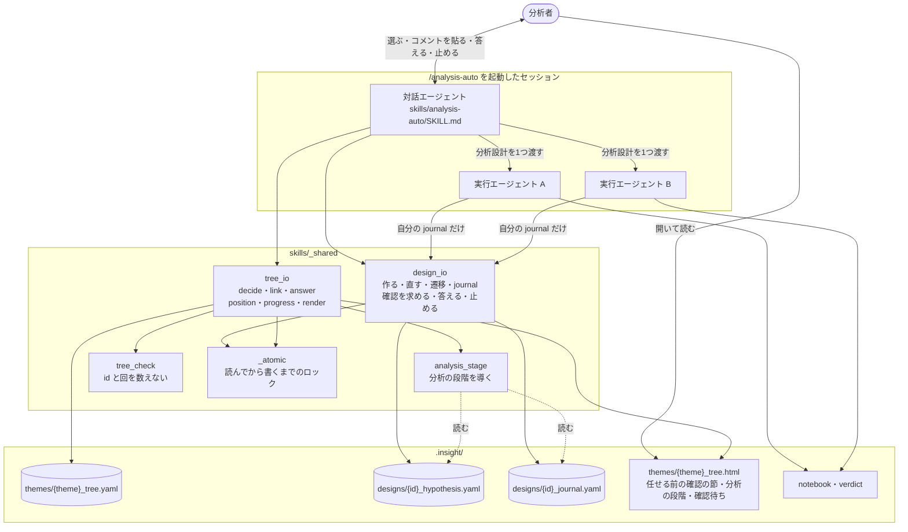
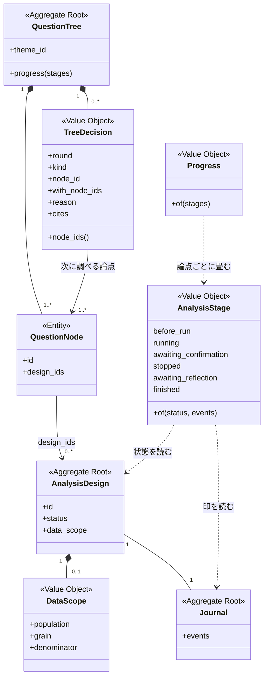
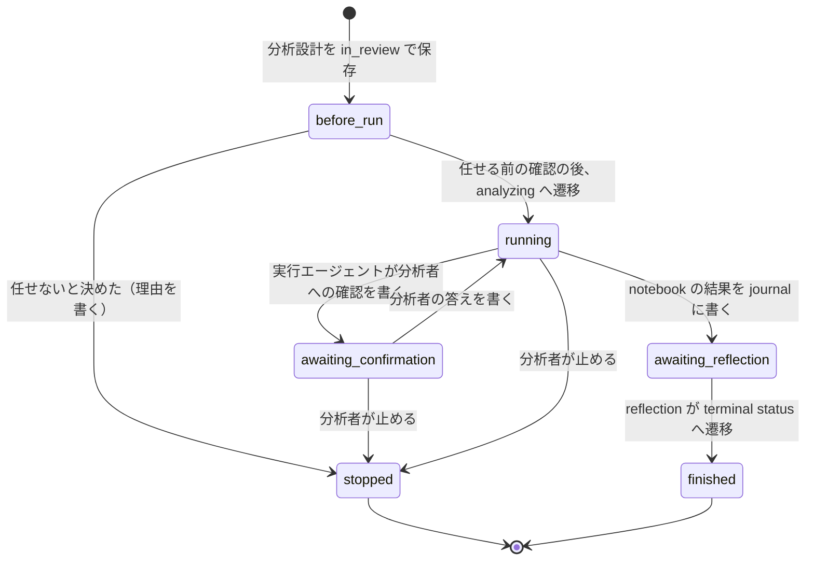
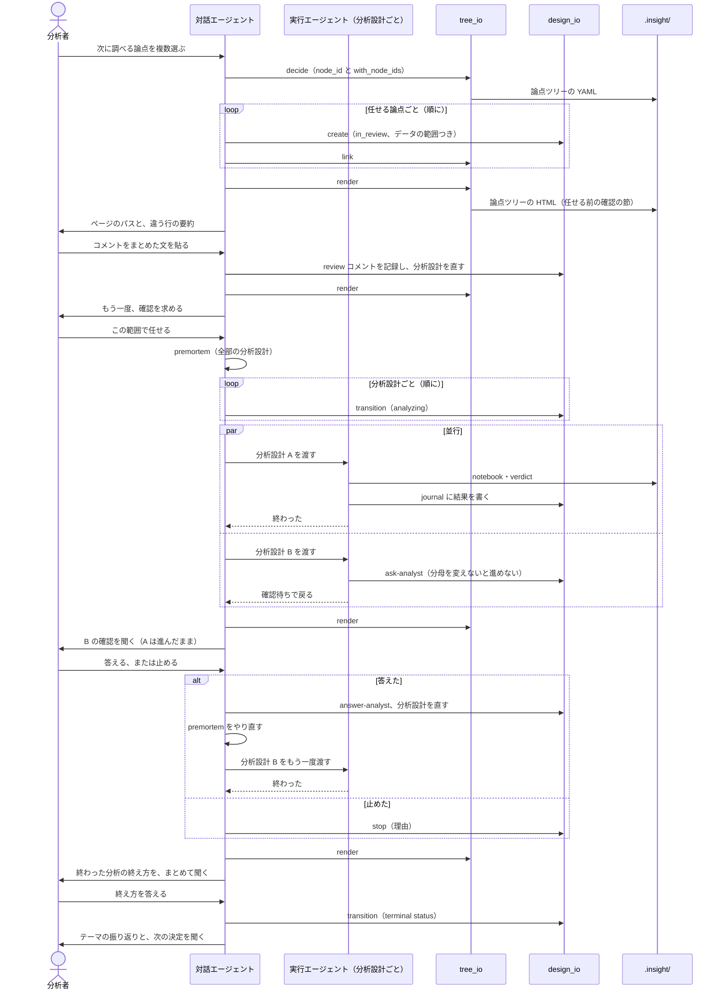

# Epic 35: 互いを待たない論点をまとめて任せて、まとめて戻る

## Background

本書がこの Epic の要求と背景の正本（[FLOW-0001](../adr/flow/0001-designdoc-owns-requirements.md)）。
Epic issue（[#284](https://github.com/etoyama/insight-blueprint-skills/issues/284)）には要約と本書へのリンクだけを置く。

- 解く課題: 分析者は `/analysis-auto` で論点を1つずつ調べる。論点を選び、分析設計を4回に分けて確かめ、結果を振り返り、次の論点を決める。
  調べたい論点が3つあると、互いの結果を待たない論点でも、この流れを3回くり返す。実データのテーマで数えると、止まる回数は約29回の見込みだった。
  分析者が1回1回の確認で読む中身は必要なものである（[ADR-0007](../adr/0007-upstream-judgment-gates.md)）。減らしたいのは読む中身ではなく、止まる回数である。
  - 課題1: 互いの結果を待たない論点でも、まとめて任せる手段が無い。論点ツリーの決定は論点を1つしか指せず、巡回の現在地も最新の決定の論点しか見ない。
    3つ任せても、記録と表示に残るのは1つである。
  - 課題2: 分析設計の確認は、分析設計ごとに4回止まる。3つで12回になる。並べて読めないので、分析設計の間で粒度や分母が違うことに気づきにくい。
  - 課題3: 任せた後、分析がどこまで進んだかを見分けられない。走っている分析も、計算が終わって振り返りを待つ分析も、論点ツリーには「検証中」と出る。
  - 課題4: 任せた後に、分析者が読んでいない抽出や分母で走らせない決まりが無い。進行中の分析を1つだけ止める手段と、止めた理由を残す所も無い。
  - 課題5: 分析を並行で走らせると、記録が黙って消える。分析設計の id が重なり、論点への結び付けが消える。
  - 課題6: 論点ツリーの決定の理由や答えの文に、論点の id や「2回目の振り返り」と書くと、根拠に無い数として拒まれる
    （[#277](https://github.com/etoyama/insight-blueprint-skills/issues/277)）。まとめて任せると、理由に複数の論点の id を書きたくなる。
  - 課題7: 分析設計は、対象・粒度・分母を書く項目を持たない。確認のときにチャットで言うだけで、記録に残らない。
- PRD の要件: [docs/PRD.md](../PRD.md) のコアバリュー「分析設計」「journal / reflection」と、非機能要件「分析者に届く数と結論は、記録に書いてあるものに限る」。
- 既存手段が不十分な理由: [ADR-0026](../adr/0026-analysis-auto-walks-the-question-tree.md) は巡回を「論点を1つ調べるひと回り」と決めた。
  1つずつ調べる前提で、決定・現在地・進捗・書き込みの全部が作られている。

### 起票の経緯

親の issue は [#250](https://github.com/etoyama/insight-blueprint-skills/issues/250)（合意した複数の論点をまとめて任せ、論点ツリーの上で進み具合と次の候補を見る）である。
人間は #250 を分け、前半をこの Epic にした（2026-11-26）。

- この Epic: 互いを待たない論点をまとめて任せて、まとめて戻る。#277 を含める。
- 次の Epic: 前の分析の結果を使う分析、次に調べる論点の候補、戻ったときに図を並べて見る場所と選ぶ画面、[#271](https://github.com/etoyama/insight-blueprint-skills/issues/271)。
- その次: [#251](https://github.com/etoyama/insight-blueprint-skills/issues/251)・[#236](https://github.com/etoyama/insight-blueprint-skills/issues/236)。

初版の途中で、範囲を削る案を人間に出した（コメント欄を次へ回す、終え方をまとめて聞くのを次へ回す、任せた後の確認と止めることを次へ回す）。
人間は削らないと決めた（2026-11-27）。

### 前提にした事実

着手前に、PM のセッションが今の skill（v0.21.0）のまま「まとめて任せる」流れを2回通した（2026-11-26）。
1回は図書館の合成シナリオで CLI を直接呼び、1回は実データのテーマでサブエージェントに実行させた。実データの値は本書に書かない。
初版では、図書館の合成シナリオで案を試した（2026-11-27）。

- 実データで止まった回数は3回だった（論点を選ぶ、横に並べた確認、振り返りと次の決定）。今の skill のまま3つの巡回に分けると、約29回の見込みである。
- 待ちの大半は分析者の確認で、計算ではない。互いを待たない2つの分析は同時に始まり、約1分半で終わった。
- `design_io` で分析設計を2プロセス同時に作ると、20回中20回、同じ id になって片方が上書きされた。
  `tree_io` で論点に同時に結ぶと、20回中20回、片方の結び付けが消えた。今のロックは書き戻す一瞬だけに掛かる（`skills/_shared/_atomic.py`）。
  読んでから書くまでをロックで囲むと、どちらも20回中0回になった。
- 親がツリーと分析設計を順に書き、サブエージェントが自分の notebook と journal だけを書く分け方では、ぶつからなかった。
  ただし `/analysis-notebook` の Step 7 が論点ツリーの HTML を書き直す。サブエージェントの1人は、指示に反してこれを走らせた。
- `tree_io position` は、片方の分析設計が終わると、もう片方が `analyzing` でも `concluded` と返した。
- `TreeDecision` に既定値つきの項目を足しても、保存済みの論点ツリーは読め、書き戻しても同じ内容になった。
- 決定が指す論点の並びを読み、分析設計の状態と journal だけから、進行中・確認待ち・止めた・振り返り待ち・終わったを導けた（試作）。
- 決定の理由に論点の id を書くと、id の数字が拒まれた。答えの文の「率比が1を超える」の 1 も拒まれた。後者は、その値を書いた出来事を根拠に足して通した。
- premortem は抽出の行数を見積もり、`.insight/config.yaml` の `static_rows_high` を超えると `HIGH` で止まる。金額や時間の上限は無い。
- `AnalysisDesign` と `Methodology` は、対象・粒度・分母の項目を持たない（`src/insight_blueprint/models/design.py` を読んだ）。
- 論点ツリーの HTML は script を持たない。人間がデスクトップアプリのペインで試作を試すと、ボタンでクリップボードには入らず、ページに出た文は手でコピーできた。
- 確かめていないこと: 分析設計3つぶんを、分析者が1回で読み切れるか。確認待ちが実際にどのくらい出るか（手で通した2回では0回）。
  ロックを待つ時間が実際の分析で気になるか。

## User Stories

AC の正本はここ。

本書は、分析者と話す側と、分析を実行する側を次の語で呼ぶ（人間が選んだ、2026-11-27）。

- 対話エージェント: `/analysis-auto` を起動したセッションの Claude。分析者と話し、任せ、記録を書く。
- 実行エージェント: 対話エージェントが分析設計を1つ渡して実行させるサブエージェント。

### US-1: 分析者が、互いを待たない論点をまとめて選んで任せられる

分析者として、止まる回数を減らすために、互いの結果を待たない論点を1回の決定でまとめて選び、任せたい。

- [ ] AC 1: 論点ツリーの決定は、次に調べる論点に加えて、一緒に任せた論点を0個以上持てる。一緒に任せた論点は論点ツリーにある論点で、互いにも、次に調べる論点とも重ならない。区切る決定は持てない。
- [ ] AC 2: 一緒に任せた論点を持たない保存済みの論点ツリーは、そのまま読める。読んで書き戻しても、内容は変わらない。
- [ ] AC 3: 巡回の現在地は、最新の決定が指す全部の論点について、結んだ分析設計と、その分析の段階を返す。終わっていない分析が1つでもあれば、巡回が終わったとは返さない。
- [ ] AC 4: 決定の種類の検査は、前の決定が指した全部の論点を基準にする。深めるはそのどれかの中へ進み、親に戻るはそのどれの中でもない所へ進み、区切るはそのどれかで区切る。
- [ ] AC 5: 対話エージェントは、論点を選ぶ場面で複数の論点を選ばせる。別の論点の結果を入力に使う論点は一緒に任せず、その理由を分析者に言う。

### US-2: 分析者が、任せる前に1回、分析設計を横に並べて読み、コメントを返せる

分析者として、実行の前に読んで直せることを保ったまま止まる回数を減らすために、任せる分析設計を1ページに並べて読み、分析設計ごとにコメントを返したい。

- [ ] AC 1: 対話エージェントは、任せる分析設計を `in_review` で保存し、論点に結んでから、分析者に確認を求める。確認の前には、premortem も回さず、データにも触らない。
- [ ] AC 2: 論点ツリーの HTML は、最新の決定が指す論点に結んだ実行前の分析設計を、列に並べた節を持つ。行は、意図、何に答えるか（探索は探索の問い、検証は検証仮説）、判定の基準、対象、粒度、分母、データソース、手法、主指標、抽出、図である。抽出は全文を読める。
- [ ] AC 3: 同じ行の値が分析設計の間で違うとき、コードがその行に印を付ける。印が付くのは対象・粒度・分母・データソースの行である。対話エージェントは、印の付いた行をチャットにも要約して出す。
- [ ] AC 4: 節は分析設計ごとのコメント欄を持つ。分析者が書いたコメントを、分析設計の id を添えた1つの文にまとめて、ページに出す。ページは外へ何も送らない。
- [ ] AC 5: 分析者が貼ったコメントを、対話エージェントは分析設計ごとに review コメントとして記録し、分析設計を直し、節を作り直してもう一度確認を求める。任せないと決めた分析設計は、理由つきで止める。

### US-3: 分析者が、論点ツリーの上で、分析ごとの段階と自分が返す確認を読める

分析者として、席を外している間と戻ったときに次にすることを知るために、論点ツリーで、どの分析がどの段階にあり、どれが自分の確認を待っているかを読みたい。

- [ ] AC 1: 分析の段階は保存しない。分析設計の状態と journal から導き、実行前・進行中・あなたの確認待ち・止めた・振り返り待ち・終わった、を見分ける。規則は1か所にある。
- [ ] AC 2: 論点ツリーの HTML は、論点に結んだ分析設計ごとに、分析の段階を言葉と色で出す。色だけでは伝えない。止めた分析には理由を、確認待ちの分析には何を確認したいかを添える。
- [ ] AC 3: ページは、分析者の確認を待つ分析を冒頭に抜き出す。無いときは抜き出しの欄を出さない。
- [ ] AC 4: 論点の進捗は、未着手・検証中・分析済み・止めた、の4つになる。結んだ分析設計が全部止めた論点は「止めた」と出し、止めた以外の分析設計が1つでもあれば、止めた分析設計を数えずに決める。ページ、`tree_io position`、`tree_io progress`、レポート、skill が分析者に伝える進み具合は、同じ規則を使う。
- [ ] AC 5: ページの「次に調べる論点」と決定の一覧は、決定が指す全部の論点を出す。

### US-4: 分析者が読んでいない内容でデータに触らず、分析を1つずつ止められる

分析者として、任せた後も判断を手放さないために、読んだ内容を変える前に聞かれ、進行中の分析を1つだけ止められるようにしたい。

- [ ] AC 1: 実行エージェントは、任せる前に分析者が読んだ内容（対象、粒度、分母、抽出、データソース、主指標、判定の基準）を変えないと進めないとき、データに触る前に止まり、分析者への確認を自分の journal に書いて戻る。
- [ ] AC 2: 確認を待つ間、止まるのはその分析だけである。ほかの分析は進む。
- [ ] AC 3: 分析者の答えは、その分析設計の journal に、どの確認への答えかを添えて残る。答えの付いた確認は、未解決の問いに数えない。抽出を変えたら、実行の前に premortem をやり直す。
- [ ] AC 4: 分析者は進行中の分析を1つだけ止められる。止めた分析は、止めた理由を journal に持ち、論点ツリーに「止めた」と出る。止めた分析は再開せず、やり直すときは派生で別の分析設計を作る。
- [ ] AC 5: 確認と、その答えと、止めた理由の印は、`design_io` の専用の命令だけが書く。

### US-5: 並行で書いても、記録が黙って消えない

分析者として、任せた分析の記録を信じるために、複数の分析が同時に走っても、分析設計・論点ツリー・journal が欠けないでほしい。

- [ ] AC 1: `design_io` と `tree_io` の書き込みは、読んでから書き戻すまでを1つのロックで囲む。2つのプロセスが同時に分析設計を作っても、id は重ならない。同時に論点へ結んでも、どちらの結び付けも残る。
- [ ] AC 2: まとめて任せた実行では、論点ツリー、分析設計、論点ツリーの HTML を書くのは対話エージェントだけである。実行エージェントが書くのは、自分の notebook・verdict・journal だけである。
- [ ] AC 3: まとめて任せた実行では、論点ツリーの HTML は、対話エージェントが実行エージェントの戻りのたびに書き直す。単独で起動した `/analysis-notebook` は、今までどおり自分で書き直す。

### US-6: 分析者が、理由と答えの文に、論点の id と振り返りの回を書ける

分析者として、まとめて任せた理由を自然に書くために、論点や分析設計の id と「N回目の振り返り」を、根拠に無い数として拒まれずに書きたい。

- [ ] AC 1: ツリーの検査は、論点ツリーにある論点の id と、論点に結んだ分析設計とその出来事の id を、数として数えない。
- [ ] AC 2: ツリーの検査は、「N回目の振り返り」の N を、N が今の振り返りの回以下のときだけ、数として数えない。
- [ ] AC 3: それ以外の数は、今までどおり、根拠にした出来事の本文に無ければ拒む。論点ツリーに無い id の数字、比べる相手の値（「1を超える」の 1）、まだ無い回の数も拒む。
- [ ] AC 4: 数を拒んだとき、`tree_io` は直し方を言う。その値を書いた出来事を根拠に足すか、文から数を外す。

### US-7: 分析者が、分析設計に対象・粒度・分母を書いて残せる

分析者として、何を数える分析かを後から読めるようにするために、対象・粒度・分母を分析設計の項目として残したい。

- [ ] AC 1: 分析設計は、対象・粒度・分母の組を任意で持てる。持つときは3つとも空でない。持たない保存済みの分析設計は、そのまま読める。
- [ ] AC 2: まとめて任せる分析設計は、この組を持つ。持たない分析設計は、任せる前の確認に進めない。
- [ ] AC 3: 分析ノートは、この組を手法の近くに出す。

### 分析者に見せる言葉

内側と画面で言葉が違う語。文書・コード・テストは左の列、分析者に見せる文は右の列を使う。画面の言葉は `skills/_shared/tree_words.py` に置く。
右の列は初版の案で、人が実物の画面を読む段（[FLOW-0019](../adr/flow/0019-human-reads-real-screen-after-first-display-story.md)）で確かめる。

| 内側の用語（文書・コード） | 分析者に見せる言葉 |
|---|---|
| 任せる前の確認 | 分析を任せる前の確認 |
| 分析設計の間で値が違う行の印 | 分析間の違い |
| 抽出の行（SQL は `methodology.steps` のクエリの全文、CSV などはファイル・列・絞り込み） | 抽出・加工条件 |
| 一緒に任せた論点 | 使わない。「次に調べる論点」に、決定が指す全部の論点を並べる |
| 分析の段階: 実行前（`before_run`） | 任せる前 |
| 分析の段階: 進行中（`running`） | 進行中 |
| 分析の段階: 確認待ち（`awaiting_confirmation`） | あなたの確認待ち |
| 分析の段階: 止めた（`stopped`） | 止めた |
| 分析の段階: 振り返り待ち（`awaiting_reflection`） | 計算が終わり、振り返りを待っている |
| 分析の段階: 終わった（`finished`） | 終わった |
| 対話エージェント、実行エージェント | エージェント |
| データの範囲 | 使わない。対象・粒度・分母をそれぞれの行に出す |

## Stories

Story は仮の分割で、起票は PM のセッションが行う。「触る所」が重なる Story は同じ波に置かない。

| Story | 波 | User Story | 扱う AC | 触る所 | 前提 |
|---|---|---|---|---|---|
| 35.1 id と振り返りの回を数えない | 1 | US-6 | AC 1, AC 2, AC 3, AC 4 | `skills/_shared/tree_check.py`（`numbers_in`、`_cite_problems`）、`skills/_shared/tree_io.py` の違反を返す所の文、`skills/analysis-reflection/SKILL.md` の数の書き方の表、`tests/test_tree_check.py`、`tests/tree_io/`、`docs/UBIQUITOUS_LANGUAGE.md` のツリーの検査 | — |
| 35.2 書き込みのロック、分析の段階、確認と止める命令、データの範囲 | 1 | US-5、US-3、US-4、US-7 | US-5 AC 1（`design_io` の分）、US-3 AC 1、US-4 AC 5、US-7 AC 1, AC 3 | `skills/_shared/_atomic.py`（ロックの helper）、`skills/_shared/design_io.py`、`skills/_shared/analysis_stage.py`（新規）、`src/insight_blueprint/models/design.py`（`DataScope`）、`skills/_shared/design_note.py`・`design_note_read.py`（データの範囲を出す）、`skills/analysis-journal/SKILL.md` の metadata の表、`tests/`、`docs/UBIQUITOUS_LANGUAGE.md` | — |
| 35.3 決定が複数の論点を指し、現在地が全部を返す | 2 | US-1、US-5、US-3 | US-1 AC 1, AC 2, AC 3, AC 4、US-5 AC 1（`tree_io` の分） | `src/insight_blueprint/models/tree.py`（`TreeDecision`、`_check_decision_after`、`Progress`、`QuestionTree.progress`）、`skills/_shared/tree_io.py`（`decide` と書き込みの全部）、`skills/_shared/tree_read.py`（`position`、`progress`）、`docs/ARCHITECTURE.md`、`docs/UBIQUITOUS_LANGUAGE.md`（「論点ツリーの決定」への改名を含む）、`.yomiyasu-words/`、`tests/test_tree_models.py`、`tests/tree_io/` | 35.2 |
| 35.4 分析の段階と確認待ちを論点ツリーに出す | 3 | US-3 | AC 2, AC 3, AC 4, AC 5 | `skills/_shared/tree_words.py`、`skills/_shared/tree_render.py`・`tree_render_parts.py`・`_html.py`、`skills/_shared/design_note.py` の `_progress`、`skills/_shared/tree_read.py` の `render` と `_theme_report`、`skills/_shared/theme_report.py`、`scripts/handoff_trial.py`、`tests/test_tree_render.py`、`tests/test_theme_report.py`、`tests/tree_io/test_render*.py` | 35.3 |
| 人が実物の画面と言い回しの一覧を読む（FLOW-0019） | 3 の後 | — | — | 合成シナリオで作った論点ツリーの HTML と、`tree_words.py` から抜き出した言い回しの一覧 | 35.4 |
| 35.5 任せる前の確認の節とコメント欄 | 4 | US-2 | AC 2, AC 3, AC 4 | `skills/_shared/tree_render_handover.py`（新規）、`skills/_shared/tree_render.py`、`skills/_shared/tree_words.py`、`skills/_shared/tree_read.py` の `render`、`tests/test_tree_render_handover.py`（新規）、`tests/tree_io/test_render*.py` | 人が画面を読む段 |
| 35.6 まとめて任せる流れ | 5 | US-1、US-2、US-5、US-7 | US-1 AC 5、US-2 AC 1, AC 5、US-5 AC 2、US-7 AC 2 | `skills/analysis-auto/SKILL.md`、`skills/analysis-framing/SKILL.md` の 4b と 4d、`skills/analysis-reflection/SKILL.md` の Step T7、`skills/analysis-design/SKILL.md`、`tests/skills/` | 35.5 |
| 35.7 任せた後の確認、止めること、まとめて戻ること | 6 | US-4、US-5 | US-4 AC 1, AC 2, AC 3, AC 4、US-5 AC 3 | `skills/analysis-auto/SKILL.md`、`skills/analysis-notebook/SKILL.md` の Step 7、`skills/premortem/SKILL.md`、`skills/_shared/design_note_read.py`（答えの付いた確認を未解決の問いから外す）、`tests/skills/`、`tests/test_design_note*.py`、`docs/ARCHITECTURE.md` の guided autopilot のシーケンス | 35.6 |

- 波 1 は 35.1 と 35.2 で、並行で進められる。35.1 は `tree_check` と `tree_io`、35.2 は `design_io` と分析設計のモデルで、触る所は重ならない。
  用語集は2つとも触る。35.1 は「ツリーの検査」の行、35.2 は足す行だけを触る。
- 35.3 は 35.2 のロックの helper と分析の段階の規則を使う。35.4 と 35.5 はどちらも `tree_render.py` と `tree_words.py` を触るので、順に進める。
  35.6 と 35.7 はどちらも `skills/analysis-auto/SKILL.md` を触るので、順に進める。
- 人が実物の画面を読む段は 35.4 の後に置く。画面に言葉を出す 35.5 と、skill が分析者に出す文を書く 35.6・35.7 は、この段の後に始める。
- 「検証中」（論点の進捗）と「進行中」（分析の段階）が同じページに並ぶ。言葉を揃えるかは、人が実物の画面を読む段で人間が決める。
- 戻ったときに、終わった分析の終え方をまとめて聞くことは、この Epic に入れる（人間の判断、2026-11-27）。聞き方は 35.7 が `/analysis-auto` の文で決め、`/analysis-reflection` の Step 3 は変えない。
  変える必要が出たら、35.7 は手を付ける前に PM のセッションに送る。
- 論点ごとの進み具合と巡回の現在地は、次の所が出している。規則を変える 35.3 と、言葉を出す 35.4・35.6 は、この全部を同じ規則に揃える。
  規則は `models/tree.py` の `Progress.of`・`QuestionTree.progress`。コマンドは `tree_read.progress`・`tree_read.position`。
  画面は `tree_render.py`・`tree_render_parts.py`・`design_note.py` の `_progress`、言葉は `tree_words.py` の `PROGRESS_WORDS`。レポートは `tree_read._theme_report` と `theme_report.py`。
  skill の文は `analysis-auto`（Step 1 の表、Step 3 の 9）、`analysis-framing`（4c、4d）、`analysis-reflection`（Step T1 と末尾の命令の表）、`knowledge-extract`。
- どの Story も `CHANGELOG.md` の `[Unreleased]` に1行足す。重なるのはそこだけである。
- 用語集は、コード上の名前を入れた Story が直す（名前が実在することをテストが確かめる）。

Story が使う既存の helper（作り直さない）。

| ほしいもの | 既にある所 |
|---|---|
| 合成シナリオを通して HTML を作る | `scripts/handoff_trial.py` の `Scenario`・`build`（`uv run python -m scripts.handoff_trial build --scenario lib --out <dir>`）。題材は `tests/fixtures/handoff/lib/` と `psy/` |
| 画面の言葉を置く所と、言葉を確かめるテスト | `skills/_shared/tree_words.py`、PR #283 でまとめたテスト |
| SKILL.md と文書の構造テスト | `tests/skills/`（`_auto.py`、`_markdown.py`、`_shown.py`）、[ADR-0010](../adr/0010-skill-tdd-structure-tests.md) |
| 書き込みを原子的にする | `skills/_shared/_atomic.py` の `atomic_write_yaml`・`atomic_write_text` |
| 分析設計の id を振る、journal に出来事を足す | `design_io.next_design_id`、`design_io.append_journal_event` |
| 論点とその下の論点に結んだ分析設計 | `QuestionTree.designs_by_branch()`、`QuestionTree.linked_designs()` |
| 文の数を引用先と照らす | `tree_check.numbers_in`、`tree_check._cite_problems` |
| 書く前に検査して、違反なら書かない | `tree_io.answer`・`tree_io.decide`（`_checked`・`_save`） |
| 分析ノートを論点ツリーの HTML に並べる | `tree_read.render`、`design_note.render_note` |
| 表示のテストの道具 | `tests/tree_io/_support.py`、`tests/tree_io/conftest.py`、`tests/test_tree_render.py` |

## Ubiquitous Language

この Epic で追加・変更する語。定義の正本は [docs/UBIQUITOUS_LANGUAGE.md](../UBIQUITOUS_LANGUAGE.md) で、表は名前を入れた Story が直す。

- 追加: 一緒に任せた論点（`with_node_ids`）、分析の段階（`AnalysisStage`）、任せる前の確認、分析者への確認（`ask-analyst`）、対話エージェント（`driver`）、実行エージェント（`worker`）、データの範囲（`DataScope`、`data_scope`）
- 変更: 進捗（「止めた」を足し、分析の段階から導く）、論点ツリーの決定（「ツリーの決定」から改名。一緒に任せた論点を持てる。[ADR-0061](../adr/0061-a-tree-decision-may-hand-over-several-questions-and-the-stage-is-derived.md)）、
  巡回（論点を1つ以上調べるひと回り）、巡回の現在地（決定が指す全部の論点を返す）、
  ツリーの検査（id と振り返りの回を数えない。[ADR-0065](../adr/0065-ids-and-reflection-rounds-are-not-counted-as-numbers.md)）、
  未解決の問い（答えの付いた分析者への確認を数えない）、guided autopilot と KEEP ゲート（任せる前の確認と、任せた後の確認）
- 使わない: ツリーの決定、親（対話エージェントを指すとき）、子・サブエージェント（実行エージェントを指すとき）、ボード（論点ツリーの表示を指すとき）

## Scope

[docs/PRD.md](../PRD.md) のコアバリュー「分析設計」「journal / reflection」を前進させる。
[docs/ARCHITECTURE.md](../ARCHITECTURE.md) では、Question tree（`TreeDecision`、`tree_io position`、`tree_io render`、`tree_check`）、
YAML I/O（`design_io` の書き込みと、分析設計のモデル）、Skill layer（`/analysis-auto` と、それが動かす skill）を直す。

- Epic 範囲内:
  - 論点ツリーの決定が複数の論点を指すことと、分析の段階を導くこと（[ADR-0061](../adr/0061-a-tree-decision-may-hand-over-several-questions-and-the-stage-is-derived.md)）。
  - 並行の書き込みの分担とロック（[ADR-0062](../adr/0062-only-the-dialogue-agent-writes-shared-records-and-read-to-write-is-locked.md)）。
  - 任せる前の確認を、手元の HTML に並べて見せること（[ADR-0063](../adr/0063-designs-to-hand-over-are-saved-then-read-side-by-side-on-the-page.md)）。
  - 任せた後の確認の条件と、1つずつ止めること（[ADR-0064](../adr/0064-a-handed-over-analysis-asks-before-changing-what-was-read-and-can-be-stopped.md)）。
  - ツリーの検査が id と振り返りの回を数えないこと（[ADR-0065](../adr/0065-ids-and-reflection-rounds-are-not-counted-as-numbers.md)、#277）。
  - 分析設計がデータの範囲を持てること（[ADR-0066](../adr/0066-a-design-may-state-its-population-grain-and-denominator.md)）。
- Epic 範囲外:
  - 前の分析の結果を入力に使う分析を一緒に任せること。次に調べる論点の候補をエージェントが出すこと。戻ったときに図を並べて見る場所と、選ぶ画面。#271。次の Epic に委ねる。
  - 任せた確認（機械か別のモデルが確かめるもの）と、どの分析が同じデータを使うかの表示。#251 と #236 に委ねる。
  - セッションをまたぐ実行。実行エージェントは同じセッションの中のサブエージェントに限る。
  - Artifact に置いた表示を更新する手段（#216）。任せる前の確認は手元の HTML で見せるので、要らない。
  - 金額・読むバイト数・時間の上限。費用は premortem の行数の線で見る（ADR-0064）。
  - 比べる相手の値（「1を超える」の 1）を、根拠に足さずに書けるようにすること。実データで使う段で頻度を見てから考える（ADR-0065）。
  - 止めた分析を、同じ分析設計のまま再開すること（ADR-0064）。
  - 決定の言葉「親に戻る」が、親でない論点へ移るときにも出ること。見つけた事実として issue に書く。
  - 別のワークツリーで、同じ id が別の分析設計を指すこと。id はワークツリーの中でだけ一意である。
- 触らない所:
  - `DesignStatus` と `VALID_TRANSITIONS`（理由: 分析の段階は導く。値を足すと、検査・遷移・表示の全部に場合分けが入る。ADR-0061）。
  - journal の出来事の種類の一覧（理由: 確認と止めた理由は、今ある `question` と `decide` に印を付けて書く。種類を足すと、種類の一覧を持つ所の全部に波及する。ADR-0064）。
  - `tree_check` が数を比べる規則（`numbers_in` の符号と値の比べ方、理由: 守りを緩めない。数えないものを先に除くだけにする。ADR-0065）。
  - `TreeDecisionKind`（理由: 種類は4つのままで足りる。一緒に任せた論点は種類を持たない。ADR-0061）。
  - `/analysis-design`・`/analysis-notebook`・`/premortem` を単独で起動したときの流れ（理由: 自律は `/analysis-auto` を起動した実行に限る。[ADR-0005](../adr/0005-selective-autonomous-chaining.md)）。
  - 閉じた Epic の DesignDoc と ADR の中の「ツリーの決定」（理由: 閉じた Epic の文書には追記しない。[ADR-0009](../adr/0009-adopt-repo-template-flow.md)）。

## Architecture

- 対話エージェントだけが論点ツリー・分析設計・論点ツリーの HTML を書く。実行エージェントは自分の notebook・verdict・journal だけを書く。
- 正本は論点ツリーの YAML、分析設計、journal である。分析の段階はどこにも保存しない。
- daemon・MCP サーバ・SQLite を足さない。コメント欄はページの中だけで動き、外へ何も送らない。

## Domain Model

| 型 | 種類 | 不変条件 |
|---|---|---|
| `TreeDecision` | 値オブジェクト | `with_node_ids` は論点ツリーにある論点で、互いにも `node_id` とも重ならない。`close` は `with_node_ids` を持たない。既定は空で、持たない保存済みの決定は空として読む |
| `QuestionTree` | 集約ルート | 決定の種類の検査は、前の決定の `node_id` と `with_node_ids` の全部を基準にする。深めるは、そのどれかの中へ進む。親に戻るは、そのどれの中でもない所へ進む。区切るは、そのどれかで区切る |
| `DataScope` | 値オブジェクト | 対象・粒度・分母は3つとも空でない。分析設計は組ごと持つか、持たない |
| `AnalysisStage` | 値オブジェクト | 保存しない。分析設計の状態と journal から、決まった順で1つに決まる（下の State Diagram） |
| `Progress` | 値オブジェクト | 保存しない。未着手・検証中・分析済み・止めた の4つ。結んだ分析設計が全部止めたなら止めた。止めた以外が1つでもあれば、止めた分析設計を数えずに決める |
| `Journal` | 集約ルート | 確認・答え・止めた理由の印は `design_io` の専用の命令だけが書く。答えは、どの確認への答えかを持つ |

### State Diagram

分析の段階（`AnalysisStage`）。保存する状態ではなく、記録から導く値である。矢印は、どの記録が書かれると段階が変わるかを表す。

導く順は次のとおり。上から見て、最初に当たったものになる。

1. 分析設計が terminal status なら、終わった。
2. journal に止めた印があれば、止めた。
3. journal に、答えの付いていない分析者への確認があれば、確認待ち。
4. 分析設計が `analyzing` で、journal に `hearing`・分析者への確認・その答え以外の出来事があれば、振り返り待ち。
5. 分析設計が `analyzing` なら、進行中。
6. それ以外は実行前。

## Sequence Diagram

- 実行エージェントは分析者と話さない。確認は journal に書いて戻り、対話エージェントが分析者に聞く。
- 対話エージェントの書き込みは順に行う。並行で走るのは、実行エージェントの notebook の実行と、自分の journal への書き込みだけである。
- 分析者が止まるのは、論点を選ぶ、任せる前の確認、（あれば）任せた後の確認、終え方、テーマの振り返りと次の決定、である。

## Decisions

### Decision: story-35-1-an-event-id-is-named-by-its-linked-design

- What: ツリーの検査は、出来事の id を、その分析設計が論点ツリーのどこかの論点に結んであれば数えない。journal にその出来事が実際にあるかは見ない。「N回目の振り返り」は、ページが振り返りの回を言う言葉（`tree_words.reflection`）と同じ形だけを読む。
- Why: 引用していない出来事の有無を確かめるには、結んだ分析設計の journal を全部読む必要がある。検査は今、引用した出来事の journal だけを読む（ADR-0058 の「前の決定の journal は読まない」と同じ考え）。
- Criteria: ADR-0065 の W3（守りに新しい穴を開けない）。無い出来事の id（`LIB-H01-E99`）は結果の数を運ばないので、通しても記録に無い結果は届かない。
- Affected modules: `skills/_shared/tree_check.py`、`skills/_shared/tree_words.py`
- Alternatives considered: 結んだ分析設計の journal を全部読み、実在する出来事の id だけを数えない（読む journal が増え、決定の検査が前の記録に引きずられる）。
- Consequences: 無い出来事の id を文に書いても拒まれない。引用の実在は今までどおり `missing-event` が確かめる。

### Decision: story-35-1-answers-still-keep-ids-in-cites

- What: `analysis-reflection` の Step T2 は「id を `text` に書かない」から「日付を書かない」に変え、id とその回は数えないと書いたうえで、出来事の id は `cites` に置くという指示を残す。
- Why: 拒まれる理由は消えたが、分析者が読む答えの文に id は要らない（言葉を分析者向けにする方針）。
- Criteria: ADR-0065 の Decision 5（答えの文と決定の理由に同じ規則）と、分析者に見せる文の書き方。
- Affected modules: `skills/analysis-reflection/SKILL.md`、`tests/skills/test_theme_reflection_structure.py`
- Alternatives considered: 答えの文にも id を勧める（分析者が読む文に id が並ぶ）。
- Consequences: 決定の理由には id を書け、答えの文はこれまでどおり id を使わずに書く。

### Cross-epic decisions (links to ADR)

- [ADR-0061: 論点ツリーの決定は一緒に任せた論点を持てて、分析の段階は記録から導く](../adr/0061-a-tree-decision-may-hand-over-several-questions-and-the-stage-is-derived.md): 決定に `with_node_ids` を足す。分析の段階は保存しない。「ツリーの決定」を「論点ツリーの決定」に改名する。
- [ADR-0062: 論点ツリーと分析設計は対話エージェントだけが書き、読んでから書くまでをロックする](../adr/0062-only-the-dialogue-agent-writes-shared-records-and-read-to-write-is-locked.md): 分担とロックの両方で、並行の書き込みから記録を守る。
- [ADR-0063: 任せる分析設計は先に保存し、ページで横に並べて読む](../adr/0063-designs-to-hand-over-are-saved-then-read-side-by-side-on-the-page.md): 手元の HTML に節を作り、違う行にコードが印を付け、コメント欄を置く。
- [ADR-0064: 任せた分析は、読んだ内容を変える前に聞き、1つずつ止められる](../adr/0064-a-handed-over-analysis-asks-before-changing-what-was-read-and-can-be-stopped.md): 条件は原則1つ。確認と止めた理由は journal に、専用の命令から書く。
- [ADR-0065: ツリーの検査は、id と振り返りの回を数として数えない](../adr/0065-ids-and-reflection-rounds-are-not-counted-as-numbers.md): 数えないのはこの2つだけで、比べる相手の値は今までどおり拒む。
- [ADR-0066: 分析設計は、対象・粒度・分母を持てる](../adr/0066-a-design-may-state-its-population-grain-and-denominator.md): 任意の組として足し、まとめて任せる分析設計では必須にする。

## Test Design Matrix

| Story \ Layer | Unit | Integration | E2E |
|---|---|---|---|
| Story 35.1 | ✓ | ✓ | —（表示の通し道は変えていない。ページの違反は同じ `check_cited` を通る。`tree_io decide` は合成シナリオ（`scripts.handoff_trial build --scenario lib`）で、id と「2回目の振り返り」が通り、「1を超える」の 1・まだ無い回・ツリーに無い id が `fix` つきで拒まれることを、実際に呼んで確かめた） |
| Story 35.2 | ✓ | ✓ | —（skill の流れに入れるのは 35.6・35.7。リポジトリの外の `.insight/` で、2プロセスの `design_io create` を20回（id の重なり0回）、`ask-analyst`・`answer-analyst`・`stop` と分析の段階の移り変わり、`data_scope` を持つ分析設計と持たない保存済みの分析設計が検証 hook を通り分析ノートに出ることを、コマンドで確かめた） |
| Story 35.3 | ☐ | ☐ | ☐ |
| Story 35.4 | ☐ | ☐ | ☐ |
| Story 35.5 | ☐ | ☐ | ☐ |
| Story 35.6 | ☐ | ☐ | ☐ |
| Story 35.7 | ☐ | ☐ | ☐ |

完了時に ✓ を付ける。このマトリクスが Epic PR のレビューゲート。

## Story Timeline

- 2026-11-27 — 初版: 人間が d1〜d5 と、分析設計にデータの範囲を足すことを決めた。範囲を削る案（4つ）は採らなかった。
- 2026-11-27 — 人間が見本（画面1・画面2・言い回しの一覧）を読んだ: 指摘 3 件、すべて画面の言葉で、今直した（分析を任せる前の確認、分析間の違い、抽出・加工条件）。
- 2026-11-27 — 全体の整合: 任せない分析設計は結んでから止める、全部止めた論点の進捗は「止めた」、を人間が決めた。区切る決定の検査の書き漏れを直した。
- 2026-11-27 — 人間が初版を承認した。
- 2026-11-27 — Story 35.1 completed: 論点ツリーの id と今の回以下の「N回目の振り返り」を数として数えない。拒んだ数には `tree_io` が `fix` で直し方を付ける（#285）。
