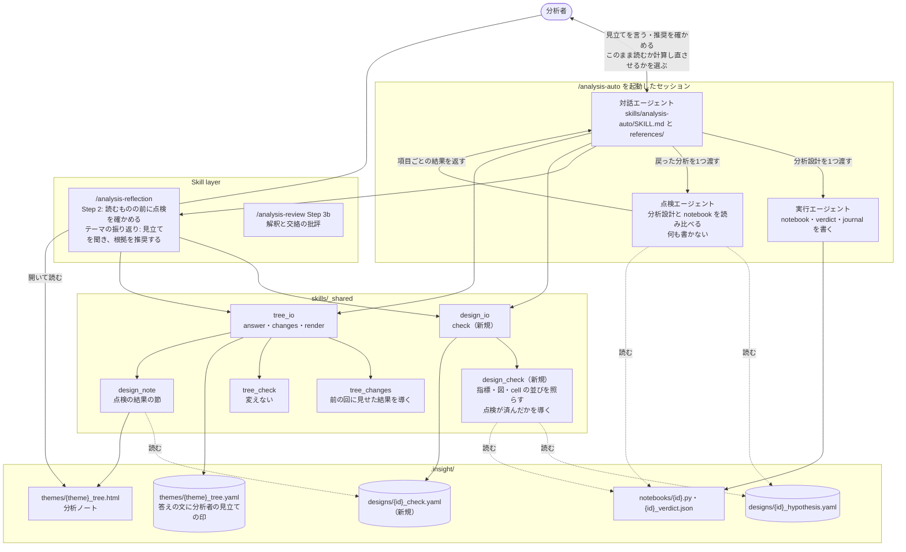
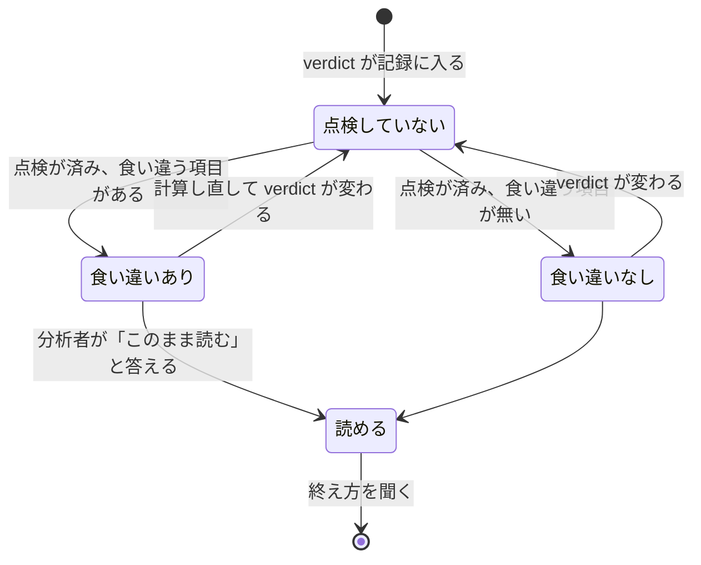
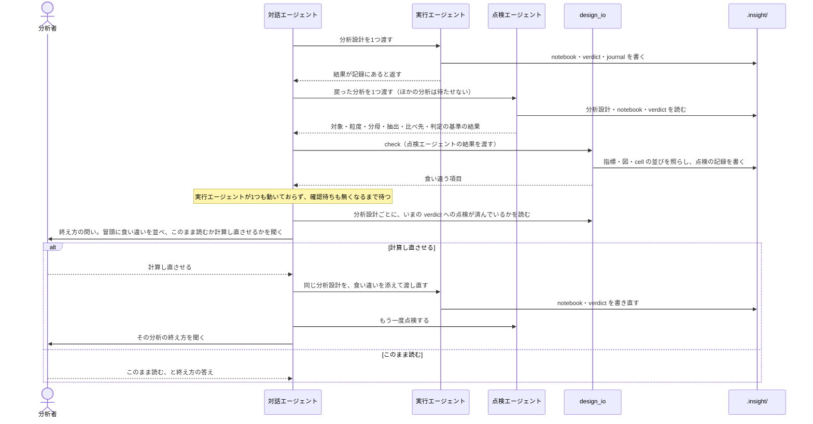
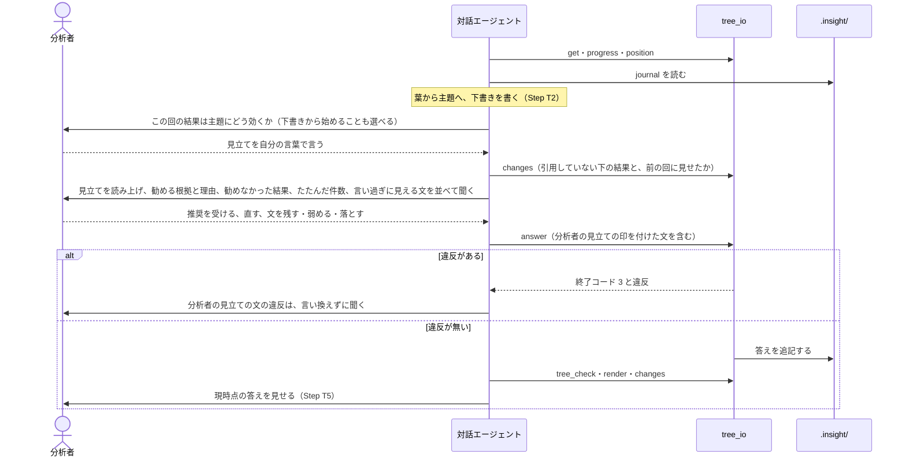

# Epic 36: 分析者が読む前に点検を済ませ、答える前に根拠を推奨する

## Background

本書がこの Epic の要求と背景の正本（[FLOW-0001](../adr/flow/0001-designdoc-owns-requirements.md)）。
Epic issue（[#302](https://github.com/etoyama/insight-blueprint-skills/issues/302)）には要約と本書へのリンクだけを置く。

- 解く課題: 分析者は分析を任せた後に2か所で、エージェントが済ませられる仕事を自分でしている。
  原則は「エージェントが済ませられること（AUTO）は、分析者の判断（KEEP ゲート）より前に済ませる」である。
  - 課題1: notebook が分析設計どおりに計算したかを、どの skill も確かめていない。対象・粒度・分母・抽出が計算と合うかは、
    分析者が分析ノートを読んで自分で気づくしかない。読んで終え方に答えた後に計算の誤りが見つかると、答えそのものが変わる
    （[#297](https://github.com/etoyama/insight-blueprint-skills/issues/297)）。
  - 課題2: 実行エージェントが分析設計に無い指標や比べ先を足しても、分析者は読むまで気づけない。
  - 課題3: テーマの振り返りで、主題の答えの根拠にする分析結果を選ぶ問いが重い。実データのテーマでは41件が平らに並び、推奨が無い。
    前の回に見せて選ばなかった結果も毎回並ぶ（[#298](https://github.com/etoyama/insight-blueprint-skills/issues/298)）。
  - 課題4: 分析者が言いたいのは、分析設計をまたいだ見立て（主題の答えを支える、変える、まだ言えない）である。それを書く場所が無い。
    引用を越える見立てを claim に書くと、次の回のエージェントが決まりに従って直す。
  - 課題5: 前の答えの、根拠より強く言って見える文が残る。黙って書き換えるのはやめたので、分析者に見せて聞く場面が要る
    （[#271](https://github.com/etoyama/insight-blueprint-skills/issues/271)）。
  - 課題6: `analysis-auto`（544 行）と `analysis-reflection`（801 行）の SKILL.md が長い。対話エージェントが毎回全部を読む
    （[#294](https://github.com/etoyama/insight-blueprint-skills/issues/294)）。この Epic は両方に段を足すので、先に分ける。
- PRD の要件: [docs/PRD.md](../PRD.md) のコアバリュー「notebook 契約 & lineage」「journal / reflection」「論点ツリー」と、
  非機能要件「分析者に届く数と結論は、記録に書いてあるものに限る」。
- 既存手段が不十分な理由:
  - 結果のレビュー（`/analysis-review` Step 3b）の観点は、判定の線、値と判定、図、guardrail、cell の5つである。
    対象・粒度・分母・抽出は見ない。しかも受けるかは任意で、終え方に答えるときに選ぶ。
  - [ADR-0025](../adr/0025-cited-answers-checked-after-writing.md) は「答えは人が書く」案を落とし、答えの文をすべてエージェントに書かせた。
    分析者の言葉が残るのは、分析設計ごとの `conclude` と、論点ツリーの決定の理由だけである。
  - [ADR-0056](../adr/0056-answer-changes-are-derived-from-cites-and-shown-on-both-cards.md) は、答えに入れないと決めた結果と、
    まだ見ていない結果を区別しない。「巡回のたびに聞かれて煩わしいと分かったら別の決定で足す」と書いている。それが起きた。

### 起票の経緯

Epic 35（[#284](https://github.com/etoyama/insight-blueprint-skills/issues/284)）の、実データで使う段の findings 13・14 番から起こした。
範囲は人間が決めた（2026-11-28）。軸は #298 で、#297 と #271 を束ね、最初の波に #294 を置く。
含めないものは #272・#279・#280・#292・#293・#295・#296・#299 と、#273 の残りである。

### 前提にした事実

v0.22.0 のコードと SKILL.md を読み、実データのテーマ（Epic 35 で使った round の記録）を読むだけにして試した（2026-11-28）。
実データの値は本書に書かない。

- 答えを書く前の一覧（引用していない下の結果）は、合成シナリオでは1〜2件、実データでは41件だった。合成シナリオでは課題3 の重さが出ない。
- 41件のうち17件は、前の回の一覧にもあった。答えは追記だけで回を持つので、これは論点ツリーだけから導ける。
- 実際の round で分析者が選んだのは13件である。13件とも、この回に初めて一覧に入った24件からで、前から残る17件からは0件だった。
- 種類では推奨を作れない。24件のうち選ばれたのは、`conclude` 3件中3、`evidence` 10件中5、`question` 10件中5、`observe` 1件中0だった。
- 主題の答え13文のうち6文は、2つの分析設計の出来事を引用している。分析設計をまたぐ文は、型の上では書けている。
- Step T2 は、新しい結果が関わらない文でも、「引用した出来事より多くを言う claim」を直させる（`skills/analysis-reflection/SKILL.md`）。
- 論点ツリーの決定には前例がある。理由は分析者の言葉で、根拠はエージェントが探して読み上げ、検査の違反は分析者に聞く
  （[ADR-0058](../adr/0058-a-tree-decision-may-cite-the-events-behind-its-reason.md)）。
- 分析設計の指標は id を持たない。それでも、3つの分析設計の指標11本のうち10本は、verdict に `target` と同じ名前で入っていた。契約ではない。
- 名前を照らすだけで、設計に無い verdict の指標が、1つの分析設計で4本、別の1つで1本見つかった。後者は図の数も分析設計と違った。
- 1つの分析設計と notebook（210 行）を読むと、約3分で、対象・粒度・分母が計算と合うことと、設計に無い比べ先の行が1つあることが分かった。
  `data_scope` は自由な文なので、ここは機械では照らせない。
- 単独の経路（`/analysis-notebook` → `/analysis-reflection`）も、まとめて任せる流れの終え方の問いも、`/analysis-reflection` の Step 2 を通る。
- `design_io stop` は、結果が記録にある分析を止めない（[ADR-0064](../adr/0064-a-handed-over-analysis-asks-before-changing-what-was-read-and-can-be-stopped.md)）。
- 確かめていないこと: エージェントの推奨が、分析者の選ぶ結果とどのくらい合うか。点検エージェントがどのくらい見落とすか。
  計算し直した分析の journal に前の実行の出来事が残ることが、答えの引用を乱すか。どれも実データで使う段で確かめる。

## User Stories

AC の正本はここ。

### US-1: 分析者が、主題の答えを自分の見立てから始められる

分析者として、分析設計をまたいだ見立てを主題に結び付けるために、主題の答えを書く前に、自分の言葉で見立てを言いたい。

- [ ] AC 1: テーマの振り返りは、主題の答えを書く前に、この回の結果が主題にどう効くかを、分析者の言葉で聞く。
  分析者はエージェントの下書きから始めることも選べる。聞くのは主題についてだけである。
- [ ] AC 2: 分析者の見立ては、主題の現時点の答えの文として、分析者の言葉のまま残り、分析者の見立ての印を持つ。
  印を持たない保存済みの答えは、そのまま読める。
- [ ] AC 3: 分析者の見立ての文も、journal の出来事を1つ以上引用し、ツリーの検査を同じ規則で受ける。
- [ ] AC 4: エージェントは、分析者の見立ての文を言い換えない。後の回の振り返りは一字一句そのまま送り、検査の違反は分析者に聞く。
  変えるのは、分析者が変えると言ったときだけである。
- [ ] AC 5: 論点ツリーの HTML とレポートは、分析者の見立ての文に、それと分かる印を出す。

### US-2: 分析者が、根拠を選ぶ代わりに、推奨を確かめるだけで済む

分析者として、帳簿づけを減らすために、主題の答えの根拠にする分析結果を、理由つきの推奨から確かめたい。

- [ ] AC 1: 引用していない下の結果は、前の回の一覧にもあったかを持つ。保存せず、論点ツリーだけから導く。
- [ ] AC 2: 答えを書く前の問いは、この回に初めて一覧に入った結果を、推奨するものとしないものに分け、推奨には理由を1行添える。
  前の回に見せた結果は件数だけを出し、分析者が言えば全部を出す。
- [ ] AC 3: エージェントは、前の回に見せた結果のうち、この回の結果で意味が変わるものを、理由を添えて推奨に上げられる。
- [ ] AC 4: 答えの根拠になるのは、分析者が確かめた結果だけである。推奨をそのまま受けることも、確かめることに当たる。

### US-3: 分析者が、言い過ぎに見える前の答えの文を、書く前に見て決められる

分析者として、古い言い過ぎを残さないために、根拠より強く言って見える文を、答えを書く前に見て、残すか弱めるか落とすかを決めたい。

- [ ] AC 1: 答えを書く前の問いは、前の答えの文のうち、引用した出来事より多くを言って見える文を並べ、残す・弱める・落とすを聞く。
- [ ] AC 2: エージェントは、分析者が答える前に、その文を変えない。
- [ ] AC 3: 分析者の見立ての文は、並べることはできるが、弱めた文をエージェントが作らない。変える文は分析者が言う。

### US-4: 分析者が分析ノートを読む前に、計算の点検が済んでいる

分析者として、読んで答えたことが後から変わらないように、notebook が分析設計どおりに計算したかの点検を、読む前に済ませてほしい。

- [ ] AC 1: 計算の点検は、分析設計ごとに、対象・粒度・分母・抽出・指標・比べ先・図・判定の基準・cell の並びを、
  合っている・食い違う・確かめられないのどれかで記録する。食い違いは根拠にした cell を持つ。
- [ ] AC 2: 指標・図・cell の並びはコードが見る。設計の指標が verdict に同じ名前で無いこと、verdict の指標が設計に無いこと、
  図の数が違うことを食い違いに挙げる。notebook は設計の指標を `target` の名前で verdict に書く。
  設計に無い指標を足すことは、比べ先を足すことと同じに扱い、データに触る前に分析者への確認を書いて戻る。
- [ ] AC 3: 対象・粒度・分母・抽出・比べ先・判定の基準は、その notebook を書いていない点検エージェントが読む。
  点検エージェントを立てられないホストでは同じセッションが読み、誰が点検したかを記録に残す。
- [ ] AC 4: 計算の点検は、分析者に何も聞かずに終わる。記録は `design_io` の命令だけが書き、まとめて任せた実行では対話エージェントだけが書く。
- [ ] AC 5: 計算の点検は点検した verdict を覚える。verdict が変わったら、点検は済んでいないと読む。

### US-5: 分析者が、どの経路でも、食い違いを読む前に知って決められる

分析者として、食い違いを承知で読むか計算し直させるかを選ぶために、食い違いを、終え方を聞かれる前に知りたい。

- [ ] AC 1: `/analysis-reflection` は、読むものを出す前に、いまの verdict への計算の点検が済んでいることを確かめ、無ければ走らせる。
  単独の経路でも、まとめて任せる流れでも同じである。
- [ ] AC 2: まとめて任せる流れは、実行エージェントが戻るたびに、その分析の点検を始める。ほかの分析を待たせない。
- [ ] AC 3: 食い違いが無い分析は、点検が済んだことを1行で言う。食い違いがある分析は、終え方の問いの冒頭に食い違いを並べ、
  このまま読むか、計算し直させるかを聞く。分析者が止まる回数は増やさない。計算し直した分析は、もう一度点検してから終え方を聞く。
- [ ] AC 4: 分析ノートは、計算の点検の結果を結果の値より前に出す。その節は、何と何を見比べたか、誰が見比べたか、
  何を確かめていないか（数の正しさ、分析設計の妥当さ、結果の解釈）を、結果の表より前に文で言う。

### US-6: 結果のレビューが、解釈と交絡の批評に絞られる

分析者として、同じ指摘を2か所で読まないために、結果のレビューには、計算の点検が見ないことだけを批評してほしい。

- [ ] AC 1: 結果のレビューの観点は、値と判定の矛盾、図、guardrail、解釈と交絡（別の説明、言える範囲）である。
  判定の線の写しと cell の並びは、計算の点検が見る。
- [ ] AC 2: 結果のレビューを勧める目安は、判定で終わること（検証）と、数の照合がデータの中の足し上げだけであることの2つである。

### US-7: 対話エージェントが、要る段の SKILL だけを読む

開発者として、SKILL.md を読む負担と直す範囲を小さくするために、長い段を参照ファイルに分けたい。振る舞いは変えない。

- [ ] AC 1: `analysis-auto` のまとめて任せる流れと実行エージェントのブリーフ、`analysis-reflection` のテーマの振り返りは、
  それぞれの `references/` に置き、本文は、いつそれを読むかを言って参照する。
- [ ] AC 2: 構造テストは移した先の文を読む。分ける前と後で、テストが確かめる文は同じである。
- [ ] AC 3: #294 が挙げた2点（`tree_io render --theme` を値なしで呼べる所、進行中のまま別のセッションで再開したときの扱い）を確かめ、
  穴があれば issue にする。この Story では直さない。

### 分析者に見せる言葉

内側と画面で言葉が違う語。文書・コード・テストは左の列、分析者に見せる文は右の列を使う。
右の列は初版の案で、人間が実物の画面を読む段（[FLOW-0019](../adr/flow/0019-human-reads-real-screen-after-first-display-story.md)）で確かめる。

| 内側の用語（文書・コード） | 分析者に見せる言葉 |
|---|---|
| 分析者の見立て | あなたの見立て（チャット）、分析者の見立て（ページとレポート） |
| 見立ての向き | いまの答えを支える・いまの答えを変える・まだ言えない |
| 根拠の推奨 | 根拠に入れることを勧める分析結果 |
| 推奨しない結果 | 勧めなかった、この回の分析結果 |
| 前の回に見せた結果 | 前の回までに見せて、答えに入れなかった分析結果 |
| 言い過ぎに見える文 | 根拠より強く言っているように見える、前の答えの文 |
| 計算の点検 | 分析設計どおりに計算したかの点検。初めて出す所で、「分析設計に書いたことと、分析コードがしている計算が同じかを、エージェントが読み比べること」と言う |
| 点検の結果: 合っている（`agrees`） | 分析設計どおり |
| 点検の結果: 食い違う（`differs`） | 分析設計と違う |
| 点検の結果: 確かめられない（`not_checkable`） | 確かめられなかった |
| 食い違いへの答え | このまま読む・分析設計どおりに計算し直させる |
| cell の並び | 分析コードの区切り |
| 点検エージェント | エージェント |

## Stories

Story は PM のセッションが起票した。「触る所」が重なる Story は同じ波に置かない。

| Story issue | 波 | User Story | 扱う AC | 触る所 | 前提 |
|---|---|---|---|---|---|
| #303 36.1 SKILL を参照ファイルに分ける | 1 | US-7 | AC 1, AC 2, AC 3 | `skills/analysis-auto/SKILL.md` と `references/`（新規）、`skills/analysis-reflection/SKILL.md` と `references/`（新規）、`tests/skills/` の構造テスト | — |
| #304 36.2 分析者の見立ての印と、前の回に見せた結果 | 1 | US-1、US-2 | US-1 AC 2, AC 3、US-2 AC 1 | `src/insight_blueprint/models/tree.py`（`AnswerStatement`）、`skills/_shared/tree_io.py`（`answer`）、`skills/_shared/tree_changes.py`（`UncitedBelow`）、`skills/_shared/tree_read.py`（`changes`）、`tests/test_tree_changes.py`、`tests/tree_io/`、`docs/UBIQUITOUS_LANGUAGE.md`、`docs/ARCHITECTURE.md` の Domain Model | — |
| #305 36.3 見立てを先に聞き、根拠を推奨する | 2 | US-1、US-2 | US-1 AC 1, AC 4、US-2 AC 2, AC 3, AC 4 | `skills/analysis-reflection/references/`（テーマの振り返りの Step T2・T3・T5）、`skills/analysis-auto/SKILL.md` の Gate policy の theme reflection の行、`tests/skills/` | 36.1、36.2 |
| #306 36.4 計算の点検の記録と、コードが見る項目 | 2 | US-4 | AC 1, AC 2, AC 5 | `skills/_shared/design_check.py`（新規）、`skills/_shared/design_io.py`（`check` の命令）、`src/insight_blueprint/models/`（点検の記録の型）、`src/insight_blueprint/validate.py`（手で書かせない）、`skills/analysis-notebook/references/notebook-contract.md`、`skills/analysis-notebook/SKILL.md` の Step 3、`tests/`、`docs/UBIQUITOUS_LANGUAGE.md` | — |
| #307 36.5 読む前の点検の段 | 3 | US-4、US-5 | US-4 AC 3, AC 4、US-5 AC 1, AC 2, AC 3 | `skills/analysis-reflection/SKILL.md` の Step 1・2・3、`skills/analysis-auto/SKILL.md` の Gate policy と `references/`（まとめて任せる流れの return と endings、点検エージェントのブリーフ、実行エージェントのブリーフの止まる条件）、`skills/analysis-notebook/SKILL.md` の Step 7、`tests/skills/` | 36.1、36.4 |
| #308 36.6 言い過ぎに見える文を見せて聞く | 3 | US-3 | AC 1, AC 2, AC 3 | `skills/analysis-reflection/references/`（テーマの振り返りの Step T2・T3）、`tests/skills/test_answer_keeps_its_words_structure.py` | 36.3 |
| #309 36.7 点検の結果と分析者の見立てを画面に出す | 4 | US-1、US-5 | US-1 AC 5、US-5 AC 4 | `skills/_shared/design_note.py`・`design_note_read.py`、`skills/_shared/tree_render_parts.py`・`tree_render_stage.py`・`tree_render_derived.py`、`skills/_shared/tree_words.py`、`skills/_shared/theme_report.py`、`tests/test_tree_render*.py`、`tests/test_design_note*.py` | 36.2、36.4 |
| #310 36.8 結果のレビューを絞る | 4 | US-6 | AC 1, AC 2 | `skills/analysis-review/SKILL.md` の Step 3b、`skills/analysis-reflection/SKILL.md` の Step 4、`docs/UBIQUITOUS_LANGUAGE.md`（結果のレビュー）、`tests/skills/` | 36.5 |
| 人間が実物の画面と言い回しの一覧を読む（FLOW-0019） | 4 の後 | — | — | 合成シナリオで作った論点ツリーの HTML と分析ノート、`tree_words.py` から抜き出した言い回しの一覧 | 36.7 |

- 波 1 は 36.1 と 36.2 で、並行で進められる。36.1 は SKILL.md だけ、36.2 はコードと用語集だけを触る。
- 36.3 と 36.6 は、同じ参照ファイル（テーマの振り返り）を触るので、順に進める。36.5 が触るのは `analysis-reflection` の本文と
  `analysis-auto` の参照ファイルで、36.6 と重ならない。この分け方は 36.1 の分割が前提である。
- 36.5 と 36.8 は、どちらも `skills/analysis-reflection/SKILL.md` の本文を触るので、順に進める。
- 画面を変えるのは 36.7 だけである。人間が実物の画面を読む段は 36.7 の後に置く。チャットの問いの文（36.3・36.5・36.6）は、
  初版の見本で人間が読んだ。
- 見立てのモデル: 36.2・36.3・36.4・36.5 は未決の設計判断が残るので上位のモデル、36.1・36.6・36.7・36.8 は手順がはっきりしているので標準のモデル。
- 合成シナリオでは課題3 の重さが出ない。36.2 と 36.3 のテストは、実データと同じ大きさの木
  （論点7つ、一覧が40件前後、前の回に見せた結果が半分近く）を fixture に足して確かめる。ゲートでは実データで1 round 回す。
- どの Story も `CHANGELOG.md` の `[Unreleased]` に1行足す。重なるのはそこだけである。
- 用語集は、コード上の名前を入れた Story が直す（名前が実在することをテストが確かめる）。

同じ値を出す所。推奨と点検の結果を足す Story は、この全部を同じ規則に揃える（v0.22.0 を `grep` で確かめた）。

| 出す値 | 規則を持つ所 | 出している所 |
|---|---|---|
| 引用していない下の結果と、その分け方 | `skills/_shared/tree_changes.py` の `uncited_below`・`UncitedBelow` | コマンドは `tree_read.changes`（`tree_io changes`）。ページは `tree_render_derived.py` の `left_out_sections`・`_left_out_row` と `tree_render_parts.py`。言葉は `tree_words.py`。チャットは `skills/analysis-reflection/references/theme-reflection.md` の Step T3・T5 |
| 答えの文と、その種類 | `src/insight_blueprint/models/tree.py` の `AnswerStatement` | ページは `tree_render.py`・`tree_render_parts.py`・`tree_render_derived.py`。レポートは `theme_report.py` の `_statements`。分析ノートは `design_note_read.py`。検査は `tree_check.py` |
| 計算の点検の結果（新規） | `skills/_shared/design_check.py`（新規） | 分析ノートは `design_note.py`（`_results` の前）。ページは `tree_render_stage.py` の `stage_notes`。チャットは `/analysis-reflection` の Step 2 と、まとめて任せる流れの endings |
| 結果のレビューの説明と目安 | `skills/analysis-reflection/SKILL.md` の Step 4 | `skills/analysis-auto/references/handover.md`（まとめて任せる流れ）の endings（Step 4 を参照し、写さない）。`skills/analysis-review/SKILL.md` の Step 3b。`docs/UBIQUITOUS_LANGUAGE.md` の「結果のレビュー」 |

Story が使う既存の helper（作り直さない）。

| ほしいもの | 既にある所 |
|---|---|
| 合成シナリオを通して HTML を作る | `scripts/handoff_trial.py` の `build`。題材は `tests/fixtures/handoff/` |
| 画面の言葉を置く所と、言葉を確かめるテスト | `skills/_shared/tree_words.py`、`tests/` の言葉のテスト（PR #283） |
| SKILL.md と文書の構造テスト | `tests/skills/`（`_auto.py`、`_markdown.py`、`_shown.py`）、[ADR-0010](../adr/0010-skill-tdd-structure-tests.md) |
| 専用の命令だけが書く記録と、hook の守り | `design_io ask-analyst`・`answer-analyst`・`stop` と `validate.py`（[ADR-0067](../adr/0067-the-hook-keeps-the-journal-marks-of-design-io.md)） |
| 読んでから書くまでのロック | `skills/_shared/_atomic.py` の `write_lock` |
| verdict と notebook の cell を読む | `skills/_shared/design_note_read.py`、`skills/_shared/verdict_table.py` |
| 答えの変化と、引用していない下の結果 | `skills/_shared/tree_changes.py` |
| 書く前に検査して、違反なら書かない | `tree_io.answer`・`tree_io.decide` |

## Ubiquitous Language

この Epic で追加・変更する語。定義の正本は [docs/UBIQUITOUS_LANGUAGE.md](../UBIQUITOUS_LANGUAGE.md) で、表は名前を入れた Story が直す。

- 追加: 分析者の見立て、根拠の推奨、前の回に見せた結果、計算の点検、点検の項目、食い違い、点検エージェント
- 変更: 現時点の答え（文が分析者の見立ての印を持てる。[ADR-0068](../adr/0068-an-answer-statement-may-be-the-analysts-view.md)）、
  引用していない下の結果（前の回の一覧にもあったかを持つ。[ADR-0069](../adr/0069-evidence-is-recommended-and-results-shown-before-are-folded.md)）、
  verdict（設計の指標を `target` の名前で持つ。[ADR-0070](../adr/0070-the-computation-is-checked-against-the-design-before-the-analyst-reads.md)）、
  結果のレビュー（解釈と交絡の批評に絞る。[ADR-0071](../adr/0071-a-difference-is-shown-before-reading-and-the-review-of-a-result-is-narrowed.md)）、
  AUTO と KEEP ゲート（計算の点検は AUTO。主題への見立てと根拠の確認は KEEP ゲート）
- 使わない: 検査・照合（計算の点検を指すとき。検査はツリーの検査、照合は数の足し上げの確認を指す）、反証する（見立ての向きを指すとき。主題は問いで、検証仮説ではない）、読み（分析者の見立てを指すとき。「読む」は分析ノートを読む意味にだけ使う）

## Scope

[docs/PRD.md](../PRD.md) のコアバリュー「notebook 契約 & lineage」「journal / reflection」「論点ツリー」を前進させる。
[docs/ARCHITECTURE.md](../ARCHITECTURE.md) では、Question tree（`AnswerStatement`、`tree_io answer`、`tree_io changes`、`tree_io render`）、
YAML I/O（`design_io` の点検の命令と、点検の記録）、Skill layer（`/analysis-reflection`・`/analysis-auto`・`/analysis-notebook`・`/analysis-review`）を直す。

- Epic 範囲内:
  - 主題の答えの文が、分析者の見立ての印を持てること（[ADR-0068](../adr/0068-an-answer-statement-may-be-the-analysts-view.md)）。
  - 根拠の推奨と、前の回に見せた結果をたたむこと。言い過ぎに見える文を見せて聞くこと
    （[ADR-0069](../adr/0069-evidence-is-recommended-and-results-shown-before-are-folded.md)）。
  - 計算の点検と、その記録（[ADR-0070](../adr/0070-the-computation-is-checked-against-the-design-before-the-analyst-reads.md)）。
  - 食い違いを読む前に見せて聞くことと、結果のレビューを絞ること
    （[ADR-0071](../adr/0071-a-difference-is-shown-before-reading-and-the-review-of-a-result-is-narrowed.md)）。
  - `analysis-auto` と `analysis-reflection` の SKILL.md を参照ファイルに分けること（振る舞いは変えない）。
- 計算の点検が確かめること: 分析設計に書いた対象・粒度・分母・抽出・指標・比べ先・図・判定の基準と、notebook のコードがしている計算が同じか。
  確かめないこと: 数が正しいか（計算し直さない）、分析設計そのものが妥当か、結果の解釈が妥当か。後の2つは、結果のレビューと分析者が見る。
- Epic 範囲外:
  - 途中の論点（主題でも葉でもない論点）への見立てを聞くこと。型は持てるが、聞かない。実データで要ると分かってから決める。
  - 推奨の理由を記録に残すこと。理由はチャットで言うだけで、答えにも論点ツリーにも書かない。
  - 答えに入れないと決めたことを記録すること。前の回に見せたかは導けるので、足さない。
  - 数を含まない言い過ぎを機械で止めること（ADR-0025 の Negative のまま）。
  - 点検エージェントが数を計算し直すこと。点検は分析設計と notebook のコードを読み比べるだけで、データに触らない。
  - 設計の指標に id を足すこと。`target` の名前で結べる。
  - 計算し直した分析の journal から、前の実行の出来事を除くこと。実データで使う段で起きたら issue にする。
  - #272・#279・#280・#292・#293・#295・#296・#299 と、#273 の残り。
- 触らない所:
  - `tree_check` の規則（理由: 分析者の見立ての文も同じ守りを受ける。緩めると、数が検査を通る抜け道になる。ADR-0068）。
  - `tree_changes` の、答えの変化を比べる規則（理由: 比べるのは文の種類と本文だけのままにし、
    [ADR-0056](../adr/0056-answer-changes-are-derived-from-cites-and-shown-on-both-cards.md) の表示を変えない）。
  - `DesignStatus`・`VALID_TRANSITIONS`・`AnalysisStage`（理由: 点検が済んだかは点検の記録と verdict から導く。段階の値を足すと、
    検査・遷移・表示の全部に場合分けが入る。[ADR-0061](../adr/0061-a-tree-decision-may-hand-over-several-questions-and-the-stage-is-derived.md)）。
  - journal の出来事の種類の一覧（理由: 点検の結果は journal に書かない。答えが引用できる記録に、分析の結果でないものを混ぜない）。
  - review batch の型と遷移（理由: 点検は状態を変えない。review batch は状態の遷移を1回起こす契約である）。
  - `/analysis-reflection` の Step 3 の3つの問いの文（理由: Epic 35 の Decision `story-35-7-the-endings-are-asked-in-one-question` が、
    この文のまま並べると決めた。足すのは、問いの前に置く点検の結果だけである）。
  - 閉じた Epic の DesignDoc と ADR（理由: 追記しない。[ADR-0009](../adr/0009-adopt-repo-template-flow.md)）。

## Architecture

- 点検エージェントは読むだけで、何も書かない。点検の記録は、対話エージェントが `design_io check` で書く
  （[ADR-0062](../adr/0062-only-the-dialogue-agent-writes-shared-records-and-read-to-write-is-locked.md)）。
- 単独の経路では、`/analysis-notebook` か `/analysis-reflection` を起動したセッションが、対話エージェントの役をする。
- 点検が済んだかは、点検の記録と、いまの verdict から導く。どこにも保存しない。
- 推奨と、その理由は、チャットに出るだけである。正本に残るのは、分析者が確かめた後の答えだけである。
- daemon・MCP サーバ・SQLite を足さない。

## Domain Model

```mermaid
classDiagram
    class QuestionTree {
        <<Aggregate Root>>
        +theme_id
    }
    class QuestionNode {
        <<Entity>>
        +id
        +question
    }
    class Answer {
        <<Value Object>>
        +round
        +root_revision
    }
    class AnswerStatement {
        <<Value Object>>
        +kind
        +text
        +cites
        +analyst_view
    }
    class UncitedBelow {
        <<Value Object, derived>>
        +event_id
        +last_cited_round
        +shown_before
    }
    class AnalysisDesign {
        <<Aggregate Root>>
        +id
        +metrics
        +chart
        +data_scope
    }
    class DesignCheck {
        <<Entity>>
        +design_id
        +verdict_digest
        +checked_by
        +is_current(verdict)
        +differences()
    }
    class CheckItem {
        <<Value Object>>
        +subject
        +result
        +note
        +cell
    }
    class CheckSubject {
        <<enumeration>>
        population
        grain
        denominator
        extraction
        metrics
        compared_against
        figures
        criterion
        cells
    }
    class CheckResult {
        <<enumeration>>
        agrees
        differs
        not_checkable
    }
    class CheckedBy {
        <<enumeration>>
        check_agent
        same_session
    }
    QuestionTree "1" *-- "1..*" QuestionNode
    QuestionNode "1" *-- "0..*" Answer
    Answer "1" *-- "1..*" AnswerStatement
    QuestionNode ..> UncitedBelow : 導く
    AnalysisDesign "1" o-- "0..1" DesignCheck
    DesignCheck "1" *-- "1..*" CheckItem
    CheckItem --> CheckSubject
    CheckItem --> CheckResult
    DesignCheck --> CheckedBy
```

図のクラス名のうち、`DesignCheck`・`CheckItem`・`CheckSubject`・`CheckResult`・`CheckedBy` と、項目の `analyst_view`・`shown_before` は初版の案である。
名前を入れる Story（36.2・36.4）が決め、用語集に書く。変えたら PR 説明に書いて人間の承認を得る。

| 型 | 種類 | 不変条件 |
|---|---|---|
| `AnswerStatement` | 値オブジェクト | 分析者の見立ての印を持つ文も、引用を1つ以上持ち、ツリーの検査を受ける。印は既定で無しで、印の無い保存済みの文はそのまま読める。答えは追記だけなので、書いた文の印は変わらない |
| `UncitedBelow` | 値オブジェクト（導く） | 前の回の一覧にもあったかは、論点ツリーの最後の振り返りの回より前の答えだけで同じ一覧を作り、そこにもあったかで導く。保存しない。その回より前に答えを持たない論点では、どの結果も前の回に見せていない（Decision `story-36-2-shown-before-is-told-against-the-tree-before-its-last-round`） |
| `DesignCheck` | エンティティ（分析設計ごとに0か1つ） | `design_io check` だけが書く。点検した verdict を覚え、いまの verdict と違えば済んでいないと読む。書き直すと前の点検を置き換える。分析設計の状態を変えない |
| `CheckItem` | 値オブジェクト | 食い違う項目は、何が違うかの文と、根拠にした cell を持つ。指標・図・cell の並びの項目はコードが決め、点検エージェントの返事では上書きできない。検証でない分析設計は、判定の基準の項目を持たない |

### State Diagram

1つの分析の、計算の点検の進み方。保存せず、点検の記録と verdict から導く。分析の段階（`AnalysisStage`）は変えない。

## Sequence Diagram

まとめて任せる流れで、戻った分析を点検し、食い違いを読む前に見せる。

テーマの振り返りで、見立てを先に聞き、根拠を推奨する。

- 分析者が止まるのは、見立てを言う所と、根拠を確かめる所の2回である。今は1回（一覧から選ぶ）なので1回増えるが、
  2回目は推奨を確かめるだけで済む。下書きから始めると選んだときは、1回のままである。
- 下書きの文は、検査の前に分析者に見せない（ADR-0025）。見せるのは、分析者自身の見立てと、journal の出来事の本文と、前の回の答えの文である。

## Module Responsibilities

Story の実装に合わせて書く。

| モジュール / 関数 | 責務（する） | 境界（しない → 委譲先） |
|---|---|---|
| `src/insight_blueprint/models/tree.py::AnswerStatement` | 答えの文が、分析者の見立ての印（`analyst_view`、既定は無し）を持つ。印のある文も引用を1つ以上持つ | 引用先が実在するか、数が本文にあるかは見ない → `tree_check`。印を画面に出さない → `tree_render_*`・`theme_report`（36.7） |
| `skills/_shared/tree_io.py::answer` | 印の付いた文を、ほかの文と同じ手順で検査してから書く。印だけが違う答えは、新しい回の答えとして書く | 誰の言葉かを確かめない。印を付けるのは呼ぶ側 → `/analysis-reflection` のテーマの振り返り（36.3） |
| `skills/_shared/tree_changes.py::uncited_below` | 引用していない下の結果ごとに、前の回の一覧にもあったか（`shown_before`）を、論点ツリーだけから導く | 推奨しない。たたんで見せない → 問いは 36.3、ページは 36.7。答えの変化の比べ方は変えない（文の種類と本文だけ） |
| `skills/_shared/tree_io.py::changes`（`tree_io changes --with-answers`） | 書く前の答えを受け取り、それを書いた後の論点ツリーとして、答えの変化と、上と下の論点での引用を返す。何も書かない | ツリーの検査をしない → `tree_io answer`。標準入力を読むのはフラグがあるときだけ |
| `skills/_shared/tree_read.py::changes_of` | 渡された論点ツリーから、`tree_io changes` の JSON を作る。文は正本と同じ形で出す（印は、ある文にだけ出る） | ファイルを読まない → `tree_read.changes`・`tree_io.changes` |
| `tests/_wide_tree.py` | 実データと同じ大きさの合成の論点ツリー（論点7つ、分析設計6つ、2回の振り返り。主題の一覧は書く前に41件、うち17件が前の回に見せた結果）を作る | 実データの値を持たない。HTML の中身は確かめない → 36.7 のテスト |

## Decisions

### Decision: story-36-1-three-reference-files-keep-their-headings

- What: `analysis-auto` の Step 3H を `references/handover.md` に、実行エージェントのブリーフを `references/execution-brief.md` に、
  `analysis-reflection` のテーマの振り返り（Step T1〜T7）を `references/theme-reflection.md` に移す。移した文は見出しの深さも元のままにし、
  本文には同じ見出しと、いつ読むかを言う1〜2文だけを残す。構造テストは見出しを渡すと、それを持つ参照ファイルから読む
  （`tests/skills/_skill_text.py` の `skill_section`。読み手は `_auto.py` と `_reflection.py`）。SKILL 全体に「無い」ことを確かめるテストは、
  本文と参照ファイルの両方を読む（`skill_text`、`auto_all`、`reflection_all`）。
- Why: 対話エージェントは要る段の文だけを読めばよい（US-7）。後の Story はテーマの振り返り（36.3・36.6）と、
  reflection の本文・auto の参照ファイル（36.5）を別々に触れる。
- Criteria: US-7 AC 2（テストが確かめる文は分ける前と同じ）。決め手は見出しを元のまま残せば、テストの期待値を1つも変えずに、
  読む先だけを変えられること。
- Affected modules: `skills/analysis-auto/SKILL.md`・`references/`、`skills/analysis-reflection/SKILL.md`・`references/`、
  `tests/skills/_skill_text.py`（新規）・`_reflection.py`（新規）・`_auto.py`、テーマの振り返りと Step 3H を読む構造テスト
- Alternatives considered: ブリーフを `handover.md` に含める（36.5 が触る所が1つのファイルに集まり、ブリーフだけを読む実行エージェントの準備でも
  Step 3H 全体を読むことになる）。見出しごとに読む先を書いた表を読み手に持たせる（移す節が増えるたびに表を直す。見出しが1か所にしか無いことは
  `test_skill_references_structure.py` が確かめる）。
- Consequences: 移した文は ADR へのリンクの深さ（`../../` → `../../../`）と、「the brief below」を `execution-brief.md` へのリンクにした
  1か所だけが元と違う。本文に残した見出しは他の SKILL の「Step 3H を見よ」の文の行き先として残る。1論点の回でも、分析者が分析を止めるよう頼んだら `handover.md` の *Stopping an analysis* を読む（本文の案内に書いた）。
  構造テストの読み手は2つ以上の見出し行に前方一致する見出しを拒む。

### Decision: story-36-2-shown-before-is-told-against-the-tree-before-its-last-round

- What: 前の回に見せたか（`shown_before`）は、論点ツリーの最後の振り返りの回より前の答えだけで同じ一覧を作り、そこにもあったかで決める。
  その回より前に答えを持たない論点では、どの結果も前の回に見せていないと読む。
- Why: 初版の案はその論点の1つ前の答えと比べるとしていた。それだと、最後の回に答えを書かなかった論点で、2つ前の一覧と比べることになる。
  下の論点だけが新しい結果を引用した回の、上の論点がこの形になる。書く前の答えを渡して導くとき（次の Decision）に主題の答えを渡さなければ、主題もこの形になる。
  回は論点ツリー全体の番号なので、「最後の回の前」はどの論点でも同じ時点を指す。
- Criteria: US-2 AC 1（保存せず、論点ツリーだけから導く）と、ADR-0069 の事実（一覧が、前の回にもあった結果と、この回に初めて入った結果に分かれる）。
  決め手は、主題が最後の回に答えたときは初版の案と同じ値になり、答えなかったときも前の回の一覧と比べられること。
- Affected modules: `skills/_shared/tree_changes.py`（`uncited_below`、`UncitedBelow`）。
- Alternatives considered: その論点の1つ前の答えと比べる（初版の案。Why のとおり、最後の回に答えなかった論点でずれる）。
  その回より前に答えを持たない論点にも一覧があったと読む（見せていない結果までたたむ誤りが出る。たたまない誤りは読む量が増えるだけなので、採らない）。
- Consequences: Domain Model の表の不変条件を、この規則の文に直した（図は変えていない）。答えが1つの論点でも、その答えが最後の回より前のものなら、
  残っていた結果は前の回に見せたと読む。1回の振り返りの中で回を2つ書いたとき、1つ目の回に残った結果は2つ目の回では前の回に見せたと読む。

### Decision: story-36-2-changes-takes-the-answers-about-to-be-written

- What: `tree_io changes --with-answers` は、標準入力から `tree_io answer` と同じ形の答えを読み、それを書いた後の論点ツリーとして値を返す。
  何も書かず、ツリーの検査もしない。フラグが無いときは標準入力を読まない。
- Why: 答えを書く前の問い（Step T3）の一覧は、検査の前の下書きから作る。保存した論点ツリーだけを読む `tree_io changes` は、書いた後の一覧しか返せない。
  Epic 34 の Decision `story-34-8-keep-the-words-and-ask-before-writing` は、この一覧を Claude が下書きから作り、コードが導いた値とは照らしていないと書いた。
  一覧が40件になると、手で作る一覧も、前の回に見せたかの見分けも誤りやすい。ADR-0069 は、たたむ所をコードが導くと決めている。
- Criteria: US-2 AC 1 と AC 2（36.3 が使う）、ADR-0069 の W3（たたむ所は unit test で確かめる）。36.3 が触るのは参照ファイルだけなので、コードはこの Story で入れる。
- Affected modules: `skills/_shared/tree_io.py`（`changes`、CLI の `--with-answers`）、`skills/_shared/tree_read.py`（`changes_of`）。
- Alternatives considered: 足さない（36.3 が「書く前の `tree_io changes` の一覧にある出来事は、前の回に見せた」と読む。下書きからの一覧は手で作るままで、
  `shown_before` の読み方が書く前と後で変わる）。`changes` がいつも標準入力を読む（アプリの Bash は閉じないパイプを渡すことがあり、今の呼び方が止まる）。
- Consequences: 36.3 は Step T3 で、書くつもりの答えを `--with-answers` に渡し、`uncited_below` の `shown_before` でたたむ。
  出力には検査の前の文が入るので、分析者には見せない（ADR-0025。見せるのは出来事の本文）。ブリーフが挙げた範囲（出力に足す項目）の外の判断である。

### Cross-epic decisions (links to ADR)

- [ADR-0068: 現時点の答えの文は、分析者の見立てとして書ける](../adr/0068-an-answer-statement-may-be-the-analysts-view.md):
  主題の答えを分析者の見立てから始め、文に印を持たせる。ADR-0025 の一部を改訂する。
- [ADR-0069: 根拠はエージェントが理由を添えて推奨し、前の回に見せた結果はたたむ](../adr/0069-evidence-is-recommended-and-results-shown-before-are-folded.md):
  たたむ所はコードが導き、推奨はモデルが出す。言い過ぎに見える文は同じ問いで見せる。
- [ADR-0070: 計算の点検を、分析者が読む前に済ませる](../adr/0070-the-computation-is-checked-against-the-design-before-the-analyst-reads.md):
  形はコード、意味は点検エージェントが見る。保証は `/analysis-reflection` の Step 2 に置く。
- [ADR-0071: 食い違いは読む前に見せて聞き、結果のレビューは解釈と交絡に絞る](../adr/0071-a-difference-is-shown-before-reading-and-the-review-of-a-result-is-narrowed.md):
  自動では直さない。review Step 3b と reflection Step 4 の目安を変える。

## Test Design Matrix

| Story \ Layer | Unit | Integration | E2E |
|---|---|---|---|
| Story 36.1 | ✓ | —（SKILL.md と参照ファイルの文だけを動かし、コードは変えていない） | —（振る舞いは変えていない。分ける前の1373件のテストが期待値を変えずに緑のまま、移した文が元の文と一字ずつ同じこと（リンクの深さと、ブリーフを指す1か所を除く）を `diff` で、配布物に `references/` が入ることを手元のプラグインのキャッシュで確かめた。Claude Code のセッションに読み込んで辿ることはしていない） |
| Story 36.2 | ✓ | ✓ | —（画面とチャットの文を変えない。印を画面に出すのは 36.7、問いは 36.3。合成シナリオ `lib` と、実データと同じ大きさの合成の論点ツリーで、印の付いた答えを `tree_io answer` で書き、`changes`・`changes --with-answers`・`render --theme`・`report`・`tree_check` を通して確かめた） |
| Story 36.3 | ☐ | ☐ | ☐ |
| Story 36.4 | ☐ | ☐ | ☐ |
| Story 36.5 | ☐ | ☐ | ☐ |
| Story 36.6 | ☐ | ☐ | ☐ |
| Story 36.7 | ☐ | ☐ | ☐ |
| Story 36.8 | ☐ | ☐ | ☐ |

完了時に ✓ を付ける。このマトリクスが Epic PR のレビューゲート。

## Story Timeline

- 2026-11-28 — 初版: 人間が d1〜d5 を推奨どおりに決めた（分析者の見立ては文の印、推奨はコードがたたんでモデルが勧める、点検はコードと点検エージェント、食い違いは見せて聞きレビューを絞る、保証は reflection の Step 2）。
- 2026-11-28 — 全体の整合: 食い違いへの答えから「止める」を外した（結果が記録にある分析は止められない）。見立ての向きの言葉を「支える・変える・まだ言えない」にした。
- 2026-11-28 — 人間が見本を読んだ: 指摘 2 件、どちらも今直した。「読み」が分析ノートを読む意味と紛れるので、用語を「分析者の見立て」に変えた。分析ノートの点検の節は、点検が何を確かめ、何を確かめていないかを先に文で言う。
- 2026-11-28 — 見本の後の整合: 用語を変えた所（AC、分析者に見せる言葉、Stories、Ubiquitous Language、Scope、図、ADR-0068〜0071、ADR の索引、ARCHITECTURE の対応表）と、点検の範囲を書き足した所（US-5 AC 4、Scope、ADR-0070 の Decision 1）を1つずつ見た。
- 2026-11-28 — 人間が d6 を決めた: 分析ノートに点検の節、論点ツリーの HTML に食い違いの印と分析者の見立ての印、レポートに見立ての印を出す。推奨と理由はチャットだけに出す。人間が実物の画面を読む段を 36.7 の後に置く。
- 2026-11-28 — 人間が初版を承認した（Domain Model 図を含む）。ADR-0068〜0071 を Accepted にした。
- 2026-11-28 — Story を8本起票した（#303〜#310）。
- 2026-11-28 — Story 36.1 completed: `analysis-auto` の Step 3H と実行エージェントのブリーフ、`analysis-reflection` のテーマの振り返りを `references/` に分けた（本文は 544→325 行、801→376 行）。#294 の2点を確かめ、値なしの `tree_io render --theme` の文を #311 にした。
- 2026-11-28 — Story 36.2 completed: 答えの文に分析者の見立ての印（`analyst_view`）を足し、引用していない下の結果に前の回の一覧にもあったか（`shown_before`）を持たせた。`tree_io changes --with-answers` で、書く前の答えから同じ値を導ける。実データと同じ大きさの合成の論点ツリー（`tests/_wide_tree.py`）を足した。名前は初版の案のまま。Domain Model の表の `UncitedBelow` の不変条件の文を直した（図は変えていない）。
